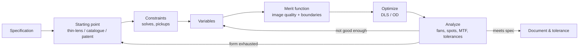

# L07 — Solves, Variables and Your First Optimization

> **Course 01 · Foundations** · Estimated time: lecture ~3 h, tasks ~5 h
> **Prerequisites:** [L03](../L03-paraxial-optics-and-ray-tracing/), [L04](../L04-stops-pupils-fields/), [L06](../L06-real-rays-and-analysis-tools/) · **Next:** [L08 — Landscape lens mini-project](../L08-landscape-lens-stop-shift-and-splitting/)

## Learning objectives
- Explain the design loop (specification → starting point → constraints → variables → merit function → optimize → analyze → iterate) and which parts are paraxial bookkeeping vs. real-ray performance.
- Derive and apply the **Marginal Ray Height** solve (image distance), the **Marginal Ray Angle / F-number** solve (focal length lock), and **pickup** solves; know when a solve beats an optimization constraint.
- Set variables sensibly and avoid degenerate or conflicting variables.
- Build a **default merit function** in the Optimization Wizard and explain each choice: RMS spot vs. wavefront, centroid vs. chief-ray reference, Gaussian-quadrature rings/arms vs. rectangular array, field/wavelength weights, and **boundary constraints** on glass and air thickness.
- Compute a merit-function value by hand from operand values, weights and targets.
- Run local optimization (**damped least squares**), interpret the result, and recognize the classic pitfalls (runaway thickness, locked focus, local minima, trivial solutions).

## Reading
- **Core:** [Geary Ch. 8, pp. 85–93] — the M-solve (§8.2) and F-solve (§8.3) derived from the PRTE; rings and arms (§8.4, with the TRAC listing in Tables 8.1–8.2); the merit-function definition and a worked MF/percent-contribution example (§8.5); local vs. global minima (Fig. 8.4); RMS spot size, centroid vs. chief ray, RMS vs. field and focus (§8.6–8.7).
- **Core:** [Geary §3.7, pp. 28–31] — Geary's homework sequence on bending, conics and thickness constraints (MNCG/MXCG) — the "ancestor" of this lesson's tasks.
- **Core:** [Geary App. E, pp. 457–458] — definitions of the operands Geary uses (EFFL, TRAC, MNCG, MXCG, MNCA, MXCA, TTHI, TOTR, SPHA, COMA, ASTI, PETC, AXCL, LACL, …).
- **Background:** [Kidger Foreword, pp. xiii–xiv] — the Imperial College group's damped-least-squares lens-design programs, which Kidger rewrote in FORTRAN in 1963: the lineage of every modern local optimizer.
- **Online:** Ansys Optics KB "How to design a singlet lens – Part 1 (F-number solve) and Part 3 (variables, Optimization Wizard, boundary values)"; KB on RMS spot in Spot Diagram vs. RSCE/RSRE; community note on DLS vs. Orthogonal Descent (links in References).

---

## 1. The design loop

An optimizer is a **local downhill walker**. It cannot invent a better design *form*; it adjusts the parameters you free, within the constraints you set, to minimize the single number you define. The designer's real work is choosing the starting point, the variables and the merit function — and reading the analyses afterwards (L06).

---

## 2. Solves: paraxial bookkeeping done exactly

A **solve** sets a parameter (radius, thickness, conic, material, semi-diameter…) from a rule, every time the lens changes. Because most solves are paraxial (L03), they are exact, instantaneous, and remove a degree of freedom from the optimizer — which is good: anything that *can* be computed should not be left to optimization.

### 2.1 Marginal Ray Height solve (the "M-solve")
Put it on the thickness before the image. It sets that thickness so that the paraxial marginal ray reaches height $h$ (usually 0) [Geary §8.2, p. 85]:

$$
y_{k+1} = y_k + u'_k t_k = h \;\Rightarrow\; t_k = \frac{h - y_k}{u'_k}.
$$

With $h = 0$ the image sits at the paraxial focus. **Pitfall:** with an M-solve on the last thickness the optimizer *cannot defocus*, but the real best focus of an aberrated lens is not the paraxial focus (L06). Either make the last thickness a **variable** (preferred for optimization), or set the solve height / "pupil zone" option so it tracks a real-ray zone (OpticStudio's Marginal Ray Height solve has a pupil-zone parameter: 0 = paraxial, non-zero = a real ray at that normalized zone).

### 2.2 Marginal Ray Angle and F-number solves (locking the focal length)
For an object at infinity, $f' = -y_1/u'_k$; fixing the exit slope of the marginal ray fixes the focal length for a given EPD. On the **last radius** you can solve for curvature so that $u'_k$ takes a chosen value [Geary §8.3, pp. 86–87]. With air behind the last surface ($n' = 1$), from $n'u' = nu - y\phi$ and $\phi = (1 - n)c$:

$$
c_k = \frac{n_k u_k - u'_k}{y_k\,(1 - n_k)}, \qquad u'_k = -\frac{1}{2N}\;\;(\text{F-number solve}).
$$

OpticStudio offers this directly as the **F Number** solve (target F/#) and, more generally, as the **Marginal Ray Angle** solve (target angle). It is the standard way to hold EFL constant while bending or adding variables (Ansys singlet tutorial Part 1 uses an F/4 solve on the rear radius).

### 2.3 Pickups
A **pickup** copies a parameter from another surface with scale and offset: $P = s\,P_{\text{source}} + o$. Uses:
- Equiconvex lens: $R_2 = -1 \times R_1$ (scale −1).
- Symmetric systems (L08, Course 02 L10): rear group mirrors the front group.
- Two lenses forced to the same glass, or a cemented surface radius shared between elements.
- Multi-configuration and thermal models (Course 03).

### 2.4 Other solves you will meet
Curvature: Chief Ray Angle, Aplanatic (zero spherical/coma at that surface — Course 02 L08), Concentric with Surface/Radius, Element Power. Thickness: Chief Ray Height (e.g. place a surface at a pupil), Edge Thickness, Position, Compensator, Pupil Position. Material: Model (n, V), Pickup, Substitute (for Hammer optimization). Semi-diameter: Pickup, Maximum. Solve letters appear next to the cell (e.g. `M`, `F`, `P`, `V` for variable). Location of each solve type in the dialog may vary by version — click the small box at the right of any LDE cell to see what's available.

**Rule of thumb:** use solves for *first-order* requirements (focal length, image distance, pupil position, symmetric shapes); use the merit function for *real-ray* performance and *inequality* constraints.

---

## 3. Variables

A variable is a parameter the optimizer may change. In OpticStudio: click the solve box and choose *Variable*, or select the cell and press **Ctrl+Z** (toggles; a `V` appears).

Good variables: curvatures, air spaces, glass thicknesses (with bounds), conics/aspheric terms (when justified), model-glass $n_d$/$V_d$ (early stages, Course 03 L05).

Bad practice:
- Making a parameter variable that is also controlled by a solve (it's ignored or conflicts).
- Two variables that do the same thing (e.g. an Even Asphere $r^2$ term and the curvature — L02).
- Freeing everything at once from a poor start: the optimizer will happily exploit nonsense (100 mm thick lenses, negative edges).
- Too few variables to correct the aberrations you target — check that you have at least as many *independent* effective degrees of freedom as independent aberrations you want controlled.

---

## 4. The merit function

### 4.1 Definition
The Merit Function Editor (MFE: Optimize → Merit Function Editor) is a list of **operands**, each with a target $T_i$, weight $W_i$ and current value $V_i$. OpticStudio (like Geary Eq. 8.7) reports

$$
\text{MF} = \sqrt{\frac{\sum_i W_i (V_i - T_i)^2}{\sum_i W_i}} ,
$$

and each operand's **% contribution** $= W_i(V_i - T_i)^2 / \sum_j W_j(V_j - T_j)^2$ [Geary §8.5, pp. 88–89]. Operands with zero weight are computed and displayed but do not count — useful for monitoring (Geary's habit of keeping `SPHA`, `COMA`, `ASTI`, `DIST`, `PETC` in the editor with weight 0 [Geary §3.7, p. 28]).

Typical operands (all exist in OpticStudio; see Geary App. E): `EFFL` (effective focal length), `TOTR` (total track), `TTHI` (sum of thicknesses), `REAY` (real ray y-coordinate at a surface), `TRAC` (transverse ray aberration, radial, w.r.t. centroid), `OPDX` (OPD w.r.t. the mean/centroid-referenced wavefront), `RSCE`/`RSCH` (RMS spot radius, Gaussian quadrature, centroid/chief ray reference), `RSRE`/`RSRH` (same with rectangular array), `AXCL`/`LACL` (colour), `MNCG`/`MXCG`/`MNEG` (min/max centre glass thickness, min edge glass thickness), `MNCA`/`MXCA`/`MNEA` (same for air), `CTGT`/`ETGT` (centre/edge thickness greater than), `BLNK` (blank line/comment), `DMFS` (marks where the default merit function starts).

### 4.2 The default merit function (Optimization Wizard)
Optimize → Optimization Wizard (or the Wizards button inside the MFE) builds the image-quality part for you. Choices:

| Option | Choices | Guidance |
|---|---|---|
| Image quality | **Spot** (RMS transverse ray error), **Wavefront** (RMS OPD), others (e.g. contrast/angular in newer versions) | Spot for aberration-limited lenses (spot ≫ Airy); Wavefront for near-diffraction-limited ones. Wavefront optimization tends to balance aberrations for the best Strehl/MTF. |
| Reference | **Centroid** or **Chief ray** (some versions add others) | Centroid is what a sensor "sees" and lets the optimizer ignore pure distortion; chief-ray reference also penalizes the centroid shift (coma, lateral colour) — slightly tighter. Default to Centroid unless you control distortion/colour separately. |
| Pupil integration | **Gaussian Quadrature** (rings × arms) or **Rectangular Array** (grid) | GQ: far fewer rays for the same accuracy, but assumes an unvignetted circular/elliptical pupil (use vignetting factors — L04). RA: handles hard apertures and obscurations ("delete vignetted"). |
| Rings / Arms (GQ) | e.g. 3 rings, 6 arms | More rings for higher-order aberrations (fast lenses, aspheres). Arms 6 is usual; 8–12 for strongly asymmetric pupils. |
| Grid (RA) | e.g. 4×4 … 20×20 | Denser for vignetted/obscured pupils. |
| Assume axial symmetry | on/off | On for rotationally symmetric systems: traces only half the pupil and only +y fields, same MF value [Geary §8.4, p. 88]. |
| Field/wavelength weights | from System Explorer | The MF uses the field and wavelength weights you set — set them deliberately (e.g. weight the NIR LED spectrum). |
| Boundary values | Glass: min, max centre, min edge; Air: min, max, min edge | Adds MNCG/MXCG/MNEG and MNCA/MXCA/MNEA lines. Always set these. |
| Start at | operand row | Leave room above for your own operands (EFFL, TOTR, …). |

**Why Gaussian quadrature works.** The RMS spot over a circular pupil is an integral $\int_0^1\!\!\int_0^{2\pi} \varepsilon^2\,\rho\,d\theta\,d\rho$. Substituting $x = \rho^2$ turns the radial part into $\int_0^1 g(x)\,dx$, and for rotationally symmetric aberrations $g$ is a polynomial in $x$. A Gauss–Legendre rule with $n$ nodes integrates polynomials up to degree $2n-1$ *exactly*. For 3 rings the nodes are $x = 0.1127, 0.5, 0.8873$, i.e. ring radii $\rho = 0.3357, 0.7071, 0.9420$ with relative weights 5/18, 8/18, 5/18 — exactly the $P_x$ values and weights ($\tfrac{5}{18}\pi = 0.8727$, $\tfrac{8}{18}\pi = 1.3963$) in Geary's Table 8.2 [Geary §8.4, pp. 87–88]. Arms sample the angle uniformly. The MF built from these rays *equals* the RMS spot radius from a dense spot diagram [Geary Table 8.3, p. 90].

### 4.3 Boundary constraints
Boundary operands are **inequalities**: e.g. `MNCG` with target 2.0 contributes nothing while the glass is ≥ 2 mm thick and pulls hard when it goes below. Typical starting values for small glass lenses (Ø10–50 mm):
- glass centre thickness: min 1.5–3 mm (≈ 1/10 of diameter for stability), max ~ 1/3 of diameter (or a value from the package);
- glass edge thickness: min 1–1.5 mm;
- air spaces: min 0.1–0.5 mm (centre and edge, to avoid lens contact), max set by the package.

Without these, the optimizer finds "solutions" that are physically absurd — Geary's homework (Ch. 3, step 10) and the worked example below show a singlet growing a 100 mm-thick glass rod.

---

## 5. How local optimization works: damped least squares

Write the merit function as a weighted sum of squares $\Phi(\mathbf x) = \sum_i W_i f_i(\mathbf x)^2$ with $f_i = V_i - T_i$ and variables $\mathbf x$. Linearize around the current design: $\mathbf f(\mathbf x + \Delta) \approx \mathbf f + \mathbf J\Delta$, with Jacobian $J_{ij} = \partial f_i/\partial x_j$ computed by finite differences (one extra ray trace of the whole MF per variable). Minimizing the linearized $\Phi$ gives the Gauss–Newton step; **damping** adds a penalty on the step size:

$$
(\mathbf J^{\mathsf T}\mathbf W\mathbf J + \lambda \mathbf D)\,\Delta = -\mathbf J^{\mathsf T}\mathbf W\mathbf f .
$$

Small $\lambda$ → fast Gauss–Newton steps (good near a minimum); large $\lambda$ → short steps along the gradient (safe when the linear model is poor). The algorithm adapts $\lambda$ each cycle. This is the Levenberg–Marquardt idea; lens designers adopted it early — the Imperial College group around Wynne used DLS for lens design, and Kidger rewrote their DLS program in 1963 [Kidger Foreword, p. xiii]. It is still the default local optimizer in OpticStudio.

Properties to remember:
- **Local:** it finds the bottom of the valley you start in (Geary Fig. 8.4: start at Z, end at B, never see the better well A) [Geary §8.5, p. 89]. Global search (Hammer, Global Search) is Course 03 L05.
- **Smoothness needed:** derivatives by finite differences require a smooth MF. Ray failures, vignetting jumps and pixelated (non-sequential) detectors make DLS stall — **Orthogonal Descent** (OD), a derivative-free method, is better there [Ansys community: OD vs DLS].
- **Scaling:** variables with very different sensitivities (a curvature vs. a 6th-order aspheric coefficient) make the linear system ill-conditioned — another reason to prefer solves and normalized aspheres.

### 5.1 In OpticStudio
Optimize → **Optimize!** (local optimization). Choose algorithm (DLS or Orthogonal Descent), number of cycles (Automatic, or 1/5/10/50), number of cores; press Start. Watch "Initial MF" and "Current MF"; Automatic stops when improvement becomes negligible. Then **look at the lens** (Cross-Section) and the analyses before accepting. Save versions (`..._o01b.zmx` / `..._o01a.zmx`, Geary §2.6, or git commits).

Quick Focus (L01) is a special one-variable optimization of the last thickness; Quick Adjust adjusts one chosen parameter to minimize a criterion.

---

## 6. Pitfalls checklist

| Symptom | Likely cause | Fix |
|---|---|---|
| MF does not improve focus-sensitive terms | M-solve locks paraxial focus | Make back focus a variable |
| Lens becomes a glass rod / knife edge | No thickness boundaries | Add MNCG/MXCG/MNEG (and air bounds) |
| EFL drifts | No focal-length control | F-number/marginal-ray-angle solve, or `EFFL` operand with a high weight |
| Optimizer "succeeds" by shrinking the beam | Aperture defined by a surface that the optimizer changes (e.g. Float By Stop Size with variable stop) | Fix the aperture definition |
| MF jumps, DLS stalls, "ray errors" | Rays missing surfaces or TIR during finite-difference steps | Better start, smaller variable set, ray aiming, OD for a few cycles |
| Great MF, poor MTF | Spot MF for a near-diffraction-limited lens | Wavefront MF; check MTF (Course 03) |
| GQ MF disagrees with spot diagram | Vignetting with GQ; different reference | Vignetting factors or RA; match references (KB article) |
| Converges to a worse shape than expected | Local minimum | Different starting bending/sign; Hammer/Global (Course 03 L05) |
| Optimized at 3 fields, bad in between | Too few field points | Check (and later add) intermediate fields [Kidger §4.2, p. 66] |

---

## Worked example — optimizing the Course 01 singlet

Specs (as before): EFL 100 mm, F/5 (EPD 20), N-BK7, fields 0/3.5/5°, F/d/C equally weighted, stop at the front surface. Numbers below come from a Python model of exactly this setup (real-ray trace, 3-ring × 6-arm Gaussian quadrature, centroid reference, MF = RMS over fields); expect OpticStudio to agree to a few percent.

**(a) F-number solve on $R_2$.** Keep $R_1 = 102.7$, $t = 4$. After S1 the marginal ray has $n u = -0.050321$ and reaches S2 at $y_2 = 9.86730$. For F/5, $u'_2 = -0.1$:
$$
c_2 = \frac{-0.050321 - (-0.1)}{9.86730 \times (1 - 1.51680)} = \frac{0.049679}{-5.09942} = -0.0097421 \Rightarrow R_2 = -102.648\ \text{mm},
$$
and EFL becomes exactly 100.000 mm (vs. 100.025 mm with $R_2 = -102.7$).

**(b) An MF by hand.** On axis, d-light only, image at the paraxial focus, the three GQ rays land at $\varepsilon = -0.00602$, $-0.05684$, $-0.13587$ mm (rings 0.3357, 0.7071, 0.9420). With weights 5/18, 8/18, 5/18:
$$
\text{MF} = \sqrt{\tfrac{5}{18}(0.00602)^2 + \tfrac{8}{18}(0.05684)^2 + \tfrac{5}{18}(0.13587)^2} = 0.0811\ \text{mm}
$$
— the same 81 µm as the dense spot diagram in L06. Percent contributions: 0.15 %, 21.8 %, 78.0 %: the outer ring dominates, exactly as in Geary's example (0.16 %, 22.2 %, 77.7 %).

**(c) The optimization sequence** (polychromatic, 3 fields):

| Step | Variables | MF (RMS spot, µm) | Result |
|---|---|---|---|
| 0 | none (paraxial focus) | 145 | equiconvex, X ≈ 0 |
| 1 | back focus only (≈ Quick Focus) | ≈ 70 | focus moves ≈ 1.7 mm towards the lens |
| 2 | $R_1$ + back focus ($R_2$ by F/5 solve), t = 4 | 59.4 | $R_1 = 58.0$, $R_2 = -461$ mm, X = 0.78; spots 60/51/66 µm at 0/3.5/5° |
| 3 | + thickness, **no bounds** | 44.1 | t → **102 mm** glass rod! |
| 4 | + thickness, bounds 2 ≤ t ≤ 8, edge ≥ 1 mm at r = 12.5 | 58.6 | t hits the 8 mm bound; tiny gain |

Interpretation:
- The optimizer rediscovered the "best-form" bending (X ≈ 0.7–0.8, curved side to the object) you found by hand in L02 — but slightly shifted by the off-axis fields.
- Further gains are blocked by **axial colour** (≈ 150 µm blur diameter, L05): the monochromatic optimum with the same variables gives 38 µm. No amount of bending fixes colour in a singlet — you need a second glass (Course 02 L06).
- Step 3 is Geary's warning made concrete: an unconstrained variable will exploit any path to lower the number. A 102 mm thick lens is actually a (bad) thick-lens telephoto with its principal planes moved — physically legal, practically useless.

---

## Key takeaways
- Use **solves** for first-order bookkeeping: Marginal Ray Height for image distance, F-number/Marginal Ray Angle for focal length, Pickups for symmetry. They are exact and remove degrees of freedom.
- Never leave the final focus locked by a paraxial M-solve during optimization — make it a variable.
- The MF is a weighted RMS of (value − target); % contribution tells you what dominates. Keep diagnostic operands at weight 0.
- Default MF choices: Spot vs Wavefront, Centroid vs Chief, GQ (rings/arms, exact for polynomial aberrations, needs unvignetted pupil) vs Rectangular Array (handles vignetting).
- Always add boundary constraints (glass/air centre and edge thickness). Unbounded variables run away.
- DLS = damped Gauss–Newton on the MF; it is local and needs smooth MFs; use OD for noisy problems; global methods later.
- After every optimization: look at the layout and the analyses, not just the MF.

## Glossary (new terms in this lesson)
| Term | Meaning |
|---|---|
| Solve | Rule that sets a parameter automatically (paraxial or real-ray based) |
| M-solve | Marginal Ray Height solve on a thickness |
| F-number solve | Curvature solve giving a target paraxial F/# (fixes EFL for a given EPD) |
| Marginal Ray Angle solve | Curvature solve giving a target marginal-ray slope after a surface |
| Pickup | Parameter copied from another surface with scale and offset |
| Variable | Parameter the optimizer may change (Ctrl+Z) |
| Operand | One line of the merit function (e.g. EFFL, TRAC, MNCG) |
| Merit function (MF) | $\sqrt{\sum W(V-T)^2/\sum W}$ |
| Default merit function | Wizard-generated image-quality operands (spot/wavefront) |
| Gaussian quadrature (GQ) | Ring/arm pupil sampling exact for polynomial aberrations |
| Rectangular array (RA) | Grid pupil sampling; handles vignetting |
| Boundary constraint | Inequality operand that only acts when violated |
| DLS | Damped least squares local optimizer |
| Orthogonal descent (OD) | Derivative-free local optimizer for noisy MFs |
| Local minimum | Best point in the current valley, not necessarily the global best |

## References
1. [Geary Ch. 8, pp. 85–93] Geary, *Introduction to Lens Design*: §8.2 M-solve, §8.3 F-solve, §8.4 rings and arms, §8.5 merit function, §8.6 RMS spot size, §8.7 RMS spot plots.
2. [Geary §3.7, pp. 28–31] homework sequence: bending with EFFL/SPHA/COMA/ASTI targets, conic variable, default MF, MNCG/MXCG thickness constraints.
3. [Geary App. E, pp. 457–458] definitions of ZEMAX operands used in the book.
4. [Kidger Foreword, pp. xiii–xiv] history: Imperial College damped-least-squares lens-design software.
5. Ansys Optics, "How to design a singlet lens – Part 1: Setup" (F-number solve on the rear radius): https://optics.ansys.com/hc/jp/articles/42661252179987
6. Ansys Optics, "How to design a singlet lens – Part 3: Optimization" (variables, Optimization Wizard, glass boundary values): https://optics.ansys.com/hc/en-us/articles/42661700528275
7. Ansys Optics KB, "Why is the RMS spot size listed in Spot Diagram different than the values reported by RSCE and RSRE operands?" (GQ vs RA, centroid vs chief ray, ray density): https://optics.ansys.com/hc/en-us/articles/43071095528979-Why-is-the-RMS-spot-size-listed-in-Spot-Diagram-different-than-the-values-reported-by-RSCE-and-RSRE-operands
8. Ansys Optics KB, "How to use vignetting factors" (GQ assumes unvignetted pupil; RA with delete vignetted): https://optics.ansys.com/hc/en-us/articles/42661826659347
9. Zemax Community, "OD vs DLS" (when to use orthogonal descent): https://community.zemax.com/got-a-question-7/od-vs-dls-464
10. Ansys Optics KB, local optimization example comparing DLS and OD on a non-sequential system: https://optics.ansys.com/hc/en-us/articles/42661692035475
