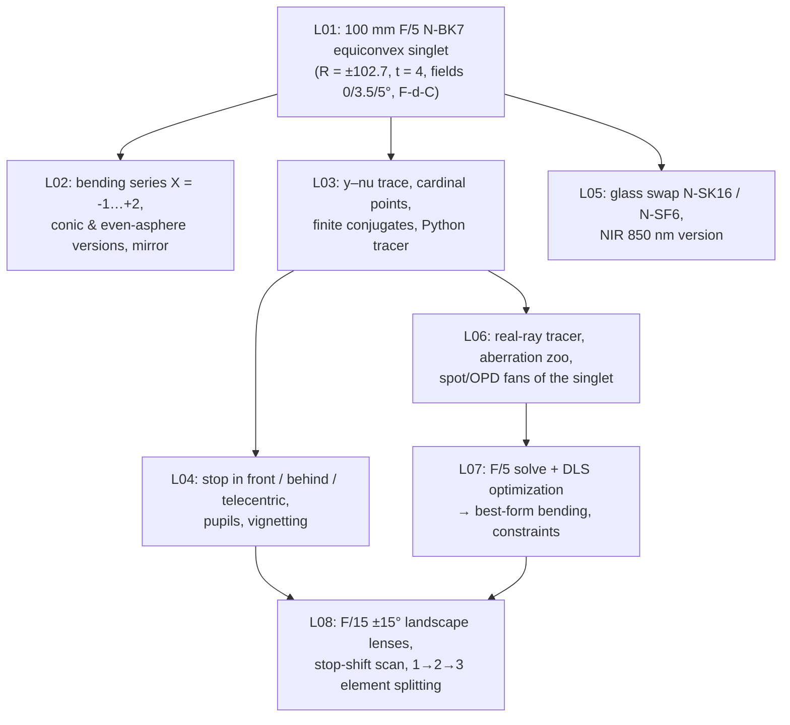

# Course 01 — Foundations: Geometrical Optics and OpticStudio Basics

The first course of the programme: from "what is a ray?" to designing, optimizing and documenting a simple lens in Ansys Zemax OpticStudio. It assumes **no prior lens-design knowledge and no prior OpticStudio use**. Everything later in the curriculum (aberration theory, classical designs, machine-vision and projector lenses, tolerancing, automation) builds on the vocabulary, conventions and habits set here.

## Goals
By the end of this course you will be able to:
- Set up any rotationally symmetric lens in OpticStudio: system aperture, fields, wavelengths, materials, surfaces (spheres, conics, even aspheres), stop position, solves.
- Do first-order (paraxial) optics by hand and in Python — y–nu traces, focal lengths, principal planes, pupils, F-numbers, Lagrange invariant — and verify OpticStudio's System Data, Cardinal Points and Single Ray Trace against your own numbers.
- Choose glasses sensibly and estimate chromatic effects from Abbe numbers (visible and NIR).
- Read the core analysis windows (layout, ray fans, OPD fans, spot diagrams, footprints, field curvature/distortion) and recognize the basic aberration signatures.
- Build a merit function, choose variables and constraints, run damped-least-squares optimization, and recognize the classic pitfalls.
- Carry out a small design project (landscape lens, stop shift, lens splitting) and write a short design report.

## Prerequisites
- Trigonometry, basic calculus, introductory physics (waves, refraction).
- Python 3 with numpy, scipy and matplotlib (used for verification scripts in every lesson).
- Ansys Zemax OpticStudio (this course is written for **Premium**, recent releases ~2025 R2 / 2026 R1; everything in Course 01 also works in Professional and Standard editions).
- The three course books (see [`../references/README.md`](../references/README.md)): **[Geary]** *Introduction to Lens Design with Practical ZEMAX Examples*; **[Kidger]** *Fundamental Optical Design*; **[Kenyon]** *The Light Fantastic*.

## Lessons

| # | Lesson | Topics | Est. time (lecture + tasks) |
|---|---|---|---|
| L01 | [Light, rays and a first tour of OpticStudio](L01-light-rays-and-opticstudio-tour/lecture-notes.md) · [tasks](L01-light-rays-and-opticstudio-tour/tasks.md) | Waves/rays, Snell, Fermat, TIR, why aberrations exist; first session: System Explorer, LDE, Cross-Section, Quick Focus, Spot Diagram; files (.zmx/.zos/.zda/.zar) | 3 h + 4 h |
| L02 | [Surfaces, sign conventions and aspheres](L02-surfaces-sign-conventions-aspheres/lecture-notes.md) · [tasks](L02-surfaces-sign-conventions-aspheres/tasks.md) | Cartesian sign convention, curvature, shape factor/bending, sag & edge thickness, conics, even aspheres, departure from sphere | 2.5 h + 4 h |
| L03 | [Paraxial optics and ray tracing](L03-paraxial-optics-and-ray-tracing/lecture-notes.md) · [tasks](L03-paraxial-optics-and-ray-tracing/tasks.md) | y–nu tables, power, thick lens, cardinal points, Gaussian & Newtonian imaging, ABCD matrices, Python paraxial tracer vs OpticStudio | 3 h + 4.5 h |
| L04 | [Stops, pupils and fields](L04-stops-pupils-fields/lecture-notes.md) · [tasks](L04-stops-pupils-fields/tasks.md) | Aperture & field stops, pupils, marginal/chief rays, F/#, NA, Lagrange invariant, field types, vignetting, ray aiming, telecentricity | 3 h + 4 h |
| L05 | [Optical glass and dispersion](L05-optical-glass-and-dispersion/lecture-notes.md) · [tasks](L05-optical-glass-and-dispersion/tasks.md) | Origin of dispersion, Sellmeier, Abbe number, partial dispersion, glass map, practical glass choice, NIR behaviour | 2.5 h + 4 h |
| L06 | [Real rays and analysis tools](L06-real-rays-and-analysis-tools/lecture-notes.md) · [tasks](L06-real-rays-and-analysis-tools/tasks.md) | Exact ray tracing, transverse vs wavefront aberration, ray/OPD fans, spot diagrams, footprints, field curvature/distortion; Python ray tracer | 3 h + 4.5 h |
| L07 | [Solves, variables and first optimization](L07-solves-variables-first-optimization/lecture-notes.md) · [tasks](L07-solves-variables-first-optimization/tasks.md) | Marginal-ray-height, F-number/marginal-ray-angle and pickup solves; variables; default merit function (spot/wavefront, centroid/chief, Gaussian quadrature); boundary constraints; DLS; pitfalls | 3 h + 5 h |
| L08 | [Mini-project: landscape lens, stop shift and lens splitting](L08-landscape-lens-stop-shift-and-splitting/lecture-notes.md) · [tasks](L08-landscape-lens-stop-shift-and-splitting/tasks.md) | Stop-shift equations, Wollaston (rear) and front landscape lenses, local minima, Petzval limit, lens splitting, design report | 2 h + 7–8 h |

Total: roughly **55–60 hours**, i.e. 8–9 weeks at one lesson per week (L08 is worth two sessions).

## How the lessons connect — the running designs
The course follows one lens from first click to first real design:

Each lesson's tasks tell you exactly which saved file to start from (e.g. `../L01-light-rays-and-opticstudio-tour/work/L01_singlet_f100.zmx`). Keep a `work/` folder in every lesson and put the whole course under git: `.zmx` files are plain text and diff nicely.

The Python thread is deliberate: you build a paraxial tracer (L03), add pupils (L04), a glass calculator (L05), a real-ray tracer and spot diagram (L06) and a damped-least-squares optimizer (L07). These become the backbone of the automation course (Course 07).

## Conventions used throughout
- Light travels left → right; distances left → right positive; radius positive when the centre of curvature is to the right of the vertex; ray angles positive counter-clockwise (upward slope). Thicknesses after a mirror are negative (OpticStudio convention).
- Wavelengths in µm (OpticStudio always uses µm); lens units mm.
- Standard visible wavelengths F, d, C = 0.4861, 0.5876, 0.6563 µm; NIR examples at 0.850 and 0.940 µm.
- Book citations give **printed** page numbers, e.g. [Geary §8.4, pp. 87–88], [Kidger §2.5, pp. 25–30].
- Numerical "check yourself" values were computed with Python (paraxial and real-ray traces using SCHOTT Sellmeier data). OpticStudio uses different default ray sampling, so expect agreement to a few percent for spot sizes and to 4–5 significant figures for paraxial quantities.

## What "done" looks like for this course
You are ready for Course 02 when you can, without notes:
1. Enter a lens from a prescription table in OpticStudio in under 10 minutes, with the correct aperture, fields, wavelengths, stop and solves.
2. Predict EFL, BFL, principal planes, pupil positions and F-number of a two-element system by hand to 3 significant figures, and confirm them in OpticStudio.
3. Look at a ray fan and name the dominant aberration; look at a spot diagram and say whether ray or wave metrics are appropriate.
4. Set up a default merit function with sensible constraints, optimize, and explain why the result is (or is not) trustworthy.
5. Hand in the L08 design report with saved files that reproduce every number in it.

## Edition and version notes
- All features used in Course 01 (sequential mode, Standard/Even Asphere/Paraxial surfaces, solves, default merit function, DLS/OD, standard analyses, Materials Catalog and analyses) are available in every OpticStudio edition. Premium-only features (non-sequential mode, Physical Optics Propagation, STAR, etc.) appear from Course 03 onward.
- Menu paths are given for the ribbon interface of recent releases (Setup / Analyze / Optimize / Tolerance / Libraries / Programming tabs). Exact group names occasionally move between releases; where a path is uncertain the lessons say "location varies by version — search the ribbon". OpticStudio's ribbon search box and Help are the fastest way to find a tool by name.
- Geary's book was written for ZEMAX SE (v6–7, 2002). His button names ("Gen", "Fie", "Wav", "Lay", "Sys", "Spt", "Pre", "Tools → Default Merit Function") are translated in L01 and L07; his BK7 is today's N-BK7.
- Lens files: `.zmx` (text) and `.zos` (binary, OpticStudio 21.3+); session files `.zda` restore your analysis windows; archives `.zar` bundle a design with its catalogues for sharing.

## Suggested weekly rhythm
1. Read the core reading (1–2 h) with the lecture notes beside it.
2. Do the pen-and-paper/Python tasks first (they build the intuition), then the OpticStudio tasks.
3. Write short answers in `work/notes.md`, commit, and answer the reflection questions before opening the solutions.
