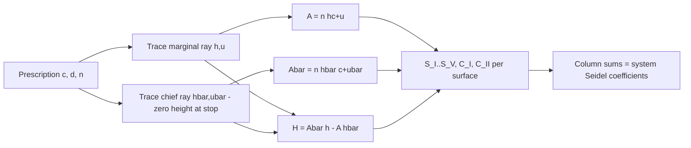

# L08 — Seidel surface contributions, stop shift and aplanatic surfaces

> **Course 02 · Aberrations and classical lens design** · Estimated time: lecture ~3 h, tasks ~4–5 h
> **Prerequisites:** [Course 01 L03 (paraxial ray trace)](../../01-foundations/L03-paraxial-optics-and-ray-tracing/), [Course 01 L04 (stops, pupils, Lagrange invariant)](../../01-foundations/L04-stops-pupils-fields/), [L01](../L01-wavefront-and-transverse-aberrations/)–[L07](../L07-secondary-spectrum-apochromats/) of this course · **Next:** [L09 — Cooke triplet](../L09-cooke-triplet/)

## Learning objectives
After this lesson you should be able to:
- Compute, by hand and in Python, the refraction invariants $A$ and $\bar A$, the Lagrange invariant $H$ and the five Seidel surface coefficients $S_I$–$S_V$ from a paraxial marginal-ray and chief-ray trace.
- Reproduce a published Seidel table (Kidger's Cooke triplet) to six decimals and match OpticStudio's **Seidel Coefficients** analysis for your own singlet/doublet.
- Convert Seidel sums into wavefront coefficients in waves ($W_{040}$, $W_{131}$, $W_{222}$, $W_{220P}$, $W_{311}$) and into transverse ray errors at the image.
- Derive and apply the stop-shift equations, and explain why a system with zero spherical aberration and zero coma has astigmatism that is independent of stop position.
- State the three "zero" conditions of a surface ($h=0$, $A=0$, $\delta(u/n)=0$), locate the aplanatic conjugates of a spherical surface, and explain why aplanatic surfaces cannot form a real image of a real object.
- Read a Seidel Diagram the way a professional does: which surfaces are "working hard", where the large cancellations are, and which surfaces to bend next.

## Reading
- **Core:** [Kidger §6.1–6.2, pp. 101–115] — derivation of $S_1$ for one surface, summary of the seven coefficients (§6.2.6), and the numerical triplet example (§6.2.7). Work through the table on p. 115 with your own script.
- **Core:** [Kidger §6.3–6.5, pp. 115–125] — stop-shift equations, dependence on curvature, the aplanatic surface.
- **Core:** [Kidger §6.6, §6.9–6.11, pp. 126–137] — zero-Seidel conditions, relationship to $W$ and transverse aberration, pupil aberrations and conjugate shift (skim §6.10–6.11).
- **Core:** [Kidger §2.8–2.9, pp. 39–44] — refraction invariant $A$ and eccentricity $E$ (needed to read §6.3).
- **Core:** [Geary §13.3, pp. 150–153] — Geary's surface-by-surface coma and astigmatism of a convex-plano singlet, compared with ZEMAX's Seidel output and with the thin-lens formulas.
- **Optional:** J. Sasián, *OPTI 517 lecture 4 — aberration coefficients* (Univ. of Arizona): <https://wp.optics.arizona.edu/jsasian/wp-content/uploads/sites/33/2016/02/L4-OPTI-517-Aberration-Coefficients.pdf> — the same theory in $W_{klm}$ language, with the stop-shift equations in wavefront form.
- **Optional:** source of the third-order module of the open-source *ray-optics* package (a compact, readable Python implementation to compare against yours): <https://ray-optics.readthedocs.io/en/latest/_modules/rayoptics/parax/thirdorder.html>

---

## 1. Why surface-by-surface aberration theory still matters

A real ray trace (Course 01 L06) tells you *how much* aberration a lens has. It does not tell you *where it comes from* or *what to change*. The great practical virtue of third-order (Seidel) theory is that, to fourth order in the wavefront, **the aberration of a system is the sum of independent contributions of its surfaces** [Kidger §6.2, pp. 101–102]. Each surface's contribution depends only on two paraxial rays — the marginal ray (axial object point, edge of the pupil) and the chief ray (edge of the field, centre of the pupil).

That additivity breaks down at fifth order (a surface's aberration changes the rays arriving at all later surfaces), which is why Seidel theory is a *diagnostic* and *predesign* tool, not a performance predictor. Professionals use it for three things:

1. **Predesign.** Thin-lens Seidel algebra gives starting powers, bendings and glasses (achromat in L06, triplet in L09, Petzval in L11).
2. **Diagnosis.** A Seidel Diagram of an optimized lens shows which surfaces contribute large, mutually cancelling terms. Large cancelling pairs usually mean high sensitivity to tolerances and large higher-order residuals — a warning sign you will revisit in Course 06.
3. **Understanding special surfaces.** Aplanatic, concentric and "at-the-image" surfaces are recognized instantly by which Seidel terms vanish.

## 2. Notation and sign conventions

We follow Kidger (and Welford), which is also what OpticStudio uses internally for its Seidel output:

- Light travels left → right; a surface's curvature $c = 1/R$ is positive when its centre is to the right.
- $n$, $n'$: indices before and after the surface. For a mirror, $n' = -n$ (Kidger §6.8).
- $h$, $u$: paraxial **marginal ray** height at the surface and slope (angle) *before* the surface; $u'$ after. Angles are positive counter-clockwise, so a ray rising to the right has $u>0$ and a ray converging to an axial image has $u'<0$.
- $\bar h$, $\bar u$: the same for the paraxial **chief ray** (zero height at the stop).
- Paraxial refraction and transfer (Course 01 L03):

$$
n'u' = nu - h\,c\,(n'-n), \qquad h_{k+1} = h_k + u'_k\, d_k .
$$

- **Refraction invariant** of the marginal ray, i.e. $n$ times the paraxial angle of incidence:

$$
A = n\,(h c + u) = n'(h c + u'),
$$

and of the chief ray, $\bar A = n(\bar h c + \bar u)$ [Kidger §2.8, eqs. 2.67–2.70].
- **Lagrange invariant** (same value in every space of the system):

$$
H = n(\bar u h - u \bar h) = \bar A h - A \bar h .
$$

For an object at infinity and the stop at the first surface, $H = \bar u_0\,h_1 = \tan\theta\cdot\text{EPD}/2$.
- The "delta" operator means *after minus before* at one surface: $\delta(u/n) = u'/n' - u/n$, $\delta(1/n) = 1/n' - 1/n$.

> **Sign warning.** Books differ in the sign of $H$ (Kidger prints $-4.0439$ in his table but $+4.04$ in the text on p. 113). $S_I$, $S_{III}$, $S_{IV}$ are even in the chief ray and never change sign; $S_{II}$ and $S_V$ are odd in the chief ray and flip if you trace the chief ray to the opposite field point. When comparing your script with OpticStudio, check the sign of $\bar u_0$ first.

## 3. The seven surface coefficients

Kidger derives $S_1$ in a page and a half by expanding the optical path through a spherical surface to fourth order in the ray height and using the paraxial imaging equation to cancel the second-order terms [Kidger §6.2.1, pp. 102–107]. The key result, and the others quoted from Welford [Kidger §6.2.6, pp. 112–113]:

$$
\begin{aligned}
S_I   &= -A^2\, h\, \delta(u/n) && \text{spherical aberration}\\
S_{II} &= -A\bar A\, h\, \delta(u/n) && \text{coma}\\
S_{III} &= -\bar A^2\, h\, \delta(u/n) && \text{astigmatism}\\
S_{IV} &= -H^2\, c\, \delta(1/n) && \text{Petzval (field curvature)}\\
S_V   &= \frac{\bar A}{A}\,(S_{III}+S_{IV}) && \text{distortion}\\
C_I   &= A\, h\, \delta(\delta n / n) && \text{axial colour}\\
C_{II} &= \bar A\, h\, \delta(\delta n / n) && \text{lateral colour}
\end{aligned}
$$

where $\delta n = n_F - n_C$ (or whatever pair of wavelengths you correct) for the medium on each side.

Read them as a family. The first three share the factor $h\,\delta(u/n)$ and differ only in how many powers of $A$ (aperture) are swapped for $\bar A$ (field):

$$
S_{II} = \frac{\bar A}{A} S_I,\qquad S_{III} = \Big(\frac{\bar A}{A}\Big)^2 S_I,\qquad C_{II}=\frac{\bar A}{A}C_I .
$$

The ratio $\bar A/A$ at a surface is the single most important number for understanding stop shifts (Section 6).

**Distortion when $A=0$.** The formula for $S_V$ divides by $A$, which is zero whenever the marginal ray is normal to the surface (e.g. a collimated beam on a plane surface). Kidger eliminates the division [§6.2.3, eq. 6.37]:

$$
S_V = -\bar A^{3} h\,\delta(1/n^2) + \bar h \bar A\,(2h\bar A - \bar h A)\,c\,\delta(1/n).
$$

Use this form in code — it is always finite and gives identical results otherwise. (I verified both forms agree to 1e-15 on Kidger's triplet.)

**Why paraxial data give a fourth-order aberration.** It feels paradoxical that aberration-free paraxial rays compute aberrations. The answer [Kidger pp. 106–107]: the real ray height is $y = h + O(h^3)$, so $y^4 = h^4 + O(h^6)$ — the error of substituting paraxial for real data is of the same (sixth) order as the terms the Seidel theory already discards.

**Units.** $S$ coefficients have the units of length (lens units). They are *not* wavefront values; the conversions are in Section 5.

### Quick qualitative insights from the formulas
- $S_{IV}$ depends only on $c$, $n$, $n'$ and $H$ — not on where the rays hit. Bending or moving a surface does not change its Petzval contribution; only power and index do. For a thin lens, $S_{IV}=H^2 K/n$ [Kidger eq. 6.41], which is why the Petzval sum $\sum K_i/n_i$ (L04) is a *glass-and-power* budget.
- $S_{IV}$ is linear in $c$, while $S_I$, $S_{II}$, $S_{III}$ are cubic in $c$ (each of $A$, $\bar A$, $\delta(u/n)$ is linear in $c$) [Kidger §6.4, pp. 120–122]. Field curvature and colour are therefore "easy or impossible"; spherical aberration and coma have rich, multi-solution behaviour.
- A plano-convex lens with the object at infinity has positive $S_I$ at *both* surfaces for every glass [Kidger §6.2.4, pp. 108–111]: no singlet with spherical surfaces can correct its own spherical aberration.

## 4. Doing it by hand: the paraxial table

The calculation is mechanical and fits on one page:

1. Choose the marginal ray: $h_1 = \text{EPD}/2$, $u_0 = 0$ (object at infinity) or $u_0 = -h_1/l$ (finite object).
2. Choose the chief ray: it must have $\bar h=0$ at the stop. If the stop is not the first surface, trace two auxiliary rays — ray *a* with $(\bar h_1, \bar u_0) = (0, \tan\theta)$ and ray *b* with $(1, 0)$ — and form $\bar{\text{ray}} = a + k\,b$ with $k$ chosen to null the height at the stop. This works because paraxial tracing is linear.
3. At every surface record $h, u, u', \bar h, \bar u, A, \bar A, \delta(u/n), \delta(1/n)$.
4. Evaluate the seven formulas, then sum the columns.

This is exactly what Kidger tabulates for the Kingslake triplet on pp. 114–115, and what OpticStudio prints in the top half of the Seidel Coefficients text window.

## 5. From $S$ coefficients to what you see

With relative pupil coordinates $(x_r, y_r)$ and relative field $h_r$ (1 at full aperture / full field), Kidger eq. 6.87 writes the third-order wavefront as

$$
W = \tfrac18 S_I (x_r^2+y_r^2)^2 + \tfrac12 S_{II}\, y_r (x_r^2+y_r^2) h_r + \tfrac12 S_{III}\, y_r^2 h_r^2 + \tfrac14 (S_{III}+S_{IV})(x_r^2+y_r^2) h_r^2 + \tfrac12 S_V\, y_r h_r^3 .
$$

So, at full aperture and full field:

| Coefficient (OpticStudio label) | From $S$ | Meaning |
|---|---|---|
| $W_{040}$ | $S_I/8$ | spherical, edge of pupil |
| $W_{131}$ | $S_{II}/2$ | coma |
| $W_{222}$ | $S_{III}/2$ | astigmatism (T–S difference) |
| $W_{220P}$ | $S_{IV}/4$ | Petzval curvature term |
| $W_{311}$ | $S_V/2$ | distortion (wavefront tilt) |
| $W_{020}$ | $C_I/2$ | axial colour (defocus between the two wavelengths) |
| $W_{111}$ | $C_{II}$ | lateral colour (tilt between the two wavelengths) |

Divide by the wavelength to get waves. The transverse ray errors at the edge of the pupil and field are [Kidger §6.9.2, eqs. 6.88–6.93], with $n'u'$ the image-space marginal-ray slope (negative for a real image):

$$
\delta\eta'_{SA} = \frac{S_I}{2n'u'},\quad \delta\eta'_{\text{coma}} = \frac{3S_{II}}{2n'u'},\quad \delta\eta'_{T} = \frac{3S_{III}+S_{IV}}{2n'u'},\quad \delta\xi'_{S} = \frac{S_{III}+S_{IV}}{2n'u'},\quad \frac{\delta\eta'}{\eta'}\Big|_{\text{dist}} = \frac{S_V}{2H}.
$$

The factor 3 in the tangential term is the origin of the rule "the tangential focal surface is three times as far from the Petzval surface as the sagittal one" [Kidger eq. 6.100], and $P = S_{IV}/H^2 = -c_P$ is the Petzval-surface curvature [eqs. 6.94–6.99].

## 6. Stop shift — moving the aperture without touching the glass

Moving the stop (and resizing it to keep the same NA) changes which part of each surface the off-axis beam uses, so the off-axis aberrations change even though no refracting surface moved [Kidger §6.3, pp. 115–120, Fig. 6.5].

### A two-line derivation
The new chief ray must cross the axis at the new stop. Because paraxial optics is linear, the new chief ray is the old one plus a multiple of the marginal ray:

$$
\bar h^* = \bar h + k\,h,\qquad \bar u^* = \bar u + k\,u \quad\Rightarrow\quad \bar A^* = \bar A + kA,\qquad H^* = H .
$$

The constant $k = \Delta(\bar h/h)$ is the same at *every* surface. (In Kidger's notation $k = H\,\Delta E$, where $E = \bar h/(H h)$ is the "eccentricity" [§2.9, §6.3.1].) Substituting into the formulas gives the **stop-shift equations** [Kidger eqs. 6.63–6.70]:

$$
\begin{aligned}
S_I^* &= S_I\\
S_{II}^* &= S_{II} + k\,S_I\\
S_{III}^* &= S_{III} + 2k\,S_{II} + k^2 S_I\\
S_{IV}^* &= S_{IV}\\
S_V^* &= S_V + k\,(3S_{III} + S_{IV}) + 3k^2 S_{II} + k^3 S_I\\
C_I^* &= C_I, \qquad C_{II}^* = C_{II} + k\,C_I .
\end{aligned}
$$

They hold for sums over whole systems, for individual surfaces, for aspheres, and for large $k$ (they are exact within third-order theory).

### Consequences every designer uses
- **Spherical aberration, Petzval and axial colour are stop-independent.**
- If $S_I = 0$, coma becomes stop-independent; if $S_I = S_{II} = 0$ (an **aplanat**), astigmatism is stop-independent too. That is why you cannot fix the astigmatism of a corrected achromat by moving the stop — you need a different design form.
- If a lens has spherical aberration, there is a stop position that zeroes coma: $k = -S_{II}/S_I$. That is the logic of the Wollaston landscape lens ([Course 01 L08](../../01-foundations/L08-landscape-lens-stop-shift-and-splitting/)) and of the "natural stop position" of a singlet.
- Lateral colour of a lens that is not axially achromatic depends on stop position — one reason symmetric lenses with a central stop (L10) are so effective.

## 7. Where Seidel terms vanish: the zero conditions and aplanatic surfaces

From the formulas, a single spherical surface has zero contributions under these conditions [Kidger §6.5–6.6, pp. 122–128]:

| Condition | Geometric meaning | Zero terms |
|---|---|---|
| $h = 0$ | surface at an image (field lens, field flattener in contact with the image) | $S_I, S_{II}, S_{III}, C_I, C_{II}$ (but generally *not* $S_V$) |
| $A = 0$ | surface concentric with the *axial image point*; the marginal ray hits normally | $S_I, S_{II}, C_I$ |
| $\bar A = 0$ | surface concentric with the *pupil*; the chief ray hits normally | $S_{II}, S_{III}, S_V, C_{II}$ |
| $\delta(u/n) = 0$ | the **aplanatic** condition | $S_I, S_{II}, S_{III}$ |
| $c = 0$ | plane surface | $S_{IV}$ |

### The aplanatic conjugates
Combining $\delta(u/n) = 0$ with the paraxial refraction equation gives the object and image distances [Kidger eqs. 6.75–6.76]:

$$
l = R\,\frac{n+n'}{n},\qquad l' = R\,\frac{n+n'}{n'} .
$$

$l$ and $l'$ always have the same sign, so one of the two conjugates is virtual: **an aplanatic surface cannot form a real image of a real object.** Remarkably, the condition is exact for real rays — a surface used at its aplanatic conjugates is free of spherical aberration to *all* orders, and also satisfies the sine condition (Kidger proves this with the sine rule, pp. 123–125).

The classic use is the front of an oil-immersion microscope objective [Kidger §6.5.1, pp. 125–126]: a hemisphere in contact with the oil (surface 1, $n=n'$, contributes nothing), then an aplanatic meniscus surface, a concentric surface and another aplanatic surface. Each aplanatic glass-to-air surface reduces the NA by a factor $n^2$ and each concentric air-to-glass surface multiplies it by $n$, so the four surfaces together divide the NA by $n^3$ (1.3 → 0.38 for $n=1.5$) without adding any spherical aberration or coma. The same trick appears in high-NA condensers and in fibre-coupling optics, and conceptually in "aplanatic" meniscus elements that a designer adds in front of fast lenses to slow the beam down gently.

**Undercorrected / overcorrected.** A simple positive lens has positive $S_I$, $S_{III}$, $S_{IV}$, $C_I$ — that sign is called *undercorrected*; negative is *overcorrected* [Kidger §6.7]. You will hear both phrases at work.

**Mirrors.** With $n'=-n$ (in air, $n=1$, $n'=-1$), a mirror has power $K = c(n'-n) = -2c$ and $S_{IV} = -H^2 c\,(1/n' - 1/n) = 2H^2 c = -H^2 K$: a mirror with *positive* power (concave toward the incoming light) has a *negative* Petzval contribution, the opposite of a positive lens [Kidger §6.8, pp. 129–130 — note Kidger writes the power as $2c$ with his own sign bookkeeping; the physical conclusion is the same]. This is the key to L12.

## 8. Pupil aberrations and conjugate shift (awareness level)

Swapping the roles of the marginal and chief rays gives the **pupil** Seidel coefficients $\bar S_I \ldots \bar S_V$ — aberrations of the image of the entrance pupil formed in the exit pupil [Kidger §6.10]. They matter when the pupil itself is used (telecentric lenses, scanning and Fourier lenses, illumination relays in Course 05) and they govern how aberrations change when the object distance changes (**conjugate shift**, §6.11): for example, distortion is unaffected by a conjugate shift only if pupil spherical aberration $\bar S_I$ is zero. Maxwell's/Wynne's result — no non-trivial lens is perfect at two conjugates — is why close-focusing camera lenses use floating elements. For a Zivid-type camera that must focus from ~0.3 m to 2+ m, this is the theory behind "why does my distortion calibration change with focus?"

## 9. In OpticStudio

- **Analyze → Aberrations → Seidel Coefficients** (text) and **Seidel Diagram** (bar chart per surface + SUM). The text window lists, per surface, the marginal/chief ray data, then columns `SPHA S1`, `COMA S2`, `ASTI S3`, `FCUR S4`, `DIST S5`, `CLA (CL)`, `CTR (CT)`, followed by blocks of *Seidel coefficients in waves* ($W_{040}$, $W_{131}$, $W_{222}$, $W_{220P}$, $W_{311}$, $W_{020}$, $W_{111}$), *transverse* and *longitudinal* aberration coefficients. The $S$ values are in lens units ("unconverted"); the $W$ values are in waves at the primary wavelength. (Exact block names vary slightly between versions; the Ansys community thread below confirms the "unconverted coefficients vs. waves" distinction.)
- The Seidel analysis uses **paraxial rays only**, the primary wavelength (colour terms use the shortest/longest system wavelengths), and the **maximum field**. It ignores vignetting factors and ray aiming, and is meaningless for non-rotationally-symmetric systems (tilts, decentres, freeforms).
- **Merit-function operands** `SPHA`, `COMA`, `ASTI`, `FCUR`, `DIST`, `AXCL`, `LACL` return a surface's (Surf # > 0) or the system's (Surf = 0) contribution. The Seidel-type operands report **waves**, not the $S$ values in the diagram — a frequent source of confusion (see the community thread). `AXCL` and `LACL` are in lens units. Use them to *watch* aberrations during optimization; driving a lens with Seidel operands alone usually yields poor real-ray performance.
- **Even aspheres** contribute extra Seidel terms (the 4th-order term acts like extra $S_I$ at that surface, which then feeds $S_{II}$–$S_V$ through the stop-shift relations); OpticStudio includes them.
- **Mirrors and dummy surfaces** are handled automatically (the index sign flip is internal).
- **Pitfall:** OpticStudio's "Seidel" distortion is third-order only; for real distortion use Field Curvature/Distortion or Grid Distortion (L05).

## Worked example

**Plano-convex N-BK7 singlet**, $n_d = 1.5168$, $R_1 = 51.68$ mm, $R_2 = \infty$, centre thickness 4 mm, EPD 20 mm (so $f = 100$ mm, F/5), object at infinity, stop on surface 1, semi-field $\theta = 5^\circ$.

*Marginal ray.* $h_1 = 10$, $u = 0$, $c_1 = 1/51.68 = 0.019350$.
- $A_1 = 10 \times 0.019350 = 0.193498$.
- $n'u' = 0 - 10(0.019350)(0.5168) = -0.1$, so $u'_1 = -0.065928$; $\delta(u/n)_1 = -0.065928/1.5168 = -0.043465$.
- $h_2 = 10 + 4(-0.065928) = 9.736287$; plane surface: $A_2 = 1.5168(-0.065928) = -0.1$, $u'_2 = -0.1$, $\delta(u/n)_2 = -0.1 + 0.043465 = -0.056535$.

*Chief ray.* $\bar h_1 = 0$, $\bar u = \tan 5^\circ = 0.087489$, so $\bar A_1 = 0.087489$, $H = \bar u h_1 = 0.87489$; inside the glass $\bar u' = 0.057680$, $\bar h_2 = 0.230720$, $\bar A_2 = 0.087489$.

*Seidel terms* (mm):

| Surf | $S_I$ | $S_{II}$ | $S_{III}$ | $S_{IV}$ | $S_V$ |
|---|---|---|---|---|---|
| 1 | 0.016274 | 0.007358 | 0.003327 | 0.005046 | 0.003786 |
| 2 | 0.005504 | −0.004816 | 0.004213 | 0 | −0.003686 |
| Σ | **0.021779** | **0.002543** | **0.007540** | **0.005046** | **0.000100** |

Checks: $S_{IV} = H^2 K/n = 0.87489^2 \times 0.01/1.5168 = 0.005046$ ✓ (thin-lens Petzval result). Converted at 587.6 nm: $W_{040} = S_I/8 = 2.72$ µm $= 4.63\lambda$; transverse marginal spherical $S_I/(2u') = 0.021779/(2\times -0.1) = -0.109$ mm (rays fall short of focus, i.e. undercorrected). $W_{131} = 2.16\lambda$, $W_{222} = 6.42\lambda$.

**Flip the lens** (plane side first, $R_2 = -51.68$): $S_I$ rises to **0.0861** (≈4× worse, $W_{040} = 18.3\lambda$), and coma becomes $S_{II} = -0.0237$. Surface 1 now contributes nothing to $S_I$ ($A=0$: collimated light on a plane) and all the bending happens at one surface. This is the Seidel explanation of the shop-floor rule "curved side toward the collimated beam".

**Stop-shift check on Kidger's triplet.** Kidger's table (p. 115) is reproduced to all printed digits by the script in the tasks, *but only* if the stop is placed 0.958 mm behind surface 4 (that is where his tabulated chief ray crosses the axis, although the text says "surface 4 is the stop"). With the stop exactly on surface 4 the sums are $S_I = 0.011435$ (unchanged), $S_{II} = 0.010916$, $S_{III} = -0.027285$, $S_{IV}=0.062162$ (unchanged), $S_V = -0.060302$. The shift corresponds to $k = \Delta(\bar h/h) = -0.051029$, and the stop-shift equations predict $S_{II}^* = 0.010916 + (-0.051029)(0.011435) = 0.010332$, $S_{III}^* = -0.028370$, $S_V^* = -0.059214$ — exactly Kidger's printed sums. A nice demonstration that the stop-shift equations are exact identities of third-order theory.

## Key takeaways
- Third-order aberrations are sums of independent surface contributions computed from just two paraxial rays; nothing else is needed.
- $S_{II}$, $S_{III}$, $C_{II}$ are $S_I$ or $C_I$ multiplied by powers of $\bar A/A$; the stop shift changes $\bar A/A$ by the same constant $k$ at every surface.
- $S_I$, $S_{IV}$, $C_I$ are stop-independent; coma is stop-independent iff $S_I=0$; astigmatism iff $S_I=S_{II}=0$.
- Petzval contribution depends only on curvature and indices; spherical aberration and coma are cubic in curvature and therefore offer multiple solutions.
- Zero conditions ($h=0$, $A=0$, $\bar A=0$, $\delta(u/n)=0$, $c=0$) let you recognise field lenses, concentric and aplanatic surfaces at a glance; aplanatic surfaces are exact to all orders but need a virtual conjugate.
- Large positive and negative surface contributions that cancel are a red flag for higher-order residuals and tolerance sensitivity.
- In OpticStudio, the Seidel Diagram shows $S$ coefficients in lens units, while the `SPHA`/`COMA`/… operands return waves.

## Glossary (new terms in this lesson)
| Term | Meaning |
|---|---|
| Refraction invariant $A$, $\bar A$ | $n\times$ paraxial angle of incidence of the marginal / chief ray; unchanged by refraction |
| Seidel surface coefficient | Third-order aberration contribution of one surface ($S_I$–$S_V$, $C_I$, $C_{II}$), in length units |
| Seidel Diagram | OpticStudio bar chart of the surface contributions and their sum |
| Stop-shift parameter $k$ | $\Delta(\bar h/h)$, the same at all surfaces when the stop moves; $=H\Delta E$ in Kidger |
| Eccentricity $E$ | $\bar h/(Hh)$; measures a surface's "distance" from the stop |
| Aplanat / aplanatic surface | Zero $S_I$ and $S_{II}$ (system); surface with $\delta(u/n)=0$ (also zero $S_{III}$) |
| Aplanatic conjugates | $l = R(n+n')/n$, $l' = R(n+n')/n'$; free of spherical aberration to all orders |
| Concentric surface | Surface centred on the axial image ($A=0$) or on the pupil ($\bar A=0$) |
| Pupil aberrations | Aberrations of the pupil imaging, obtained by swapping marginal and chief ray roles |
| Conjugate shift | Change of aberrations with object distance/magnification |
| Under-/overcorrected | Same / opposite sign of an aberration as a simple positive lens |

## References
1. [Kidger] M. J. Kidger, *Fundamental Optical Design*, SPIE Press 2002 — §2.8–2.9, pp. 39–44; Ch. 6 (§6.1–6.11), pp. 101–137.
2. [Geary] J. M. Geary, *Introduction to Lens Design*, Willmann-Bell 2002 — §13.3, pp. 150–153 (surface-by-surface coma and astigmatism of a convex-plano singlet and comparison with ZEMAX output); Table 10.1 (thin-lens and surface formulas).
3. J. Sasián, OPTI 517 *Aberration coefficients* lecture notes, University of Arizona: <https://wp.optics.arizona.edu/jsasian/wp-content/uploads/sites/33/2016/02/L4-OPTI-517-Aberration-Coefficients.pdf>
4. Ansys/Zemax community, "Seidel diagram and values in merit function operand" — confirms S (unconverted, lens units) vs. waves, and $S_{IV}=4W_{220P}$: <https://community.zemax.com/got-a-question-7/seidel-diagram-and-values-in-merit-function-operand-5121>
5. *ray-optics* (M. Hayford), third-order module source: <https://ray-optics.readthedocs.io/en/latest/_modules/rayoptics/parax/thirdorder.html>
