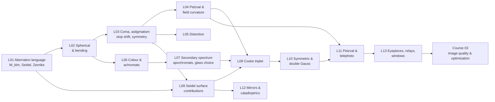

# Course 02 — Aberrations and Classical Lens Design

> Part of the self-study OpticStudio programme — see [`../CURRICULUM.md`](../CURRICULUM.md). Previous: [Course 01 — Foundations](../01-foundations/). Next: Course 03 — Image quality, optimization and physical optics (`../03-image-quality-optimization/`).

## Why this course exists

Course 01 taught you to *trace* rays and *run* an optimizer. This course teaches you to *understand* what the optimizer is doing and to *start* it in the right place. The method follows the classical arc used by Geary and Kidger:

1. **Name and measure** the aberrations — wavefront vs transverse vs longitudinal, the $W_{klm}$ polynomial, Seidel sums $S_I$–$S_V$, $C_L$, $C_T$, and how OpticStudio reports them.
2. **Predict them by hand** — thin-lens and surface-by-surface Seidel theory in a small Python toolkit you build in L01 and extend all course long (`seidel.py`).
3. **Pre-design** — choose powers, glasses, bending and stop position from thin-lens theory before touching OpticStudio.
4. **Optimize and verify** — real-ray optimization in OpticStudio, then compare with your predictions: where third order was enough, and where higher-order aberrations take over.
5. **Classical forms** — doublets, apochromats, triplets, symmetric and double-Gauss lenses, Petzval and telephoto lenses, mirrors and catadioptrics, eyepieces and relays — each one a lesson in which aberration is fought with which structural trick.

Every lesson contains at least one pen-and-paper or Python Seidel/thin-lens calculation that you then compare with OpticStudio's **Seidel Coefficients** (and real ray fans). Throughout, the examples lean toward what matters for Zivid-style hardware: machine-vision camera lenses, structured-light projectors, NIR bands, calibration-friendly distortion and robustness.

## Prerequisites
- Course 01 complete, in particular: paraxial ray tracing and the Lagrange invariant ([01/L03](../01-foundations/L03-paraxial-optics-and-ray-tracing/), [01/L04](../01-foundations/L04-stops-pupils-fields/)), glass and dispersion ([01/L05](../01-foundations/L05-optical-glass-and-dispersion/)), real-ray analysis tools ([01/L06](../01-foundations/L06-real-rays-and-analysis-tools/)), solves and DLS optimization ([01/L07](../01-foundations/L07-solves-variables-first-optimization/)), the landscape lens ([01/L08](../01-foundations/L08-landscape-lens-stop-shift-and-splitting/)).
- Python 3 with numpy, scipy, matplotlib.
- OpticStudio (Premium licence — Hammer/Global optimization, used from L07 on, are available; nothing in this course needs non-sequential mode).
- Books: [Geary] *Introduction to Lens Design*, [Kidger] *Fundamental Optical Design*; [Kenyon] *The Light Fantastic* for L12 background.

## Lessons

| # | Lesson | Topic | Core reading | Est. time |
|---|---|---|---|---|
| L01 | [Wavefront and transverse aberrations](L01-wavefront-and-transverse-aberrations/) | OPD vs ray error, $W_{klm}$ polynomial, Seidel sums ↔ wavefront/transverse, Fringe vs Standard Zernikes, OpticStudio's Seidel report | Geary §7.4–7.6; Kidger §4.1, §4.4, §6.1–6.2, §6.9 | ~7 h |
| L02 | [Spherical aberration and bending](L02-spherical-aberration-and-bending/) | Origin of spherical, thin-lens shape/conjugate factors, best form, balancing with defocus and fifth order | Geary Ch. 10–11; Kidger §6.2.1, §7.1–7.3.1, §4.4.3.1 | ~7 h |
| L03 | [Coma, astigmatism and symmetry](L03-coma-astigmatism-and-symmetry/) | Coma & astigmatism, stop-shift equations, natural stop, symmetry principle, periscopic lens | Geary Ch. 12–13; Kidger §6.2.2, §6.3, §7.2–7.3, §7.7.2 | ~7.5 h |
| L04 | [Field curvature, Petzval and flatteners](L04-field-curvature-petzval-flatteners/) | Petzval sum, S/T/P surfaces, Coddington equations, field flatteners, DOF budget | Geary Ch. 14, 27, 29; Kidger §6.9.3–6.9.4, §7.3.4 | ~7 h |
| L05 | [Distortion](L05-distortion/) | Definitions, stop dependence, f-tanθ / f-θ / fisheye mappings, grid distortion, calibration coefficients | Geary Ch. 15; Kidger §4.4.2.4, §6.2.3 | ~6.5 h |
| L06 | [Chromatic aberration and achromats](L06-chromatic-aberration-and-achromats/) | Axial & lateral colour, thin-lens achromat, cemented doublet bending, aplanat, NIR bands | Geary Ch. 16–17; Kidger Ch. 5, §8.1–8.2 | ~8.5 h |
| L07 | [Secondary spectrum and apochromats](L07-secondary-spectrum-apochromats/) | Partial dispersion, normal line, anomalous glasses, apochromats, air-spaced achromats, glass substitution (Hammer) | Geary Ch. 18, 19, 21; Kidger §5.1.3, §8.3 | ~8 h |
| L08 | [Seidel surface contributions](L08-seidel-surface-contributions/) | Surface-by-surface Seidel coefficients by hand and in OpticStudio, stop & conjugate shift, aplanatic surfaces | Kidger §6.2–6.6, §6.10–6.11; Geary §13.3 | ~7.5 h |
| L09 | [Cooke triplet](L09-cooke-triplet/) | Thin-lens predesign of a triplet, optimization, glass choice, image compactness | Geary Ch. 30; Kidger Ch. 10 | ~9 h |
| L10 | [Symmetric lenses, double Gauss, vignetting](L10-symmetric-lenses-double-gauss-vignetting/) | Symmetric achromats, Celor, double Gauss, deliberate vignetting | Geary Ch. 25, 28; Kidger §7.7.2, §10.4 | ~9.5 h |
| L11 | [Petzval lens and telephoto](L11-petzval-and-telephoto/) | Petzval portrait lens, field flattener, telephoto ratio | Geary Ch. 33; Kidger Ch. 9 | ~8 h |
| L12 | [Mirrors and catadioptrics](L12-mirrors-and-catadioptrics/) | Conic mirrors, Cassegrain/RC, Schmidt corrector, catadioptric correctors | Geary Ch. 24, 26; Kidger Ch. 13; Kenyon §8.2–8.3 | ~8.5 h |
| L13 | [Eyepieces, afocal systems, relays, windows](L13-eyepieces-afocal-relays-windows/) | Afocal layouts, eyepieces, field lenses, relays, plane-parallel plates (windows, filters, cover glass) | Geary Ch. 22–23; Kidger Ch. 11; Kenyon Ch. 4 | ~8.5 h |
| | | | **Total** | **≈ 100 h** |

At one lesson per week this is roughly a quarter of a year. L01–L07 are best done strictly in order; L08 deepens L01–L03 and can be done right after L03 if you prefer more theory before the chromatic lessons; L09–L13 depend on L08.

## How the lessons connect

Threads that run through the course:
- **`seidel.py`** — built in L01 (paraxial marginal + chief ray trace and the seven Seidel sums, validated against Kidger's triplet table), extended with the safe distortion formula in L05, chromatic sums in L06, glass/partial-dispersion tools in L07, and used for every pre-design afterwards.
- **Stop shift** — introduced in L03, used to explain distortion (L05), lateral colour (L06), the landscape and Petzval lenses (L03, L11) and why symmetric designs work (L10).
- **Petzval sum** — introduced in L04, the structural reason for negative elements in the triplet (L09), the double Gauss menisci (L10), field flatteners (L11) and mirrors' advantages (L12).
- **Design files** — several tasks reuse earlier `work/*.zmx` files (e.g. the L01 triplet in L04/L05; the L02 singlet in L03/L04; the L06 achromat in L07). Keep your `work/` folders tidy and under git.

## What "done" looks like

You have finished Course 02 when you can, without looking things up:
- Read an OpticStudio Seidel Coefficients report and Seidel Diagram, convert the numbers to waves and microns, and say which surface causes which aberration and what would fix it.
- Pre-design by hand (or in a few lines of Python) a best-form singlet, a cemented achromat with an informed glass choice, and a three-element triplet layout; then optimize each in OpticStudio and explain every difference between the thin-lens prediction and the real-ray result.
- Use the stop-shift equations and the symmetry principle to choose a stop position or a lens form deliberately.
- Specify and check field curvature, distortion and colour against a sensor's pixel size and depth of focus, including NIR and mixed-band systems.
- Choose glasses with the Abbe and partial-dispersion diagrams, and run a glass substitution (Model glass → real glass → Substitute + Hammer) with sensible catalog and cost constraints.
- Recognise each classical form (doublet, apochromat, triplet, double Gauss, Petzval, telephoto, Cassegrain/RC, Schmidt, eyepieces, relays) from its layout, state what it corrects and what it doesn't, and know when it is a good starting point for a modern machine-vision or projection lens.

Deliverables to keep: `work/seidel.py` (validated), and at least these OpticStudio files — L01 Kidger triplet, L02 best-form singlet, L03 periscopic lens (symmetric and broken), L04 flattened singlet, L05 f-θ lens, L06 N-BK7/N-SF5 aplanatic achromat, L07 "ED" doublet, L09 triplet, L10 double Gauss, L11 Petzval with flattener, L12 two-mirror telescope, L13 eyepiece/relay — each with a short `notes.md` comparing prediction and result.

## Edition and software notes
- Written for **Ansys Zemax OpticStudio ~2025 R2 / 2026 R1, Premium edition**. All analyses used here (Seidel Coefficients/Diagram, Ray/OPD Fans, Spot Diagram, Field Curvature/Distortion, Grid Distortion, Chromatic Focal Shift, Longitudinal Aberration, Lateral Color, Zernike Fringe/Standard Coefficients, Glass Map/Compare) are in all editions; **Hammer** and **Global** optimization (L07 onward) are not in the entry-level edition but are in Premium.
- Geary's book uses ZEMAX SE v6–7 (2002) menus ("Analysis → Calculations → Seidels", "GLA" button, etc.). The lessons translate those to the modern ribbon UI; where a menu path differs between versions the text says so — search the ribbon or Help for the analysis name.
- **Sign conventions:** light travels left → right; distances measured left → right are positive; radius positive when the centre of curvature is to the right of the vertex; paraxial ray slopes $u$ positive when the ray climbs (Kidger's and OpticStudio's convention). Our Seidel formulas follow Kidger/Welford; OpticStudio's CLA/CTR columns carry the opposite sign (see L06 §1.1). Geary's shape factor $X$ equals Kidger's $B$, but Geary's conjugate factor $Y = -C$ (L02).
- Merit-function operands named in the lessons (EFFL, SPHA, COMA, ASTI, FCUR, DIST, PETC, FCGT/FCGS, AXCL, LACL, PMAG, TRAY/TRAX, OPDC, ZERN, REAY/PARY, DIMX, DISG, PARR/DIFF, EFLY) exist in current OpticStudio, but units and argument conventions occasionally change between releases — always confirm an operand's value against the corresponding analysis window before you rely on it.
- Glass data in L06–L07 are SCHOTT catalogue values ($n_d$, $\nu_d$, $P_{g,F}$, $\Delta P_{g,F}$) from the SCHOTT online data sheets, or computed from SCHOTT Sellmeier coefficients; OpticStudio's SCHOTT.AGF catalogue contains the same data. Check glass status (preferred / inquiry / obsolete), relative cost and climate/stain codes before committing a design.
