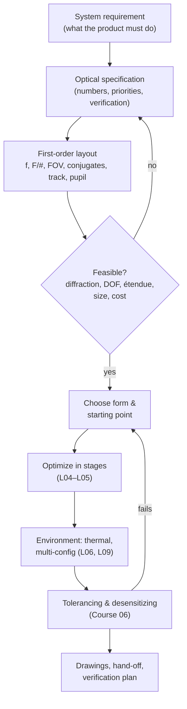

# L10 — Starting points, scaling and design strategy

> **Course 03 · Image quality, optimization and physical optics** · Estimated time: lecture ~2.5 h, tasks ~7 h
> **Prerequisites:** all of Courses 01–02 and L01–L09 of this course · **Next:** the specialisation tracks — [Course 04 (machine-vision lenses)](../../04-machine-vision-camera-lenses/), [Course 05 (illumination & projection)](../../05-illumination-projection-nsc/), [Course 06 (tolerancing)](../../06-tolerancing-manufacturing/), [Course 07 (automation)](../../07-automation-zpl-zosapi/)

## Learning objectives
- Turn a customer/system requirement into a complete optical specification, using a reusable template, and identify conflicting or missing requirements early.
- Derive the first-order layout (focal length, F/#, field, conjugates, track) and use it to choose a design form from aperture–field maps.
- Find and judge starting points: thin-lens predesign, classical forms, OpticStudio samples, stock-lens catalogs, Zebase-type collections, and patents.
- Read a patent prescription correctly (units, normalization, sag-equation and conic conventions, aspheric coefficients, glass codes) and enter it into OpticStudio.
- Scale a design in focal length and wavelength, and predict what happens to aberrations versus diffraction when you do.
- Plan a design project: stages, decision points, bookkeeping and the hand-off to tolerancing.

## Reading
- **Core:** [Geary Ch. 1, pp. 1–8] — why complex lenses exist (§1.2.1), how AOI grows with aperture and field (§1.2.3), the qualitative map of design forms vs. f-number and field angle (Fig. 1.6: e.g. a parabola for 4° at f/10, a six-element double Gauss for 20° at f/2), and the difficulties of specifications (§1.2.4: under- and over-specification).
- **Core:** [Geary §38.2, pp. 433–435] — the sixteen classical design principles he collected through the book (first-order restoration, bending, stop size and position, splitting, long-to-short conjugate, distributing bending, symmetry, rear-half-first, controlled asymmetry, balancing, Petzval/flattening, colour, field lenses, aspheres, degrees of freedom); [Geary §38.4, pp. 440–442] — "things not covered" (a good checklist of what a real project adds).
- **Core:** [Kidger Ch. 7, pp. 139–166] — thin-lens design principles behind every starting point (re-read §7.3.5 splitting, §7.4 shape-dependent/independent aberrations, §7.7 symmetry), and the Preface's warning that third-order correctability is necessary but not sufficient.
- **Online:** Zemax Community, "What is Zebase?": <https://community.zemax.com/got-a-question-7/what-is-zebase-893> — ~600 pre-built design forms as OpticStudio files (add-on).
- **Online:** Edmund Optics, lens prescription data request (Zemax black-box/Code V files for TECHSPEC lenses): <https://www.edmundoptics.eu/technical-support/optics/lens-prescription-data>
- **Online:** Ansys Optics Academy, introduction to the OpticStudio user interface (sample files, editors): <https://opticsacademy.zemax.com/1-introduction-to-zemax-opticstudio>
- **Optional:** Google Patents (<https://patents.google.com>) — the largest free source of lens prescriptions; search phrases like "imaging lens" "numerical example" "F-number" "half angle of view" plus your band ("near infrared").

---

## 1. The design process



The loops matter more than the boxes. Most failed projects fail at **D** (an infeasible specification that nobody challenged) or at **H** (a nominally beautiful design that cannot be built). Geary's §1.2.4 makes the first point: customers often don't know their requirements or over-specify; the designer must help solidify them before serious design work starts.

## 2. Writing the specification

A specification is not a wish list; every line needs a number, a condition and a verification method, and the list needs **priorities** (what may be traded first). A template you can copy into every project (also used in Course 04 L10):

```markdown
# Optical specification — <project>  (rev, date, owner)

## 1. Application & priorities
- Purpose, scene, what "good" means for the algorithm (e.g. fringe contrast, dot centroid precision)
- Priority order for trade-offs (e.g. 1 depth precision, 2 size, 3 cost, 4 light)

## 2. Optical requirements
| Item | Value | Condition | Verification |
|---|---|---|---|
| Wavelength band & weights | 940 ± 20 nm (source spectrum) | over temperature | spectral data |
| Focal length / magnification | … ± … | at nominal temp | test bench |
| F/# (working) | … | … | |
| Field of view / image circle | … | sensor … | |
| Object distance range | … – … mm | fixed focus? | |
| Image quality | MTF ≥ … at … cy/mm (Nyquist/2), fields 0/0.7/1.0, T&S | over working range & temp | MTF bench |
| Distortion | |dist| ≤ … % (or smooth & calibratable) | | |
| Relative illumination | ≥ … % at corner | | |
| Chief-ray angle at sensor | ≤ … ° (match sensor microlens CRA) | | |
| Transmission | ≥ … % | in band | |
| Ghosts / stray light | ≤ … of signal | defined source | |

## 3. Interfaces & mechanics
- Sensor (format, pixel, cover glass), filter, mount (M12, C, custom), back focal distance, total length, max diameter, mass

## 4. Environment
- Operating / storage temperature (e.g. 0–45 °C / −20–60 °C), humidity, shock/vibration, sealing

## 5. Manufacturing & cost
- Volume, target cost, preferred materials (glass/plastic, RoHS), max element count, aspheres allowed?, assembly/active alignment

## 6. Deliverables & verification
- Design files, tolerance report, drawings (ISO 10110), test plan, acceptance criteria
```

**Feasibility checks before designing** (all first-order, all from earlier lessons):
- Diffraction ceiling: MTF_dl at the specified frequency for the specified F/# and band (L02).
- Depth of focus vs object range and temperature (L03, L06, L09).
- Étendue / light budget: sensor signal at the required exposure (Course 05 L01).
- Size: a fast, wide lens with a short track is a contradiction that no optimizer resolves.

## 3. First-order layout and choosing a form

From the specification compute: focal length (from FOV and sensor, or from magnification and working distance), entrance-pupil diameter, semi-field angle, total track and back-focus constraints, pupil position (telecentricity, CRA). Then locate the design on an aperture–field map. Geary's Fig. 1.6 is the classic one; L05 §5 gives a tabular version. The deeper reason forms differ is Geary's §1.2.3: aberrations grow with the angles of incidence, and AOIs grow with both aperture and field, so complexity rises with both [Geary pp. 4–5].

Machine-vision/3D specifics that move you on the map:
- **Narrow NIR band** removes most colour correction → fewer elements than a visible lens of the same F/# and field.
- **Low CRA / telecentricity** requirements push the stop forward and need extra positive power near the image (Course 04 L03).
- **Fixed focus over a depth range** pushes the F/# up (L06 Task 4) — which in turn makes the design *easier* aberration-wise.
- **Cost/volume** pushes toward molded plastic aspheres (fewer but complex elements; thermal care, L09).

## 4. Where starting points come from

| Source | Pros | Cons |
|---|---|---|
| **Your own thin-lens predesign** (Courses 01–02, Kidger Ch. 7) | You understand it; fits your exact first order | Takes time; thick-lens conversion needed |
| **Classical forms in textbooks** (Kidger, Geary, Smith, Laikin…) | Well-understood, documented aberration behaviour | Often visible-band, old glasses, F/# and field may not match |
| **OpticStudio sample files** (in the Samples folder of your Zemax data directory, e.g. a "Double Gauss 28 degree field" objective) | Instantly usable, correct OpticStudio setup | Few, generic |
| **Zebase-type collections** (~600 forms, add-on) | Broad coverage incl. zooms, scanners | Licence; files need context |
| **Patents** (Google Patents, national offices) | Modern, aspheric, application-specific designs; huge number | Conventions vary; designs may be optimized for other constraints; IP: a starting point is fine for learning, but commercial use of a patented design needs a freedom-to-operate review |
| **Commercial databases** (e.g. LensView) | Searchable by specs | Cost |
| **Vendor stock lenses** (Libraries → lens catalogs; vendor black-box files) | Real, buyable parts; fast prototypes | Black-box files hide prescriptions; limited optimization |

A professional habit: **collect 3–5 candidate starting points, normalize them to your first order (scale, F/#, field, wavelength), optimize each lightly with the same merit function, then choose** — the L05 campaign logic applied to starting points.

## 5. Reading a patent prescription

A typical "Numerical Example" lists for each surface: radius $r$ (or curvature), spacing $d$, $n_d$, $\nu_d$, sometimes effective diameter; then aspheric coefficients and overall data (f, F-number, half angle of view ω, image height Y, total length). Checklist:

1. **Units and normalization.** Many patents scale to $f = 1$ or $f = 100$, or give mm for the real product. Check by computing f from the table (enter it and read EFL).
2. **Surface order and stop.** "STO" or "S" marks the stop; filters/cover glasses ("CG", "P", "G") are usually listed after the last lens — include them, they affect aberrations (Course 02 L13 plates).
3. **Glass.** Usually only $n_d$, $\nu_d$ (sometimes a six-digit glass code, e.g. 517642 = $n_d$ 1.517, $\nu_d$ 64.2 → N-BK7). Options: (a) model glass with those values (fast, approximate dispersion), (b) find the nearest catalog glass (OpticStudio Materials Catalog search / glass substitution), (c) both, then re-optimize. Japanese patents often use OHARA/HOYA/Sumita names or codes; check partial dispersion if colour matters.
4. **Sag equation conventions.** Read the patent's own formula. Common form: $z = \dfrac{h^2/R}{1+\sqrt{1-(1+K)h^2/R^2}} + A_4h^4 + A_6h^6 + \dots$ — identical to OpticStudio's Even Asphere with conic $k = K$. Some patents write $1 - K h^2/R^2$ (so $k = K - 1$), some use $\varepsilon$ or $\kappa$ with yet other offsets. Getting this wrong produces a lens that is "almost right" and optimizes into nonsense.
5. **Aspheric coefficient indexing.** Patent $A_4$ ($h^4$) ↔ OpticStudio Even Asphere "4th order term" (parameter for $r^4$). Odd terms ($A_3$, $A_5$) need the Odd Asphere surface. Watch for normalized radius in Q-type or extended polynomial surfaces.
6. **Missing data.** Clear apertures and vignetting are rarely given; tolerances never. Expect to re-establish vignetting factors and apertures.
7. **Verify** against the patent's stated f, F/#, ω, Y and any aberration plots (spherical, astigmatism, distortion curves are often printed — compare shapes).

## 6. Scaling a design

**Geometric scaling by factor $s$** (OpticStudio: Scale Lens tool; Make Focal to scale to a target focal length — location varies by version): all radii, thicknesses and semi-diameters multiply by $s$; even-asphere coefficients of $r^{2i}$ scale as $s^{1-2i}$ (e.g. $r^4$ term × $s^{-3}$, $r^6$ term × $s^{-5}$); F/# and field angles are unchanged.

What happens to performance:
- **Transverse ray aberrations and spot sizes scale with $s$** (in mm).
- **Wavefront aberration in length scales with $s$**, so in *waves at fixed λ* it also scales with $s$.
- **Diffraction does not scale**: the Airy radius $1.22\lambda N$ depends only on F/# and λ.

So scaling a lens **down** makes it relatively more diffraction-limited (why tiny phone lenses can be fast and simple), and scaling **up** makes residual aberrations grow relative to diffraction — a design that is diffraction-limited at f = 25 mm is 4× worse in waves at f = 100 mm. MTF at a fixed cycles/mm gets worse when scaling up, unless you also scale the pixel.

**Changing wavelength** (e.g. visible design → 940 nm): indices drop (N-BK7: 1.5168 → 1.5084), so powers drop and focus moves; dispersion becomes much smaller (good) but glass choices optimized for visible colour correction are no longer optimal. Re-optimize with the new wavelengths, then let Hammer reconsider glasses (L05) — narrowband NIR typically rewards high-index, low-cost glasses or plastics.

**Changing conjugates** (infinity design → 0.5 m object): re-optimize at the real conjugate; for magnifications beyond ~0.1 the aberration balance changes noticeably (Course 02 L02 conjugate-shift effects).

## 7. Running the project — habits that distinguish professionals

From Geary's closing chapter and the earlier lessons:
- **Bookkeeping.** Name and version every file (Geary's `_o01b/_o01a` scheme or git), keep a design log with every decision and its reason [Geary §38.2: "Would it not be embarrassing to end up with a good design and not know how you got there?"].
- **Principles before optimizers.** Geary's list of sixteen principles — first-order restoration, bending, stop size/location, splitting, working from long to short conjugate, distributing bending, symmetry and controlled asymmetry, balancing, Petzval/field flattening, colour, field lenses, aspheres, and counting degrees of freedom [Geary §38.2] — is the vocabulary of the moves in L05 §4.
- **Stage gates.** (1) first order frozen; (2) form chosen from candidates; (3) nominal design meets spec with margin (typically 20–30% on MTF); (4) thermal/multi-config OK; (5) tolerances meet yield; (6) drawings and test plan done.
- **Know when to stop.** When the nominal design has margin and tolerancing (Course 06) is the dominant risk, further nominal improvement is wasted effort.
- **Everything not covered** (Geary §38.4 list: tolerancing in depth, fabrication and mechanics, environment, metrology, wide-angle/fast systems, IR/UV, glass choice, zooms, MTF optimization, non-rotational designs, diffractive optics, non-imaging optics, coatings, ghosts, polarization) — most of it is now covered by Courses 03–07 of this programme. That list is a useful self-check of your coverage on any project.

---

## Worked example — from requirement to starting point for a 3D-camera receiver lens

**Requirement:** a structured-light camera must see an 800 mm wide field at 1.0 m with a 2448 × 2048-pixel, 3.45 µm sensor (8.45 × 7.07 mm, diagonal 11.0 mm) at 850 nm, with usable sharpness from 0.7 to 1.3 m, fixed focus, low cost.

1. **Magnification and focal length:** $m = 8.45/800 = 0.01056$; with the object 1000 mm from the lens, $f = s\,m/(1+m) = 10.45$ mm; image distance $f(1+m) = 10.56$ mm.
2. **Field:** half-diagonal 5.5 mm → semi-field $\arctan(5.5/10.56) = 27.5°$.
3. **Depth range:** Newton image shifts for 700 and 1300 mm: 0.158 and 0.085 mm → focus half-range ±36.8 µm. A blur of ≤ 2 pixels (6.9 µm) needs $N \ge 36.8/6.9 = 5.3$.
4. **Diffraction check at Nyquist (145 cycles/mm):** MTF_dl = 0.57 (F/2.8), 0.40 (F/4), 0.20 (F/5.6). Airy diameters: 5.8 / 8.3 / 11.6 µm.
5. **The conflict:** F/5.6 meets the geometric depth requirement but halves the diffraction-limited contrast at Nyquist and costs 4× light vs F/2.8. Options to bring back to the customer/system team: (a) accept F/4 with ~9 µm blur at the range ends and judge pattern contrast with the *pattern* frequency rather than Nyquist (L02 Task 5 showed coarse patterns tolerate defocus well); (b) shrink the depth range; (c) use a Scheimpflug/tilted sensor if the working volume is a slanted plane (Course 04 L09); (d) accept lower resolution (binning).
6. **Form:** at F/4, ±27.5°, narrow NIR band → Geary's map/L05 table put this between a triplet/Tessar and a wide-angle form; with one or two aspheres a 4-element design is a realistic starting point. Candidates: a scaled Cooke triplet (Course 02 L09), a Tessar-like form from a sample file, and a recent 4-element machine-vision patent; normalize all three to f = 10.45 mm, F/4, 850 nm and run the L05 campaign.

---

## Key takeaways
- Most design failures are specification or manufacturability failures; challenge the spec with first-order physics before designing.
- Use a written spec template with values, conditions, verification and priorities.
- Choose the form from aperture–field maps and application constraints (band, CRA, depth range, cost).
- Starting points: own predesign, classical forms, samples, Zebase, patents, vendor catalogs — collect several, normalize, compare.
- Patent pitfalls: normalization, sag/conic convention, aspheric indexing, glass identification, missing apertures.
- Scaling: aberrations scale with size, diffraction does not; even-asphere coefficients scale as $s^{1-2i}$. Re-optimize after wavelength or conjugate changes.
- Keep a design log and stage gates; stop polishing when tolerancing dominates.

## Glossary (new terms in this lesson)
| Term | Meaning |
|---|---|
| Specification | Quantified, prioritized, verifiable list of requirements |
| First-order layout | Paraxial description: f, F/#, field, conjugates, pupils, track |
| Design form | Arrangement type (triplet, double Gauss, retrofocus…) |
| Starting point | Initial prescription handed to the optimizer |
| Glass code | Six-digit code: first three digits of $(n_d-1)$, three digits of $10\nu_d$ |
| Model glass | Glass defined by $n_d$, $\nu_d$ (and partial dispersion) instead of a catalog entry |
| Scale Lens / Make Focal | OpticStudio tools to scale a design geometrically / to a focal length |
| Stage gate | Decision point in a design project |
| Freedom to operate | Legal check that a product does not infringe active patents |

## References
1. [Geary] J. M. Geary, *Introduction to Lens Design*, 2002: Ch. 1, pp. 1–8; §38.2, pp. 433–435; §38.4–38.5, pp. 440–442.
2. [Kidger] M. J. Kidger, *Fundamental Optical Design*, 2002: Preface, pp. xvii–xviii; Ch. 7, pp. 139–166.
3. Zemax Community, "What is Zebase?": <https://community.zemax.com/got-a-question-7/what-is-zebase-893>
4. Edmund Optics, Lens prescription data (Zemax/Code V files on request): <https://www.edmundoptics.eu/technical-support/optics/lens-prescription-data>
5. Ansys Optics Academy, Introduction to Zemax OpticStudio: <https://opticsacademy.zemax.com/1-introduction-to-zemax-opticstudio>
6. Google Patents: <https://patents.google.com>
