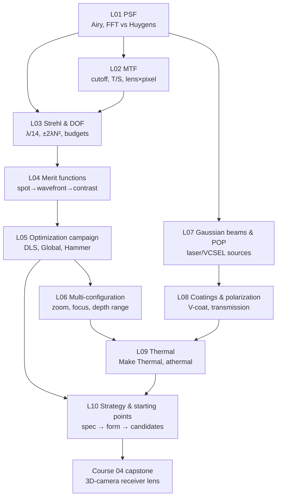

# Course 03 — Image Quality, Optimization and Physical Optics

The third core course. Courses 01–02 taught you to build and correct lenses with rays and Seidel aberrations; this course teaches you to **judge** a lens the way the physics and the customer do (PSF, MTF, Strehl, depth of focus), to **drive** OpticStudio's optimizers like a professional (merit-function design, local and global optimization, multi-configuration), and to step beyond rays where it matters for 3D cameras and projectors (Gaussian beams and POP, coatings and polarization, temperature). It ends with the design-strategy lesson that bridges into the specialisation tracks (Courses 04–07).

## Goals
By the end of this course you will be able to:
- Compute and interpret diffraction PSFs, encircled energy, MTF (diffraction and geometric), Strehl ratio and depth of focus — by hand/Python for ideal systems and in OpticStudio for real ones — and know which OpticStudio method (FFT, Huygens, geometric) is valid where.
- Translate a written specification into a layered, tolerance-weighted merit function using the full operand toolbox (including math operands, inequality constraints and `CONF` blocks).
- Run reproducible optimization campaigns combining DLS/OD, Global Search and Hammer (with glass substitution), and escape local minima with design moves rather than brute force.
- Model zoom, focusing, fixed-focus depth-range and thermal states with the Multi-Configuration Editor.
- Propagate laser/fibre/VCSEL beams with Gaussian-beam theory, the Paraxial Gaussian Beam tool and Physical Optics Propagation.
- Design and apply AR coatings, model polarization and build transmission budgets.
- Predict and fix thermal defocus over an industrial temperature range (athermalization by glass and mount).
- Write a specification, choose a design form, collect and normalize starting points (including patents), and plan a design project.

## Prerequisites
- [Course 01 — Foundations](../01-foundations/README.md) and [Course 02 — Aberrations and classical design](../02-aberrations-classical-design/README.md), in particular: paraxial optics and pupils (01 L03–L04), real rays and analysis tools (01 L06), solves/variables/first optimization (01 L07), wavefront aberrations and Zernikes (02 L01), the Cooke triplet (02 L09) and telephoto (02 L11).
- Python 3 with numpy, scipy, matplotlib (FFTs, ABCD and thin-film matrices, small optimizers).
- OpticStudio **Premium** (Professional is sufficient for everything except where noted; POP, Contrast optimization, Global Search/Hammer are not in Standard).
- Books: **[Kenyon]** Ch. 6–7, 9–10, 14 (physical optics); **[Geary]** Ch. 1, 8, 31–32, 34, 38; **[Kidger]** Foreword/Preface, §4.5, Ch. 7, §9.4, §12.5.2. See [`../references/README.md`](../references/README.md).

## Lessons

| # | Lesson | Topics | Est. time (lecture + tasks) |
|---|---|---|---|
| L01 | [Diffraction and the PSF](L01-diffraction-and-the-psf/lecture-notes.md) · [tasks](L01-diffraction-and-the-psf/tasks.md) | Huygens–Fresnel, Fraunhofer at focus, pupil function, Airy pattern (1.22 λN, 83.8%), working F/#, resolution criteria, FFT sampling/aliasing, FFT vs Huygens PSF validity, Python FFT PSF | 3 h + 5 h |
| L02 | [MTF theory and practice](L02-mtf-theory-and-practice/lecture-notes.md) · [tasks](L02-mtf-theory-and-practice/tasks.md) | OTF/MTF/PTF, pupil autocorrelation, cutoff 1/(λN), circular-pupil MTF, defocus/SA effects, geometric MTF, T/S, through-focus & vs field, lens × pixel, fringe contrast | 3 h + 5 h |
| L03 | [Strehl, wavefront budgets and depth of focus](L03-strehl-wavefront-error-depth-of-focus/lecture-notes.md) · [tasks](L03-strehl-wavefront-error-depth-of-focus/tasks.md) | Strehl and Maréchal (λ/14 → 0.8) and their limits, RMS of balanced aberrations, best-focus criteria, axial intensity, DOF ±2λN², RSS budgets | 2.5 h + 5 h |
| L04 | [Merit function mastery](L04-merit-function-mastery/lecture-notes.md) · [tasks](L04-merit-function-mastery/tasks.md) | MF arithmetic and tolerance weighting, every default-MF option, operand families, math operands (SUMM/DIFF/PROD/DIVI/ABSO/OPGT/OPLT/EQUA…), Contrast optimization, NIR receiver MF | 3 h + 6 h |
| L05 | [Optimization strategies and global search](L05-optimization-strategies-and-global-search/lecture-notes.md) · [tasks](L05-optimization-strategies-and-global-search/tasks.md) | DLS in depth (and Kidger's DLS history), OD, Global Search, Hammer + glass substitution, escaping local minima, form choice, campaign logging | 3 h + 7 h |
| L06 | [Multi-configuration and zoom](L06-multi-configuration-and-zoom/lecture-notes.md) · [tasks](L06-multi-configuration-and-zoom/tasks.md) | MCE operands (THIC, CRVT, GLSS, PRAM, APER, WAVE, TEMP…), pickups, `CONF`, two-group zoom cams, unit vs internal focusing (Kidger telephoto), fixed focus over a 3D working volume | 2.5 h + 6 h |
| L07 | [Gaussian beams and POP](L07-gaussian-beams-and-pop/lecture-notes.md) · [tasks](L07-gaussian-beams-and-pop/tasks.md) | TEM₀₀, q-parameter & ABCD law, waist shift, M², laser diodes/VCSELs, Paraxial Gaussian Beam, Physical Optics Propagation (pilot beam, sampling, fibre coupling), speckle | 3 h + 6 h |
| L08 | [Polarization and coatings](L08-polarization-and-coatings/lecture-notes.md) · [tasks](L08-polarization-and-coatings/tasks.md) | Fresnel equations, Brewster/TIR, Jones calculus, characteristic-matrix thin films, MgF₂ and NIR V-coat design, coating files (`MATE`/`COAT`/ideal), polarization analyses, transmission budgets | 3 h + 5 h |
| L09 | [Thermal and environmental analysis](L09-thermal-and-environmental-analysis/lecture-notes.md) · [tasks](L09-thermal-and-environmental-analysis/tasks.md) | SCHOTT dn/dT model, relative vs absolute, thermo-optic coefficient β, thermal defocus, athermal mounts and glasses, plastics, Make Thermal/`TEMP`/`PRES`, 0–45 °C analysis | 2.5 h + 6 h |
| L10 | [Starting points and design strategy](L10-starting-points-and-design-strategy/lecture-notes.md) · [tasks](L10-starting-points-and-design-strategy/tasks.md) | Specification template and feasibility checks, form selection, starting-point sources, reading patents (conic conventions, glass codes), scaling laws, project stage gates | 2.5 h + 7 h |

Total: roughly **85–90 hours** — about 10–12 weeks at one lesson per week (L05 and L10 are worth a week and a half each).

## How the lessons connect

**The running design.** From L04 on, one lens threads through the course: an **8 mm, F/2, 940 nm NIR receiver lens** (image height 3 mm, object at 1 m). You write its merit function in L04 (`L04_T3_nir_start.zmx`, `L04_T3_nir.MF`), optimize it with global search and glass substitution in L05 (`L05_T4_nir_hammer.zmx`), test fixed focus over a working volume in L06, coat it and build its transmission budget in L08 (`L08_T3_nir_coated.zmx`), and analyse it over 0–45 °C in L09 (`L09_T3_nir_thermal.zmx`). L10 then restarts the process properly from a written specification for a full 3D-camera receiver lens — the seed of the Course 04 capstone. Earlier designs reused: the Course 01 singlet (L01 stretch), Course 02 achromat (L01, L03), Cooke triplet (L02, L04, L10) and Kidger's telephoto (L06).

The Python thread continues too: FFT PSF/MTF engine (L01–L02), Strehl and axial-intensity tools (L03), small DLS/OD/global optimizers (L05), zoom cam calculator (L06), Gaussian-beam ABCD library (L07), Fresnel/thin-film calculator (L08), dn/dT model (L09) and prescription tools (L10). Course 07 will connect these to OpticStudio via the ZOS-API.

## What "done" looks like for this course
You are ready for the specialisation tracks when you can, without notes:
1. Look at any lens and say whether spot, wavefront/Strehl or MTF is the right metric, which PSF/MTF method is valid, and what the diffraction ceiling is at the sensor's Nyquist frequency.
2. Write a merit function from a one-page spec in under an hour, with tolerance-based weights, inequality constraints and comments — and explain every row.
3. Run and document an optimization campaign that compares several forms and picks one for reasons other than the MF value.
4. Set up a multi-configuration model for focus/zoom/depth range and a thermal model over 0–45 °C, and state the thermal focus shift of your lens and how you would athermalize it.
5. Model a laser/fibre source in POP with converged sampling, and design and verify a NIR AR coating in OpticStudio.
6. Read a patent prescription correctly and normalize it as a starting point.

## Edition and version notes
- **Premium/Professional features used:** Physical Optics Propagation (L07), Contrast optimization criterion (L04–L05), Global Search and Hammer (L05), Huygens PSF/MTF (L01–L02), polarization and coating analyses (L08), Make Thermal and thermal pickups (L09). STAR (structural-thermal-optical) is mentioned in L09 and used in Course 06; it is a Premium feature.
- **Menu paths** follow the recent ribbon interface (2025 R2 / 2026 R1). Group names move between releases; when a path is uncertain the lessons say so — use the ribbon search box and Help. After Synopsys' acquisition of Ansys (2025), some API documentation links redirect from `developer.ansys.com` to `developer.synopsys.com`; the Ansys Optics knowledge base (optics.ansys.com) remained the main how-to resource at the time of writing.
- **Operand names** used in this course were checked against the Ansys knowledge base or are long-standing operands listed in Geary's Appendix E; always confirm argument conventions (Int1/Int2/Hx/Hy/Px/Py/Data) in the MFE Help for your version.
- **Numbers.** All pen-and-paper "check yourself" values were computed in Python (scripts in the spirit of the hints in each task). OpticStudio results depend on sampling; expect agreement to a few percent for diffraction quantities when sampling has converged, and treat optimization results as ranges.
- **Geary's ZEMAX-era menus** ("Tools → Default Merit Function", "Analysis → MTF") are translated to Optimize → Optimization Wizard and Analyze → MTF / Image Quality throughout.

## Suggested weekly rhythm
1. Core reading (1–2 h), with the lecture notes open.
2. Python tasks first (they make the OpticStudio results predictable), then OpticStudio tasks.
3. Keep `work/notes.md` and, from L05 on, `work/campaign.md` (optimization log). Commit `.zmx`, `.MF` and coating files under git.
4. Answer the reflection questions before opening the answers.
