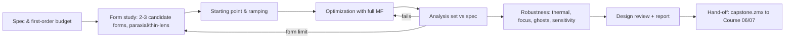

# L10 — Capstone: receiver lens for a structured-light 3D camera

> **Course 04 · Machine-vision & camera lens design** · Estimated time: lecture ~2 h, tasks ~16–20 h (two to three weekly sessions)
> **Prerequisites:** all of Course 04 (L01–L09) and Course 03 · **Next:** Course 06 L08 (tolerancing this design) and Course 07 L08 (automated design report) — both start from the file you produce here, `work/capstone.zmx`.

## Learning objectives
- Turn a system requirement (3D accuracy, volume, light budget, robustness) into a complete, numbered optical specification for a receiver lens, with a derivation for every number.
- Run a professional design flow: first-order budget → design-form choice → staged optimization → full analysis set → design review → hand-off.
- Demonstrate compliance (or documented deviation) for image quality over a depth range, CRA/telecentricity, relative illumination, distortion smoothness and stability, filter angles, thermal focus and ghosts.
- Write a design report another engineer can review and a tolerancing engineer can continue from.

## Reading
- Re-read your own notes and `work/notes.md` from L01–L09 — the capstone is a synthesis.
- [Geary Ch. 1, pp. 1–10] — the customer/designer relationship, over- and under-specification, design-form chart; and [Geary Ch. 37–38] on practical design wisdom (skim).
- [Kidger Ch. 7] — principles of lens design (optimization strategy, degrees of freedom) as a checklist for the design phase.
- Ansys Optics KB articles referenced in L03 (telecentricity, KA-01552), L05 (wide-angle ray aiming), L08 (Ghost Focus Generator).

---

## 1. The assignment

Design the **receiver (camera) lens of an industrial structured-light 3D camera** for robotic picking, working at 0.6–1.2 m. The projector is outside the scope (Course 05 L09 designs it), but its wavelength band, baseline and pattern frequencies are inputs. Robustness is valued above peak sharpness: the camera is factory-calibrated once and must hold calibration over temperature and handling.

### 1.1 System inputs (given)
| Item | Value |
|---|---|
| Sensor | 2448 × 2048, $p$ = 3.45 µm, global shutter, monochrome; active area 8.45 × 7.07 mm (diag 11.0 mm); cover glass 0.50 mm (use N-BK7 if no vendor data), 0.40 mm air to the die; sensor CRA spec: 0° (centred microlenses) with ±10° acceptance |
| Illumination | LED projector, 850 nm centre, ±5 nm production tolerance, FWHM ~30 nm, drift 0.25 nm/K |
| Geometry | projector–camera baseline 150 mm; working range 0.6–1.2 m (from the camera front window) |
| Patterns | phase-shifted fringes with periods ≥ 8 camera pixels (≤ 36.2 lp/mm on the sensor), plus coarser Gray codes |
| Environment | operation 0–45 °C, calibration at 25 °C; aluminium lens barrel and bracket |
| Volume | the lens must fit a Ø 18 mm barrel; total track ≤ 30 mm (first vertex to image) |

### 1.2 Derived first-order numbers (verified)
- **Focal length:** to see ≥ 600 × 500 mm at 0.6 m with the 8.45 × 7.07 mm sensor: $f$ = 8.0 mm gives 625 × 523 mm at 600 mm (L02). Object pixel: 0.26 mm (0.6 m), 0.34 mm (0.8 m), 0.51 mm (1.2 m).
- **Focus:** harmonic mean of 0.6 and 1.2 m → 0.8 m; image-side defocus at the range ends ±27.2 µm (L02).
- **F-number:** light budget asks for ≤ F/2.4 (LED projector, eye-safe power, NIR QE ~0.3); $N_\text{opt}$ for the depth range at 850 nm is 3.6 (L02). Choose **F/2.4** (EPD 3.33 mm) and accept range-end blur of 11.3 µm; a perfect lens then still gives 0.73 MTF at 36.2 lp/mm at the range ends (defocus × diffraction).
- **Diffraction MTF at 850 nm, F/2.4:** 0.95 (18.1 lp/mm), 0.91 (36.2), 0.81 (72.5), 0.63 (144.9).
- **Cone half-angle** at F/2.4: 11.8°.
- **CRA:** sensor accepts ±10°; to keep filter AOI and calibration stable, target CRA ≤ 8° (goal) / ≤ 12° (limit) at the corner → exit pupil ≥ 39 mm (goal) / ≥ 26 mm (limit) from the image (L03). With a 30 mm track, the stop must sit in the front part of the lens and the rear group must act as a field lens.
- **Depth noise** (for the report, L09): $\delta z = z^2\,\delta d\,p/(fb)$ = 0.144 mm at 1 m for $\delta d$ = 0.05 px; every 10 % of fringe-frequency MTF lost costs ~10 % more depth noise.

### 1.3 Optical specification (v1.0)

| # | Parameter | Requirement | Verification |
|---|---|---|---|
| S1 | EFL | 8.00 mm ± 1 % | EFFL |
| S2 | Aperture | F/2.4 (EPD 3.33 mm) | System Data, WFNO at 0.8 m |
| S3 | Image circle | Ø 11.4 mm (h = 5.7 mm incl. margin) | Real Image Height fields |
| S4 | Wavelengths | 0.835, 0.850, 0.865 µm, weights 1 : 2 : 1 | |
| S5 | Object distance | design focus 800 mm from first vertex; performance 600–1200 mm | Multi-Config (THIC surface 0) |
| S6 | Filter | 850 nm band-pass on 1.0 mm substrate (N-BK7 / fused silica), in image space, ≥ 0.5 mm from the cover glass | LDE |
| S7 | Filter AOI | ≤ 24° for all rays at all fields | RAID at filter (chief and marginal rays) |
| S8 | MTF @ 36.2 lp/mm (8-px fringes), 0–0.9 field, T & S | ≥ 0.60 at 0.8 m; ≥ 0.45 at 0.6 and 1.2 m | FFT MTF per config |
| S9 | MTF @ 72.5 lp/mm, 0.8 m | ≥ 0.45 on axis; ≥ 0.35 to 0.9 field | FFT MTF |
| S10 | CRA | ≤ 12° everywhere (goal ≤ 8°) | RAID at image |
| S11 | Relative illumination | ≥ 0.60 at full field (real apertures, no vignetting factors) | Relative Illumination, RELI |
| S12 | Distortion | barrel allowed; \|D\| ≤ 5 %; monotonic; Brown–Conrady $k_1,k_2$ fit residual ≤ 0.1 px | Field Curvature/Distortion + REAY table → Python |
| S13 | Distortion stability (focus) | full-field chief-ray height change ≤ 0.5 px for ±15 µm sensor shift | Multi-Config, REAY |
| S14 | Thermal | 0–45 °C, Al barrel: best-focus shift ≤ ±5 µm relative to the sensor; EFL change ≤ ±150 ppm | Thermal Multi-Config (Course 03 L09) |
| S15 | Lateral colour (835–865 nm) | ≤ 0.3 px (1 µm) | Lateral Color |
| S16 | Ghosts | no double-bounce ghost focusing within ±0.5 mm of the image with relative peak irradiance > 10⁻⁴ (0.5 % AR per surface) | Ghost Focus Generator |
| S17 | Mechanics | TTL ≤ 30 mm; max clear Ø ≤ 16 mm; BFL (last vertex → image) ≥ 4.0 mm; centre thickness ≥ 1.0 mm (+), ≥ 0.8 mm (−); edge ≥ 0.8 mm; air gaps ≥ 0.15 mm | operands, Prescription |
| S18 | Materials | catalogue glasses (one vendor), ≤ 6 elements, ≤ 1 cemented doublet, no plastics; prefer good climate/stain resistance | Glass catalogue data |
| S19 | Sensitivity (preview) | no single tolerance in a default sensitivity run (Course 06) dominating > 50 % of the MTF loss | Tolerance → Sensitivity |

Any requirement you cannot meet → write a **deviation** with evidence and a proposal (that is a normal and valuable outcome of a design study).

## 2. Design flow

### 2.1 Form study
The constraints — F/2.4, ±35° diagonal field (at $h$ = 5.7 mm), low CRA, BFL ≥ 4 mm with a filter, ≤ 6 glass elements, TTL ≤ 30 mm — point to:
- **Front-stop / "telecentric-rear" forms:** a front negative meniscus (retrofocus flavour, L05, lowers field angles), the stop, a positive core with a cemented doublet for colour (little colour needed at 835–865 nm, but lateral colour and the doublet's thermal leverage are useful), and a strong positive rear element as field lens to push the exit pupil away (low CRA, L03).
- **Double-Gauss derivative** with a positive field element near the image: good correction, but CRA control and length are harder.
Compare two forms at the thin-lens/paraxial level (EFL, BFL, exit-pupil distance, rear-element diameter) before optimizing either.

### 2.2 Merit function architecture (template)
1. **Dashboard** (weight 0): EFFL, WFNO, TOTR, EXPP, PMAG, DIMX, RAID (image, Hy = 1), RELI (full field).
2. **Image quality**: RMS wavefront or spot (centroid), Gaussian quadrature, configurations 1–3 (0.6 / 0.8 / 1.2 m) with weights 1 : 2 : 1, fields at 0, 0.3, 0.5, 0.7, 0.9, 1.0 of real image height. Final polish with MTFT/MTFS at 36.2 and 72.5 lp/mm.
3. **First order**: EFFL = 8.00; image distance as compensator (common focus for all configurations).
4. **Camera constraints**: RAID ≤ 12° (image, several Hy); RAID ≤ 24° at the filter for marginal rays; RELI ≥ 0.6; DIMX ≤ 5 %; REAY targets for a smooth barrel mapping if needed (L05).
5. **Mechanics**: MNCT/MXCT/MNET for glass and air, TOTR ≤ 30, clear-aperture limits, BFL ≥ 4.
6. **Thermal** (late): thermal configurations with TEMP; constrain focus difference between hot/cold configurations.

### 2.3 Robustness checks
- **Focus stability** (S13): ±15 µm image-plane configurations.
- **Thermal** (S14): TEMP/PRES multi-config with the barrel modelled through thermal pickups (Course 03 L09).
- **Ghosts** (S16): Ghost Focus Generator; NSC for confirmation if a ghost is marginal.
- **Sensitivity preview** (S19): default tolerances, sensitivity only, MTF criterion at 36.2 lp/mm (full analysis in Course 06 L08).

## 3. Design report template

Use this skeleton for `work/capstone_report.md` (Course 07 L08 will automate its generation):

1. **Summary** (½ page): what was designed, key results vs spec (PASS/FAIL/deviation table S1–S19), main risks.
2. **Requirements and derivations**: system inputs, first-order budget (L01–L03, L09 formulas with numbers).
3. **Design-form rationale**: candidates, comparison table, decision.
4. **Prescription**: radii, thicknesses, glasses, clear apertures, aspheres (if any), stop location; layout figure.
5. **Performance**: MTF vs field (3 object distances), through-focus, spot diagrams, distortion curve and calibration-fit residual, RI, CRA vs sensor spec, lateral colour, filter AOI map and resulting spectral shift.
6. **Robustness**: focus stability, thermal, ghosts, sensitivity preview.
7. **Deviations and open issues**: with proposals.
8. **Hand-off**: file names and versions, merit-function and multi-configuration conventions, compensators intended for tolerancing (focus = image distance), list of operands that Course 06/07 scripts will read.
9. **Appendix**: full Prescription Data, glass list with cost/availability notes.

## 4. Hand-off conventions (important for Courses 06 and 07)
- Save the final design as **`work/capstone.zmx`** (text format; use *Save As* and choose .zmx if your default is .zos). Keep `work/capstone_v0x.zmx` intermediate versions under git.
- Configuration 1 = 0.6 m, 2 = 0.8 m (nominal), 3 = 1.2 m. Further configurations (thermal, focus ±15 µm) after these.
- The **last thickness before the filter** is the focus compensator; label it in the Comment column "FOCUS COMP".
- Put the dashboard operands at the top of the MFE with comments; Course 07 scripts will read them by row comment.
- Surface comments: "L1 front", "L1 rear", … "STOP", "FILTER", "COVER", so that tolerancing and scripts can find surfaces by name.

## Worked example — first-order sanity check of the given spec
1. $f$ = 8 mm, F/2.4 → EPD 3.33 mm; full-field real image height 5.7 mm → field angle ≈ $\arctan(5.7/8)$ = 35.5° (before distortion; with −5 % barrel the object angle is somewhat larger).
2. Range-end defocus 27.2 µm → blur 11.3 µm at F/2.4; defocus MTF at 36.2 lp/mm = 0.81; × diffraction 0.91 → 0.73 for a perfect lens. S8 (≥ 0.45 at range ends) therefore allows an aberration MTF factor of ~0.6 — realistic but not loose.
3. CRA ≤ 12° with $h$ = 5.5 mm needs $d_{XP}$ ≥ 25.9 mm; ≤ 8° needs ≥ 39.1 mm.
4. Filter AOI ≤ 24°: CRA 12° + cone 11.8° = 23.8° ✓ (at the limit — another reason to aim for CRA ≤ 8°).
5. Thermal: S14's ±150 ppm EFL over ±25 K means |γ| ≤ 6 ppm/K for the lens as a whole — glass only, with attention to the high-$dn/dT$ glasses.

## Key takeaways
- A capstone spec is a chain of derivations: sensor → field → focal length → depth range → F/# → CRA → filter → thermal → ghosts. Write the chain down.
- The 3D-specific requirements are MTF at fringe frequencies over depth, low CRA, smooth and stable distortion, and thermal focus/EFL stability — not peak MTF at Nyquist.
- Choose the form by its first-order properties (exit-pupil distance, BFL, rear diameter) before optimizing.
- Keep the file hand-off clean: names, configurations, compensator, dashboard — other courses depend on it.

## Glossary (new terms in this lesson)
| Term | Meaning |
|---|---|
| Deviation | Documented, justified non-compliance with a spec line, with a proposal |
| Design review | Structured check of a design against its spec by people other than the designer |
| Compensator | Parameter adjusted in production (here: focus) and in tolerancing |
| Dashboard operands | Zero-weight operands summarizing key properties |
| Hand-off | Transfer of a design (files + conventions) to the next engineer/step |

## References
1. [Geary Ch. 1, pp. 1–10] — specifications and the design process; design-form chart (p. 6).
2. [Kidger Ch. 7] — principles of lens design.
3. All references of L01–L09 of this course; in particular Ansys Optics KB KA-01552 (<https://optics.ansys.com/hc/en-us/articles/42661811743251>), the wide-angle/fisheye ray-aiming article (<https://optics.ansys.com/hc/en-us/articles/42661958377491>), and the Ghost Focus Generator article (<https://optics.ansys.com/hc/en-us/articles/43071067483795>).
