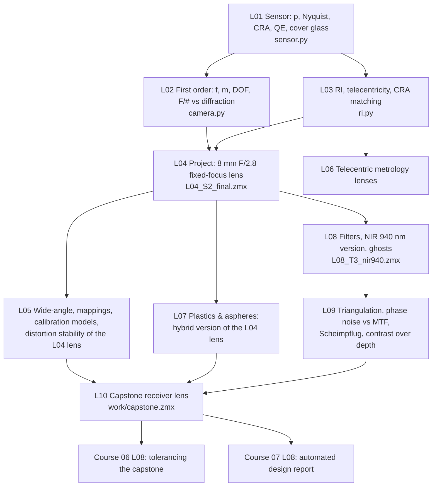

# Course 04 — Machine-vision & camera lens design

The first professional specialisation track, and the core of the programme for work on industrial 3D cameras. It turns the general lens-design skills of Courses 01–03 into the way a senior machine-vision optics engineer thinks: **start from the sensor and the measurement, derive every number, design for robustness and calibration stability, and prove compliance line by line.** The running application is the receiver (camera) of a structured-light 3D camera working at 0.3–2 m in the visible and/or NIR, where thermal stability, low chief-ray angles, narrow-band filters, ghosts and stable distortion matter more than peak sharpness.

## Goals
By the end of this course you will be able to:
- Translate sensor data (pixel pitch, format, CRA, cover glass, QE, EMVA 1288 data) into optical requirements, including MTF at Nyquist and at pattern frequencies.
- Do the complete first-order design of a camera: focal length from field and working distance, magnification, depth of field with a measurement-driven circle of confusion, F/# from the balance of light, defocus and diffraction.
- Control relative illumination, image-space telecentricity and CRA matching, and put them into a merit function (RAID, RELI, EXPP/RECI, …).
- Design compact fixed-focus, wide-angle/retrofocus and telecentric lenses, choose distortion mappings together with calibration models, and quantify distortion stability.
- Use optical polymers and molded aspheres knowingly (thermal behaviour, birefringence, Q-type surfaces, moldability).
- Model cover glass and filters, size band-pass filters from angle shifts and source drift, design for 850/940 nm, and hunt ghosts.
- Connect lens performance to 3D accuracy (triangulation, phase noise vs MTF, baselines) and handle Scheimpflug geometry in OpticStudio.
- Deliver a capstone receiver-lens design with a specification, evidence, design report and clean hand-off for tolerancing (Course 06) and automation (Course 07).

## Prerequisites
- Courses 01–03 (in particular 01/L03–L04 paraxial optics and pupils, 02/L05 distortion, 02/L09–L10 triplet and double Gauss, 02/L13 plates, 03/L02 MTF, 03/L04–L05 merit functions and global search, 03/L08 coatings, 03/L09 thermal analysis).
- Python 3 with numpy/scipy/matplotlib: every lesson builds small tools (`sensor.py`, `camera.py`, `ri.py`, `fitmodels.py`, filter and depth-noise scripts) that the capstone reuses.
- Ansys Zemax OpticStudio **Premium** (recent release ~2025 R2 / 2026 R1).
- The course books: **[Kidger]**, **[Geary]**, **[Kenyon]** (see [`../references/README.md`](../references/README.md)). This course leans more on online application notes (Ansys/Zemax KB, Edmund Optics, sensor and filter vendors, EMVA 1288) than earlier ones; every link was checked when the lessons were written.

## Lessons

| # | Lesson | Topics | Est. time (lecture + tasks) |
|---|---|---|---|
| L01 | [Image sensors and sampling](L01-image-sensors-and-sampling/lecture-notes.md) · [tasks](L01-image-sensors-and-sampling/tasks.md) | Pixel pitch, Nyquist, optical-format naming, pixel MTF, CRA & microlens shift, QE (NIR), shot noise, EMVA 1288, cover glass | 2.5 h + 4 h |
| L02 | [Camera first-order design](L02-camera-first-order-design/lecture-notes.md) · [tasks](L02-camera-first-order-design/tasks.md) | f from FOV & working distance, magnification, working F/#, DOF/hyperfocal with pixel-based CoC, optimum F/# vs diffraction, multi-config depth study | 2.5 h + 4 h |
| L03 | [Relative illumination and telecentricity](L03-relative-illumination-and-telecentricity/lecture-notes.md) · [tasks](L03-relative-illumination-and-telecentricity/tasks.md) | cos⁴ and its generalisation, vignetting vs pupil effects, RI analysis, image-space telecentricity, CRA-curve matching (RAID, RELI, EXPP/RECI) | 2.5 h + 4 h |
| L04 | [Project: compact fixed-focus lens](L04-compact-fixed-focus-lens-project/lecture-notes.md) · [tasks](L04-compact-fixed-focus-lens-project/tasks.md) | Two-session project: f = 8 mm F/2.8 lens for a 1/1.8"-type sensor, TTL ≤ 20 mm, IR-cut + cover glass, focused at 1 m; spec, form choice, MF, analysis checklist, report | 2 h + 10–12 h |
| L05 | [Wide-angle lenses and distortion mappings](L05-wide-angle-and-distortion-mappings/lecture-notes.md) · [tasks](L05-wide-angle-and-distortion-mappings/tasks.md) | Retrofocus layout, fisheye mappings, resolution & RI per mapping, Brown–Conrady vs Kannala–Brandt, distortion stability for 3D cameras, enhanced ray aiming | 2.5 h + 4.5 h |
| L06 | [Telecentric metrology lenses](L06-telecentric-metrology-lenses/lecture-notes.md) · [tasks](L06-telecentric-metrology-lenses/tasks.md) | Perspective error, object-space & bi-telecentric layouts, NA/DOF/resolution trade, telecentric slope spec, *Object Space Is Telecentric* | 2 h + 4.5 h |
| L07 | [Plastic optics and molded aspheres](L07-plastic-optics-and-molded-aspheres/lecture-notes.md) · [tasks](L07-plastic-optics-and-molded-aspheres/tasks.md) | PMMA/PC/COP/COC/OKP, thermo-optic coefficient, athermal hybrids, birefringence, even vs Q-type aspheres, moldability rules | 2.5 h + 5 h |
| L08 | [Filters, cover glass, NIR and ghosts](L08-filters-cover-glass-nir-and-ghosts/lecture-notes.md) · [tasks](L08-filters-cover-glass-nir-and-ghosts/tasks.md) | Plates in converging beams, interference-filter angle shift and cone averaging, filter placement and bandwidth budget, 850/940 nm design, Ghost Focus Generator | 2.5 h + 4.5 h |
| L09 | [3D-vision optics: triangulation, stereo, Scheimpflug](L09-3d-vision-optics-scheimpflug-stereo/lecture-notes.md) · [tasks](L09-3d-vision-optics-scheimpflug-stereo/tasks.md) | $\delta z \approx z^2\delta d/(fb)$, structured light as active stereo, phase noise vs MTF, baselines & overlap, focus over depth, Scheimpflug & tilted planes in OpticStudio | 3 h + 5 h |
| L10 | [Capstone: receiver lens for a structured-light 3D camera](L10-capstone-machine-vision-lens/lecture-notes.md) · [tasks](L10-capstone-machine-vision-lens/tasks.md) | Spec S1–S19 → form study → optimization → full evidence → report → hand-off (`work/capstone.zmx`) | 2 h + 16–20 h |

Total: roughly **95–105 hours**, i.e. 12–14 weeks at one session per week (L04 takes two sessions, L10 two to three).

## How the lessons connect

The L04 lens is the running design: L05 measures its distortion stability, L07 makes a hybrid version, L08 converts it to 940 nm and hunts its ghosts, L09 evaluates pattern contrast over depth with it. The capstone (L10) is a new, harder lens that uses everything; its file and conventions are the input to Courses 06 and 07.

## Conventions used in this course
- Sign conventions as in Course 01 (light left → right, radii positive with centre to the right). In first-order camera formulas (L02, L09) object distances are written as positive magnitudes $s$; this is stated where used.
- Sensor numbers: the recurring example sensors are 2448 × 2048 @ 3.45 µm (2/3"-type, 8.45 × 7.07 mm) and 2048 × 1536 @ 3.45 µm (1/1.8"-type, 7.07 × 5.30 mm).
- Wavelengths: F, d, C for visible examples; 0.84–0.86 µm and 0.93–0.95 µm for NIR; µm in OpticStudio.
- MTF frequencies on the sensor in lp/mm; Nyquist $\nu_N = 1/(2p)$; fringe periods in camera pixels.
- Every number in worked examples and "check yourself" boxes was recomputed with Python. OpticStudio optimization results are given as ranges.

## What "done" looks like for this course
You are ready to move on when you can, without notes:
1. Turn a sensor datasheet and an application sentence ("see 600 × 500 mm at 0.6–1.2 m with 0.15 mm depth noise") into a first-order lens spec in one hour, with every number derived.
2. Explain to a sensor vendor, a calibration engineer and a mechanical engineer what CRA, distortion stability and focus stability mean for *them*, with numbers.
3. Design and document a 4–6 element camera lens that meets a realistic machine-vision spec, including filter, cover glass, RI, CRA and thermal checks.
4. Size a band-pass filter and decide its position; find the top ghosts of a design.
5. Estimate 3D depth noise from lens MTF, SNR, baseline and focal length.
6. Hand over `work/capstone.zmx` with a design report that someone else can review and tolerance.

## Edition and version notes
- Everything in this course works in OpticStudio **Professional and Premium**; most of it also in Standard. Premium-specific items are optional here: non-sequential ghost/stray-light confirmation (L08, L10), STAR/structural coupling for molding stress (L07, mentioned only).
- Menu locations of analyses (Relative Illumination, Ghost Focus Generator, Image Simulation, coating/transmission analyses, Find Best Asphere) move between releases; lessons say "location varies by version" where unsure — use the ribbon search box.
- Ray aiming: wide-angle and fisheye lenses (L05) use *Enhanced Ray Aiming* (OpticStudio 22.1+); older versions have *Robust Ray Aiming* only.
- Q-type aspheres (Qbfs/Qcon) are available as the *Q-Type Asphere* surface in recent releases (L07).
- Material catalogue names for plastics (ZEON, MISC, …) and for cover-glass materials vary by version; lessons say so and give fallback choices.
- File formats: save the capstone as **.zmx** (text, diff-friendly) because Courses 06/07 parse and version it.
