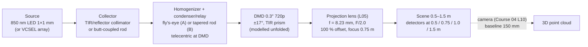

# L09 — Capstone: a structured-light projector, from source to scene

> **Course 05 · Illumination, projection and non-sequential design** · Estimated time: lecture ~2 h, tasks ~18–22 h (three weekly sessions)
> **Prerequisites:** all of Course 05 (L01–L08), especially the saved work of [L01](../L01-radiometry-photometry-etendue/tasks.md), [L04](../L04-illumination-optics-collimators-condensers/tasks.md), [L05](../L05-projection-lens-design/tasks.md), [L06](../L06-hybrid-mixed-mode-and-nsc-optimization/tasks.md) and [L07](../L07-stray-light-scattering-ghosts/tasks.md); the receiver side is [Course 04 L10](../../04-machine-vision-camera-lenses/L10-capstone-machine-vision-lens/lecture-notes.md) · **Next:** Course 06 ([Tolerancing and manufacturing](../../06-tolerancing-manufacturing/README.md)) or Course 07 ([Automation](../../07-automation-zpl-zosapi/README.md)) — Course 07 L06–L08 is the natural way to automate the measurements you make by hand here.

This is a capstone, so the lecture is short: it states the problem, the specification, the modelling strategy and the report format, and works out the paper predictions you will test. The work is in [tasks.md](tasks.md).

## Learning objectives
- Turn an application ("fringe projection for a 3D camera over 0.5–1.5 m") into a numbered projector specification with a derivation for every line, and keep it under change control.
- Build an étendue-and-flux budget for a complete projector (source → collector → homogenizer → DMD → projection lens → scene) and predict efficiency and scene irradiance before tracing a ray.
- Explain why étendue *shape* (round beam into rectangular lenslets, square source into a 16:9 DMD, illumination cone vs lens pupil) costs light even when the étendue *value* fits.
- Choose, for each metric, the simplest honest model (paper, sequential, unfolded NSC, folded NSC, ghost model) and state its noise and its blind spots.
- Measure in OpticStudio: DMD-plane uniformity and spill, scene uniformity, source-to-scene efficiency, fringe modulation versus depth, ghost/signal ratio and half-field contrast — each with a ray-noise estimate.
- Explain how the illumination's pupil fill ($\sigma$) sets the projector's depth of field and speckle, and why a DMD is a blazed grating at 850 nm.
- Write a design report a reviewer can check line by line against the spec, with honest deviations.

## Reading
- **Core:** your own notes and `work/notes.md` from L01–L08. The capstone is graded on how well you *reuse* them.
- **Core:** [Kenyon §4.2.2, pp. 77–79] — étendue as the product $n^2\Omega A$, invariant through every intermediate image, and the statement that radiance cannot be increased. This is the backbone of §3 below.
- **Core:** [Kenyon §5.5.3, p. 112] — coherence area; note eq. 5.31: the étendue of one coherence cell is $\lambda^2$. Dividing a source's étendue by $\lambda^2$ counts its spatial modes, which is what decides speckle (§5).
- **Core:** [Geary §20.3, p. 223] — design from the long to the short conjugate (why your projection lens file is a reverse model, L05).
- **Optional:** [Kenyon §14.4.5, p. 397] — laser speckle, for the VCSEL track. [Kidger §6.6, p. 128] — fast medium-field lenses as projection lenses.
- **Optional:** [Geary Ch. 1, pp. 1–10] — specification, over- and under-specification; reread before writing your spec.
- **Online:** TI, *DLP System Optics* (DLPA022) — illumination architectures, TIR prism, tilt angle vs NA, contrast mechanisms: <https://ti.com/lit/pdf/dlpa022>
- **Online:** TI, *DMD Optical Efficiency for Visible Wavelengths* (DLPA083) — the efficiency factors (fill factor, window, mirror reflectance, diffraction) you must re-estimate for 850 nm: <https://ti.com/document-viewer/lit/html/DLPA083B/GUID-A957AE9D-7027-4283-93A6-86CF18D0D65A>

## 1. The system and what "good" means

A structured-light projector is judged by what the *camera* can extract from the scene: phase-shifted or coded patterns whose **modulation** stays high over the whole depth range, on a background that is **uniform enough** not to waste dynamic range, with **enough flux** that the camera's shot noise is small in a short exposure, and with **no structured stray light** that shifts the measured phase. The five metrics of this capstone map one-to-one onto those needs:

| Metric | Camera-side consequence | Course lesson |
|---|---|---|
| Étendue check | whether the source can fill the DMD/lens at all; what the "extra" LED area buys | L01, L03 |
| Efficiency / flux budget | exposure time, shot-noise-limited phase noise, ambient-light robustness | L01, L04, L06 |
| Uniformity (DMD and scene) | usable dynamic range; corners not starved | L04, L06 |
| Fringe modulation vs depth | phase noise $\propto 1/(\text{modulation}\times\text{SNR})$; finest usable code | L05 |
| Stray light and ghosts | contrast loss (veil) and *systematic* depth error (structured ghosts) | L07 |

Depth noise of a phase-shifting system scales as $\sigma_z \approx \dfrac{p_z}{2\pi}\,\sigma_\phi$ with $p_z = \Lambda/\tan\theta_{\text{tri}}$ the depth per fringe period ($\Lambda$ = fringe period on the scene, $\theta_{\text{tri}}$ = triangulation angle) and $\sigma_\phi$ inversely proportional to the fringe modulation times the camera SNR (Course 04 L09). So a 20 % loss in modulation at the range end is a 25 % increase in depth noise there: modulation and flux are the currencies in which every optical decision of this capstone is paid.

## 2. The specification (v1.0)

Copy this into `work/spec.md` in Task 1 and own it: every line gets an origin, a derivation and a verification method. Do not edit silently — log changes in `work/deviations.md`.

| # | Item | Requirement (threshold / goal) | Origin |
|---|---|---|---|
| P1 | Application | Phase-shifting fringe projector for the Course 04 L10 camera (baseline 150 mm); scene 0.5–1.5 m from the projection lens front vertex | system |
| P2 | Wavelength | **Track A (default):** 850 nm LED, FWHM 30 nm (L03 weights 820/835/850/865/880 nm). **Track B:** 850 nm VCSEL array. **Track V (stretch):** visible (needs a re-optimized lens) | system |
| P3 | Source | A: 1 × 1 mm Lambertian die, 1.2 W (L03 worked example A). B: 0.8 × 0.6 mm array, 2 W, per-emitter ±10° ($1/e^2$) (L03 example C, moved to 850 nm) | datasheet |
| P4 | Spatial light modulator | 0.3″ 720p DMD (DLP3010-class): 1280 × 720, $p$ = 5.4 µm, 6.912 × 3.888 mm, ±17° tilt; telecentric illumination via TIR prism (12 mm N-BK7) + 1.1 mm window; DMD efficiency $\eta_{\text{DMD}}$ = 0.65 (planning value — verify for 850 nm, §5) | L01, L05 |
| P5 | Projection lens | your `L05_T5_projlens.zmx`: $f$ = 8.23 mm, throw ratio 1.2 at 1 m, 100 % offset, Paraxial Working F/2.0 (F/1.71 optional), focused at 0.75 m, AR coating `I.9975` (L07 configuration C) | L05, L07 |
| P6 | Étendue | $G_{\text{source}} \le 0.8\,G_{\text{lens}}$ with $G_{\text{lens}} = \pi A_{\text{DMD}}\sin^2\theta_{\text{lens}}$ (5.28 mm² sr at F/2.0); shape losses quantified | L01 |
| P7 | Illumination at DMD | cone half-angle ≤ $\theta_{\text{lens}}$ = 14.5° in every azimuth; illumination chief-ray angle ≤ 2° (telecentric); report pupil-fill ratio $\sigma$ | L04, L05 |
| P8 | DMD uniformity & spill | CV ≤ 3 % on a 20 × 12 grid over the active area; spill (power outside the active area ÷ power on a 1.2× detector) ≤ 10 % | L04, L06 |
| P9 | Scene uniformity (all-on, 1.0 m) | min/max ≥ 0.6 on a 16 × 9 grid over the central 90 % × 90 % of the image (goal 0.7); CV ≤ 10 % | L05 (RI), L06 |
| P10 | Efficiency | source → projected image area at 1.0 m ≥ 15 % (goal ≥ 25 %), with a link-by-link budget, each link measured | L01 |
| P11 | Scene irradiance (all-on) | ≥ 0.3 W/m² at 1.5 m (report 0.5, 1.0 m) | P10 |
| P12 | Fringe modulation | vertical sinusoidal fringes, measured at DMD centre and at 0.7 of the image-circle radius, at 0.5, 0.75, 1.0, 1.5 m: 32-px period ≥ 0.80, 16-px ≥ 0.60 (goal 0.75); report 8-px | L05 |
| P13 | Distortion, lateral colour | inherited from L05: ≤ 1 % monotonic, ≤ 0.5 px (830–870 nm) — check only | L05 |
| P14 | Stray light | total ghost/signal on the scene ≤ 1 × 10⁻³; half-field contrast ≥ 100:1; no in-focus ghost whose phase error gives > 10 µm depth error at 1 m (L07 method) | L07 |
| P15 | Tilt geometry | no overlap of illumination, on-state and flat-state cones; angular margin between the lens acceptance cone and the flat-state cone ≥ 2° | L01, L05 |
| P16 | Package | LED-to-DMD optical path ≤ 80 mm (report; not graded hard) | mechanics |
| P17 | Eye safety | state which standard applies (IEC 62471 lamp safety for LEDs, IEC 60825-1 for lasers/VCSELs) and which quantities from your model a safety engineer will need; no classification required | compliance |
| P18 | Simulation quality | every NSC number quoted with its ray-noise estimate (L02, L06); final numbers at ≥ 10⁷ rays or with a stated noise < ¼ of the margin | method |

Notes on the spec. P6's 0.8 factor leaves room for shape losses (§3). P9 is deliberately looser than P8: the scene inherits the projection lens's relative illumination (a 32° corner field) which the illumination cannot fix without wasting light. P12's thresholds come from L05: at F/2.0 the geometric defocus blur at the range ends is ≈ 4.3 pixels (worked example below). P14 uses L07's numbers: with 0.25 % per surface the ghost sum is ≈ 6 × 10⁻⁴, so the line is reachable only with NIR coatings — that is the point.

## 3. Étendue, again — value and shape

Étendue $G = n^2 A\Omega$ (for a cone, $\pi n^2 A\sin^2\theta$) is conserved by perfect optics and grows with every imperfection [Kenyon §4.2.2, pp. 77–79]. For this system:

| Element | Étendue (mm² sr) |
|---|---|
| DMD at native ±17° ($N$ = 1.71) | $\pi\cdot26.87\cdot\sin^2 17° = 7.22$ |
| Projection lens at F/2.0 ($\theta$ = 14.48°) over the DMD | $\pi\cdot26.87\cdot0.0625 = 5.28$ |
| LED 1 × 1 mm, Lambertian | $\pi\cdot1 = 3.14$ |
| VCSEL array 0.8 × 0.6 mm, ±10° | $\pi\cdot0.48\cdot\sin^2 10° = 0.045$ |

With an F/2.0 lens the **lens**, not the DMD, is the étendue bottleneck — the illumination should therefore be designed for a 14.5° cone, not 17°. Light illuminating the DMD at 14.5°–17° passes the DMD but is clipped at the lens stop: a uniformly filled 17° cone loses $1 - \sin^2 14.48°/\sin^2 17° = 27$ % — and that light becomes barrel scatter (L07 Task 4).

**Shape.** Value alone is not enough; the phase-space *shapes* must nest. Two examples you will meet:

1. *Round collimated beam into a 16:9 fly's-eye.* The lenslets accept $\pm\alpha_y = \arctan(H/2F)$ in the short axis and $\pm\alpha_x$ in the long axis, where $F$ is the condenser focal length; a round beam with divergence $\pm\alpha_y$ wastes the long-axis acceptance. With the array confined to the circle that gives the 14.5° cone at the DMD (radius $R = F\tan14.48°$), the usable étendue of a round beam is
$$G_{\text{round}} = \pi\,(\pi R^2)\,\sin^2\alpha_y \approx \frac{\pi^2}{4}\,H^2\tan^2\theta_{\text{lens}},$$
*independent of* $F$ and of the lenslet focal length. For $H$ = 3.888 mm it is 2.47 mm² sr — only 79 % of the LED's 3.14. No choice of $F$ fixes this; an anamorphic (cylindrical) collimator or a rectangular source image does.
2. *Square LED into a rectangular rod.* A tapered rod with a 16:9 exit face converts the square input into a rectangle-filling output: $G$ is conserved (3.80 mm² sr for the 1.1 × 1.1 mm input face of L04 Task 4) and the cone at the DMD after the relay is 12.3° — within 14.5°, at the cost of a slightly larger étendue than the die (the input face is larger than the die).

Here $A_{\text{DMD}}$ = active area, $H$ = DMD active height, $R$ = array radius, $\alpha_y$ = short-axis lenslet acceptance half-angle, $\theta_{\text{lens}}$ = projection-lens half-angle at the DMD.

## 4. One model per question

A professional does not build one giant model and hope. Each metric gets the simplest model that is honest for it, and the report states each model's blind spots.

| Question | Model | Tool | Blind spots |
|---|---|---|---|
| Étendue, budgets, predictions | paper/Python (`radiometry.py`, `dof.py`, `straylight.py`) | Python | everything not in the formulas |
| Lens MTF vs depth at fringe frequencies ($\sigma$ = 1) | reverse sequential multi-config (L05) | FFT MTF (sagittal for vertical fringes) | real pupil fill, ghosts |
| DMD uniformity, cone, spill, illumination efficiency | **illumination NSC** (source → DMD-plane detectors) | NSC + detectors, `NSDD` | DMD tilt, prism |
| Scene uniformity, end-to-end efficiency | **unfolded system NSC**: illumination → DMD *as a transmissive aperture* → lens → scene | NSC | DMD diffraction and tilt; DMD–lens ghosts |
| Fringe modulation (real pupil fill) | patch source or bar mask at the DMD → lens → strip detectors | NSC + Python fit | coherence (VCSEL track) |
| Ghosts, half-field contrast | **folded ghost model** of L07 (source at DMD + DMD mirror) | NSC, split rays, ZRD, Path Analysis | illumination non-uniformity |
| Tilt geometry (on/off/flat bundles) | angles on paper + optional folded NSC sketch | pen & paper | imaging (a tilted plane mirror is not a DMD) |

**Unfolding the DMD.** For an ideal on-state micromirror with telecentric illumination, reflection simply maps the incoming cone (centred at $2\theta_t$ = 34° from the DMD normal) onto an outgoing cone centred on the normal, preserving its shape and the irradiance pattern. You can therefore *unfold* the reflection: put the illumination behind the DMD plane, coaxial with the **DMD centre** (not the lens axis — with 100 % offset they are 1.944 mm apart), and represent the DMD by an aperture (a frame of absorbing rectangles around the active area) or by a pattern mask. The micromirror losses become the scalar $\eta_{\text{DMD}}$, the illumination-side prism pass the scalar $\tau_{\text{prism}}$ (≈ 0.92, L04 §7). What the unfolded model cannot show: DMD diffraction, the tilt-induced on/off/flat bundles, and ghosts that go back to the DMD and reflect again — those come from the other models in the table.

**Tilt geometry in one line.** Illumination arrives at +34° to the array normal. A mirror tilted by $\tau$ sends it to $2\tau - 34°$: on-state ($\tau$ = +17°) → 0°, flat state (window, borders, $\tau$ = 0) → −34°, off-state ($\tau$ = −17°) → −68°. With illumination cone half-angle $\theta_c$ and lens acceptance $\theta_{\text{lens}}$, flat-state light stays out of the lens if $34° - \theta_c - \theta_{\text{lens}} > 0$; P15 asks for ≥ 2° margin.

## 5. Three physical effects the simple models hide

**Pupil fill sets the depth of field.** The projection lens images each DMD pixel with the cone the *illumination* puts into it. If the illumination fills only a fraction $\sigma = \sin\theta_c/\sin\theta_{\text{lens}}$ of the pupil, a defocus $\delta$ at the DMD produces a blur of diameter $b \approx 2\delta\sin\theta_c$, not $\delta/N$. The sequential MTF (uniformly filled stop) is therefore the *worst case* for depth of field; a rod at 12.3° ($\sigma$ = 0.85) gains about 15 % in blur. The defocused PSF is a scaled image of the pupil illumination — for a fly's-eye it is a grid of little source images, not a disc, so its MTF can be non-monotonic. Look at it (Task 5).

**Spatial modes and speckle.** By [Kenyon §5.5.3, eq. 5.31] one coherence cell has étendue $\lambda^2$. At 850 nm $\lambda^2 = 7.2\times10^{-7}$ mm², so the LED carries $G/\lambda^2 \approx 4\times10^6$ spatial modes and the VCSEL array ≈ $6\times10^4$; a single-mode laser carries one. Speckle contrast falls roughly as $1/\sqrt{M}$ with $M$ the number of independent modes (and wavelengths, and polarizations) averaged within one camera resolution cell (L03 Task 5, [Kenyon §14.4.5, p. 397]). The VCSEL track buys radiance and a small $\sigma$ (deep focus) and pays with speckle and a narrow, coherent illumination — geometric ray tracing will not show the speckle; you must estimate it on paper.

**The DMD is a blazed grating.** The mirror array has period $p$ = 5.4 µm; at 850 nm the diffraction orders are $\arcsin(\lambda/p)$ = 9.06° apart (5.85° at 550 nm). Inside a 14.5° acceptance half-angle only a few orders fit, and the fraction of light that lands in them depends on how well the 17° tilt "blazes" this wavelength. That is why TI's efficiency notes are wavelength-specific and why NIR-optimized DMDs exist; treat $\eta_{\text{DMD}}$ = 0.65 as a planning number to be replaced by vendor data, and do not expect a ray tracer to predict it.

## 6. In OpticStudio — assembling the system

- **Start from your files**, not from scratch: illumination from `L06_T4_flyseye_opt.zmx` + `L06_T5_collimator_opt.zmx` (architecture A) or the tapered rod of L04 Task 4 (architecture B); lens from `L07_T3_proj_nsc_C.zmx` (already converted to NSC, coated `I.9975`, with prism and window plates). Moving objects between NSC files: copy rows between Non-Sequential Component Editors (works for whole object rows in recent releases; if it does not in yours, re-enter the few objects and use *Ref Object* so a group moves as one).
- **Coordinates.** Give each subsystem a Null Object as its origin ("ILLUM ORIGIN", "LENS ORIGIN", "DMD CENTRE") and reference everything else to it. The DMD centre is offset by $s$ = 1.944 mm from the lens axis (sign as in your L05 file); the unfolded illumination axis passes through the DMD centre.
- **Detectors.** DMD: Detector Rectangle 6.912 × 3.888 mm (20 × 12 pixels for CV, more for pictures) plus a 1.2×-size detector 0.01 mm downstream for spill; leave the first detector's material blank so it is transparent (L02 Task 3) and does not shadow the second. Angular content: the Detector Rectangle's angle-space (radiant intensity) display or a Detector Polar just after the DMD. Scene: Detector Rectangles at 0.5, 0.75, 1.0, 1.5 m sized to the projected image + 10 %, all set transparent except the last (or traced in separate configurations via the Multi-Configuration Editor).
- **Metrics in the MFE.** `NSTR` to trace, `NSDD` to read: total power, and pixel code −4 for the standard deviation over pixels (L06); combine with `DIVI` for CV. Keep a "dashboard" block of operands at the top of the MFE so Course 07 scripts can read them.
- **Noise.** CV over $K$ pixels with $N_{\text{det}}$ rays has a noise floor $\approx\sqrt{K/N_{\text{det}}}$ (L06 worked example): 240 pixels need ≥ 10⁶ rays on the detector to see a 3 % CV, 10⁷ to verify it.
- **Premium.** Everything here is NSC and therefore needs Professional or Premium; the Sequence Selector used in L07 is Premium/Enterprise; Radiant Source models are Premium (L03).

## 7. Report template

Write `work/projector_report.md` (≤ 8 pages + appendix). A reviewer reads section 1 and decides whether to read the rest.

1. **Summary** (½ page) — architecture chosen, compliance table P1–P18 (PASS / FAIL / DEVIATION, measured value, margin, noise), top three risks.
2. **Requirements and derivations** — the spec with origins; paper predictions (étendue table, flux budget, defocus/modulation table, ghost estimate) *made before tracing*.
3. **Architecture** — A vs B (and track A vs B source) comparison table; decision and why.
4. **Models** — the §4 table for your project: each model, its file name, ray counts, noise, blind spots.
5. **Illumination results** — DMD irradiance map, CV, spill, angular distribution, telecentricity, $\sigma$.
6. **System results** — scene maps at four distances, uniformity, efficiency budget (predicted vs measured, link by link), irradiance.
7. **Pattern results** — modulation vs depth for 8/16/32-px fringes at two field points; sequential vs NSC; defocused PSF picture; recommendation for the code sequence.
8. **Stray light** — ghost/signal, half-field contrast, top paths, flat-state margin, spill destination; depth error estimate.
9. **Deviations and open issues** — honest, each with a proposal (e.g. "η_DMD unverified at 850 nm; request vendor data").
10. **Hand-off** — file list with versions, configuration meanings, dashboard operand rows, scripts.
11. **Appendix** — object tables, source definitions, detector settings, Python scripts' output.

## Worked example — paper predictions for the default track

All numbers below were computed with Python; recompute them in Task 1.

**(a) Étendue.** LED 3.14 mm² sr vs lens 5.28 mm² sr: ratio 0.60 < 0.8 → P6 passes on value. Shape: architecture A (round collimated beam into 16:9 lenslets, array radius $R = 25.92\tan14.48° = 6.69$ mm, $\alpha_y$ = 4.29°, $\alpha_x$ = 7.59°) accepts at most $G_{\text{round}}$ = 2.47 mm² sr = 79 % of the LED; to deliver the LED's full étendue at ±4.29° the collimated beam would need a radius of 7.5 mm, larger than the 6.69 mm array. Architecture B (tapered rod 1.1 × 1.1 → 3.0 × 1.6875 mm, relay ×2.304) delivers a 12.25° cone at the DMD ($\sigma$ = 0.85) with no shape loss.

**(b) Tilt margin.** At F/2.0 ($\theta_{\text{lens}}$ = 14.48°) with a matched 14.48° illumination cone: $34 - 14.48 - 14.48 = 5.0°$ margin (P15 ✓). If you kept L04's 17° fly's-eye cone: 2.5° (marginal ✓) — and 27 % of the light would be clipped at the stop anyway. At F/1.71 with a 17° cone: 0.0° — on-state and flat-state cones touch; that is TI's reason for tying F/# to tilt.

**(c) Flux budget (planning values — every one to be replaced by a measurement).**

| Link | A: collimator + fly's-eye | B: rod + relay |
|---|---|---|
| Collection | 0.669 (étendue-shape limit 0.787 × practical 0.85) | 0.92 (butt coupling, Fresnel, gap) |
| Homogenizer optics | 0.970 (6 AR faces at 0.995) × 0.95 (crosstalk, dead zones) | 0.97 (rod) × 0.980 (relay, 4 AR faces) |
| DMD fill (5 % spill) | 0.95 | 0.95 |
| TIR prism | 0.92 | 0.92 |
| DMD efficiency | 0.65 | 0.65 |
| Lens pupil acceptance (cone matched) | 0.99 | 0.99 |
| Lens transmission (14 faces, `I.9975`) | 0.966 | 0.966 |
| **Source → scene** | **0.335** | **0.475** |
| Scene irradiance, all-on, 1.2 W LED (0.5 / 1.0 / 1.5 m) | 4.19 / 1.03 / 0.455 W/m² | 5.94 / 1.46 / 0.646 W/m² |

Projected image area at distance $L$: $(W\cdot m)(H\cdot m)$ with $m = (L-f)/f$: 0.0960, 0.390 and 0.883 m² at 0.5, 1.0 and 1.5 m. Both architectures meet P10/P11 on paper; A has less margin, mostly because of the shape loss in (a). For perspective, direct sunlight delivers roughly 1 W/(m²·nm) around 850 nm, i.e. tens of W/m² through a 30 nm band-pass — this projector is an indoor device, and the camera's band-pass filter and exposure strategy (Course 04 L08) matter as much as the optics.

**(d) Fringe modulation from defocus (geometric, uniformly filled pupil, lens otherwise perfect).** Focus at the balanced distance: DMD-side conjugate offsets $x'(L) = f^2/(L-f)$ give $\pm\delta$ = ±46.2 µm at 0.5 and 1.5 m and a balanced focus of 748 mm (L05). Blur diameter $b = \delta/N$ (full fill) or $2\delta\sin\theta_c$ (partial fill); defocus MTF $2J_1(\pi b\nu)/(\pi b\nu)$ at $\nu = 1/(P p)$ for a $P$-pixel fringe period:

| Case | $b$ (µm / px) | 8 px (23.1 c/mm) | 16 px (11.6 c/mm) | 32 px (5.8 c/mm) |
|---|---|---|---|---|
| F/1.71, full fill | 27.0 / 5.0 | 0.59 | 0.88 | 0.97 |
| F/2.0, full fill (A) | 23.1 / 4.3 | 0.69 | 0.91 | 0.98 |
| F/2.0, rod $\sigma$ = 0.85 (B) | 19.6 / 3.6 | 0.77 | 0.94 | 0.98 |
| F/2.0 at 1.0 m (A) | 11.6 / 2.2 | 0.91 | 0.98 | 0.99 |

Multiply by the lens's own nominal MTF at the same frequency (from your L05 file; typically 0.8–0.95 at 11.6 c/mm) and by the ghost factor $1/(1+s)$ ≈ 0.9994 for $s = 5.7\times10^{-4}$ (L07). Prediction for P12 at the range ends: 16-px ≈ 0.75–0.85, 32-px ≈ 0.8–0.95 — the spec is reachable; 8-px fringes are usable only near the focus.

**(e) Scene scale.** Projected pixel 0.32 / 0.49 / 0.65 / 0.98 mm at 0.5 / 0.75 / 1.0 / 1.5 m; a 16-px fringe is 5.2 / 7.8 / 10.4 / 15.7 mm. With the 150 mm baseline at 1 m ($\theta_{\text{tri}}$ = 8.53°) one 16-px period corresponds to $p_z$ = 69 mm of depth (L07 worked example), so a phase noise of 1 mrad is ≈ 11 µm.

## Key takeaways
- A capstone spec is a chain: application → depth range and baseline → fringe period → defocus budget → F/# → étendue → source → illumination architecture → flux. Write the chain down before touching OpticStudio.
- With an F/2.0 lens on a ±17° DMD, the lens is the étendue bottleneck: design the illumination cone for the lens, not the DMD, or the excess becomes barrel scatter.
- Étendue shape matters as much as value: a round beam into 16:9 lenslets wastes ~20 % regardless of focal lengths; a tapered rod reshapes for free.
- Use one honest model per question (sequential MTF, illumination NSC, unfolded system NSC, folded ghost model) and write down what each cannot see.
- The illumination's pupil fill sets the projector's depth of field and its speckle; the sequential MTF is the full-fill worst case.
- At 850 nm the DMD is a coarse blazed grating; its efficiency is a vendor number, not a ray-trace result.
- Every NSC number needs its noise; every planned number in the budget needs its measurement; every miss needs a deviation with a proposal.

## Glossary (new terms in this lesson)
| Term | Meaning |
|---|---|
| Unfolded model | NSC model in which the DMD reflection is replaced by transmission through an aperture/mask at the DMD plane |
| Pupil fill ratio σ | $\sin\theta_{\text{illumination}}/\sin\theta_{\text{lens}}$; σ = 1 fills the projection-lens stop |
| Étendue shape loss | Loss when two phase-space footprints have compatible étendue values but incompatible shapes (round vs rectangular, square vs 16:9) |
| Spill | Illumination falling outside the DMD active area |
| Flat-state light | Light reflected by flat DMD structures (window, border, gaps) at −2θ_t from the projection axis |
| Fringe modulation | $(I_{\max}-I_{\min})/(I_{\max}+I_{\min})$ of a projected fringe; for sinusoidal fringes equal to the system MTF at the fringe frequency (times stray-light factors) |
| Dashboard operands | A commented block of MFE rows holding the system metrics, read by scripts |
| Spatial modes | $G/\lambda^2$: number of independent coherence cells a source carries; controls speckle averaging |

## References
1. [Kenyon §4.2.2, pp. 77–79] — étendue, its invariance, conservation of radiance.
2. [Kenyon §5.5.3, p. 112] — coherence area; étendue of one coherence cell = $\lambda^2$ (eq. 5.31).
3. [Kenyon §14.4.5, p. 397] — laser speckle.
4. [Geary §20.3, p. 223] — designing from the long to the short conjugate.
5. [Geary Ch. 1, pp. 1–10] — specifications and the designer–customer relationship.
6. [Kidger §6.6, p. 128] — fast aspheric medium-field lenses as projection lenses.
7. Texas Instruments, *DLP System Optics* (DLPA022) — <https://ti.com/lit/pdf/dlpa022>
8. Texas Instruments, *DMD Optical Efficiency for Visible Wavelengths* (DLPA083) — <https://ti.com/document-viewer/lit/html/DLPA083B/GUID-A957AE9D-7027-4283-93A6-86CF18D0D65A>
9. Texas Instruments, DLP3010 product page — <https://www.ti.com/product/DLP3010>
10. Ansys Optics KB, *Introduction to stray light analysis – Part 2* (ghosts, filter strings, Path Analysis) — <https://optics.ansys.com/hc/en-us/articles/42661744883091>
11. Ansys Optics, introductory article on detectors in illumination systems (Detector Rectangle, ray-count noise) — <https://optics.ansys.com/hc/en-us/articles/42661774340243>
12. Course lessons reused: [L01](../L01-radiometry-photometry-etendue/lecture-notes.md) étendue; [L03](../L03-source-modeling-leds-and-lasers/lecture-notes.md) sources; [L04](../L04-illumination-optics-collimators-condensers/lecture-notes.md) homogenizers; [L05](../L05-projection-lens-design/lecture-notes.md) projection lens and defocus; [L06](../L06-hybrid-mixed-mode-and-nsc-optimization/lecture-notes.md) NSC optimization and noise; [L07](../L07-stray-light-scattering-ghosts/lecture-notes.md) stray light; [L08](../L08-diffractive-optics-and-pattern-projection/lecture-notes.md) DOE alternative.
