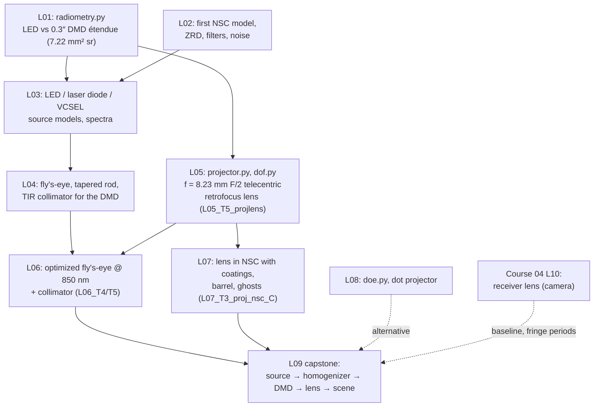

# Course 05 — Illumination, Projection and Non-Sequential Design

The illumination and projection track of the programme. Courses 01–04 taught you to *image*; this course teaches you to *deliver light*: count it (radiometry, étendue), trace it the way it really travels (non-sequential ray tracing with splitting, scattering and detectors), shape it (condensers, homogenizers, collimators), project it (DMD projection lenses), keep it from going where it should not (stray light and ghosts), and diffract it (DOEs and dot projectors). Everything converges on the capstone: a complete **structured-light projector** of the kind used in industrial 3D cameras, analysed from source to scene.

## Goals
By the end of this course you will be able to:
- Do radiometric and photometric bookkeeping by hand and in Python: flux, intensity, radiance, irradiance, Lambertian sources, and **étendue** — including when étendue *shape*, not value, limits a design.
- Build, trace and interpret non-sequential models in OpticStudio: sources, objects, detectors, ray splitting, Ray Database files and filter strings, with a ray-count/noise estimate for every number.
- Turn LED, laser-diode and VCSEL datasheets into source models, and compare sources by radiance, étendue, spectrum and coherence (speckle).
- Design and size illumination optics: critical vs Köhler illumination, condensers, fly's-eye homogenizers, light pipes and tapered rods, TIR collimators, DMD illumination.
- Design a telecentric retrofocus projection lens for a DMD in reverse, specify it in DMD pixels, and budget depth of focus and fringe contrast over a structured-light working range.
- Combine sequential and non-sequential models (mixed mode, Convert to NSC Group) and optimize illumination systems despite Monte-Carlo noise.
- Find, rank and fix stray light: scatter models (Lambertian, ABg), importance sampling, ghost paths, baffles, NIR-reflective "black" mechanics, and translate them into fringe-contrast and depth errors.
- Design diffractive pattern generators (Dammann gratings, fan-outs) and hybrid refractive–diffractive lenses, and know when scalar models stop being valid.
- Specify, model, measure and report a complete projector against a written spec.

## Prerequisites
- **Courses 01–03** (paraxial optics, pupils and étendue's sequential cousin the Lagrange invariant, aberrations, MTF, optimization, multi-configuration, Gaussian beams/POP, coatings and polarization).
- **Course 04** is strongly recommended before L05 and L09: telecentricity and relative illumination (C04 L03), wide-angle/retrofocus forms (C04 L05), filters and ghosts (C04 L08), 3D triangulation (C04 L09), and the receiver lens of the C04 capstone, which is the camera that watches this course's projector.
- Python 3 with numpy, scipy, matplotlib — you will build `radiometry.py`, `projector.py`, `dof.py`, `straylight.py` and `doe.py` and reuse them in the capstone.
- Ansys Zemax OpticStudio **Premium** (Professional also covers almost everything; see edition notes).
- Books: **[Kenyon]** *The Light Fantastic* (radiometry, étendue, coherence, diffraction, scattering), **[Kidger]** and **[Geary]** for the projection-lens lesson. See [`../references/README.md`](../references/README.md).

## Lessons

| # | Lesson | Topics | Est. time (lecture + tasks) |
|---|---|---|---|
| L01 | [Radiometry, photometry and étendue](L01-radiometry-photometry-etendue/lecture-notes.md) · [tasks](L01-radiometry-photometry-etendue/tasks.md) | Radiometric/photometric quantities, Lambertian and cosine-power sources, conservation of radiance, étendue, DMD acceptance; `radiometry.py` | 3 h + 4 h |
| L02 | [Non-sequential fundamentals](L02-non-sequential-fundamentals/lecture-notes.md) · [tasks](L02-non-sequential-fundamentals/tasks.md) | NSC Editor, objects, sources, detectors, layout vs analysis rays, Monte-Carlo noise, polarization and ray splitting, ZRD files, filter strings, Detector Viewer | 3 h + 4–5 h |
| L03 | [Source modelling: LEDs, laser diodes and VCSEL arrays](L03-source-modeling-leds-and-lasers/lecture-notes.md) · [tasks](L03-source-modeling-leds-and-lasers/tasks.md) | Datasheet → source parameters, domed LEDs, spectra as weighted wavelengths, laser-diode divergence and M², VCSEL arrays, radiance/étendue/speckle comparison | 3 h + 4–5 h |
| L04 | [Illumination optics: condensers, Köhler, homogenizers, TIR collimators](L04-illumination-optics-collimators-condensers/lecture-notes.md) · [tasks](L04-illumination-optics-collimators-condensers/tasks.md) | Critical vs Köhler, condensers, fly's-eye sizing, light pipes and tapered rods, TIR collimator étendue limit, illuminating a DMD | 3.5 h + 5 h |
| L05 | [Projection lens design](L05-projection-lens-design/lecture-notes.md) · [tasks](L05-projection-lens-design/tasks.md) | Reverse design, DMD geometry and tilt-limited F/#, throw ratio and offset, TIR prism as plates, keystone, spec in pixels, depth of focus and fringe contrast over 0.5–1.5 m; telecentric retrofocus lens | 3.5 h + 6 h |
| L06 | [Hybrid (mixed-mode) systems and NSC optimization](L06-hybrid-mixed-mode-and-nsc-optimization/lecture-notes.md) · [tasks](L06-hybrid-mixed-mode-and-nsc-optimization/tasks.md) | NSC groups in sequential files, Convert to NSC Group, NSDD/NSTR merit functions, noise vs DLS, optimizing a fly's-eye and a collimator | 3.5 h + 6 h |
| L07 | [Stray light: scattering, ghosts and baffling](L07-stray-light-scattering-ghosts/lecture-notes.md) · [tasks](L07-stray-light-scattering-ghosts/tasks.md) | BSDF/TIS, Lambertian/ABg, importance sampling, ghost paths and Path Analysis, coatings, barrels and vanes, NIR "black", fringe-contrast and depth errors from ghosts | 3.5 h + 6–7 h |
| L08 | [Diffractive optics and pattern projection](L08-diffractive-optics-and-pattern-projection/lecture-notes.md) · [tasks](L08-diffractive-optics-and-pattern-projection/tasks.md) | Grating equation, diffraction efficiency, Dammann/fan-out DOEs, Binary 2 and diffractive lenses, hybrid achromats, dot projectors, zero order and eye safety | 3.5 h + 6–7 h |
| L09 | [Capstone: structured-light projector](L09-capstone-structured-light-projector/lecture-notes.md) · [tasks](L09-capstone-structured-light-projector/tasks.md) | Spec → étendue & flux budget → illumination to DMD → unfolded system model → fringe modulation vs depth → ghosts → report; graded checklist | 2 h + 18–22 h |

Total: roughly **90 hours** — about 12–13 weeks at one lesson per week, with the capstone taking three sessions.

## How the lessons connect — the running designs

The DMD (0.3″ 720p, 5.4 µm, ±17°), the 850 nm LED (1 × 1 mm, 1.2 W) and the 0.5–1.5 m working range recur from L01 to L09, so every lesson adds one link to the same projector. Each lesson's tasks name the files to save in its `work/` folder; later lessons start from them by name (e.g. `../L05-projection-lens-design/work/L05_T5_projlens.zmx`). The capstone lists all of them in one table. Keep the course under git — `.zmx` files are text.

## Conventions used in this course
- Sign conventions as in Course 01. Lens units mm; wavelengths µm in OpticStudio (nm in prose).
- NIR default: 850 nm (LED band 820–880 nm with Gaussian weights from L03); 940 nm where a VCSEL example calls for it; visible F, d, C for photometric examples.
- Étendue $G = \pi n^2 A\sin^2\theta$ in mm² sr; DMD F/# $= 1/(2\sin\theta_t)$ (TI convention).
- Projection lenses are modelled **in reverse** (screen as object, DMD as image) unless stated.
- Every NSC result is quoted with its Monte-Carlo noise (≈ $1/\sqrt{\text{rays per pixel}}$); "check yourself" values for pen-and-paper and Python tasks were recomputed with Python; NSC results are given as ranges.

## What "done" looks like for this course
You are ready to move on when you can, without notes:
1. Given an LED datasheet and a DMD, say within 10 minutes whether the source fits, what the illumination cone should be, and roughly what fraction of the LED flux will reach the scene — and where the rest goes.
2. Build an NSC model of a source + homogenizer + target, choose ray and pixel counts from a noise target, and optimize it without being fooled by noise.
3. Specify a projection lens in DMD pixels (MTF at Nyquist, distortion, lateral colour, CRA) and predict fringe contrast over a depth range from F/#, focal length and pupil fill.
4. Find the top ghost and scatter paths of a lens + housing, express them as a contrast loss and a depth error, and propose fixes a mechanical engineer can act on.
5. Explain to a system architect the trade between LED and VCSEL illumination (étendue, radiance, depth of field, speckle, eye safety) with numbers.
6. Hand over the capstone report with a compliance table that a reviewer can check line by line.

## Edition and version notes
- **Non-sequential mode requires OpticStudio Professional or Premium**; Standard cannot do L02–L04, L06–L09. This course is written for **Premium**.
- Premium-specific items used here: Radiant Source models (L03, optional); Sequence Selector filters (L07, optional — ordinary filter strings and Path Analysis cover the core tasks). Rigorous DOE modelling (RCWA/FDTD) is a different Ansys product (Lumerical), mentioned in L08 only.
- Object availability and parameter names (Lenslet Array 1/2, Fresnel objects, Slide, Source Diode array parameters, Paraxial-lens objects) vary between releases — lessons say "check the object list / Help in your release" where unsure. Use the ribbon search box for analyses that move (Path Analysis, Detector Viewer options, Convert to NSC Group).
- Filter-string operators (`Hn`, `Gn`, `X_GHOST`, `X_HITFACE2`, …) are documented under *The Filter String* in the Help; check syntax there when a filter returns nothing.
- Save models as **.zmx** (text) so git diffs and Course 07 scripts can read them; ZRD ray files are large — keep them out of git (add `*.ZRD` to `.gitignore`).
