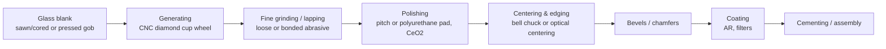

# L01 — Manufacturing processes and tolerances

> **Course 06 · Tolerancing and manufacturing** · Estimated time: lecture ~2.5 h, tasks ~4 h
> **Prerequisites:** Courses 01–03 (in particular [01/L02 — surfaces and sag](../../01-foundations/L02-surfaces-sign-conventions-aspheres/), [03/L03 — wavefront budgets](../../03-image-quality-optimization/L03-strehl-wavefront-error-depth-of-focus/)); [04/L07 — plastic optics](../../04-machine-vision-camera-lenses/L07-plastic-optics-and-molded-aspheres/) is useful · **Next:** [L02 — Tolerance Data Editor and compensators](../L02-tolerance-data-editor-and-compensators/)

## Learning objectives
- Describe the process chain for a polished glass lens (blank → generating → fine grinding → polishing → centering/edging → coating → cementing) and say which step determines which toleranced parameter.
- Compare polished glass, precision-molded glass, injection-molded plastic and diamond-turned optics in achievable tolerances, cost and volume — and say which a Zivid-style camera module would use where.
- Explain how a surface is measured: test plates and Newton fringes, Fizeau and Twyman–Green interferometers, power vs irregularity fringes, spherometers, centering measurement.
- Convert between radius tolerance (mm or %) and power fringes, between edge-thickness difference, wedge and beam deviation, and between surface irregularity fringes and transmitted wavefront error.
- Read a commercial / precision / high-precision tolerance table and pick a starting tolerance grade for a design.
- Explain the cost–tolerance curve and why "tighter" is not the same as "better".

## Reading
- **Core:** [Geary §9.4, pp. 98–100] — the Fizeau interferometer: reference surface, double-pass surface error, interferogram as a contour map, transmission spheres for testing lenses.
- **Core:** [Kenyon §5.7–5.7.2, pp. 113–116] — Twyman–Green and Fizeau interferometers for component testing; why amplitude-division interferometers dominate optical testing.
- **Core:** [Geary §38.3, pp. 436–440] — Geary's short introduction to tolerancing (the singlet focal-length example); read now for motivation, again in L02.
- **Online:** Edmund Optics, "Precision Tolerances for Spherical Lenses" — the commercial / precision / high-precision table used below: <https://edmundoptics.eu/knowledge-center/application-notes/optics/precision-tolerances-for-spherical-lenses>
- **Online:** Optimax Systems, "Manufacturing Tolerance Chart" (fabricator view, includes material, wedge/ETD, roughness): <https://optimaxsi-com.dev.webhost.io/?p=2979> (Optimax's chart as found by search; the canonical site is optimaxsi.com).
- **Online:** Apollo Optical Systems, "Manufacturing Tolerances" for injection-molded polymer optics: <https://www.apollooptical.com/manufacturing-tolerances>
- **Optional:** Tech Briefs / Edmund Optics, "Properly Tolerancing Aspheric Lenses to Balance Cost and Performance" (radius vs fringes for aspheres, slope error, asphere centration): <https://www.techbriefs.com/component/content/article/50616-properly-tolerancing-aspheric-lenses-to-balance-cost-and-performance>

---

## 1. Why a lens design is not finished at nominal

Everything you have done so far optimizes a *nominal* lens: exact radii, exact thicknesses, catalogue indices, perfectly centred elements. No such lens exists. Every number in the Lens Data Editor will be wrong in the real part — by a few micrometres, a few arc-seconds, a few units in the fourth decimal of the index. Tolerancing answers three questions:

1. **How good will the lenses we actually build be?** (as-built performance, a *distribution*, not a number)
2. **Which errors matter?** (sensitivity ranking — the few parameters that need tight control)
3. **What will it cost?** (tolerance grade, adjustment steps, yield = fraction of builds that meet spec)

Geary puts it bluntly: a design "is not really complete until you do a tolerance analysis" [Geary §38.3, p. 436]. In industry this is even more true: for a camera module made in tens of thousands per year, a design that has 0.70 nominal MTF but 60 % yield is worse than one with 0.62 nominal and 98 % yield.

The course arc:

| Lesson | Question |
|---|---|
| L01 (this) | What can a shop make and measure, at what cost? |
| L02–L03 | How do we model errors in OpticStudio and predict as-built performance? |
| L04 | How do we design lenses that are less sensitive? |
| L05 | How do mechanics (mounts, barrels, temperature) enter? |
| L06 | How do we communicate tolerances to vendors (ISO 10110)? |
| L07 | How do alignment and active alignment recover performance in production? |
| L08 | Capstone: tolerance the Course 04 receiver lens and write the report. |

## 2. Making a polished glass lens

A conventional spherical glass lens passes through roughly these steps. For tolerancing, the important thing is *which step sets which parameter*.

**Blank.** Glass comes from the manufacturer as strip, block or pressed blanks ("gobs" pressed close to the final shape). The material properties — index and Abbe number relative to catalogue, homogeneity, striae, bubbles, stress birefringence — are fixed here and are bought by *grade* (L06).

**Generating.** A CNC curve generator with a diamond-impregnated cup wheel cuts the sphere: the radius is set by the wheel tilt and geometry. Generating removes most material and roughly sets radius and centre thickness, leaving a damaged subsurface layer tens of micrometres deep.

**Fine grinding (lapping).** Successively finer abrasives on a spherical tool remove the damaged layer and bring the radius very close to final. Centre thickness is now controlled by measured removal — typically to a few tens of micrometres, and ±10 µm with care.

**Polishing.** A pitch or polyurethane lap with cerium-oxide slurry produces the specular surface. Polishing removes only a few micrometres, but it is where the *figure* is set: the polisher adjusts stroke, speed and pressure until the surface matches a **test plate** to the required number of fringes. This is the step that determines **power** (radius error) and **irregularity**, and it is where the surface quality (scratch–dig) and roughness are born. Many lenses are polished on blocks of several parts at once — cheap per part but with part-to-part variation.

**Centering and edging.** The lens is gripped between two coaxial bell chucks (self-centring for moderate curvatures) or held on a spindle and centred optically (the reflected or transmitted image of a target is watched while the lens is pushed until the image stops wobbling). The edge is then ground concentric to the *optical axis* — the line through both centres of curvature. Centering defines the **wedge** (edge-thickness difference) and therefore the element's tilt/decenter relative to its own mechanical edge. Bell chucking needs enough "clamping angle": very weak surfaces (long radius) do not self-centre and need optical centering.

**Bevels, coating, cementing.** Protective bevels (chamfers) prevent chipping. Coating (AR, band-pass) adds thin-film stress that can bend thin parts. Cementing a doublet introduces a new error: the two elements can be decentered and tilted relative to each other (L05).

### 2.1 Aspheres
A polished asphere cannot be made with a full-aperture spherical lap: it needs **sub-aperture** CNC polishing (small tool, deterministic dwell-time control), magnetorheological finishing (MRF) or ion-beam figuring for the best parts. Consequences for tolerancing:
- form is measured by stylus or optical **profilometer**, or interferometrically with a null/CGH — not with a test plate;
- sub-aperture tools leave **mid-spatial-frequency** ripple, specified as slope error;
- an asphere has a unique axis, so centration must be specified as *both* tilt and decenter (a sphere only has a tilt-equivalent wedge). The Tech Briefs/Edmund article listed above makes these points and recommends tolerancing an asphere's base radius linearly (mm), not in fringes.

### 2.2 Precision glass molding (PGM)
A heated glass preform is pressed between ultra-precise (typically diamond-turned or ground carbide/ceramic) molds. Only low-$T_g$ glasses mold well (each vendor has a "molding glass" list). Every part is a near-copy of the mold, so *part-to-part* repeatability is excellent, but you pay for the mold (and its iterative correction) up front; volumes from thousands upward. Typical issues: the index drops slightly during molding ("index drop", vendors provide the molded index), thickness is set by the press stroke, and decenter between the two surfaces is set by the mold alignment. Ask the vendor for their tolerances — order-of-magnitude values are CT ±0.01–0.02 mm, surface-to-surface decenter ~0.005–0.01 mm, form ~0.5–1 µm PV for small lenses.

### 2.3 Injection-molded plastic
Covered in [04/L07](../../04-machine-vision-camera-lenses/L07-plastic-optics-and-molded-aspheres/). The tolerance picture is different from glass: radius is "loose" (%), irregularity is tens of fringes, but **thickness and flange geometry are very repeatable** because they come from the mold. Apollo Optical's published tolerances (link above): radius ±1 % commercial / ±0.5 % precision; CT ±0.025 / ±0.015 mm; surface-to-surface concentricity 0.025 / 0.015 mm; power 10 / 4 fringes and irregularity 6 / 3 fringes (at 632.8 nm over 25 mm). Compare with polished glass below — plastic is coarser in form, similar or better in CT, and its *mechanical* features (flanges, interlocks) can be molded in, which reduces assembly error.

### 2.4 Single-point diamond turning (SPDT)
An ultra-precision lathe with a diamond tool cuts the surface directly — any rotationally symmetric asphere, also freeforms with fast-tool servos. Materials: non-ferrous metals (aluminium mirrors), many IR crystals (Ge, ZnSe, Si), and polymers. Not ordinary oxide glasses (the diamond wears chemically). Diamond turning is how most **molds** for plastic and glass molding are made, so its accuracy sits behind every molded lens. It leaves periodic tool marks (fine grating-like structure) that can scatter or diffract in the visible.

### 2.5 Which process for which Zivid-type part?
| Part | Typical process | Why |
|---|---|---|
| Camera receiver lens, front elements, doublet (Course 04 capstone) | polished glass spheres | robust, low $dn/dT$, cemented doublet possible |
| Field/rear element with asphere | PGM glass asphere | asphere at volume, glass thermal behaviour |
| Projector condenser, low-cost illumination optics | injection-molded plastic | cheap, complex shapes, thermal drift tolerable |
| Metal mirrors, molds, IR prototypes | SPDT | any asphere, prototyping |

## 3. Measuring what was made

You can only tolerance what can be measured: a tolerance without a test method is a wish.

### 3.1 Test plates and Newton fringes
A **test plate** is a precision glass reference with the opposite curvature (a convex plate for a concave surface). Placed on the part with a thin air gap, it shows Newton's rings under monochromatic light (sodium or He–Ne, or the green mercury line). Each fringe is a change of $\lambda/2$ in the gap, because the light crosses the gap twice — the fringes are **double-pass**. Counting rings tells the polisher:

- **Power** (radius mismatch): the number of circular rings. A radius error changes the sag over the test diameter by $\Delta s$, giving $N = 2|\Delta s|/\lambda$ fringes.
- **Irregularity**: departure of the fringes from perfect circles — elliptical fringes (astigmatism, "cylinder"), a turned-down edge, a zone.

Shops own *sets* of test plates with certified radii. Choosing radii that match existing plates ("test-plate fitting", L06) avoids buying a new plate pair per surface and is a standard final design step.

### 3.2 Interferometers
For higher precision and documentation, shops use laser interferometers ([Geary §9.4, pp. 98–100]; [Kenyon §5.7.2, pp. 115–116]):

- **Fizeau:** a laser beam, expanded and collimated, passes a slightly wedged reference plate whose last surface (the *reference surface*, figured to $\lambda/20$ PV or better) reflects part of the beam; the rest is reflected by the test surface. The two returns interfere on a camera. Geary stresses that the reflected test wave carries **twice** the surface error, so each fringe again corresponds to $\lambda/2$ of surface height. Spherical surfaces are tested with a **transmission sphere** — a lens whose last surface is the reference and whose focus is placed at the centre of curvature of the test surface. Fizeau interferometers are common path (reference and test share almost the whole path), which makes them insensitive to imperfections of the interferometer optics.
- **Twyman–Green** (a Michelson derivative): separate reference and test arms; flexible, used for transmitted-wavefront tests of complete lenses with a return sphere [Kenyon §5.7.1, p. 114].

Modern phase-shifting interferometers fit Zernike polynomials to the measured map. A shop report typically states *power* (the Zernike defocus term converted to fringes) and *irregularity* (PV of the residual after removing piston, tilt and power), sometimes also RMS irregularity and the rotationally symmetric part separately. The standard test wavelength is **632.8 nm** (He–Ne). ISO 10110 defaults to **546.07 nm** (mercury e-line) unless a wavelength is stated on the drawing (L06) — always state the test wavelength.

### 3.3 Other measurements
- **Radius:** spherometer (ring + dial gauge) or interferometer with a radius bench (cat's-eye to confocal position).
- **Centre thickness:** contact gauges (to ~1 µm), non-contact low-coherence interferometry for assembled lenses.
- **Centering:** the part rotates on an air-bearing spindle while an autocollimator observes the reflected image of a reticle from each centre of curvature; the wobble radius gives the surface tilt relative to the rotation axis (L07 builds alignment on this). A cheaper test for single elements: rotate on the edge and measure the **edge-thickness difference (ETD)** with a dial gauge, or measure **beam deviation** in transmission.
- **Aspheres:** stylus or optical profilometers (µm-level), CMM for coarse molded parts, interferometers with CGH nulls for precision.
- **System level:** MTF benches and transmitted-wavefront interferometry of the finished lens — the final acceptance test for a camera lens is usually through-focus MTF at a few field points.

## 4. Converting between the units

Tolerances are quoted in mixed units. You must convert fluently.

### 4.1 Radius error ↔ power fringes
The sag of a sphere of radius $R$ at semi-diameter $r$ is $s(R) = R - \sqrt{R^2-r^2}$. A radius error $\Delta R$ changes the sag by $\Delta s = s(R+\Delta R)-s(R)$, which over the test aperture shows as

$$
N_\text{power} = \frac{2\,|\Delta s|}{\lambda_\text{test}} \approx \frac{D^2\,|\Delta R|}{4\,\lambda_\text{test}\,R^2},
$$

where $D = 2r$ is the test diameter and the approximation uses $s \approx r^2/(2R)$ (valid for $r \ll R$). Note that the fringe count depends on the **test diameter**: the same $\Delta R$ gives four times more fringes over twice the diameter. That is why a fringe tolerance for a small, steep lens can correspond to a surprisingly large radius error, and for a large flat-ish lens to a very small one. OpticStudio's **TFRN** operand tolerances the radius directly in fringes (double-pass, at the test wavelength set by **TWAV**) over the surface's clear semi-diameter; **TRAD** tolerances it in lens units. L02 discusses which to use.

### 4.2 Wedge ↔ ETD ↔ beam deviation ↔ decenter
A lens whose optical axis is tilted relative to its mechanical (edge) axis has a wedge. For a lens of diameter $D$ with edge-thickness difference ETD,

$$
\theta_\text{wedge} \approx \frac{\text{ETD}}{D}, \qquad \delta_\text{beam} \approx (n-1)\,\theta_\text{wedge},
$$

and an equivalent picture for a lens of focal length $f$: decentering the optical axis by $d$ relative to the mechanical axis deviates the transmitted axial beam by $\delta \approx d/f$. Edmund's "centering 3 / 1 / 0.5 arcmin" is such a **beam deviation**.

### 4.3 Surface irregularity ↔ transmitted wavefront
A surface height error $\Delta z$ on a refracting surface between media $n_1$ and $n_2$ produces a wavefront error $(n_2-n_1)\,\Delta z$; on a mirror in air, $2\,\Delta z$. With one fringe $= \lambda_\text{test}/2$ of surface height:

$$
W_\text{PV} \approx |n-1|\cdot N_\text{irr}\cdot\frac{\lambda_\text{test}}{2}.
$$

So a glass surface ($n \approx 1.5$) contributes roughly a quarter of its fringe count in waves of transmitted wavefront, before accounting for the fact that each field point's beam only uses part of the surface. For a camera lens with a small stop, rear elements see small footprints per field point and their irregularity matters less than you might think; elements near the stop see the full beam for every field and matter most.

## 5. Typical tolerance grades

The following combines Edmund Optics' "Precision Tolerances for Spherical Lenses" and Optimax's tolerance chart (links in Reading). Fabricators differ; treat this as the vocabulary and the order of magnitude.

| Parameter | Commercial | Precision | High precision | Main process step |
|---|---|---|---|---|
| Index $n_d$ / Abbe $\nu_d$ (Optimax) | ±0.001 / ±0.8 % | ±0.0005 / ±0.5 % | melt data, controlled | glass purchase |
| Diameter | +0/−0.10 mm | +0/−0.025 mm | +0/−0.010 mm | edging |
| Centre thickness | ±0.10 mm (Edmund) – ±0.15 (Optimax) | ±0.05 mm | ±0.01–0.02 mm | grinding |
| Sag | ±0.05 mm | ±0.025 mm | ±0.010 mm | generating |
| Radius | ±0.3 % (Edmund) / ±0.2 % or 5 fr (Optimax) | ±0.1 % or 3 fr | fit to test plate / ±0.025 % or 1 fr | polishing vs test plate |
| Power (PV, 633 nm) | 3 fr ($3\lambda$ in Edmund's double-pass "λ") | 1.5 fr | 0.5 fr | polishing |
| Irregularity (PV) | 1 λ | λ/4 | λ/20 | polishing |
| Centering (beam deviation) | 3 arcmin | 1 arcmin | 0.5 arcmin | centering |
| Wedge as ETD (Optimax) | 0.05 mm | 0.01 mm | 0.005 mm | centering |
| Scratch–dig | 80–50 | 40–20 (Optimax 60–40) | 10–5 | polishing, handling |
| Roughness (Å RMS, Optimax) | 20 | 10 | 5 | polishing |
| Clear aperture | 80 % | 90 % | 90 % | — |

Caution with units: shops say "λ" or "waves" for power and irregularity and sometimes mean fringes ($\lambda/2$ surface) and sometimes waves of surface height. Always write "fringes at 632.8 nm, double pass" or quote the ISO 10110 notation $3/A(B)$ with the test wavelength — L06.

**Assembly** tolerances (element decenter and tilt in a barrel, air-space errors) come from the mechanical parts and the assembly method, not the optical shop: order-of-magnitude 10–50 µm decenter and 1–5 arcmin tilt for a conventional drop-in barrel; better with precision-machined seats or active alignment (L05, L07).

### 5.1 Cost–tolerance behaviour
Cost rises slowly while you stay inside a shop's normal process, then steeply when a tolerance forces a different process (extra polishing iterations, optical centering, individual measurement, selective assembly, melt-matched glass). Rules of thumb used by experienced designers:
- Moving one step from commercial to precision on *one* parameter is cheap; on *all* parameters it roughly doubles element cost.
- High precision on even one parameter often means the part is made one at a time instead of on a block.
- Reducing **sensitivity** in the design (L04) is free in production; tight tolerances are paid on every part.
- For mass production, a single **compensator** (focus) plus a sensible tolerance grade beats a "perfect" lens that needs tight everything.

## 6. In OpticStudio

You will meet these parameters as tolerance operands in L02. As a preview, the physical meaning of each row in §5:

| Shop parameter | OpticStudio tolerance operand(s) |
|---|---|
| Radius (mm) / power (fringes) | TRAD / TFRN (with test wavelength TWAV); TCUR (curvature) |
| Centre thickness, air spaces | TTHI |
| Irregularity | TIRR (fringes; modelled as half spherical aberration, half astigmatism), or Zernike-based TEZI |
| Wedge / centering of a surface | TSDX/TSDY (surface decenter), TSTX/TSTY (surface tilt) |
| Element in barrel | TEDX/TEDY (element decenter), TETX/TETY (element tilt) |
| Index, Abbe | TIND, TABB |

Two more OpticStudio features connect to this lesson:
- **ISO Element Drawing** (Tolerance tab → Manufacturing Drawings and Data group) turns your tolerance operands into an ISO 10110 drawing for a single element (L06).
- **Cost Estimator** (Tolerance tab; also from the ISO drawing) sends element data to a participating fabricator (Optimax at the time of writing) for a near-real-time prototype price. Ansys KB "How to get real-time lens prototype costs in OpticStudio": <https://optics.ansys.com/hc/en-us/articles/42661862184083>. Use it in the tasks to *see* the cost–tolerance curve for one of your own lenses.

## Worked example — a 12 mm lens surface, three conversions

A biconvex N-BK7 lens with $R_1 = 20$ mm, clear aperture $D = 12$ mm, focal length ≈ 20 mm, test wavelength 632.8 nm.

**(a) Radius tolerance ↔ fringes.** Sag at $r = 6$ mm: $s = 20 - \sqrt{400-36} = 0.9212$ mm.
- Edmund *precision* radius ±0.1 % → $\Delta R$ = 0.020 mm: $s(20.02) - s(20) = -0.965$ µm → $N = 2\times0.965/0.6328 = 3.05$ fringes.
- Edmund *commercial* ±0.3 % → 9.1 fringes.
- Conversely, 3 fringes over 12 mm ↔ $\Delta R$ = 0.0197 mm (exact) — the small-sag approximation $N \approx D^2\Delta R/(4\lambda R^2)$ gives 0.0211 mm, 7 % off, because $s/R \approx 0.046$ is not negligible for this steep surface.
So "3 fringes" and "0.1 %" are about the same thing *for this lens*. For a $R = 100$ mm surface of the same diameter, 3 fringes would be ±0.53 mm (±0.53 %) — fringes are the natural unit for flat-ish surfaces, % for steep ones.

**(b) Wedge.** A precision ETD of 0.010 mm over 12 mm → wedge $\theta = 0.833$ mrad = 2.86 arcmin → beam deviation $(1.5168-1)\cdot\theta$ = 1.48 arcmin. A high-precision ETD of 0.005 mm → 0.74 arcmin, consistent with Edmund's 0.5–1 arcmin "precision–high precision" centering. Equivalently, 1 arcmin of beam deviation (0.291 mrad) for $f$ = 20 mm corresponds to an optical-axis decenter of $d = \delta f$ = 5.8 µm; for an 8 mm lens (the Course 04 capstone EFL) only 2.3 µm.

**(c) Irregularity → wavefront.** 0.5 fringe irregularity at 632.8 nm = 0.158 µm surface PV → transmitted wavefront PV ≈ $0.5168\times0.158$ = 0.082 µm = **0.096 waves at 850 nm** (0.13 waves at 632.8 nm). With a typical PV/RMS ratio of 3–5 for low-order irregularity, that is ~0.02–0.03 waves RMS per surface. Ten such surfaces added in quadrature (if fully illuminated) give ~0.06–0.1 waves RMS — a substantial fraction of the Maréchal budget of 0.07 waves (03/L03). That is why surfaces near the stop of a high-quality lens get precision-grade irregularity, and why the footprint matters.

All numbers were computed with `python3` (see Task 1).

## Key takeaways
- Each fabrication step owns certain parameters: generating/grinding → CT and rough radius; polishing → power, irregularity, surface quality; centering → wedge/decenter of the optical axis; assembly → element decenter/tilt and air spaces.
- Fringes are double-pass: 1 fringe = $\lambda_\text{test}/2$ of surface height; the radius ↔ fringe relation depends on test diameter and radius.
- Molded parts (glass or plastic) are repeatable part-to-part; their errors are set by the mold and the press, and their price is paid up front.
- A tolerance must name its unit and its test method (wavelength, aperture, datum). Ambiguous "λ" causes real disputes.
- Typical precision-grade values: CT ±0.05 mm, radius 3 fr (or ±0.1 %), irregularity λ/4 (0.5 fr), centering 1 arcmin, index ±0.0005 — memorize them as starting points.
- Tightening tolerances costs money on every part; reducing sensitivity costs design time once.

## Glossary (new terms in this lesson)
| Term | Meaning |
|---|---|
| Generating | CNC grinding of the sphere with a diamond cup wheel; sets rough radius and thickness |
| Test plate | Reference surface of opposite curvature used to measure power and irregularity via Newton fringes |
| Fringe (double-pass) | One interference fringe = $\lambda/2$ of surface height (or gap) |
| Power (surface form) | Radius-of-curvature error expressed as fringes over the test aperture |
| Irregularity | Surface departure from the best-fit sphere after removing power (PV, fringes) |
| Wedge / ETD | Angle between the two surfaces' axes / resulting edge-thickness difference |
| Beam deviation | Angular deviation of an axial beam caused by wedge or decenter |
| Bell chucking | Mechanical self-centering of a lens between two coaxial cups for edging |
| PGM | Precision glass molding of low-$T_g$ glasses between diamond-machined molds |
| SPDT | Single-point diamond turning |
| Fizeau interferometer | Common-path interferometer with a reference surface in the test arm |
| Transmission sphere | Lens that creates a spherical reference wave to test spherical surfaces or lenses |
| Scratch–dig | Cosmetic surface-quality specification (MIL-PRF-13830B or ISO 10110-7) |

## References
1. [Geary §9.4, pp. 98–100] — Fizeau interferometry; double-pass surface error; transmission sphere.
2. [Geary §38.3, pp. 436–440] — introduction to tolerancing (singlet focal-length example).
3. [Kenyon §5.7–5.7.2, pp. 113–116] — Twyman–Green and Fizeau interferometers.
4. Edmund Optics, "Precision Tolerances for Spherical Lenses": <https://edmundoptics.eu/knowledge-center/application-notes/optics/precision-tolerances-for-spherical-lenses>
5. Optimax Systems, "Manufacturing Tolerance Chart": <https://optimaxsi-com.dev.webhost.io/?p=2979>
6. Apollo Optical Systems, "Manufacturing Tolerances" (injection-molded optics): <https://www.apollooptical.com/manufacturing-tolerances>
7. Tech Briefs / Edmund Optics, "Properly Tolerancing Aspheric Lenses to Balance Cost and Performance": <https://www.techbriefs.com/component/content/article/50616-properly-tolerancing-aspheric-lenses-to-balance-cost-and-performance>
8. Ansys Optics KB, "How to get real-time lens prototype costs in OpticStudio" (Cost Estimator, KA-01516): <https://optics.ansys.com/hc/en-us/articles/42661862184083>
9. Zemax Community, "TRAD/TCUR/TFRN tolerance operands conversion to ISO 10110-5 surface form tolerance": <https://community.zemax.com/people-pointers-9/trad-tcur-tfrn-tolerance-operands-conversion-to-iso10110-5-surface-form-tolerance-4724>
