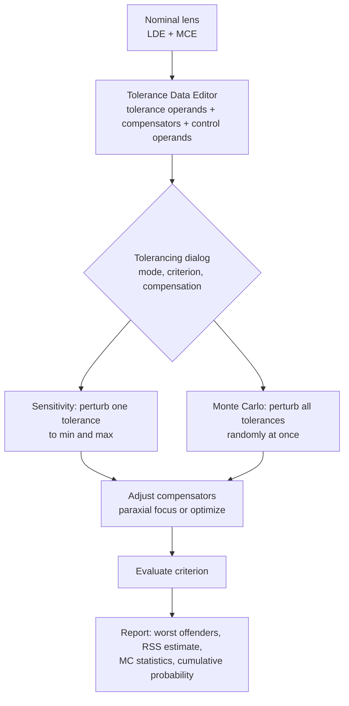

# L02 — The Tolerance Data Editor, compensators and criteria

> **Course 06 · Tolerancing and manufacturing** · Estimated time: lecture ~2.5 h, tasks ~5 h
> **Prerequisites:** [L01 — Manufacturing processes and tolerances](../L01-manufacturing-processes-and-tolerances/); [03/L04 — merit functions](../../03-image-quality-optimization/L04-merit-function-mastery/); [03/L06 — multi-configuration](../../03-image-quality-optimization/L06-multi-configuration-and-zoom/) · **Next:** [L03 — Sensitivity, inverse sensitivity and Monte Carlo](../L03-sensitivity-and-monte-carlo/)

## Learning objectives
- Prepare a lens file for tolerancing (fixed semi-diameters, solves reviewed, ray aiming, symmetric vs non-symmetric fields).
- Generate a tolerance set with the Tolerance Wizard and explain every operand in the Tolerance Data Editor (TDE): TRAD/TFRN/TCUR, TTHI (with its adjust surface), TSDX/TSDY, TSTX/TSTY, TIRX/TIRY, TIRR, TEZI, TEDX/TEDY, TETX/TETY, TIND, TABB, plus the control operands TWAV, COMP, CPAR, STAT and SAVE.
- Translate a fabricator's tolerance table (L01) and a mechanical drawing into TDE values with correct units.
- Choose compensators that correspond to real production adjustments, with realistic ranges, and choose between "Paraxial Focus" and "Optimize All" compensation.
- Choose a tolerancing criterion (RMS spot, RMS wavefront, MTF, boresight, merit function, user script) that matches the specification, and set its sampling and field handling sensibly.
- Inspect what OpticStudio actually does to the lens during tolerancing (saved TSAV and MC files).

## Reading
- **Core:** [Geary §38.3, pp. 436–440] — the manual vs automatic tolerance check of a singlet. Note the obsolete menu names ("Editors > Merit Function Tolerance Data", "Tools > Default Tolerances"): today this is the **Tolerance** ribbon tab → **Tolerance Data Editor**, whose toolbar has the **Tolerance Wizard**, and the **Tolerancing** dialog (Tolerance tab).
- **Core (online):** Ansys Optics KB, "Tolerancing a laser beam expander — an overview of the OpticStudio workflow" — default tolerances, element vs surface tolerances, thickness adjust surfaces, compensators, sensitivity, inverse sensitivity and Monte Carlo on one small example: <https://optics.ansys.com/hc/en-us/articles/42661666289043>
- **Core (online):** Ansys Optics KB, "How to Inspect OpticStudio's internal tolerance models" — the SAVE operand and saved Monte Carlo files: <https://optics.ansys.com/hc/en-us/articles/43071088477587>
- **Online:** Ansys Optics KB, "How to get any optimization operand value in the tolerance report" (tolerance scripts, COMP): <https://optics.ansys.com/hc/en-us/articles/43071055522579>
- **Online:** Zemax Community, "Monte Carlo statistics" — distributions and the STAT operand: <https://community.zemax.com/got-a-question-7/monte-carlo-statistics-171>
- **Optional:** R. Haynes, "Zemax tolerancing tutorial", Univ. of Arizona OPTI 521 (an independent walk-through of the TDE, compensators and Monte Carlo): <https://wp.optics.arizona.edu/optomech/wp-content/uploads/sites/53/2016/10/521.Tutorial.Zemax-Tolerancing.Haynes.pdf>
- **Optional:** OpticStudio Help → "The Tolerance Tab" → "Tolerancing" (the complete operand list; this lesson only covers the everyday ones).

---

## 1. The tolerancing machine in one picture

OpticStudio's tolerancing is a loop around your lens file:

Three ingredients you must design:
1. **What can be wrong** — tolerance operands with min/max values (this lesson, §3–4).
2. **What can be adjusted** — compensators with ranges (§5).
3. **How good is good** — the criterion (§6), which must reflect the specification.

L03 deals with the analysis modes and statistics.

## 2. Preparing the lens file

Most bad tolerancing results come from a lens file that was not ready. Before opening the TDE:

1. **Save a copy** (`..._tol.zmx`); tolerancing runs on the file, saved MC files land in its folder.
2. **Solves.** Every solve in the LDE stays active during tolerancing and therefore acts like a free compensator. A marginal-ray-height solve on the image distance is a *perfect* focus adjustment — fine only if production really adjusts focus that way. An F-number solve on the last radius silently "repolishes" the lens for every trial — never acceptable. Remove curvature solves (convert to fixed values), keep pickups that represent physical identities (e.g. a cemented surface shared by two elements in a multi-pass system).
3. **Semi-diameters.** With "automatic" semi-diameters, a perturbed lens recomputes its apertures and vignetting changes unrealistically. Fix them (convert to Fixed) or define clear apertures; OpticStudio warns about this when tolerancing starts.
4. **Ray aiming** on (Paraxial or Real) for any wide-angle or fast lens; decentered elements move the stop image and without ray aiming the pupil sampling is wrong.
5. **Fields.** Tilts and decenters break rotational symmetry. A lens optimized with fields only along +y must be evaluated at ±y and ±x during tolerancing. The Tolerancing dialog's criterion settings let you choose how fields are used (Y-symmetric, XY-symmetric or user-defined; names vary slightly by version). Use **XY-symmetric** (or define ±x, ±y field points) whenever decenters/tilts are toleranced.
6. **Variables.** Remove all optimization variables (Optimize tab → Remove All Variables). During tolerancing, only compensators may vary.
7. **Merit function.** If your criterion is the merit function (§6), it must contain only what you want to judge — no boundary operands that fight the compensators, no dashboard rows with non-zero weight.

## 3. The Tolerance Data Editor

Open it from the **Tolerance** tab. Each row is an operand with integer arguments (Int1, Int2, …), Nominal, Min, Max and a Comment. The **Tolerance Wizard** at the top of the editor generates a default set ("Default tolerances" in Geary's day).

### 3.1 The Tolerance Wizard defaults
The wizard proposes, for a surface range you choose, tolerances on:
- **Surface:** radius (in lens units or in fringes), thickness, decenter X/Y, tilt X/Y (in degrees or as a runout in lens units), S+A irregularity (fringes) and/or Zernike irregularity;
- **Element:** decenter X/Y, tilt X/Y (degrees);
- **Index** and **Abbe** (Abbe in %);
- options: the test wavelength, start/stop surfaces, and compensator settings (back-focus compensator on the last thickness).

The out-of-the-box values are of the order of: radius 1 fringe (or 0.2 mm), thickness ±0.2 mm, decenter ±0.2 mm, tilt ±0.2 (deg or mm TIR), irregularity 0.2 fringe, index ±0.001, Abbe ±1 % (the beam-expander KB article walks through them). **These are placeholders, not a shop grade:** ±0.2 mm decenter is enormous for an 8 mm camera lens and 1 fringe radius is tight. Always replace them with values from your vendor's table (L01 §5) and your mechanics (L05).

### 3.2 Manufacturing (element-level) operands

| Operand | Meaning | Ints | Typical value source |
|---|---|---|---|
| **TRAD** | radius tolerance, lens units | Int1 = surface | % or mm from fabricator |
| **TFRN** | radius tolerance in fringes (double pass, at the TWAV wavelength, over the surface's semi-diameter) | Int1 = surface | test-plate fringes |
| **TCUR** | curvature tolerance (1/lens units) — convenient for flat or near-flat surfaces | Int1 = surface | |
| **TTHI** | thickness tolerance | Int1 = surface toleranced, Int2 = adjust surface (see below) | CT ±, air-space ± |
| **TIRR** | irregularity in fringes, modelled as a mix of 3rd-order spherical aberration and astigmatism of the surface | Int1 = surface | power/irregularity spec, $3/A(B)$ |
| **TEZI** | irregularity via Zernike terms (more general shapes) | Int1 = surface, Int2/Int3 = term range | measured surface statistics |
| **TSDX/TSDY** | surface decenter (lens units) | Int1 = surface | wedge/centering |
| **TSTX/TSTY** | surface tilt (degrees) | Int1 = surface | wedge/centering |
| **TIRX/TIRY** | surface tilt expressed as a runout in lens units (Total Indicator Runout) | Int1 = surface | ETD from the drawing; check the Help for the exact definition |
| **TIND** | index error | Int1 = surface (glass after it) | glass grade, melt |
| **TABB** | Abbe-number error (absolute; the wizard takes %) | Int1 = surface | glass grade |

**TFRN vs TRAD.** Use fringes for surfaces measured with test plates or interferometers and when the radius is long (L01: fringes ≈ constant cost); use TRAD (or %) for steep surfaces, aspheres, and molded parts. TFRN needs a sensible semi-diameter and the **TWAV** test wavelength (default 0.6328 µm).

**Surface tilt vs decenter on spheres.** A sphere is defined by its centre of curvature; decentering it or tilting it about its vertex both just move the centre of curvature sideways — they are almost degenerate. For spherical surfaces, model wedge with *either* surface tilt (TSTX/TIRX) *or* surface decenter, not both at full value. For an **asphere** both are independent and both are needed (L01).

**TTHI and its adjust surface.** When the centre thickness of element $k$ grows, does everything behind it move back (the next element sits on a spacer that rests on this element's rear face), or does the next element stay put (it sits on its own seat in the barrel)? TTHI's Int2 says which thickness absorbs the change:
- Int2 = the following air space → the change is compensated (the total position of later elements is unchanged). The wizard's default; it mimics mounting each element against a **front-face seat**.
- Int2 = Int1 → no compensation: the whole lens behind moves (spacer stack). The beam-expander KB article describes exactly this switch ("TTHI 2 2").
Choose per element from the mechanical design — L05.

### 3.3 Assembly operands

| Operand | Meaning | Ints |
|---|---|---|
| **TEDX/TEDY** | decenter of an element or group (lens units) | Int1 = first surface, Int2 = last surface |
| **TETX/TETY** | tilt of an element or group (degrees) about a pivot (by default the first surface vertex) | Int1, Int2 |
| **TUDX/TUDY, TUTX/TUTY/TUTZ** | user-defined decenter/tilt on existing coordinate-break surfaces (multi-pass systems, custom pivots) | Int1 = coordinate break |

Element tolerances describe **how the part sits in the barrel**; surface tolerances describe **how the part is made**. A cemented doublet gets TEDX/TETX on the *pair* (both elements together, the barrel error) *and* on the individual elements only if the cementing process allows relative shift (it does — typically a few µm).

Internally, OpticStudio inserts coordinate-break pairs (with solves that restore the axis) for each decenter/tilt — the KB article on internal models shows the generated LDE. Once you have looked at a saved file (Task 4) the whole thing stops being magic.

### 3.4 Control operands (they are rows in the TDE, too)

| Operand | Purpose |
|---|---|
| **TWAV** | test wavelength for fringe-based tolerances (TFRN, TIRR) |
| **COMP** | compensator on a thickness (Int1 = surface), with min/max range |
| **CPAR** | compensator on a surface parameter (Int1 = surface, Int2 = parameter number) — e.g. a coordinate-break decenter for lateral sensor adjustment, or a tilt |
| **CMCO** | compensator on a multi-configuration operand value |
| **STAT** | sets the Monte Carlo statistics (normal/uniform/parabolic/user) for the operands that follow it, until the next STAT |
| **SAVE** | saves the perturbed lens files for the *preceding* tolerance (TSAV_MIN/MAX files) |
| **TMCO** | tolerance on a multi-configuration operand value (e.g. an object distance) |

Non-sequential systems use TNPS/TNPA/TNMA with compensators CNPS/CNPA — Course 05 L06 and the NSC tolerancing KB.

## 4. From shop and mechanics to TDE values

A practical recipe that professionals follow:

1. **Run the wizard** with your chosen grade (not the defaults) to get the structure.
2. **Delete what has no physical meaning:** thickness tolerance on the object distance and the last image gap (that is the compensator); surface tilt on flat surfaces that register against a seat (KB beam-expander example); irregularity on the cover glass if the vendor specifies it; tolerances on dummy and coordinate-break surfaces.
3. **Fix the adjust surfaces of TTHI** from the mechanical stack.
4. **Add what the wizard does not know:** decenter of a cemented interface, sensor tilt (TETX on the image surface, or a tilted coordinate break + TUTX), filter wedge, mounting of the stop, multi-configuration items (TMCO on the object distance if the working distance itself is uncertain).
5. **Label every row** (Comment column) with the drawing reference: "L3 CT", "L3 seat tilt" — the report becomes readable and scripts (Course 07) can find rows.

## 5. Compensators

A compensator is an adjustment made **during assembly or test** that recovers performance. The classic one is focus: the image distance (or the sensor/lens spacing) is set per unit at the MTF bench. Others:
- axial position of one element or group (a "focusing element" in a zoom or high-end lens);
- lateral position of an element (centering lens adjusted while watching an image, L07);
- sensor tilt/shift — **camera-module active alignment** (L07) is a 5–6-axis compensator;
- spacer selection ("select-on-test" from a set of 5 µm steps).

### 5.1 Compensation modes
In the Tolerancing dialog you choose how compensators are adjusted for each trial:
- **Paraxial Focus**: only the back-focus is adjusted, so that the paraxial focus is restored. Fast; correct only if focus is the only compensator *and* paraxial focus is the right focus — it is not when spherical aberration or field curvature change.
- **Optimize All (DLS or OD)**: all compensators are optimized (a few cycles) to minimize the criterion. Realistic, slower.
- **None**: no compensation (useful to see the raw sensitivity).

### 5.2 Ranges matter
A compensator with an unlimited range is a silent cheat. Production has limits: thread travel of an M12 lens, shim set, active-alignment stage travel, adhesive gap (an active-alignment glue line of 50–150 µm typically allows only a few tens of µm of motion). Set Min/Max on every COMP/CPAR, and check after a Monte Carlo run that the compensator statistics stay inside the range (L03).

### 5.3 What the compensator should optimize
If production focuses by maximizing MTF at the centre of the image, but your criterion is average MTF over the field, OpticStudio will choose a different (better) focus than the factory does. That is optimistic. Where the difference matters, use a **tolerance script** or a dedicated merit function to emulate the factory procedure (L07, L08).

## 6. Criteria

The criterion is the single number per trial that OpticStudio reports and builds statistics on. Options (names as in the dialog; exact list varies by version):

| Criterion | Use when | Notes |
|---|---|---|
| RMS Spot Radius (X, Y, radial) | geometric-aberration-limited systems (blur ≫ Airy) | fast, robust |
| RMS Wavefront | near-diffraction-limited systems | connects to Strehl/Maréchal (03/L03) |
| Merit Function | the criterion is a custom MF you built | most flexible; must be clean (§2.7) |
| Geometric / Diffraction MTF (average, tangential, sagittal) at a frequency | camera lenses with MTF specs | diffraction MTF is slow; MTF can be noisy at low sampling |
| Boresight Error | pointing/line-of-sight; image shift of the chief ray | important for calibrated 3D cameras: shifts the principal point |
| Diffraction encircled energy, User Script | fibre coupling; custom metrics | scripts (.tsc) can evaluate anything |

Settings that change the answer:
- **Sampling** (rays or pupil grid): too low → noisy criterion, dominates small tolerance effects. Check by running the nominal at two samplings.
- **Fields** (Y- vs XY-symmetric, user defined, see §2.5) and **configurations** (all at once or each separately; with multi-config the criterion is computed over all configurations by default).
- **Comp** mode and **cycles** for optimize-all.

**Which criterion for a camera lens?** The spec is MTF at specific frequencies (e.g. 36.2 lp/mm for the Course 04 capstone fringes). Tolerancing directly on Diffraction MTF Average at that frequency is honest but slow. A common professional compromise: run sensitivity and Monte Carlo with **RMS wavefront** (fast, smooth, Optimize-All compensators), then check the Monte Carlo files at the yield-relevant percentiles with MTF, or use a merit function with MTFT/MTFS operands at the spec frequency as criterion for the final run (L08).

## 7. In OpticStudio — a session checklist

1. Tolerance tab → Tolerance Data Editor → **Tolerance Wizard**: set surface range, values, test wavelength; OK.
2. Edit the TDE (§4); add **COMP**/**CPAR** rows with ranges; label rows.
3. Tolerance tab → **Tolerancing**: Set-Up (mode = Sensitivity first), Criterion (criterion, sampling, comp mode, fields, configs), Monte Carlo (number of runs, number to save, statistics), Display.
4. Run. Read the report top to bottom once; save it as text (it is long).
5. Save the `.zmx` — the TDE is stored in it (you can also save/load `.tol` tolerance files from the TDE). The settings of the Tolerancing dialog can be saved as a `.top` file.

Pitfalls seen most often:
- forgetting XY-symmetric fields → decenters look harmless;
- solves acting as compensators;
- defaults left at ±0.2 mm;
- focus compensator with ±∞ range;
- TFRN on a lens with a wrong (automatic, oversized) semi-diameter → wrong ΔR;
- double-counting wedge with both surface decenter and tilt on spheres.

## Worked example — a precision-grade TDE for an 8 mm camera lens

Take the Course 04 M12 lens (EFL 8 mm, element Ø ≈ 7 mm clear aperture). The vendor offers "precision" (L01 §5): radius 3 fringes at 632.8 nm, CT ±0.05 mm (glass) and ±0.02 mm (spacers), irregularity 0.5 fringe, wedge ETD 0.01 mm, index ±0.0005, Abbe ±0.5 %. The barrel bore is Ø D +0.010/0 and the lenses Ø D 0/−0.010 mm. Spacer faces are parallel to 0.005 mm over Ø7 mm.

**Radius.** TFRN 3 fringes over Ø7 mm means (exact sag, `tolconv.py` from L01):
- $R$ = 6 mm: ΔR = 0.0041 mm (0.07 %),
- $R$ = 12 mm: ΔR = 0.021 mm (0.17 %),
- $R$ = 25 mm: ΔR = 0.096 mm (0.38 %).
Using TFRN = 3 for all is consistent with how the shop works; if a shop quotes "±0.1 %" instead, the steep $R$ = 6 mm surface would actually be *looser* than 3 fringes (0.1 % = 0.006 mm) and the $R$ = 25 surface much *tighter*. Ask which they mean.

**Wedge.** ETD 0.01 mm over Ø7 → tilt 0.01/7 rad = 0.082° (4.9 arcmin) as TSTX/TSTY on one surface of each element (the second surface, relative to the first, which is the reference for edging). Do not also add TSDX at full value (degenerate for spheres).

**Element decenter.** Maximum diametral clearance = 0.010 + 0.010 = 0.020 mm → maximum radial decenter 0.010 mm. TEDX = TEDY = ±0.010 mm. (In Monte Carlo, independent normal X and Y with ±2σ = ±0.010 give a radial decenter whose 95th percentile is about 0.012 mm — slightly *more* than the physical maximum; L03 discusses why some engineers then use ±0.007 mm per axis or a uniform distribution.)

**Element tilt.** Spacer parallelism 0.005 mm over Ø7 → 0.041° → TETX = TETY = ±0.04°.

**Thickness.** TTHI on glass CT ±0.05 with Int2 = following air space if the next element has its own seat, Int1 = Int2 if it is a stacked spacer design (typical for M12 lenses: all elements and spacers stacked against a front shoulder and held by a retainer — every CT error then moves everything behind it, but the focus compensator absorbs most of the *common* shift).

**Compensator.** COMP on the image distance (thread focus), range ±0.10 mm. Rough check of the needed range: a precision index error ±0.0005 on one positive element of power ≈ the system power and $n \approx 1.7$ changes the focal length by ≈ $f\,\Delta n/(n-1) = 8\times0.0005/0.7$ ≈ 6 µm; radius and thickness errors of similar size on 4–6 elements, added in quadrature, plus the object-distance range, stay well inside ±0.1 mm. The Monte Carlo compensator statistics (L03) will confirm.

**Counting.** A 5-element air-spaced lens with 10 surfaces gets roughly: 10 TFRN + 10 TIRR + 10 surface-tilt pairs (20) + 5 element decenter pairs (10) + 5 element tilt pairs (10) + ~9 TTHI + 5 TIND + 5 TABB ≈ 80 tolerance operands. That is typical; sensitivity runs take seconds to minutes, and the number matters for Monte Carlo sample size (L03).

## Key takeaways
- Prepare the file: remove variables, review solves, fix semi-diameters, ray aiming on, XY-symmetric fields when decenters are toleranced.
- Wizard defaults are placeholders; replace them with your vendor's grade and your mechanical stack.
- Element operands (TEDX/TETX) are assembly errors; surface operands (TSDX/TSTX/TIRX, TFRN/TRAD, TIRR) are fabrication errors. On spheres, wedge is one degree of freedom.
- TTHI's adjust surface encodes how the barrel is built — decide it from mechanics.
- Every compensator must be a real production adjustment with a real range.
- The criterion must represent the specification; a fast proxy (RMS wavefront) is fine for exploration, but check the final yield against the true spec (MTF).

## Glossary (new terms in this lesson)
| Term | Meaning |
|---|---|
| TDE | Tolerance Data Editor; rows of tolerance, compensator and control operands |
| Tolerance Wizard | Generates a default tolerance set from chosen values |
| Compensator | Parameter adjusted during assembly/test to recover performance (COMP, CPAR, CMCO) |
| Criterion | Single performance number evaluated for each perturbed system |
| Adjust surface | TTHI Int2: the thickness that absorbs a thickness change |
| TIR (runout) | Tilt expressed as a length (indicator runout) rather than an angle |
| Element vs surface tolerance | Placement of a whole part in the barrel vs errors in making one surface |
| Boresight error | Shift of the image of the axial/chief ray (line of sight) caused by perturbations |
| TSAV / MC files | Lens files written by SAVE (single tolerance) or the Monte Carlo "number to save" setting |

## References
1. [Geary §38.3, pp. 436–440] — tolerancing a singlet manually and automatically.
2. Ansys Optics KB, "Tolerancing a laser beam expander: overview of the OpticStudio workflow": <https://optics.ansys.com/hc/en-us/articles/42661666289043>
3. Ansys Optics KB, "How to inspect OpticStudio's internal tolerance models" (SAVE, MC files): <https://optics.ansys.com/hc/en-us/articles/43071088477587>
4. Ansys Optics KB, "How to get any optimization operand value in the tolerance report": <https://optics.ansys.com/hc/en-us/articles/43071055522579>
5. Ansys Optics KB, "How to tolerance for tilts and decenters of a double pass system" (TUDX/TUTX on coordinate breaks): <https://optics.ansys.com/hc/en-us/articles/43071118693139>
6. Ansys Optics KB, "How to perform a non-sequential tolerance analysis" (TNPS/TNPA/TNMA, CNPS/CNPA): <https://optics.ansys.com/hc/en-us/articles/43071055481363>
7. Ansys Optics KB, "ISO Element Drawing" (which TDE operands feed the drawing): <https://optics.ansys.com/hc/en-us/articles/43071071251475>
8. Zemax Community, "Monte Carlo statistics": <https://community.zemax.com/got-a-question-7/monte-carlo-statistics-171>; "STAT command vs Monte Carlo settings": <https://community.zemax.com/got-a-question-7/stat-command-vs-monte-carlo-settings-4596>
9. R. Haynes, OPTI 521 Zemax tolerancing tutorial, Univ. of Arizona: <https://wp.optics.arizona.edu/optomech/wp-content/uploads/sites/53/2016/10/521.Tutorial.Zemax-Tolerancing.Haynes.pdf>
