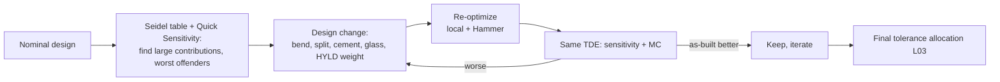

# L04 — Desensitization and as-built performance

> **Course 06 · Tolerancing and manufacturing** · Estimated time: lecture ~2.5 h, tasks ~6 h
> **Prerequisites:** [L03 — Sensitivity and Monte Carlo](../L03-sensitivity-and-monte-carlo/); [02/L08 — Seidel surface contributions](../../02-aberrations-classical-design/L08-seidel-surface-contributions/); [03/L05 — optimization strategies](../../03-image-quality-optimization/L05-optimization-strategies-and-global-search/) · **Next:** [L05 — Opto-mechanics and CAD integration](../L05-opto-mechanics-and-cad-integration/)

## Learning objectives
- Explain physically why some designs are sensitive: large, mutually cancelling surface aberration contributions and steep angles of incidence.
- Derive and use the rule that a lateral shift $\delta$ of a surface (or element) converts its spherical-aberration contribution $W_{040}$ into axial coma of magnitude $4W_{040}\,\delta/h$, and predict which elements are decenter-sensitive from the Seidel table.
- Apply desensitization levers: lower angles of incidence, lens splitting, cemented vs air-spaced groups, index choice, symmetry, compensator-friendly architectures, aspheres with care.
- Use OpticStudio's tolerance-aware optimization: the HYLD operand ("Improve Manufacturing Yield" in the Optimization Wizard), the TOLR operand, and multi-start comparison of candidate designs by as-built performance.
- Compare two designs with equal nominal performance by their Monte Carlo as-built distributions and choose the better one for production.

## Reading
- **Core:** [Kidger §7.3.5, p. 156] — splitting a lens into two reduces its spherical aberration by about 4× ($S_1 \propto h^4K^3$).
- **Core:** [Kidger §9 (field-flattened Petzval), p. 192] — "large angles of incidence of any ray on a steep surface is a sure sign that the aberrations may be excessive and that manufacturing tolerances will be tight" (a one-line summary of this lesson).
- **Core:** [Kidger Ch. 8 intro p. 167 and end of §8 pp. 182–183] — cemented vs split doublets: the cemented surface has much smaller aberrations, so tolerances are easier and the lens is more robust; the split doublet's air space is very sensitive.
- **Core:** [Kidger §7.7.2, p. 165] — front-to-back symmetry cancels odd aberrations (coma, distortion, lateral colour) — and, as a bonus, often reduces sensitivity.
- **Core (online):** Ansys Optics KB, "High-Yield Optimization: designing for as-built performance with the HYLD operand": <https://optics.ansys.com/hc/en-us/articles/43071054749459>
- **Core (online):** Ansys Optics KB, "Optimizing for as-built performance with the TOLR operand": <https://optics.ansys.com/hc/en-us/articles/42661801770003>
- **Optional:** Zemax Community, "Improving manufacturing yield" (what HYLD does): <https://community.zemax.com/got-a-question-7/improving-manufacturing-yield-476>; Novus Light announcement of High-Yield Optimization (19.8): <https://www.novuslight.com/new-in-opticstudio-high-yield-optimization_N9759.html>

---

## 1. Why are some designs sensitive?

Two designs can have identical nominal MTF and very different as-built MTF. The difference is in *how* the aberrations are corrected. Every refracting surface contributes aberrations (02/L08: Seidel surface contributions); the image sees their sum. A design can reach a small sum either because every contribution is small, or because large contributions of opposite sign cancel.

Cancellation is fragile. A manufacturing error changes one surface's contribution, or shifts it relative to its partners, and the cancellation is broken. The perturbation is roughly proportional to the size of the contributions involved — not to the size of the residual. Hence:

> **Sensitivity scales with the magnitude of the individual aberration contributions, not with the nominal residual.**

Large contributions come from large angles of incidence on steep surfaces (the aberration of a surface grows quickly with the incidence angle — Snell's law is non-linear). Kidger's remark about the field-flattened Petzval says exactly this. The HYLD operand in OpticStudio penalizes precisely these large ray angles (§4.1).

### 1.1 Decenter converts spherical aberration into coma
Consider a surface whose spherical-aberration contribution is $W_{040}\rho^4$ in the normalized pupil of the beam passing it, and whose marginal-ray height on that surface is $h$. Decenter the surface by $\delta$ in $x$: relative to the surface, the beam is shifted by $-\delta$, i.e. the surface sees pupil coordinates shifted by $\varepsilon = \delta/h$. Its contribution becomes

$$
W_{040}\,|\boldsymbol\rho + \boldsymbol\varepsilon|^4 = W_{040}\left(\rho^2 + 2\varepsilon\rho\cos\theta + \varepsilon^2\right)^2
= W_{040}\rho^4 + 4W_{040}\,\varepsilon\,\rho^3\cos\theta + O(\varepsilon^2).
$$

The new term $4W_{040}\varepsilon\,\rho^3\cos\theta$ is **coma that is present on axis** (constant over the field) — the classic signature of a decentered element: the on-axis MTF becomes asymmetric and the best-focus image shows a comatic flare. After the best-fit tilt is removed, its RMS is

$$
W_\text{RMS} = \frac{4\,|W_{040}|\,\delta/h}{3\sqrt 8} \approx 0.471\,|W_{040}|\,\frac{\delta}{h}.
$$

(The $O(\varepsilon^2)$ terms give a little astigmatism and defocus.) Likewise the surface's coma contribution, shifted, produces astigmatism that varies linearly with field, and its astigmatism produces field tilt. The general theory is *nodal aberration theory* (Shack and Thompson) — you do not need it to use the rule of thumb:

- **Element decenter** moves both surfaces together: the induced axial coma follows from the *element's* total $W_{040}$ (both surfaces at similar $h$).
- **Surface decenter / wedge** moves one surface relative to the other: the *surface's* own $W_{040}$ matters — which can be much larger than the element total, if the element's two surfaces cancel each other.

So the Seidel table (OpticStudio: Analyze → Aberrations → **Seidel Coefficients**, which also lists the per-surface wavefront coefficients $W_{040}, W_{131}, W_{222}, \dots$ in waves) is a sensitivity predictor you can read *before* tolerancing. Look for surfaces with large $|W_{040}|$ and $|W_{131}|$ relative to the total.

### 1.2 Other sensitivity sources
- **Tight air spaces between strong surfaces** of opposite power (a split doublet's central gap, Kidger pp. 182–183): small spacing errors change large ray-height-dependent aberrations.
- **Large ray bending in one element** (high power concentrated in a single lens): power errors and decenters of that element dominate.
- **Fast beams at an asphere far from the stop**: asphere decenter produces coma and astigmatism with large coefficients.
- **High-order aberration balancing**: a design that balances 3rd, 5th and 7th order spherical aberration against each other with large individual terms degrades rapidly with any perturbation.
- **Field-dependent critical surfaces** near the image (field flatteners) are usually *insensitive* to decenter (small footprint per field) but sensitive to tilt (image tilt, asymmetric field curvature).

## 2. Design levers that reduce sensitivity

| Lever | Why it works | Cost |
|---|---|---|
| Lower angles of incidence (bend surfaces to be closer to aplanatic/concentric with the rays) | smaller per-surface contributions | sometimes more elements |
| **Split** a strong element into two [Kidger §7.3.5] | $S_1 \propto h^4K^3$: two halves give ~1/4 the spherical aberration | one more element, more interfaces, longer |
| **Cement** instead of air-space [Kidger pp. 182–183] | the cemented interface has small index difference → small contributions; one less critical air space; element-to-element decenter fixed by cementing | fewer degrees of freedom; cemented interface thermal stress |
| Higher-index glasses | flatter surfaces for the same power | cost, transmission in the blue/NIR, density, $dn/dT$ |
| **Symmetry** about the stop [Kidger §7.7.2] | odd aberrations cancel by structure, not by tuning | layout constraints |
| Distribute power evenly | no single critical element | — |
| Put the sensitivity where a compensator is | e.g. make the focus-adjustable group the one with the largest power errors; or make one element laterally adjustable | assembly step |
| Fewer surfaces near the stop with large $W_{040}$ | stop-near surfaces see the full beam at every field | — |
| Aspheres | can *replace* strong cancelling spherical pairs by one gentle surface → less sensitive; *or* create new sensitivity (decenter) | asphere centration tolerance |
| Avoid deep "high-order balancing" solutions | robust minima are smoother | some nominal performance |

A practical professional habit: after every major optimization, run **Quick Sensitivity** (or a sensitivity run with paraxial focus and 0 MC trials) and track the RSS estimate next to the merit function — like tracking a second objective.

## 3. Comparing designs by as-built performance

Global optimization (Hammer, Global Search) produces many candidate designs with similar merit functions. Choose among them by *as-built* performance:

1. Save the top 5–10 candidates (Global Search saves them for you).
2. Apply **the same** TDE (same vendor grade, same mechanical model) and the same criterion and compensators to each.
3. Run sensitivity + Monte Carlo (≥ 200 trials, fixed statistics).
4. Compare distributions (median, 90th percentile, yield at spec), not nominal values.
5. Look at *why* the winner wins (Seidel contributions, worst offenders) — this is how you learn design judgement.

The Ansys KB High-Yield article gives a published example of exactly this comparison for a 9-element F/3 lens optimized two ways (numbers from the article, RMS spot radius):

| Metric | Traditional optimization | High-yield optimization |
|---|---|---|
| Nominal RMS spot | 1.65 µm | 3.8 µm |
| As-built RMS (RSS estimate) | 81.9 µm | 22.9 µm |
| Monte Carlo mean (500 systems) | 38.1 µm | 16.0 µm |
| 90 % of systems below | 55.8 µm | 23.1 µm |

The nominally "worse" design is more than twice as good as built. In a Zivid-style context — tens of thousands of camera modules, each calibrated but never re-focused in the field — it is the as-built distribution and its stability (L05) that determine 3D-point accuracy and yield.

## 4. Tolerance-aware optimization in OpticStudio

### 4.1 HYLD — High-Yield Optimization
- Optimization Wizard → check **Improve Manufacturing Yield** (with a weight): the wizard adds a **HYLD** operand to the merit function.
- HYLD penalizes large angles of incidence/exitance at every surface, using the same rays as the image-quality criterion — a cheap proxy for tolerance sensitivity (no extra ray tracing, so no speed penalty).
- Available in OpticStudio 19.8 and later, **Professional and Premium** subscription editions (Premium ✓).
- Use: start from a working design, add HYLD with moderate weight (the KB case study used 10), re-optimize (local, then Hammer/Global), and compare as-built performance with the previous design. Scan the weight (e.g. 0, 3, 10, 30): nominal performance drops slowly while sensitivity drops quickly — until it doesn't. Pick the knee.

### 4.2 TOLR — the tolerance estimate inside the merit function
- Set up a complete tolerancing run (TDE, criterion, compensators), save the dialog settings as `TOLRnnn.TOP` (nnn = 1…999) in the `{Zemax}/Configs` folder, and add a **TOLR** operand referencing that file number to the merit function.
- Its data item selects: 1 = nominal criterion, 0 = estimated change (RSS), 2 = nominal + change. Targeting item 2 to zero optimizes the *estimated as-built* criterion.
- It runs a sensitivity analysis at every merit-function evaluation → slow. Remove insignificant tolerances first, use few optimization cycles, many cores. The KB doublet example improved the estimated as-built RMS spot from ~120 µm to ~79 µm at the expense of nominal performance.
- Remember L03 §2.2: the RSS estimate is a heuristic. Verify the final design with Monte Carlo.

### 4.3 Perturbed multi-configuration optimization
A transparent alternative you control fully: add configurations in which the most sensitive parameters (from the worst-offender list) are perturbed to ± their tolerances (e.g. element 3 decentered +δ and −δ in x and y via coordinate breaks; or a thickness changed), give each configuration its own focus compensator variable (CMCO-like: a per-configuration image distance), and optimize the sum of image quality over all configurations. The design learns to be robust to exactly the errors you included. Cost: one configuration per included perturbation; useful for the 3–6 worst offenders.

### 4.4 Choosing the criterion of robustness
- Robust MTF at the spec frequency across the depth range (Course 04 capstone): HYLD is generic; TOLR can use your MTF criterion directly; perturbed multi-config can include object distances too.
- Robust boresight/distortion stability (calibrated 3D cameras): include REAY/boresight checks in perturbed configurations.

## 5. In OpticStudio — a desensitization loop

Pitfalls:
- Comparing designs with different TDEs, criteria or compensator ranges.
- Declaring victory on the RSS estimate (or TOLR value) alone.
- Losing first-order constraints (EFL, BFL, CRA) while chasing robustness — keep the full merit function.
- Over-weighting HYLD until the nominal fails spec.

## Worked example — predicting decenter sensitivity from the Seidel table

Two versions of an 8 mm F/2.4 lens at 850 nm (stop semi-diameter $h \approx$ 1.67 mm; the elements next to the stop have marginal-ray heights close to $h$). The Seidel wavefront table shows for element L2 (next to the stop):

| | Surface 3 $W_{040}$ | Surface 4 $W_{040}$ | Element total |
|---|---|---|---|
| Design A | +9.0 waves | −6.0 waves | +3.0 waves |
| Design B | +3.5 waves | −2.5 waves | +1.0 wave |

(Illustrative values of the size found in fast camera lenses; both designs have the same nominal performance because other elements balance the totals.)

**Element decenter** δ = 0.010 mm (precision barrel, L02): ε = δ/h = 0.0060.
- A: induced coma coefficient $4\cdot3.0\cdot0.0060$ = 0.072 waves → RMS = 0.072/(3√8) = **0.0085 waves**.
- B: **0.0028 waves**.

At the commercial value δ = 0.025 mm (ε = 0.015): A 0.0212 waves, B 0.0071 waves RMS.

**Surface decenter (wedge)** of surface 4 by 0.005 mm (ε = 0.0030), the element's other surface fixed:
- A: $4\cdot6.0\cdot0.0030/(3\sqrt8)$ = 0.0085 waves; B: 0.0035 waves.

All four elements of a lens contribute such terms in quadrature (×2 for x and y), plus tilts. If Design A ends up with, say, ten contributors of ~0.02 waves RMS at commercial tolerances, they add $\sqrt{10}\cdot0.02$ ≈ 0.063 waves — nearly the whole Maréchal budget of 0.07 waves; Design B's ~0.007-wave contributors add to ~0.022 waves. For Design A to match B's as-built performance, its decenter tolerances would have to be ~3× tighter: from commercial (0.025 mm) to about 0.008 mm — beyond "precision". That is the money a desensitized design saves on every unit.

(The RMS formula was checked numerically by fitting and removing piston, tilt and defocus from $W_{040}|\boldsymbol\rho+\boldsymbol\varepsilon|^4 - W_{040}\rho^4$ on a 801 × 801 pupil grid: agreement to 4 significant figures.)

## Key takeaways
- Sensitivity follows the size of individual aberration contributions and the steepness of ray incidence, not the nominal residual.
- A decentered surface turns its spherical aberration into axial coma: $W_\text{RMS} \approx 0.47\,|W_{040}|\,\delta/h$. Read the Seidel table as a sensitivity map.
- Desensitize with lower incidence angles, splitting, cementing, higher index, symmetry, and by placing sensitivity where a compensator acts.
- HYLD (cheap proxy, Professional/Premium), TOLR (estimated as-built, slow) and perturbed multi-config optimization build robustness into optimization.
- Compare candidate designs by as-built distributions with identical tolerance models — the nominally best design is often not the best product.

## Glossary (new terms in this lesson)
| Term | Meaning |
|---|---|
| Desensitization | Design changes that reduce the performance change per unit manufacturing error |
| As-built performance | Distribution of performance over manufactured units (Monte Carlo) |
| Aberration contribution | A single surface's part of a Seidel (or higher-order) sum |
| Nodal aberration theory | Theory of aberration fields in systems with decentered/tilted components (Shack, Thompson) |
| HYLD | Merit-function operand penalizing large ray angles at surfaces (High-Yield Optimization) |
| TOLR | Merit-function operand returning a tolerance-analysis result from a saved TOLRnnn.TOP setup |
| Perturbed multi-configuration | Configurations with deliberately perturbed parameters, optimized jointly for robustness |

## References
1. [Kidger §7.3.5, p. 156] — splitting lenses reduces spherical aberration.
2. [Kidger §7.7.2, p. 165] — front-to-back symmetry.
3. [Kidger Ch. 8, p. 167 and pp. 182–183] — cemented vs split doublets and their tolerances.
4. [Kidger Ch. 9, p. 192] — large angles of incidence imply tight tolerances.
5. Ansys Optics KB, "High-Yield Optimization (HYLD)": <https://optics.ansys.com/hc/en-us/articles/43071054749459>
6. Ansys Optics KB, "Optimizing for as-built performance with TOLR": <https://optics.ansys.com/hc/en-us/articles/42661801770003>
7. Zemax Community, "Improving manufacturing yield": <https://community.zemax.com/got-a-question-7/improving-manufacturing-yield-476>
8. Novus Light, "New in OpticStudio: High-Yield Optimization": <https://www.novuslight.com/new-in-opticstudio-high-yield-optimization_N9759.html>
9. Zemax Community, "Using more than 1 TOLR operands" (TOLR data items in practice): <https://community.zemax.com/got-a-question-7/using-more-than-1-tolr-operands-474>
