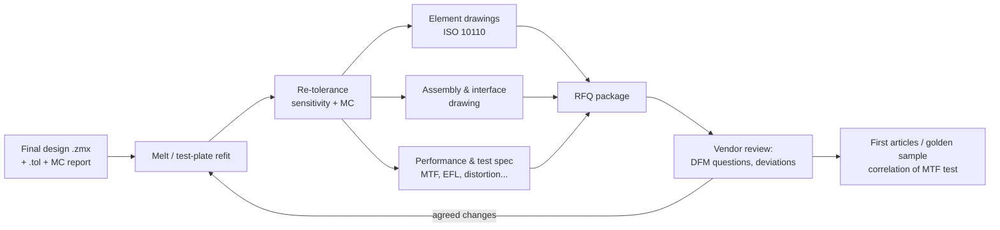

# L06 — Drawings, ISO 10110 and vendor hand-off

> **Course 06 · Tolerancing and manufacturing** · Estimated time: lecture ~2.5 h, tasks ~5–6 h
> **Prerequisites:** [L01 — manufacturing processes and tolerances](../L01-manufacturing-processes-and-tolerances/) (units: fringes, ETD, wedge), [L02 — TDE and compensators](../L02-tolerance-data-editor-and-compensators/), [L03 — sensitivity and Monte Carlo](../L03-sensitivity-and-monte-carlo/), [L05 — opto-mechanics](../L05-opto-mechanics-and-cad-integration/) · **Next:** [L07 — Alignment and active alignment](../L07-alignment-and-active-alignment/)

## Learning objectives
- Read and write the ISO 10110 coded indications **0/ to 6/** (stress birefringence, bubbles, inhomogeneity/striae, surface form, centring, surface imperfections, laser damage) and the three-field drawing layout.
- Translate Tolerance Data Editor rows (TFRN/TRAD, TIRR, TSTX/TSTY, TSDX/TSDY, TTHI, TIND/TABB, TWAV) into drawing callouts and back, including the change of test wavelength (632.8 nm ↔ 546.07 nm) and per-axis ↔ radial centring statistics.
- Compare ISO 10110-7 surface-imperfection notation with MIL-PRF-13830B scratch–dig, and explain why the two cannot be converted exactly.
- Generate an element drawing with OpticStudio's **ISO Element Drawing** tool, and know which fields it fills automatically and which you must fill.
- Run **Test Plate Fitting** against a vendor test-plate list and judge whether the fitted design is still acceptable.
- Fit glass **melt data** to a dispersion correction, put it in a user catalog, and re-optimize/refocus before fabrication.
- Assemble a complete vendor hand-off / RFQ package for a mass-produced camera lens, including an MTF acceptance specification.

## Reading
- **Core:** [Geary §6.2.5, p. 55] — melt data: catalogue indices are approximate (differences "in the third decimal place on out"); for sensitive designs re-tweak with the measured melt *before* grinding starts. Also [Geary §38.3, p. 436] — a design is not finished until it is toleranced and adjusted to melt data and measured parts.
- **Core (online):** Ansys Optics KB, "Creating ISO 10110 element drawings in OpticStudio: a singlet example" — what the ISO Element Drawing tool imports from the TDE: <https://optics.ansys.com/hc/en-us/articles/43071071251475>
- **Core (online):** J. Lane, "Tutorial on ISO 10110 Optical Drawing Standards" (Univ. of Arizona OPTI 521, 2009) — all coded indications with examples: <https://wp.optics.arizona.edu/optomech/wp-content/uploads/sites/53/2016/10/Tutorial-on-ISO-10110-Optical-Drawing-Standards.pdf>
- **Core (online):** LAYERTEC, "Surface form tolerances" — current ISO 10110-5 notation with RMS terms and the requirement to state the wavelength: <https://www.layertec.de/en/knowledge/knowhow-surface-form-tolerances/>
- **Online:** D. Aikens, "New options for optical quality tolerances" (IODC 2017) — ISO 10110-7:2017 dimensional and visibility methods vs MIL-PRF-13830B: <https://www.savvyoptics.com/files/D-Aikens-New-options-for-optical-quality-tolerances-IODC-17.pdf>
- **Online:** ISO 10110-7:2017 sample pages (iTeh) — grade series, C/L/E/W notation: <https://cdn.standards.iteh.ai/samples/65444/3189fea30d58482e9c216521311cf0dc/ISO-10110-7-2017.pdf>
- **Online:** Crystran, "Explanation of optical drawing standard ISO 10110" — a compact worked drawing: <https://www.crystran.com/news/post/explanation-of-optical-drawing-standard-iso-10110>
- **Online:** J. H. Burge, "Specifying optical components" (Univ. of Arizona slides) — test plates, typical tolerances: <https://wp.optics.arizona.edu/optomech/wp-content/uploads/sites/53/2016/08/10-Specifying-optical-components.pdf>
- **Online:** SCHOTT, "Optical glass — technical details" — nd/νd tolerance steps and test reports: <https://www.schott.com/en-bg/products/optical-glass/technical-details>
- **Online:** Optikos, "Compensation methods for glass tolerances" — melt-fit compensation by air spaces vs radii, with Monte Carlo numbers: <https://www.optikos.com/compensation-methods-for-glass-tolerances-performance-and-manufacturing-considerations/>
- **Optional:** T. Zwinger (Excelitas), "Enhancing image quality with melt-fit technology", Vision Systems Design 2025: <https://vision-systems.com/cameras-accessories/article/55332620/enhancing-image-quality-with-melt-fit-technology-customizing-optics-to-material-variations>

> **About the standard itself.** ISO 10110 is a paid standard in ~20 parts that is revised piecemeal (e.g. Part 5 in 2015, Part 7 in 2017, Part 1 in 2019, Part 14 in 2018). Everything below is taken from the public summaries listed above. When a drawing is contractual, buy the current parts your company uses and check against them — and write the edition on the drawing ("ISO 10110-5:2015").

---

## 1. Why a drawing, and who writes it

By the end of L05 your design lives as a `.zmx` file plus a `.tol` file and a Monte Carlo report. None of these is a manufacturing document. A lens shop needs, per element, an unambiguous statement of **what to make and how it will be inspected** — and nothing else. That is the element drawing. The system-level documents (assembly drawing, performance test spec, packaging) come on top.

Geary puts the order of work bluntly: tolerance, then use "melt data, spherometer, thickness and spacing measurements … to tweak the design so that the 'as built' lens will still meet the specifications" [Geary §38.3, p. 436], and do the melt tweak "before the optical shop actually starts grinding and polishing" [Geary §6.2.5, p. 55]. Drawings, test-plate fitting and melt fitting are therefore **the last design iteration**, not paperwork after the design.

**Who writes the element drawings at Zivid-type companies.** For compact camera and projector lenses made in volume, three models are common:

| Model | Who owns element drawings | What you must deliver | What you must be able to read |
|---|---|---|---|
| **Build-to-print** | You | Element drawings, assembly drawing, test spec | Vendor's deviation requests |
| **Co-design** (common for Zivid) | Vendor, from your prescription | Prescription, tolerance budget, system spec & test spec | Vendor's element drawings (to approve them) |
| **Catalogue/custom-from-vendor** | Vendor | System spec only | Vendor's datasheet and test report |

Even when the vendor draws the elements, you approve those drawings — so you must read ISO 10110 fluently and recognise when a callout is looser than your tolerance analysis assumed.

## 2. The ISO 10110 drawing

### 2.1 Layout
ISO 10110 drawings put the element cross-section in the middle and a **three-field table** above the title block: left surface | material | right surface [Lane; Crystran]. Dimensions that belong on the picture (thickness, diameter, chamfers, datum) go on the picture; surface and material specs go in the table.

```
            ┌────────────────────────────────────────────────┐
            │            cross-section with:                 │
            │   CT 2.80 ±0.03   Ø9.00 -0.02   datum A (OD)   │
            │   ⌀e (clear apertures)   protective chamfers   │
            ├────────────────┬──────────────┬────────────────┤
            │ LEFT SURFACE   │ MATERIAL     │ RIGHT SURFACE  │
            │ R  12.50 CX    │ N-SK16       │ R  30.00 CX    │
            │ ⌀e 7.0         │ nd 1.62041   │ ⌀e 7.4         │
            │ coating spec   │ ±0.0005      │ coating spec   │
            │ 3/ 3(0.5)      │ νd 60.32     │ 3/ 3(0.5)      │
            │ 4/ –  (datum)  │ ±0.5 %       │ 4/ 1.5'        │
            │ 5/ 3×0.16;     │ 0/ 20        │ 5/ 3×0.16;     │
            │    L1×0.010;   │ 1/ 3×0.16    │    L1×0.010;   │
            │    E0.3        │ 2/ 1;1       │    E0.3        │
            │ λ = 632.8 nm   │              │ λ = 632.8 nm   │
            ├────────────────┴──────────────┴────────────────┤
            │ title block: part no., rev, ISO 10110 editions │
            └────────────────────────────────────────────────┘
```
(Values are those of the worked example; "CX" = convex. The notes in the table are illustrative. Radius *signs* are not used on ISO drawings — CX/CC describes each surface as seen from outside the part.)

### 2.2 The coded indications
Each coded indication has a number followed by a slash. The current numbering, checked against Lane (2009), Burge, Crystran and the ISO 10110-7:2017 sample pages:

| Code | ISO 10110 part | Meaning | Notation | Example |
|---|---|---|---|---|
| **0/** | Part 2 | Stress birefringence | `0/A`, A = max optical path difference in **nm per cm** of path | `0/20` |
| **1/** | Part 3 | Bubbles and inclusions | `1/N×A`, N inclusions of grade A (A = √area in mm) | `1/3×0.16` |
| **2/** | Part 4 | Inhomogeneity and striae | `2/A;B`, A = inhomogeneity class, B = striae class | `2/1;1` |
| **3/** | Part 5 | Surface form tolerance | `3/A(B/C)` [+ RMS terms], in fringes unless units given | `3/3(0.5)` |
| **4/** | Part 6 | Centring tolerance | `4/σ`, tilt angle of the surface relative to the datum axis (′ or ″) | `4/1.5'` |
| **5/** | Part 7 | Surface imperfections | `5/N×A; C N′×A′; L N″×A″; E A‴` (dimensional) or `5/S–D` (visibility, since 2017) | `5/3×0.16; L1×0.010; E0.3` |
| **6/** | Part 17 (older documents: Part 13) | Laser irradiation damage threshold | threshold, wavelength, pulse data | rarely on camera lenses |

Other parts have no code number but appear on the drawing: Part 8 (surface texture: ground/polished, roughness $R_q$), Part 9 (surface treatment and coating — a coating symbol on the surface with a reference to the coating spec), Part 11 (default tolerances for anything not specified — never rely on them; specify everything that matters), Part 12 (aspheric surface equations), Part 14 (wavefront deformation tolerance, for system-level or transmitted-wavefront specs), Part 19 (general surface/freeform description). Assembly-level imperfections use 15/ in ISO 10110-7:2017.

> **Note on the brief's code numbers.** The list "0/ birefringence, 1/ bubbles & inclusions, 2/ inhomogeneity & striae, 3/ surface form, 4/ centring, 5/ surface imperfections, 6/ laser damage" is correct. One web summary gives the birefringence unit as "mm/cm" — the correct unit is nm/cm (Lane, Crystran, Burge).

### 2.3 Material indications (0/, 1/, 2/) — what they mean physically
**0/ Stress birefringence.** Residual stress from annealing makes glass slightly birefringent: the two polarizations see an optical path difference proportional to path length. `0/20` allows 20 nm per cm of glass. A 3 mm element then gives ≤ 6 nm — irrelevant for an unpolarized camera, but not for a polarization-sensitive system or a structured-light projector with polarization optics. Precision-annealed glass reaches ≤ 4–6 nm/cm; molded and plastic parts can be much worse (molding stress), which is why plastic-lens drawings sometimes specify birefringence explicitly.

**1/ Bubbles and inclusions.** `1/3×0.16` allows three inclusions of grade 0.16 (each up to 0.16 × 0.16 = 0.0256 mm² projected area), or an equivalent larger number of smaller ones (same total area). In a lens far from any focus, a bubble is a tiny obscuration that removes a negligible fraction of the light; only near a field plane (field lens, cover glass, reticle) does it image as a defect.

**2/ Inhomogeneity and striae.** Inhomogeneity class A bounds the PV index variation over the part: class 0 = 50 × 10⁻⁶, 1 = 20 × 10⁻⁶, 2 = 5 × 10⁻⁶, 3 = 2 × 10⁻⁶, 4 = 1 × 10⁻⁶, 5 = 0.5 × 10⁻⁶ (table from the Sinoptix summary, consistent with SCHOTT's H4 = 2 × 10⁻⁶ and H5 = 1 × 10⁻⁶ listed on its technical-details page). The resulting wavefront error is $\Delta W \approx \Delta n\, t$. For a 2.8 mm element: class 0 → 140 nm (0.24 waves at 587.6 nm), class 1 → 56 nm (0.095 waves), class 2 → 14 nm (0.024 waves) PV. Small pieces cut from a good melt are usually far better than the class limit, but a 0.24-wave allowance on one element of a lens with a 0.07-wave RMS budget is a real number — so do not leave 2/ at the default for elements near the stop.

### 2.4 Surface form, 3/A(B/C)
This is the indication you will write most often. In fringes (one fringe = λ/2 of surface height, double pass — L01):

- **A — sagitta error ("power").** PV of the best-fit sphere departure from the nominal (test-plate) radius over the test area.
- **B — irregularity.** PV of the departure from the best-fit sphere (after removing power).
- **C — rotationally symmetric irregularity** (optional), the part of B that is rotationally invariant (zones, turned-down edge).
- Since ISO 10110-5:2015, optional RMS terms can be appended: `RMSt < Dt` (total), `RMSi < Di` (irregularity), `RMSa < Da` (rotationally variant irregularity), and the wavelength `λ = E` (LAYERTEC).

Examples: `3/3(0.5)` (3 fringes power, 0.5 fringe irregularity); `3/–(1)` (power not toleranced here because the radius tolerance is given dimensionally, e.g. "R 12.50 ± 0.02"); `3/2(1/0.5); λ = 632.8 nm`; `3/–; RMSt < 100 nm; RMSi < 30 nm; λ = 546 nm`.

**The wavelength trap.** Older editions of ISO 10110-5 defined the fringe at **λ = 546.07 nm** (mercury e-line) when no wavelength was stated; the current edition requires the wavelength to be stated (LAYERTEC). Most shops test with He–Ne at **632.8 nm**. A fringe at 632.8 nm is 1.159 times larger than one at 546.07 nm, so "3 fringes" means two different things. Rule: **always write λ on the drawing**, and when you translate, scale the count:

$$
N_{546.07} = N_{632.8}\cdot\frac{632.8}{546.07} = 1.159\,N_{632.8}.
$$

**Power vs radius tolerance.** A test plate has a certified radius with its own tolerance. The drawing radius is the test-plate radius; "power" A is measured against it. If you specify both a dimensional radius tolerance and a power tolerance, make sure they are consistent (L01: 3 fringes over Ø7 mm on R = 12.5 mm is ΔR ≈ 0.023 mm). For short radii and small diameters, power in fringes is a *loose* constraint on R; for long radii it is a tight one.

### 2.5 Centring, 4/σ
`4/σ` is the maximum tilt angle of the surface's optical axis relative to the **datum axis** you defined on the drawing (usually the cylindrical edge, sometimes one optical surface). For a sphere, "tilt about the datum" and "decenter of its centre of curvature" are the same error:

$$
\sigma = \frac{d}{R}\quad\text{(rad)},
$$

where $d$ is the lateral offset of the centre of curvature from the datum axis and $R$ the radius. So a surface decenter TSDX = 0.005 mm on R = 12.5 mm is σ = 0.40 mrad = 1.38′. The wedge of the element follows from the centring of both surfaces (L01 relates wedge to ETD and beam deviation).

### 2.6 Surface imperfections, 5/ — ISO vs MIL scratch–dig
**ISO 10110-7, dimensional method.** `5/N×A` allows N imperfections of grade A, where A is the side of a square with the maximum allowed area (A = √area, mm). Smaller ones may be traded so that the total area ≤ N·A². Grades follow the R5 series (… 0.63, 0.4, 0.25, 0.16, 0.1, 0.063, 0.04, 0.025, 0.016, 0.01 mm). Optional sub-indications: `C N′×A′` coating blemishes, `L N″×A″` long scratches (> 2 mm, A″ = width), `E A‴` edge chips (max extent inward from the edge), and since 2017 `W` for maximum width (ISO 10110-7:2017 sample; Aikens). Example: `5/3×0.16; C2×0.1; L1×0.010; E0.3`.

**ISO 10110-7:2017, visibility method.** `5/S–D` with scratch and dig grades (80, 60, 40, 20, 10 / 50, 40, 20, 10, 5), plus a note naming the comparison standard — e.g. `5/80-50` with "use Army-traceable comparison standard … or equivalent" (Aikens, Table 2).

**MIL-PRF-13830B scratch–dig** (e.g. "40-20"):
- the **dig** number is the dig diameter in units of 0.01 mm (dig 20 = 0.20 mm);
- the **scratch** number is a *visibility* grade against master scratch standards. It is often (wrongly) quoted as a width in 0.1 µm; Aikens calls the numbers "entirely arbitrary" — the inspector compares appearance, not width;
- accumulation rules: e.g. the combined length of maximum-grade scratches ≤ ¼ of the diameter; max-size digs limited to one per 20 mm of diameter; tighter concentration rules for scratch grades ≤ 20 (Arizona scratch–dig tutorial, Aikens).

**Translation is approximate.** A dig of diameter $d$ has area $\pi d^2/4$, so the ISO grade with the same area is $A = 0.886\,d$: dig 20 ↔ A ≈ 0.18 (use 0.16 or 0.25), dig 10 ↔ 0.089 (0.1). ISO/TR 21477 gives approximate scratch equivalents, e.g. scratch 10/20/40 ↔ `L2×0.004 / 0.006 / 0.010` and scratch 80 ↔ `L5×0.016` (quoted by Aikens). A **visibility** spec (MIL, or ISO visibility method) and a **dimensional** spec (ISO 5/N×A) measure different things; vendors know which one their inspectors use — ask, and write the one they inspect to.

**How tight for a camera lens?** Imperfections scatter a little light and, near a focus, are imaged. For a camera lens element far from the sensor, 60-40 (MIL) or `5/5×0.25` is usually fine; for the element closest to the sensor, the cover/filter and anything near an intermediate image, go tighter (40-20 / `5/3×0.16`) — and specify the clear aperture over which the spec applies. For a structured-light projector, imperfections near the pattern plane (DOE, mask, DMD cover) are imaged into the scene: those surfaces deserve the tightest grade on the drawing.

### 2.7 Coatings, texture, chamfers
- **Coating (ISO 10110-9):** a coating symbol on the surface, referring to a written spec. Write the *performance*, not the recipe: "AR: $R_\text{avg} \le 0.5\,\%$, 420–680 nm, AOI 0–30°" or, for a Zivid NIR channel, "$R \le 0.3\,\%$ at 850 ± 20 nm, AOI 0–25°". Add durability (adhesion, humidity, abrasion — vendors typically test to ISO 9211-4 or MIL-C-48497/-675 style procedures; name the one in your contract) and the AOI range from your ray trace (Course 03 L08). Cemented surfaces get no AR but the cement is named.
- **Texture (Part 8):** optical surfaces polished (often just "P"), edges and chamfers ground ("G").
- **Chamfers and edges:** "protective chamfer 0.1–0.3 × 45°" prevents edge chips; any mounting surface (flat annulus, step) must be dimensioned and toleranced with respect to the same datum as the optical surfaces.
- **Clear aperture** (effective diameter ⌀e): the region where surface specs apply. Make it ≥ the max ray footprint plus a margin (5–10 % of the radius or ≥ 0.3 mm) — your **fixed semi-diameters** from L02 Task 1 are the source.

## 3. From the Tolerance Data Editor to the drawing

The drawing must be **no looser** than the tolerance model that predicted your yield, and should not be pointlessly tighter. Make the mapping explicit in a table that lives with the design files:

| TDE row (OpticStudio) | Drawing field | Conversion |
|---|---|---|
| TFRN (fringes at TWAV) | 3/A | rescale to drawing λ: $A = N\cdot\lambda_\text{TWAV}/\lambda_\text{drawing}$ |
| TRAD / TCUR | R ± ΔR, or 3/A | ΔR ↔ fringes with the exact-sag formula over ⌀e (L01 `tolconv.py`) |
| TIRR (fringes, ½ SA + ½ astig. model) | 3/(B) | same λ rescaling; TEZI (Zernike) for a more specific irregularity model |
| TSTX/TSTY (deg) | 4/σ (arcmin) | per-axis → radial statistics (below) |
| TSDX/TSDY (mm) | 4/σ | σ = d/R, then per-axis → radial |
| TTHI (mm) | thickness tolerance on the picture | direct (edge thicknesses follow) |
| TIND, TABB | material: nd ±, νd ± | direct (TABB is in Abbe units; ±0.5 % of 60.32 = ±0.30) |
| TEDX/TEDY, TETX/TETY | **not** element drawing | barrel/assembly drawing (L05) |
| (none) | 0/, 1/, 2/, 5/, coating | specify from the application; not modelled in the TDE |

**Per-axis vs radial.** The TDE has TSTX and TSTY as independent per-axis tilts; a drawing gives one radial angle. With OpticStudio's default normal statistics (limits at ±2σ), a per-axis tolerance ±T gives a radial tilt that is Rayleigh-distributed with scale T/2, whose 95th percentile is $\sqrt{-2\ln 0.05}\cdot T/2 = 1.224\,T$. So:

- TDE ±T per axis → write about `4/(1.22 T)` on the drawing (95 % of modelled parts inside);
- vendor drawing `4/σ` → model per-axis ±σ/1.224 (normal, ±2σ), or—more conservatively, if parts are sorted to the limit—uniform in the disc (L05 Task 1 did this algebra for decenters).

Write which way you converted. Vendors deliver parts that are inside the drawing limit, often with a distribution piled toward the limit (sorting), so the conservative choice is the uniform-disc model.

**Where is the datum?** OpticStudio tilts a surface about its vertex relative to the *previous* surface's axis, while the drawing tilts both surfaces relative to the edge datum. For a singlet edged on its OD the element's "optical axis vs OD" error is part TEDX (assembly) and part TSTX/TSDX (fabrication). Decide once, write it in the notes, and use the same convention in the barrel analysis (L05) and here.

## 4. Test-plate fitting

Shops own sets of test plates (L01). If your design radius is not in the vendor's list, they must make a new plate pair — Burge quotes roughly \$1000 and 2–3 weeks per radius — or test with an interferometer and a radius bench. Matching radii to existing plates is therefore a standard final step.

**Procedure.**
1. Get the vendor's test-plate list (radius, plate diameter, convex/concave). OpticStudio ships lists from several vendors (`.TPD` files in the test-plate folder of your Zemax data directory — folder name and vendor set vary by version) and you can add your own.
2. Make the radii you want fitted **variable** and keep the full merit function (L04 constraints, compensator focus).
3. Run **Test Plate Fitting** (location varies by version — recent ribbons put it on the Tolerance tab near the manufacturing tools; search the ribbon/Help). The tool replaces one variable radius at a time by the nearest suitable plate radius, freezes it, and re-optimizes the remaining variables with the current merit function; it offers several orderings (e.g. best-to-worst, worst-to-best, try all) because the result depends on which surface is fitted first. A plate must also be at least as large as the clear aperture.
4. Inspect the result: merit function, MTF, EFL/BFL, distortion, CRA. Then **re-run the sensitivity and Monte Carlo** (L03): test-plate fitting can move the design into a more sensitive region.
5. Leave surfaces with no good plate (or aspheres, which are not tested with plates) to the shop's interferometer — and say so on the drawing.

**Order of the last iteration.** A common professional sequence is: final optimization → melt-data refit (if any) → test-plate fit (radii) → re-optimize thicknesses/air spaces → re-tolerance → drawings. If the melt data arrive after plates are chosen, compensate with air spaces (thickness of spacers) rather than radii — Optikos shows that air-space compensation recovers much, but not all, of what a full radius re-optimization recovers.

**Why not just use the nearest plate and let the power tolerance absorb it?** Because the offset becomes *systematic*: every part is now biased by that many fringes, and your Monte Carlo (centred on nominal) no longer describes production. Worked example (c): a design radius 24.37 mm on Ø9 mm with the nearest plate at 24.40 mm is 1.66 fringes away — more than half of a 3-fringe power tolerance used up before polishing starts.

**Molded optics** (glass PGM, plastic) do not use test plates; their equivalent is that the mold insert is cut once and iteratively corrected. There the "fitting" step is to agree the asphere's metrology (profilometer trace, best-fit residual) and the mold-correction loop with the vendor.

## 5. Glass melt data

### 5.1 What a melt sheet is
A catalogue gives nominal $n_d$, $\nu_d$ and dispersion-formula coefficients. Each **melt** (lot) deviates. SCHOTT sells glass in tolerance **steps** on $n_d$ / $\nu_d$ (ISO 12123): step 3 = ±0.0005 / ±0.5 %, step 2 = ±0.0003 / ±0.3 %, step 1 = ±0.0002 / ±0.2 %, step 0.5 = ±0.0001 / ±0.1 %, with step 3/3 as the default delivery unless specified, and all parts in a lot within ±1 × 10⁻⁴ of the lot's test report (SCHOTT technical details page). The **test report / melt sheet** that accompanies a lot gives the measured $n_d$, $\nu_d$ (and typically $n_e$, $\nu_e$ and indices at several spectral lines; more lines and higher accuracy on request).

Geary's point is simple: catalogue data are approximate to "the third decimal place on out" [Geary §6.2.5, p. 55]. Whether that matters is a sensitivity question, which you already know how to answer: TIND/TABB rows in the L03 sensitivity table.

### 5.2 When to use melt data
- **Not needed:** low-NA, focus-compensated lenses whose TIND/TABB contributions are small in the L03 sensitivity table — typical for an M12 machine-vision lens. The focus compensator absorbs the mean index error of the lot.
- **Needed:** fast lenses, apochromats (partial dispersion), lenses with no focus compensator, tight EFL/magnification specs (metrology lenses; calibrated 3D cameras where EFL drives the calibration starting point), large elements, or when Monte Carlo yield is limited by glass rows.
- **Mass production subtlety:** a production lens is made from many lots over years. A melt-fit design is optimal for *one* lot; the tolerance model must still cover lot-to-lot variation unless you re-fit per lot (Optikos warns that mixing melts violates the assumptions of the tolerance model). For Zivid-type volumes, the usual outcome is: specify step 2 or 3 glass, keep the focus compensator, and use melt data only to explain an offset seen in production.

### 5.3 Fitting melt data
A melt typically shifts the whole dispersion curve slightly. A robust two-parameter correction to the catalogue index is

$$
n_\text{melt}(\lambda) = n_\text{cat}(\lambda) + a + \frac{b}{\lambda^2},
$$

with $a, b$ fitted to the measured lines (least squares if more than two are given). With only $n_d$ and $\nu_d$, solve the two equations $\Delta n(\lambda_d) = \Delta n_d$ and $\Delta n(\lambda_F) - \Delta n(\lambda_C) = (n_d^\text{melt}-1)/\nu_d^\text{melt} - (n_F - n_C)_\text{cat}$. Use the fitted correction to evaluate indices at **your** wavelengths — including NIR wavelengths (850/940 nm) that the melt sheet may not list; extrapolating a 2-term correction a little beyond C is usually acceptable, far beyond is not (ask for IR indices).

In OpticStudio, enter the result as a **new glass in a user catalog** (never edit the vendor catalogs — they are overwritten on upgrade):
- Libraries → Materials Catalog → **Fit Index Data** / the Glass Fitting tool fits index–wavelength pairs (an ASCII `.IND` file) to a dispersion formula (Schott, Sellmeier 1, Herzberger, Conrady); it needs ≥ 3 points for Conrady and ≥ 6 (preferably 12–15) for the others (Ansys KB "Fitting index data"). Generate those points from your corrected formula in Python.
- OpticStudio also has a dedicated melt-data fitting feature; glasses it creates carry the catalogue status flag **Melt** (Ansys KB on AGF files). Its exact location varies by version — search Help for "melt".
- Name the glass so nobody confuses it (e.g. `NBK7_M2026A` in `MYMELT.AGF`), substitute it, refocus (and re-optimize if needed), and record the lot number in the design notes.

## 6. Vendor hand-off package



A complete package for a mass-produced camera lens (the professional checklist):

1. **Prescription** — LDE export (Prescription Data report and the `.zmx`, if the NDA allows), wavelengths and weights, fields, stop, compensators allowed (which air space, range), sensor cover glass/filter assumed.
2. **Element drawings** (or, in co-design, the tolerance budget per element in drawing units) — §2–3.
3. **Assembly/interface drawing** — mechanical interface (thread, flange, datum), flange focal distance / back focus with tolerance, overall length, max diameter, keep-out zones, aperture stop diameter and tolerance, glue/retainer specification (from L05).
4. **Tolerance report** — sensitivity table, Monte Carlo statistics with the distribution assumptions, the predicted yield vs the acceptance criteria, and which tolerances you consider "load-bearing".
5. **Performance & test specification** — the contract with production (below).
6. **Coating spec** — per surface, wavelength band, AOI range, durability tests.
7. **Environmental spec** — operating/storage temperature, humidity, vibration and shock, thermal focus-shift limit (from Course 03 L09), test methods (ISO 9022 parts or your company standard).
8. **Cosmetic spec** — surface imperfections per element or a lens-level rule (no visible defects in the clear aperture under specified inspection), cleanliness (particles inside the assembly), glue overflow.
9. **Material control** — approved glass/plastic per element *including* allowed equivalents (e.g. a CDGM or HIKARI equivalent of a SCHOTT glass — only after you re-ran the design with its catalogue data), RoHS/REACH.
10. **Packaging, labelling and traceability** — trays, caps, ESD/cleanliness, lot/serial marking, certificate of conformance, measurement data per lot.
11. **Quality process** — first-article inspection, sampling plan (AQL) for production, golden samples, change notification (no change of glass, coating, process or sub-supplier without approval).

### 6.1 The MTF test specification
The system-level acceptance test is usually an MTF bench measurement. Write it so that it is **measurable, unambiguous and tied to your Monte Carlo**:

- **Conditions:** wavelength band (light source + filter, e.g. "white LED + IR-cut" or "850 nm LED, FWHM ≤ 40 nm"), object conjugate (infinity collimator or finite distance), sensor-side cover glass in the beam (yes!), temperature.
- **Focus procedure:** best focus defined how (peak of on-axis MTF at frequency $f_0$, or best weighted average) — this is your **compensator** in production.
- **Measurement points:** field positions (e.g. 0, 0.5, 0.7, 0.9 of image height, in four azimuths), tangential and sagittal, at one or two frequencies (e.g. 72 and 36 lp/mm for a 3.45 µm pixel → Nyquist 145 lp/mm).
- **Limits:** derived from the Monte Carlo distribution at the chosen yield, e.g. "on-axis MTF ≥ 0.55 at 72 lp/mm; T and S at 0.9 field ≥ 0.30; difference between opposite azimuths ≤ 0.10" (the last line catches decenter/tilt which a symmetric average hides).
- **Other measured quantities:** EFL ± tolerance, flange focal distance, distortion at full field, relative illumination, boresight (image-centre offset, important for Zivid calibration), through-focus asymmetry or field tilt.
- **Correlation:** a golden sample measured on your bench and the vendor's bench; agree the offset before production. Different benches disagree by several MTF points.

## 7. In OpticStudio

- **ISO Element Drawing:** Tolerance tab → Manufacturing Drawings and Data → ISO Element Drawing (Ansys KB). In the General tab choose the first surface and the component type (surface, singlet, doublet). Per surface: a tab for codes 3–4 (radius, conic, diameters, coating, form, centring) and one for codes 5–6 (imperfections, laser damage, texture, chamfer); a Material tab for singlets/doublets (glass, $n$, $\nu$, thickness, 0/, 1/, 2/).
  - **Reset from TDE** imports TRAD, TCUR, TFRN, TCON, TTHI, TIND, TABB, TSTX/TSTY, TSDX/TSDY, TIRR, TEZI and TWAV. Missing tolerances default to zero and are not shown. Tilts are converted from degrees to arcminutes. **TEDX/TEDY/TETX/TETY are not reported** — they are assembly tolerances.
  - Effective diameter = 2 × clear (or regular) semi-diameter; Diameter adds the chip zone; flat diameter from the mechanical semi-diameter. Fixed, rounded semi-diameters (L02) therefore matter.
  - Uncheck "Automatic" to overwrite a field. Codes 0/–2/, 5/, 6/, coatings and chamfers are not computed — you type them.
  - Singlets can be exported as XML.
  - Known limits: only single surfaces, singlets and doublets; surface imperfections in the dimensional method only (the visibility method was not available as of a 2022 Zemax Community answer — check your version).
  - **Check the per-axis → radial conversion** yourself: the tool shows your per-axis TSTX/TSTY values as a 4/ angle; decide whether that is the radial number you mean (§3).
- **Cost Estimator** (Tolerance tab; also reachable from the ISO drawing) sends the element to a participating fabricator for a prototype quote — useful to see how 3/, 4/ and 5/ grades move price (L01).
- **Test Plate Fitting** and **test-plate lists** (§4) — locations vary by version; search the ribbon/Help for "Test Plate".
- **Materials Catalog / Fit Index Data / melt fitting** (§5.3) on the Libraries tab.
- **TWAV** is the test wavelength used by TFRN and TIRR — make it equal the wavelength written on the drawing, or convert.

## Worked example

**Element E2 of an M12 lens:** N-SK16 ($n_d$ = 1.62041, $\nu_d$ = 60.32), R1 = 12.50 mm (convex), R2 = −30.00 mm (convex as seen from outside), CT 2.80 mm, clear apertures Ø7.0 / Ø7.4 mm, OD Ø9.00 mm. TDE rows from your L03/L04 budget: TFRN 3 and TIRR 0.5 on both surfaces with TWAV 0.6328 µm; TSTX/TSTY ±0.02° on S2; TTHI ±0.03 mm; TIND ±0.0005; TABB ±0.30.

**(a) Surface form.** At 632.8 nm the drawing reads `3/3(0.5); λ = 632.8 nm` on both surfaces. If the vendor's standard is 546.07 nm: $3\times1.159 = 3.48$, $0.5\times1.159 = 0.58$ → write `3/3.5(0.6); λ = 546.07 nm` (rounding *up* would loosen; rounding 3.48 → 3.5 loosens by 0.6 %, negligible — but say so). Physical meaning: 3 fringes at 632.8 nm over Ø7.0 on R = 12.5 mm is ΔR = 0.0228 mm (0.18 %); on R2 = 30 mm over Ø7.4 it is ΔR = 0.124 mm (0.41 %). The irregularity 0.5 fringe = 158 nm surface PV → $(1.620-1)\times158 = 98$ nm = 0.17 waves PV transmitted at 587.6 nm.

**(b) Centring.** Per-axis ±0.02° = ±1.2′. Radial 95th percentile under the normal ±2σ model: $1.224\times1.2 = 1.47′$ → write `4/1.5'` on S2 (S1 is the reference together with the OD datum, or give it its own 4/ if the datum is the OD only). Conversely, if the vendor proposes `4/2'`, the matching TDE row is ±2/1.224 = ±1.63′ = ±0.0272° per axis — rerun the sensitivity with that before accepting. If you had modelled S1 with TSDX = 0.005 mm instead, the equivalent tilt is 0.005/12.5 = 0.40 mrad = 1.38′.

**(c) Test plate.** A different element has R = 24.37 mm, Ø9 mm. Vendor plates: 24.20, 24.40, 24.50 mm. Offsets: 9.5, 1.66 and 7.1 fringes at 632.8 nm. Only 24.40 mm is a candidate; accepting it without refit would bias every part by 1.66 fringes against a 3-fringe tolerance (3 fringes ↔ ΔR = 0.054 mm here). Fit it, re-optimize the neighbours, re-tolerance.

**(d) Melt.** An N-BK7 lot reports $\Delta n_d = +0.00012$ and $\nu_d$ 0.3 % low (64.17 → 63.97). Fitting $\Delta n = a + b/\lambda^2$ gives $a = 8.04\times10^{-5}$, $b = 1.367\times10^{-5}\,\mu\text{m}^2$; hence $\Delta n_F = +0.000138$, $\Delta n_C = +0.000112$, $\Delta n(850\text{ nm}) = +0.000099$. For an 8 mm N-BK7 singlet at the d-line, $\Delta f = -f\,\Delta n/(n-1) = -8\times0.00012/0.5168 = -1.86$ µm, well inside the ±$2\lambda N^2$ = ±9.2 µm depth of focus at F/2.8 — the focus compensator absorbs it. This lot would satisfy SCHOTT step 1 on $n_d$ (±0.0002) and step 2 on $\nu_d$ (±0.3 %).

All numbers were computed with `python3` (Task 1 and Task 4 reproduce them).

## Key takeaways
- ISO 10110 codes: **0/** birefringence (nm/cm), **1/** bubbles & inclusions, **2/** inhomogeneity & striae, **3/** surface form A(B/C), **4/** centring, **5/** surface imperfections, **6/** laser damage. Coatings, texture, aspheres and defaults are in other parts without code numbers.
- Always write the test wavelength; 1 fringe at 632.8 nm = 1.159 fringes at 546.07 nm. Old ISO default was 546.07 nm.
- Map every TDE row to a drawing field and back; per-axis TDE tilts ↔ radial 4/ angles need a statistical conversion (×1.22 for 95 % with normal ±2σ). Assembly tolerances (TEDX/TETX) go on the barrel drawing, not the element drawing.
- MIL scratch–dig (visibility) and ISO 5/N×A (dimensional) are not equivalent; write the one the vendor's inspectors use and specify the clear aperture.
- Test-plate fitting and melt fitting are the last design iteration: refit, re-optimize, re-tolerance, *then* release drawings.
- For mass-produced, focus-compensated camera lenses, melt fitting is rarely needed; specify glass step and approved equivalents instead.
- The RFQ package is more than drawings: prescription, tolerance report, MTF test spec with focus procedure and azimuth-difference limit, coatings, environmental, cosmetic, materials, packaging and change control.

## Glossary (new terms in this lesson)
| Term | Meaning |
|---|---|
| ISO 10110 | International standard series for optical drawings (coded indications 0/–6/, layout, defaults) |
| Coded indication | Numbered callout such as `3/3(0.5)` placed in the drawing table |
| Datum axis | Reference axis (usually the cylindrical edge) for centring tolerances |
| Sagitta error (A) | Surface-form power: PV departure of the best-fit sphere from the nominal radius |
| Irregularity (B, C) | PV departure from the best-fit sphere; C = rotationally symmetric part |
| RMSt / RMSi / RMSa | RMS surface-form terms added in ISO 10110-5:2015 |
| Dimensional vs visibility method | ISO 10110-7 imperfection specs by area (N×A) or by appearance (S–D) |
| Scratch–dig | MIL-PRF-13830B visibility-based imperfection spec, e.g. 40-20 |
| Test-plate list | Vendor's set of available test-plate radii and diameters |
| Test Plate Fitting | OpticStudio tool that snaps radii to plate radii and re-optimizes |
| Melt data / melt sheet | Measured index data of a specific glass lot |
| Tolerance step | Glass-supplier tolerance class on $n_d$/$\nu_d$ (e.g. SCHOTT step 3 = ±0.0005/±0.5 %) |
| RFQ package | Documents sent to vendors for quotation and production |
| Golden sample | Reference lens measured by both parties to correlate test benches |

## References
1. [Geary §6.2.5, p. 55] — melt data; adjust the design to the actual melt before fabrication.
2. [Geary §38.3, p. 436] — tolerancing and using melt/measured data to tweak the as-built design.
3. Ansys Optics KB, "Creating ISO 10110 element drawings in OpticStudio: a singlet example": <https://optics.ansys.com/hc/en-us/articles/43071071251475>
4. J. Lane, "Tutorial on ISO 10110 Optical Drawing Standards", Univ. of Arizona OPTI 521 (2009): <https://wp.optics.arizona.edu/optomech/wp-content/uploads/sites/53/2016/10/Tutorial-on-ISO-10110-Optical-Drawing-Standards.pdf>
5. LAYERTEC, "Surface form tolerances" (ISO 10110-5 notation, RMS terms, wavelength): <https://www.layertec.de/en/knowledge/knowhow-surface-form-tolerances/>
6. D. Aikens, "New options for optical quality tolerances", IODC 2017: <https://www.savvyoptics.com/files/D-Aikens-New-options-for-optical-quality-tolerances-IODC-17.pdf>
7. ISO 10110-7:2017 sample pages (iTeh): <https://cdn.standards.iteh.ai/samples/65444/3189fea30d58482e9c216521311cf0dc/ISO-10110-7-2017.pdf>
8. Crystran, "Explanation of optical drawing standard ISO 10110": <https://www.crystran.com/news/post/explanation-of-optical-drawing-standard-iso-10110>
9. Sinoptix, "ISO 10110 optics design norm: a complete guide" (inhomogeneity/striae class tables): <https://sinoptix.eu/iso-10110-complete-guide/>
10. J. H. Burge, "Specifying optical components" (Univ. of Arizona): <https://wp.optics.arizona.edu/optomech/wp-content/uploads/sites/53/2016/08/10-Specifying-optical-components.pdf>
11. J. Kuhn, "Scratch-dig tutorial" (Univ. of Arizona, 2012) — MIL scratch–dig rules: <https://wp.optics.arizona.edu/optomech/wp-content/uploads/sites/53/2016/10/ScratchDig_Tutorial.pdf>
12. Zemax Community, "ISO 10110 drawing: imperfections in visibility method rather than dimensional method": <https://community.zemax.com/got-a-question-7/iso-10110-drawing-imperfections-in-visibility-method-rather-than-dimensional-method-1981>
13. SCHOTT, "Optical glass — technical details" (tolerance steps, test reports): <https://www.schott.com/en-bg/products/optical-glass/technical-details>
14. Ansys Optics KB, "Fitting index data / Glass Fitting tool": <https://optics.ansys.com/hc/en-us/articles/42661797777299>
15. Ansys Optics KB, "How to add new materials and glasses in OpticStudio": <https://optics.ansys.com/hc/en-us/articles/42661706968211>
16. Ansys Optics KB, "Zemax material catalog files" (AGF format; Melt status flag): <https://optics.ansys.com/hc/en-us/articles/46891219767827>
17. Optikos, "Compensation methods for glass tolerances: performance and manufacturing considerations": <https://www.optikos.com/compensation-methods-for-glass-tolerances-performance-and-manufacturing-considerations/>
18. T. Zwinger, "Enhancing image quality with melt-fit technology", Vision Systems Design (2025): <https://vision-systems.com/cameras-accessories/article/55332620/enhancing-image-quality-with-melt-fit-technology-customizing-optics-to-material-variations>
19. ISO 10110-17:2004, laser irradiation damage threshold (catalogue entry): <https://iteh.es/catalog/standards/iso/080a5dc4-412b-4425-88a3-9c442f96fef8/iso-10110-17-2004>
