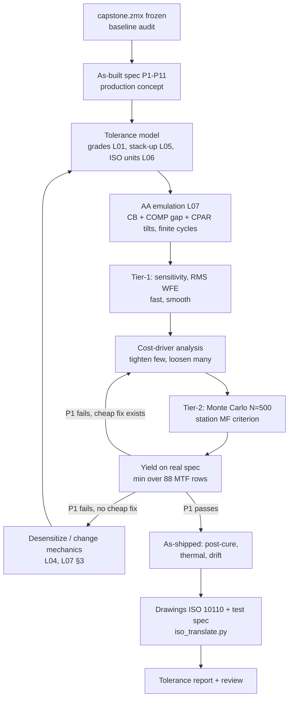

# L08 — Capstone: tolerancing the camera lens

> **Course 06 · Tolerancing and manufacturing** · Estimated time: lecture ~2 h, tasks ~20–24 h (three sessions)
> **Prerequisites:** L01–L07 of this course; the Course 04 capstone [`../../04-machine-vision-camera-lenses/L10-capstone-machine-vision-lens/`](../../04-machine-vision-camera-lenses/L10-capstone-machine-vision-lens/) with its hand-off file `work/capstone.zmx` · **Next:** [Course 07 L07 — automated optimization and tolerancing](../../07-automation-zpl-zosapi/L07-automated-optimization-and-tolerancing/) / [Course 07 L08 — automated design report](../../07-automation-zpl-zosapi/L08-capstone-automated-design-report/)

## Learning objectives
- Turn a nominal optical specification (Course 04 S1–S19) into an **as-built (production) specification** with a yield target and a statistical acceptance rule, and explain every number.
- Build a complete, physically traceable tolerance model of the capstone receiver lens — fabrication, barrel, holder, sensor, filter — from shop grades (L01), stack-ups (L05) and drawing conventions (L06).
- Emulate the production process in OpticStudio: active alignment (focus + two tilts) as a range- and effort-limited compensator (L07), followed by post-cure errors applied *after* compensation.
- Compute **yield on the real spec** (minimum over fields, all three object distances) from Monte Carlo data, with its confidence interval, and decide whether the design passes.
- Run a **cost-driver analysis**: identify the few tolerances that carry the variance, tighten those, loosen the rest, and show the yield/cost trade quantitatively.
- Produce the production deliverables: tolerance budget, drawings package consistent with the TDE, MTF test specification with guard bands, and a tolerance report another engineer can audit.

## Reading
- **Core:** re-read your own L01–L07 notes and `work/` folders; this lesson is integration, not new theory. The task file lists which earlier script is reused where.
- **Core:** [Geary §38.3, pp. 436–440] — Geary's point that a design is not finished until it is toleranced, illustrated by the singlet focal-length sensitivity (curvature errors dominate, thickness errors hardly matter). Read it again as the "why" of this capstone.
- **Core:** [Kidger Ch. 8 intro, p. 167; §8 end, pp. 182–183] — why a cemented doublet is preferred for manufacturing: its cemented surface contributes far less aberration than the air-spaced pair, and the central air space of a split doublet is a sensitive, unstable parameter. Your capstone's doublet is probably among the top sensitivity rows; this explains why it is still the right choice.
- **Core:** [Kidger Ch. 9, p. 192] — "large angles of incidence of any ray on a steep surface" signal tight tolerances: the diagnostic you use when a single element dominates.
- **Online (as used in L02/L03):** Ansys Optics KB, "How to get any optimization operand value in the tolerance report" — a tolerance script (`.tsc`) that reports a zero-weight merit-function operand for every perturbed system or Monte Carlo trial: <https://optics.ansys.com/hc/en-us/articles/43071055522579>
- **Online:** Ansys Optics KB, "How to inspect OpticStudio's internal tolerance models" (SAVE operand, saved Monte Carlo files): <https://optics.ansys.com/hc/en-us/articles/43071088477587>
- **Online:** Ansys Optics KB, "Mechanical Pivot Points (MPVT) in tolerance analysis": <https://optics.ansys.com/hc/en-us/articles/42661839385875>
- **Optional:** Ansys Optics KB, "High-Yield Optimization (HYLD)": <https://optics.ansys.com/hc/en-us/articles/43071054749459> — if Task 5's yield fails and you must desensitize (L04).

---

## 1. The assignment

You are now the **tolerancing engineer** who receives `capstone.zmx` from the lens designer (who happens to be you, three months ago). The camera goes into production at about 10⁴ units per year. The production concept, decided with mechanics and manufacturing:

| Item | Concept | Course 06 source |
|---|---|---|
| Elements | ≤ 6 polished spherical glass elements, one cemented doublet, catalogue glass from one vendor | L01, 04/L10 S18 |
| Barrel | aluminium drop-in barrel, spacers, threaded retainer; elements seated on front shoulders | L05 |
| Filter | 850 nm band-pass in the lens holder, moves with the lens | 04/L08, L07 §6.1 |
| Focus and tilt | **5-axis active alignment** (z, θx, θy; x, y for centring) of lens+holder to the sensor, UV/thermal dual-cure glue, nominal gap 100 µm | L07 |
| Calibration | per-unit intrinsic + projector–camera extrinsic calibration at 25 °C | L07 §5 |
| Test | MTF bench at the AA station (same 9 ROIs) and an audit bench for sampling | L06 §6.1 |

What is *not* compensated by anything: everything inside the lens that is not a pure image-plane tilt or focus — element decenters and wedges near the stop (axial coma), astigmatism from tilted elements, irregularity, the curvature of the best-focus surface. That is where the yield is decided.

### 1.1 From the nominal spec to an as-built spec

Course 04's spec S8/S9 are **nominal design** targets. A production lens is accepted against a looser **as-built** limit, and the design is accepted if a stated fraction of builds meet it. Where does the allowance come from? From the system: depth noise scales roughly with 1/MTF at the fringe frequency (04/L09), so a 15 % MTF loss costs ~15 % depth noise, which the 3D-camera system budget can accept at the edges of the population. That gives the as-built limits below (0.85 × the nominal S8/S9 numbers, rounded).

| # | Requirement (production) | Value | Origin |
|---|---|---|---|
| P1 | **Yield** on P2–P4 after AA (finite station) | ≥ 90 % at 95 % one-sided confidence (≈ ≥ 465 of 500 trials) | business case |
| P2 | MTF @ 36.2 lp/mm, T and S, 13 fields, 0.8 m | ≥ 0.50 at **every** row | S8 × 0.85 |
| P3 | same at 0.6 m and 1.2 m (same AA state) | ≥ 0.38 at every row | S8 × 0.85 |
| P4 | MTF @ 72.5 lp/mm, 0.8 m: on axis / AA corners | ≥ 0.38 / ≥ 0.30 | S9 × 0.85 |
| P5 | EFL | 8.00 mm ± 1 % for ≥ 99 % of trials | S1 |
| P6 | Boresight (principal-point offset) | ≤ 0.10 mm for ≥ 99 % | FOV overlap with projector |
| P7 | Compensator envelope | AA gap mean ± 3σ within ±0.040 mm; \|tilt\| 99.7th pct ≤ 0.35° | glue gap, stage |
| P8 | As-shipped | post-cure + thermal on the p90 unit: P2 still ≥ 90 % met; focus shift 0–45 °C within ±5 µm | L07 §4.4, S14 |
| P9 | Robustness | no single tolerance > 50 % of the criterion variance | S19 |
| P10 | Cost | cost points ≤ the "all-precision" reference; ≤ 6 rows at high precision | L01 §5.1 |
| P11 | Drawings | every drawing callout no looser than the TDE value it represents | L06 §3 |
| G1 | Goal (report only) | post-calibration lateral image drift ≤ 0.17 µm (→ depth error ≤ depth noise 0.144 mm at 1 m) | L07 §5.2 |

The **13 fields** are the 9 AA ROIs (centre; ±x at 3.38 mm; ±y at 2.83 mm; four corners at (±3.38, ±2.83) mm = 0.8 of the half-diagonal 5.51 mm) plus 4 corners at the S8 limit, 0.9 × 5.7 mm = 5.13 mm, i.e. (±3.93, ±3.29) mm. Rows = 13 fields × T/S = 26 per object distance.

**Why "every row" and not the average?** L03 §4.5: an average-over-field criterion hides a single bad corner — and a tilted or decentred element produces exactly that. Your yield is the fraction of trials in which the *minimum* of 26 (P2) + 52 (P3) + 10 (P4) MTF values clears its limit.

**Why a confidence rule?** A Monte Carlo yield is an estimate. With $N$ trials and observed $\hat p$, the standard error is $\sqrt{\hat p(1-\hat p)/N}$ (L03 §4.2). "Yield ≥ 90 %" written as "point estimate ≥ 90 %" passes half of the designs whose true yield is exactly 90 %. Requiring the one-sided 95 % (Wilson) lower bound to be ≥ 0.90 makes the claim defensible: with $N$ = 500, 465 passing trials (93.0 %) give a lower bound of 0.909 (pass); 460 (92.0 %) give 0.898 (fail by a hair).

## 2. The workflow

Two rules from professional practice govern the whole flow:
1. **The design file is frozen.** You tolerance a copy (`tol_capstone.zmx`). Any design change (step I) creates a new design revision `capstone_r1.zmx`, re-verified against Course 04 S1–S18 and logged — tolerancing must never silently re-optimize the lens.
2. **Two criteria tiers.** Diffraction-MTF criteria are slow and noisy; RMS wavefront is fast and smooth. Use RMS wavefront for the many quick runs (sensitivity, allocation, iteration with 50–100 trials) and the true MTF criterion for the final Monte Carlo and the yield claim. Check that the two rank the worst offenders the same way; if they don't, trust MTF.

## 3. The tolerance model, row by row

A 6-element capstone yields roughly 100–150 TDE rows. Organise them by **who controls the error** — that is also how you will negotiate them:

| Block | Rows | Starting values (precision grade) | Statistics |
|---|---|---|---|
| Glass shop: surfaces | TFRN, TIRR (TWAV 0.6328 µm), one wedge per element (TSTX/TSTY on one surface of each sphere) | 3 fr, 0.5 fr, wedge 1′ radial on drawing → ±0.0136° per axis | uniform |
| Glass shop: thickness | TTHI on CTs | ±0.025 mm | uniform |
| Glass vendor | TIND, TABB | ±0.0005, ±0.5 % | normal |
| Cementing | TEDX/TEDY of the second doublet element relative to the first | ±0.005 mm | normal |
| Barrel | TEDX/TEDY, TETX/TETY per element (doublet as one), MPVT for the pivot; TTHI on air spaces with adjust surfaces from the stack | from your stack-up (L05): ≈ ±0.0077 mm, ±0.02–0.04° | normal |
| Holder & filter | barrel/holder tilt over all lens surfaces ±0.3° (AA allows a cheap holder), holder decenter ±0.05 mm, filter tilt in holder, filter thickness | L07 Task 4 B | normal |
| Sensor | die tilt in package (TETX/TETY on image) ±0.1° | sensor datasheet | normal |
| Compensators | COMP on the AA gap ±0.050 mm; CPAR Par 3/Par 4 on the AA coordinate break ±0.5° | glue gap, stage travel | — |

Every row gets a Comment naming its drawing reference ("E2 S2 wedge", "E3-4 bore decenter"); the drawings (L06) and the scripts (Course 07) find rows by comment.

Three modelling decisions you must write down because they change the answer:
- **Spheres: wedge as tilt *or* decenter, not both** (L02 §3.2). Use TSTX/TSTY on one surface per element; the decenter of a sphere is the same error.
- **Pivot points.** The barrel tilt pivots at the rear flange (MPVT, Rear Mechanical Edge) — a tilt about a point 15–20 mm behind the front vertex is also a decenter of the front elements (L05 §2).
- **Where is the AA coordinate break?** The filter moves with the lens, so the "AA" coordinate break goes *after* the filter and in front of the cover glass; the filter→cover-glass air thickness becomes the AA gap compensator. The Course 04 "FOCUS COMP" (lens→filter) is now a fixed holder dimension with an ordinary TTHI tolerance. Removing the old COMP is mandatory — two focus compensators are degenerate (L07 §6.4).

### 3.1 Barrel numbers and the thermal conflict
Run your L05 `stackup.py` with the capstone barrel: bore +0.012/0, element OD 0/−0.010, bore runout Ø0.010 mm. Decenter: worst case 0.016 mm; Monte Carlo (uniform parts, random directions) mean 0.0049 mm, 95th percentile 0.0094 mm → **TEDX = TEDY ±0.0077 mm** (normal, ±2σ). Seat tilt from 0.004 mm spacer parallelism over a contact diameter of 0.8 × OD: 0.024° for a Ø12 mm element, 0.018° for Ø16 mm.

But: that bore allows **zero** clearance at maximum material, and cooling the aluminium barrel from 20 °C to 0 °C closes the diametral gap of a Ø16 mm element by $16\times(23.6-7.1)\times10^{-6}\times 20$ = 5.3 µm, to −40 °C storage by 15.8 µm. Shifting the bore to +0.008/+0.020 mm (minimum clearance 8 µm) protects operation but raises the decenter to WC 0.020 mm, p95 0.0128 mm, **±0.0104 mm per axis** — 35 % looser on exactly the rows that tend to dominate. This is a typical cost-driver conflict; its resolution (compliant mount, RTV-bonded element, active centring of the doublet as a lens-internal compensator, L07 §3) is a decision your report must document.

## 4. Emulating the factory

### 4.1 Station merit function and criterion
The AA station maximises a figure of merit at 9 ROIs at one target distance. Your tolerancing criterion should do the same — no more. Build `aa_station_capstone.MF`: `CONF 2`, then `MTFT` and `MTFS` at 36.2 lp/mm (= ν_N/4, also the fringe frequency) for the 9 AA fields, centre weight 2, others 1, target 1. Criterion = Merit Function, Comp = Optimize All (DLS) with a **fixed small number of cycles** (3–5), compensator ranges set. That is a finite-effort station; "Automatic" cycles emulate a station nobody owns (L07 §6.1).

The *evaluation* (P2–P6) is a separate, larger merit function `eval_capstone.MF` with the 88 MTF rows (13 fields × T/S × 3 configs at 36.2; plus 10 rows at 72.5), MINN rows per block, EFFL, and REAX/REAY of the on-axis chief ray for boresight — all weight 0 and commented ("C2_F07_T", "C1_MIN"…). It is evaluated on each compensated trial, not optimized. Two ways to get it per trial:
- **Tolerance script** (`.tsc` in `{Zemax}/Tolerance/`, Criterion = User Script): the KB article above shows a script that sets the compensators, optimizes, and reports zero-weight merit-function operands for every Monte Carlo trial. Check the command list in Help → "Tolerance Scripts" for your version.
- **Saved Monte Carlo files + ZOS-API**: save all trials (e.g. 500 `tol_capstone_MC_T####.ZMX`), then load each, load `eval_capstone.MF`, evaluate, and write a CSV (Course 07 L03–L05 tooling). This is slower to set up but gives you the full row matrix for failure-mode analysis — recommended.

### 4.2 Post-cure and as-shipped
OpticStudio applies all perturbations and then the compensators, so anything you put in the TDE is "aligned away". Errors that occur *after* the glue sets — cure shrink spread, tilt from differential shrinkage, thermal post-cure, temperature in the field — are applied in a **second stage** with Comp = None, on the median and p90 units (or on every saved trial with a script). L07 §4.4 gives the focus budget (RSS ±7.1 µm against ±16.6 µm geometric / ±9.8 µm diffraction depth of focus at F/2.4); here you check it on real units and include the Course 04 thermal configurations (S14).

## 5. Cost-driver analysis

The sensitivity report gives, per row, the criterion change at the tolerance limit. Turn this into a **variance budget**: for a quadrature-type criterion (RMS wavefront), each row $i$ with limit contribution $w_i$ adds variance $w_i^2\,\mathrm{Var}(u_i)$, where $u_i$ is the normalised error ($\mathrm{Var} = 1/3$ for uniform on [−1, 1]; $0.25\times0.774 = 0.193$ for OpticStudio's normal with limits at ±2σ, truncated). Rank by share. Then assign each row a **cost point** value — 0 commercial, 1 precision, 3 high precision (the shape of L01 §5.1: one step is cheap, high precision means one-at-a-time processing; replace with vendor quotes when you have them). Three moves, in order of preference:
1. **Loosen** rows with tiny shares (often index, Abbe, radius in fringes, some CTs) — this *saves* money with negligible yield loss.
2. **Tighten** the top 2–3 rows by one grade — or replace a tolerance by a process (centring, select-on-test, active centring).
3. Only if 1–2 cannot reach P1 within P10: **change the design or the mechanics** (L04, L07 §3).

The anti-pattern is "everything one grade tighter": it always works and is always the most expensive answer.

## 6. Deliverables and the report

The capstone produces (details and template in the task file):
- `tolerance_budget.md` — final TDE as a table with sources, grades, statistics and variance shares;
- Monte Carlo reports, `mc_rows.csv`, `yield_summary.md` with P1–P9 evidence;
- `cost_drivers.md` — Pareto, scenarios, decision;
- `drawings/` — ISO 10110 element drawings (6 elements + filter), callout table generated from the TDE by `iso_translate.py`, assembly/interface summary, `test_spec.md`;
- `tolerance_report.md` — the document a production engineer, a vendor and a reviewer read.

## 7. In OpticStudio — capstone pitfalls

- **Real Image Height fields in the tolerance file.** The field points move with the perturbed lens, so corner MTF is evaluated at the wrong place and AA tilts have nothing to bite on. Use Object Angle fields (Course 04 config 2 geometry) for the tolerancing copy only.
- **Multi-configuration criteria.** With a merit-function criterion, the `CONF` rows select configurations; check how your version's "Configuration" setting interacts (Help → Tolerancing → Criterion). The station MF uses config 2 only; the 0.6/1.2 m rows are evaluation rows.
- **Thermal and focus-shift configurations** (Course 04 configs 4+) must not be in the station MF; keep them for Task 6.
- **MTF sampling noise.** Run the nominal at two pupil samplings; if the 36.2 lp/mm value changes by > 0.005, increase sampling before trusting the yield (L03 §5).
- **Compensator statistics.** After every MC run, read the compensator min/max: a tilt CPAR sitting at ±0.5° in some trials means the station range, not the lens, is limiting yield.
- **Runtime.** 18 MTF rows × DLS cycles × 500 trials is hours; multi-core tolerancing parallelises trials. Iterate with RMS wavefront and 100 trials; run the 500-trial MTF Monte Carlo overnight, once per tolerance revision.

## Worked example — a cost-driver allocation on a proxy budget

To see the mechanics of §5 before you have your own data, consider an **illustrative** sensitivity table for a 6-element lens (your capstone's numbers will differ). Criterion: field-averaged RMS wavefront at 850 nm in config 2 after AA, nominal $W_0$ = 0.050 λ. Each row's limit contribution $w_i$ is the quadrature increase at its limit, $w_i = \sqrt{W_i^2 - W_0^2}$. Suppose a calibration on saved trials showed that $W \le 0.077$ λ corresponds to passing P2 (Task 5 builds that calibration). Model: $W = \sqrt{W_0^2 + \sum_i (w_i u_i)^2}$, 400 000 samples.

| Group | Rows | $w_i$ (λ) | Stat. | Variance share (all precision) |
|---|---|---|---|---|
| Doublet bore decenter TEDX/Y | 2 | 0.040 | normal | 19.4 % |
| E2 wedge TSTX/Y | 2 | 0.030 | uniform | 18.8 % |
| Other wedges | 10 | 0.012 | uniform | 15.0 % |
| Irregularity TIRR | 13 | 0.010 | uniform | 13.6 % |
| Doublet internal decenter | 2 | 0.025 | normal | 7.6 % |
| Radius TFRN | 13 | 0.006 | uniform | 4.9 % |
| Element tilts | 12 | 0.008 | normal | 4.6 % |
| Air spaces | 5 | 0.009 | uniform | 4.2 % |
| E5 / E1 / E6 decenters | 6 | 0.018 / 0.015 / 0.010 | normal | 3.9 / 2.7 / 1.2 % |
| CT | 6 | 0.007 | uniform | 3.1 % |
| TIND / TABB | 12 | 0.004 / 0.001 | normal | 0.6 / 0.0 % |
| Holder + sensor tilt (after AA) | 4 | 0.004 | normal | 0.4 % |

**The RSS of all limit values** is $\sqrt{0.050^2 + \sum n_i w_i^2}$ = 0.122 λ — the "everything at its limit at once" view would declare the design hopeless. The Monte Carlo says mean 0.0753 λ, 90th percentile 0.0815 λ. With 100 independent rows the extremes do not line up.

Scenarios (cost points: 0 commercial, 1 precision, 3 high precision per row; holder/sensor rows 0):

| Scenario | Change | Mean $W$ | p90 $W$ | Yield ($W \le 0.077$) | Cost points |
|---|---|---|---|---|---|
| A | all precision | 0.0753 | 0.0815 | 65.8 % | 83 |
| B | all high precision ($w_i$ halved) | 0.0574 | 0.0595 | 100 % | 249 |
| C | top-2 groups (4 rows) → high precision | 0.0691 | 0.0724 | 99.8 % | 91 |
| D | C + TFRN 3 → 5 fr, TIND/TABB → commercial (×2) | 0.0715 | 0.0748 | 98.2 % | 66 |
| E | D + CT ±0.025 → ±0.05 | 0.0735 | 0.0769 | 90.4 % | 60 |

Reading the table like a professional:
- **B** is the "tighten everything" reflex: 3× the cost of A for a margin nobody needs.
- **C** fixes the problem with 4 rows (+8 points); **D** then pays for it by loosening 32 low-share rows: better yield than A at **20 % lower cost**. That is the whole point of cost-driver analysis.
- **E** is tempting (cheapest) but its 90.4 % sits on the P1 edge: with a 500-trial Monte Carlo the standard error is 1.3 %, so E cannot *demonstrate* ≥ 90 % at 95 % confidence. Choose D, and record E as the option to revisit once supplier capability data (L03 §4.1, user-defined STAT) exist.
- Notice how **steep** yield is near the limit (65.8 % → 98.2 % for a 5 % shift of the mean): the distribution of a criterion built from ~100 independent rows is narrow. Small errors in the proxy calibration (the 0.077 λ threshold) translate into large yield errors — which is why the final claim must come from the MTF Monte Carlo itself, not from the proxy.

**Part 2 — the test limit.** Suppose the final MTF Monte Carlo gives the minimum P2 row per unit as approximately normal with mean 0.585 and σ 0.045. True yield on P2: Φ((0.585 − 0.50)/0.045) = Φ(1.89) = **97.1 %**. The AA-station MTF measurement has a unit-to-unit reproducibility σ_m = 0.02 (bench offsets are calibrated out with a golden sample, L06 §6.1). With the test limit equal to the spec (0.50), the measured pass rate is Φ(0.085/√(0.045² + 0.02²)) = **95.8 %**; 2.0 % of all units are good but rejected and 0.74 % are bad but shipped (0.77 % of shipped units). With a guard band, limit 0.52: pass rate 90.7 %, false rejects 6.6 %, escapes 0.17 %. The test limit is a business decision (scrap cost vs field-return cost); the tolerancing engineer's job is to put these numbers on the table. All values computed with `python3` (analytic and $2\times10^6$-sample simulation agree).

## Key takeaways
- The capstone deliverable is a **yield claim with evidence**, not a tolerance table: as-built spec, process model, statistics, confidence, cost.
- Write the as-built spec before running anything; define yield on the *minimum* over fields and object distances, with a confidence rule.
- Model the factory: active alignment as a limited compensator (range + cycles), the old focus compensator removed, post-cure and thermal errors applied *after* compensation.
- Use a fast criterion to iterate and the true MTF criterion to decide; check that both agree on the worst offenders.
- Cost-driver analysis = variance shares × cost points: tighten few, loosen many; "all one grade tighter" is the most expensive answer.
- Mechanical conflicts (thermal clearance vs decenter) are tolerancing decisions — document them.
- Drawings, test limits and the TDE must be the same numbers in different units; generate one from the other.

## Glossary (new terms in this lesson)
| Term | Meaning |
|---|---|
| As-built specification | Production acceptance limits (here P1–P11), looser than nominal design targets, with a yield requirement |
| Station merit function | The criterion that the alignment station (and your compensator emulation) maximises |
| Evaluation merit function | Zero-weight rows evaluated on each compensated trial to compute yield on the real spec |
| Wilson bound | A confidence bound for a binomial proportion that behaves well near 0 and 1; used for the yield claim |
| Variance share | A row's contribution to the variance of a quadrature criterion, $w_i^2\mathrm{Var}(u_i)$ normalised to the total |
| Cost point | A relative cost unit per tolerance row and grade, used to compare scenarios before vendor quotes exist |
| Guard band | Test limit set inside the spec limit to reduce shipped defects at the price of false rejects |
| As-shipped performance | Performance after alignment *and* the errors that occur after it (cure, thermal, aging) |

## References
1. J. M. Geary, *Introduction to Lens Design*, Willmann-Bell, 2002 — §38.3 "Tolerancing", pp. 436–440.
2. M. J. Kidger, *Fundamental Optical Design*, SPIE Press, 2002 — Ch. 8 intro p. 167 and pp. 182–183 (cemented vs split doublets); Ch. 9 p. 192 (steep surfaces and tight tolerances).
3. Ansys Optics KB, "How to get any optimization operand value in the tolerance report": <https://optics.ansys.com/hc/en-us/articles/43071055522579>
4. Ansys Optics KB, "How to inspect OpticStudio's internal tolerance models": <https://optics.ansys.com/hc/en-us/articles/43071088477587>
5. Ansys Optics KB, "Mechanical Pivot Points (MPVT) in tolerance analysis": <https://optics.ansys.com/hc/en-us/articles/42661839385875>
6. Ansys Optics KB, "Tolerancing a laser beam expander: overview of the OpticStudio workflow": <https://optics.ansys.com/hc/en-us/articles/42661666289043>
7. Ansys Optics KB, "Creating ISO 10110 element drawings in OpticStudio": <https://optics.ansys.com/hc/en-us/articles/43071071251475>
8. Ansys Optics KB, "High-Yield Optimization (HYLD)": <https://optics.ansys.com/hc/en-us/articles/43071054749459>
9. Zemax Community, "Monte Carlo statistics": <https://community.zemax.com/got-a-question-7/monte-carlo-statistics-171>
10. Course cross-references: 06/L01 §5 (grades), L02 §3–6 (TDE, compensators, criteria), L03 §4 (Monte Carlo), L04 §4 (HYLD/TOLR), L05 §2–3 (pivots, stack-ups), L06 §3, §6 (TDE↔ISO, hand-off, MTF test spec), L07 §4, §6 (active alignment and its model); 04/L10 §1.3 (S1–S19), §4 (hand-off conventions).
