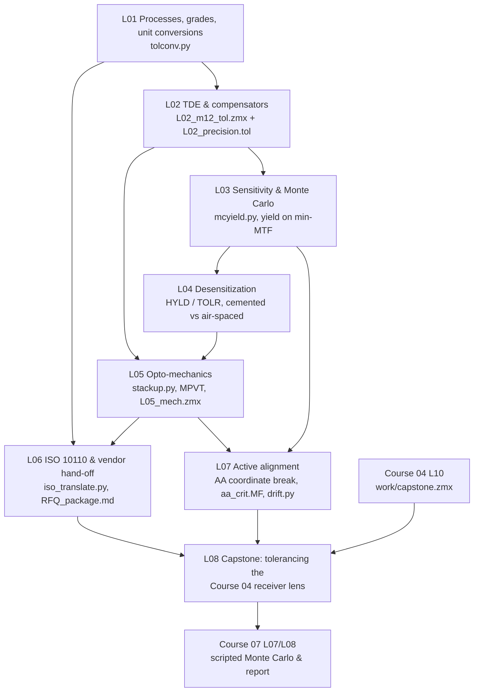

# Course 06 — Tolerancing and manufacturing

A nominal design is a promise; a toleranced design is a product. This specialisation track takes a lens from "meets spec in OpticStudio" to "can be bought, built, aligned and tested at a known yield and cost". You learn how lenses are made and measured, how the Tolerance Data Editor represents those processes, how sensitivity and Monte Carlo analysis turn tolerances into yield, how to design for low sensitivity, how mechanics, drawings and vendors fit in, and how active alignment changes the game for camera modules. Throughout, the running application is the receiver lens of a structured-light 3D camera: a mass-produced, calibrated instrument where corner MTF, focus stability and boresight drift matter more than peak sharpness.

## Goals
By the end of this course you will be able to:
- Convert between shop language and model language: fringes ↔ radius error, wedge/ETD ↔ tilt/decenter, ISO 10110 callouts ↔ TDE rows, and know commercial / precision / high-precision grades and what they cost.
- Build a physically traceable tolerance model in the **Tolerance Data Editor**: surface, element, material and assembly operands, adjust surfaces, statistics (STAT), pivots (MPVT), and compensators with realistic ranges.
- Choose criteria that match the specification (RMS wavefront for speed, MTF/merit-function criteria for truth), run sensitivity, inverse sensitivity and Monte Carlo, and state yield with a confidence interval.
- Reduce sensitivity at the design stage (cemented interfaces, lower ray angles, HYLD/TOLR, comparison by as-built performance).
- Translate a barrel drawing into decenters, tilts and stack-ups; exchange geometry with CAD; understand where structural/thermal coupling (STAR) enters.
- Write ISO 10110 element drawings, use test-plate fitting and melt data, and assemble a vendor RFQ package with an MTF test specification.
- Model alignment processes — centring, element compensators and **camera active alignment** — including post-cure shifts and the calibration consequences for a 3D camera.
- Deliver a complete tolerance analysis of a real design: as-built spec, yield ≥ target after active alignment, cost-driver analysis, drawings package and tolerance report.

## Prerequisites
- Courses 01–03 (in particular 01/L02 sag, 03/L02 MTF, 03/L03 wavefront budgets, 03/L04 merit functions, 03/L06 multi-configuration, 03/L09 thermal analysis).
- Course 04: the M12-style fixed-focus lens from [04/L04](../04-machine-vision-camera-lenses/L04-compact-fixed-focus-lens-project/) (`work/L04_S2_final.zmx`) is the practice lens for L02–L07; the **Course 04 capstone** [`04/L10 work/capstone.zmx`](../04-machine-vision-camera-lenses/L10-capstone-machine-vision-lens/) is required for L08 (L01 Task 4 already refers to it).
- Python 3 with numpy/scipy/matplotlib — the course builds reusable tools: `tolconv.py` (L01), `mcyield.py`/`rss.py` (L03), `stackup.py` (L05), `iso_translate.py`/`meltfit.py` (L06), `aa_fit.py`/`drift.py` (L07), all reused in L08.
- Ansys Zemax OpticStudio **Premium** (recent release ~2025 R2 / 2026 R1).
- The course books **[Geary]**, **[Kidger]**, **[Kenyon]** (see [`../references/README.md`](../references/README.md)). The books are thin on tolerancing practice, so this course relies more on the Ansys Optics knowledge base, fabricator application notes (Edmund Optics, Optimax), University of Arizona OPTI 521 material and adhesive/alignment vendor papers; every link was checked when the lessons were written.

## Lessons

| # | Lesson | Topics | Est. time (lecture + tasks) |
|---|---|---|---|
| L01 | [Manufacturing processes and tolerances](L01-manufacturing-processes-and-tolerances/lecture-notes.md) · [tasks](L01-manufacturing-processes-and-tolerances/tasks.md) | Grinding/polishing, aspheres, PGM, molding, SPDT; test plates and interferometry; fringes ↔ ΔR, wedge ↔ ETD ↔ deviation; tolerance grades; cost–tolerance curve | 2.5 h + 4 h |
| L02 | [Tolerance Data Editor, compensators and criteria](L02-tolerance-data-editor-and-compensators/lecture-notes.md) · [tasks](L02-tolerance-data-editor-and-compensators/tasks.md) | Preparing the file, wizard defaults, TRAD/TFRN/TTHI/TIRR/TSDX/TSTX/TEDX/TETX/TIND/TABB, COMP/CPAR/STAT/SAVE, adjust surfaces, compensation modes, criteria | 2.5 h + 5 h |
| L03 | [Sensitivity, inverse sensitivity and Monte Carlo](L03-sensitivity-and-monte-carlo/lecture-notes.md) · [tasks](L03-sensitivity-and-monte-carlo/tasks.md) | RSS estimate and its traps, inverse limit/increment, Monte Carlo statistics, number of trials, yield on the real (minimum-over-fields) spec | 2.5 h + 5 h |
| L04 | [Desensitization and as-built performance](L04-desensitization-and-as-built-performance/lecture-notes.md) · [tasks](L04-desensitization-and-as-built-performance/tasks.md) | Why designs are sensitive (decenter → coma from Seidel terms), design levers, cemented vs air-spaced, HYLD, TOLR, comparing candidates by as-built performance | 2.5 h + 6 h |
| L05 | [Opto-mechanics and CAD integration](L05-opto-mechanics-and-cad-integration/lecture-notes.md) · [tasks](L05-opto-mechanics-and-cad-integration/tasks.md) | Mounting, element vs surface tolerances, pivots (MPVT), stack-ups, thermal clearance, CAD export/import, STAR | 2.5 h + 5 h |
| L06 | [Drawings, ISO 10110 and vendor hand-off](L06-drawings-iso10110-and-vendor-handoff/lecture-notes.md) · [tasks](L06-drawings-iso10110-and-vendor-handoff/tasks.md) | ISO 10110 codes 0/–6/, TDE ↔ drawing translation, ISO Element Drawing tool, test-plate fitting, melt data, RFQ package, MTF test spec | 2.5 h + 5–6 h |
| L07 | [Alignment and active alignment](L07-alignment-and-active-alignment/lecture-notes.md) · [tasks](L07-alignment-and-active-alignment/tasks.md) | Centring, element compensators, camera AA stations and algorithms, adhesive and post-cure budgets, boresight and calibration, AA as a compensator in OpticStudio | 2.5 h + 6 h |
| L08 | [Capstone: tolerancing the camera lens](L08-capstone-tolerancing-the-camera-lens/lecture-notes.md) · [tasks](L08-capstone-tolerancing-the-camera-lens/tasks.md) | As-built spec P1–P11, full tolerance model of the Course 04 capstone, AA emulation, yield on 88 MTF rows × confidence, cost drivers, as-shipped checks, drawings, test spec, report | 2 h + 20–24 h |

Total: roughly **80–90 hours**, i.e. 10–12 weeks at one session per week (the capstone takes about three sessions plus an overnight Monte Carlo run).

## How the lessons connect

**One practice lens, one capstone lens.** L02–L07 all work on the same Course 04 M12-style lens (8 mm, F/2.8): L02 builds its tolerance model, L03 runs its sensitivity and Monte Carlo, L04 desensitizes it, L05 puts it in a barrel, L06 draws its elements and writes its RFQ, L07 aligns it actively. Each lesson's tasks name the files to save in its `work/` folder and later lessons start from them by name (e.g. `../L05-opto-mechanics-and-cad-integration/work/L05_mech.zmx`). The capstone then repeats the whole chain on a harder, faster lens (the Course 04 capstone, F/2.4, 3.45 µm pixels, three object distances) and reuses every script. Keep the course under git; `.zmx`, `.tol` and tolerance reports are text.

## Conventions used in this course
- Sign conventions as in Course 01; lens units mm; tilts in degrees in the TDE, arcminutes on drawings.
- Fringes are **double-pass fringes at the TWAV test wavelength** (default 632.8 nm) unless a drawing wavelength is stated; ISO 10110 callouts always carry their wavelength.
- Statistics: OpticStudio's normal distribution with limits at ±2σ unless a STAT row says otherwise; uniform for "in-spec" shop parameters where stated. Per-axis ↔ radial conversions use the Rayleigh factor $\sqrt{-2\ln 0.05}/2 = 1.224$ (95 %).
- Yield is always computed on the actual specification (minimum over fields/configurations), and quoted with its standard error; claims use a one-sided 95 % confidence bound.
- Every number in worked examples and "check yourself" boxes was recomputed with Python; OpticStudio tolerancing results depend on your design and are given as ranges or qualitative expectations.

## What "done" looks like for this course
You are ready to move on when you can, without notes:
1. Take a shop's tolerance table and a barrel drawing and produce a commented TDE for a 5–6 element lens in an afternoon, explaining every value's source.
2. Explain to a manager why an RSS estimate, an average-criterion yield or a 50-trial Monte Carlo is not a yield claim — and produce one that is.
3. Point at the three tolerances that drive a design's yield, explain the optics behind them, and propose the cheapest fix (tolerance, process, compensator or design).
4. Write an ISO 10110 drawing and an MTF test specification that match your tolerance model, and discuss them with a vendor.
5. Model an active-alignment process honestly (limited range and effort, post-cure errors after compensation) and translate residual drifts into 3D depth errors.
6. Hand over the capstone tolerance report with drawings, test spec and reproducible scripts that a reviewer can audit and Course 07 can automate.

## Edition and version notes
- Sequential tolerancing (TDE, sensitivity, inverse sensitivity, Monte Carlo, Quick Sensitivity) is available in all editions; **HYLD** ("Improve Manufacturing Yield", L04) needs Professional or Premium (19.8+); **MPVT** mechanical pivots (L05, L08) need Premium (or Enterprise) — in Professional use coordinate breaks with TUTX/TUTY.
- **STAR** (L05) is a separately licensed module (included in Enterprise; legacy Professional/Premium need the STAR licence) — check Help → About. All STAR content is optional; a manual workaround is given.
- Non-sequential tolerancing and CAD import of barrels for stray-light checks (L05) need Professional/Premium; dynamic CAD links are Premium.
- **Tolerance scripts** (`.tsc`, used in L07–L08 to emulate factory sequences and report operand values per trial) and the **ISO Element Drawing** and **Cost Estimator** tools exist in recent releases; the Cost Estimator needs registration with a participating fabricator and may not be available in every region. Menu locations of the drawing, test-plate and tolerance-data tools move between releases — use the ribbon search box.
- Large Monte Carlo runs with MTF criteria take hours; OpticStudio parallelises trials over cores. For anything beyond what the dialog offers (yield on many rows, post-cure per trial), Course 07 L07 shows the ZOS-API route.
