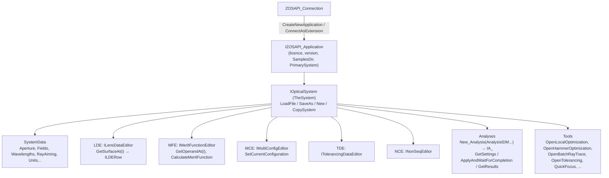

# L03 — ZOS-API architecture and Python setup

> **Course 07 · Automation with ZPL and the ZOS-API** · Estimated time: lecture ~2.5 h, tasks ~4.5 h
> **Prerequisites:** [L01](../L01-zpl-macro-fundamentals/), [L02](../L02-user-defined-operands-and-analyses/); Python 3.11+, git · **Next:** [L04 — Building and editing systems from Python](../L04-building-and-editing-systems-from-python/)

## Learning objectives
- Draw the ZOS-API object model from connection to editor rows and name the interfaces you will use daily (`IZOSAPI_Application`, `IOpticalSystem`, `ILensDataEditor`, `IMeritFunctionEditor`, `IMultiConfigEditor`, `ITolerancingDataEditor`, `SystemData`, `Analyses`, `Tools`).
- Choose the right connection mode (Standalone, Interactive Extension, User Extension/Operand/Analysis) for a job and explain the licensing and instance implications.
- Connect to OpticStudio from Python both "raw" (official pythonnet boilerplate) and with ZOSPy, check the licence, open/save files and disconnect cleanly.
- Handle the .NET-from-Python friction points: enums/constants, interface casting, .NET arrays, `out`/`ref` parameters, exceptions, and the one-connection-per-process rule.
- Set up a reproducible project: virtual environment, pinned dependencies, package layout, logging of software versions, git with correct handling of `.zmx/.zos/.ZDA/.zar` files.

## Reading
- **Core:** ZOSPy documentation — installation <https://zospy.readthedocs.io/en/latest/user_guide/getting_started/installation.html>, connecting <https://zospy.readthedocs.io/en/latest/user_guide/usage/connection.html>, FAQ <https://zospy.readthedocs.io/en/latest/user_guide/getting_started/faq.html>, compatibility <https://zospy.readthedocs.io/en/latest/user_guide/getting_started/compatibility.html>.
- **Core:** ZOSPy paper: L. van Vught, C. Haasjes, J.-W. M. Beenakker, "ZOSPy: Optical ray tracing in Python through OpticStudio", *JOSS* 9(96), 5756 (2024), <https://doi.org/10.21105/joss.05756> — why a wrapper exists and what it adds.
- **Core:** ZOS-API Python example 1 (the official `PythonStandaloneApplication` boilerplate): <https://developer.synopsys.com/docs/zos-api-interface-2025-r1/page_ex01_py.xhtml> (also in your installation's ZOS-API sample folder and generated by Programming → Python → Standalone Application).
- **Core:** Ansys KB, T. Jacobs, ZOS-API sample files and connection modes: <https://optics.ansys.com/hc/en-us/articles/42661773562899>
- **Optional:** Ansys KB, S. Auriol, connecting with the Interactive Extension from Python: <https://optics.ansys.com/hc/en-us/articles/42661779005075>; Ansys KB, M. Humphreys, setting up Python for the ZOS-API (Python.NET vs pywin32): <https://optics.ansys.com/hc/en-us/articles/42661756633619>
- **Reference (keep open while coding):** ZOS-API Syntax Help — installed with OpticStudio (Help tab → ZOS-API Syntax Help; location varies by version) and online for recent releases, e.g. <https://developer.ansys.com/docs/zos-api-interface-2025-r1/index.xhtml> (the developer portal now redirects to developer.synopsys.com for some pages; content is the same).

---

## 1. What the ZOS-API is

The ZOS-API is a .NET (C#) class library shipped with OpticStudio (`ZOSAPI.dll`, `ZOSAPI_Interfaces.dll`, plus a helper `ZOSAPI_NetHelper.dll` that finds the installation) [3]. Every editor, setting, tool and analysis you can click in the GUI is exposed as an object with properties and methods. Any language that can host .NET objects can drive it: C# natively, C++ via COM, MATLAB via its .NET bridge, and Python via **Python.NET (pythonnet)** [6].

Two practical consequences for a Python programmer:

1. **You are calling .NET, not Python.** Objects are .NET proxies: attribute names are PascalCase, arrays are `System.Double[]`, enums are .NET enums, interfaces sometimes need explicit casting, and errors are .NET exceptions surfaced in Python.
2. **You are remote-controlling a big application.** Each call crosses an inter-process boundary (standalone/extension modes). A Python loop that calls the API 10⁵ times is slow for the same reason a ZPL loop is; the API's *bulk* operations (batch ray trace, analysis results as arrays) are how you go fast (L06).

### 1.1 The object model



Read it as the GUI turned into code: *System Explorer* = `SystemData`; *Lens Data Editor* = `LDE`; *Optimize tab* = `Tools.Open…Optimization()`; *Analyze tab* = `Analyses.New_…`. Names in the diagram are the ones used in the official samples and ZOSPy docs; the exact signatures are in the Syntax Help for your version.

### 1.2 Tools are modal
Only **one tool** (optimizer, tolerancer, batch ray trace, quick focus, …) can be open on a system at a time. The pattern is always:

```python
tool = system.Tools.OpenLocalOptimization()   # open
# configure tool.Algorithm, tool.Cycles, ...
tool.RunAndWaitForCompletion()                # run (blocking)
tool.Close()                                  # ALWAYS close, or the next Open… returns None
```

A forgotten `Close()` (often after an exception) is the #1 cause of "`NoneType` has no attribute …" errors in ZOS-API scripts. Use `try/finally` (or a small context manager, Task 4).

## 2. Connection modes

| Mode | How it starts | GUI | Speed | Use it for |
|---|---|---|---|---|
| **Standalone application** | Your process creates a new, hidden OpticStudio instance (`CreateNewApplication()`) | none | fastest (no GUI refresh) | batch jobs, sweeps, reports, anything unattended |
| **Interactive Extension** | You click Programming → Interactive Extension in a running OpticStudio; your script connects to that instance (instance number shown in the dialog) [7] | live | slower (GUI updates) | exploration in a notebook while watching the lens, debugging a script step by step |
| User Extension / Analysis / Operand | Started *by* OpticStudio (L02) | — | — | packaged tools for others |

ZOSPy summarizes the trade-off: standalone is the default and faster because GUI updates slow simulations; extension mode suits debugging and watching progress, and requires enabling Interactive Extension first [2].

### 2.1 Licensing and instances
- The API requires an edition that includes it; the application object reports `IsValidLicenseForAPI` and a `LicenseStatus` (Premium / Professional / Standard / Invalid in the official sample) [3]. Your Premium licence qualifies.
- **A standalone application is an OpticStudio instance.** It consumes whatever your licence counts (seats/instances). The Ansys sample-file article warns to make sure no more than one instance is already open when launching a standalone application, to stay within licensing limits [4]. With network/elastic licensing the rules differ: ask your licence administrator how many simultaneous instances you may run before planning parallel jobs (L07).
- **One ZOS-API connection per Python process.** The API supports only one connection per process; ZOSPy therefore makes `ZOS` a singleton [2][5]. One *instance* can hold several optical systems, though (`create_new_system()` / `CreateNewSystem`) [2]. Parallelism = several processes, each with its own instance (and licence implications).
- Connection lifetime: in standalone mode, disconnecting closes the hidden instance; in extension mode it leaves OpticStudio open [5]. Python's exit also cleans up [5], but explicit is better — a crashed script can leave a zombie `OpticStudio.exe` holding a seat (check Task Manager).

## 3. Python ↔ .NET: the friction points

### 3.1 pythonnet
- Python.NET (`pip install pythonnet`) lets CPython load .NET assemblies: `import clr; clr.AddReference(path)`; then `import ZOSAPI` [6].
- **pythonnet 3.x changed behaviour** relative to 2.x (stricter implicit conversions, interface handling). Older Ansys boilerplates and forum snippets were written for 2.x; the Ansys setup article mentions testing with Python 3.4–3.8 [6] — i.e. it is old. ZOSPy targets Python.NET 3 and documents the fixes it applies [9]. If you use raw pythonnet, use the boilerplate generated by *your* OpticStudio version, and expect to adapt old snippets.
- **pywin32/COM** is the legacy alternative [6]; don't start new work with it.

### 3.2 Enums and constants
Enum values live in ZOSAPI namespaces: e.g. aperture types under `ZOSAPI.SystemData.ZemaxApertureType`, analysis IDs under `ZOSAPI.Analysis.AnalysisIDM`. ZOSPy mirrors them under `zp.constants` with autocomplete — e.g. `zp.constants.SystemData.ZemaxApertureType.FloatByStopSize` and `zp.constants.Analysis.AnalysisIDM.PathAnalysis` [9][10].

### 3.3 Interfaces and casting
Some properties return a general interface whose specific settings live in a derived interface — the classic case is a surface's type-specific data or an analysis's settings object. In C# you cast; in pythonnet 3 you may need `obj.__implementation__` or an explicit interface cast, and ZOSPy hides much of this [9]. When a property you know exists "is missing", suspect casting before suspecting the documentation.

### 3.4 Arrays, out-parameters, units
- Bulk data comes as .NET arrays (`System.Double[]`, `System.Double[,]`). Convert once to numpy (`np.fromiter`, or copy via `System.Runtime.InteropServices.Marshal` for speed — L06), never element by element in hot loops. The official sample includes `reshape`/`transpose` helpers for `Double[,]` [3].
- Methods with `out` parameters (common in batch ray tracing) return a **tuple** in pythonnet: the method's return value followed by the out values (L06).
- Units are the system's lens units (usually mm); wavelengths in µm — same as the GUI.

### 3.5 Exceptions and state
.NET exceptions propagate into Python as Python exceptions (with the .NET message). After an exception, the system may be half-modified and a tool may be open. Always:
1. close tools in `finally`,
2. work on a copy of the design file, never your only copy,
3. save to a *new* path (`SaveAs`) and keep the original read-only in git.

## 4. Two ways to connect

### 4.1 Raw pythonnet (what the official boilerplate does)
The official `PythonStandaloneApplication` class [3]: read the OpticStudio root from the registry (`HKCU\Software\Zemax`), load `ZOSAPI_NetHelper.dll`, call `ZOSAPI_Initializer.Initialize()` and `GetZemaxDirectory()`, load `ZOSAPI.dll` and `ZOSAPI_Interfaces.dll`, create `ZOSAPI.ZOSAPI_Connection()`, call `CreateNewApplication()`, check `IsValidLicenseForAPI`, take `PrimarySystem`. Its destructor calls `CloseApplication()`. A condensed version (verify against your installed version's ZOS-API Syntax Help and the boilerplate your OpticStudio generates):

```python
# raw_connect.py — condensed from the official boilerplate; pythonnet 3.x
import os
import winreg
import clr  # pythonnet

def connect_standalone():
    key = winreg.OpenKey(winreg.ConnectRegistry(None, winreg.HKEY_CURRENT_USER),
                         r"Software\Zemax", 0, winreg.KEY_READ)
    zemax_root = winreg.QueryValueEx(key, "ZemaxRoot")[0]          # value name as in the boilerplate
    winreg.CloseKey(key)
    clr.AddReference(os.path.join(zemax_root, r"ZOS-API\Libraries\ZOSAPI_NetHelper.dll"))
    import ZOSAPI_NetHelper
    if not ZOSAPI_NetHelper.ZOSAPI_Initializer.Initialize():
        raise RuntimeError("Cannot find OpticStudio")
    zos_dir = ZOSAPI_NetHelper.ZOSAPI_Initializer.GetZemaxDirectory()
    clr.AddReference(os.path.join(zos_dir, "ZOSAPI.dll"))
    clr.AddReference(os.path.join(zos_dir, "ZOSAPI_Interfaces.dll"))
    import ZOSAPI
    conn = ZOSAPI.ZOSAPI_Connection()
    app = conn.CreateNewApplication()            # standalone; extension: conn.ConnectAsExtension(0)
    if app is None or not app.IsValidLicenseForAPI:
        raise RuntimeError(f"No valid API licence: {app.LicenseStatus if app else 'no app'}")
    return ZOSAPI, conn, app, app.PrimarySystem
```

Use the raw route to *understand* what happens and when you need something ZOSPy doesn't wrap; use ZOSPy for daily work.

### 4.2 ZOSPy
ZOSPy (MIT licence, MReye/LUMC) wraps connection, constants, common analyses and solvers, returns parsed analysis results, and supports Python 3.10–3.14 with OpticStudio 2024 R1 – 2025 R1 tested (older versions "likely work") [1][8][11]. Install in a separate environment [1]:

```powershell
py -3.12 -m venv .venv
.\.venv\Scripts\activate
python -m pip install --upgrade pip
pip install zospy numpy pandas matplotlib
```

Connect (ZOSPy ≥ 2.0 API, from its docs [2]):

```python
import zospy as zp

zos = zp.ZOS()                       # singleton; pass opticstudio_directory=... to pick a version
oss = zos.connect("standalone")      # or "extension" (enable Interactive Extension in OpticStudio first)
print(zos.version)                   # OpticStudio version (log it!)
oss.load(r"C:\work\designs\capstone.zmx")
print(oss.LDE.NumberOfSurfaces)      # oss exposes the ZOS-API IOpticalSystem members
oss.save_as(r"C:\work\results\capstone_copy.zmx")  # absolute path: relative paths do not work
zos.disconnect()
```

`oss` is ZOSPy's `OpticStudioSystem`; the underlying ZOS-API members (`LDE`, `MFE`, `SystemData`, `Tools`, `Analyses`) are reachable through it, as in the ZOSPy README (`oss.LDE.InsertNewSurfaceAt(1)`, `oss.SystemData.Wavelengths.GetWavelength(1).Wavelength = 0.543`) [11]. Multiple systems: `oss2 = zos.create_new_system()` (standalone mode only) [2][13]; `oss.copy_system()` copies the current one — handy for "what-if" edits that must not touch the loaded design [13]. Reconnect: `zos.disconnect()` then `zos.connect()` on the same `zos` object (don't create a new `ZOS()`) [2][5].

**Version sensitivity.** ZOSPy 2.0 changed the connection API and the analysis framework relative to 1.x [5][10]; forum code from 2023 may use the older forms (`zos.wakeup()`, `zos.connect_as_standalone()`…). Pin ZOSPy in your lock file and read the docs for *your* version.

## 5. A reproducible project layout

```
zivid-lens-automation/
├── pyproject.toml          # name, python>=3.11, deps pinned (zospy==X.Y.Z, numpy, pandas, matplotlib)
├── README.md               # how to run; OpticStudio version used
├── .gitignore  .gitattributes
├── designs/                # input lens files (.zmx), read-only by convention
├── src/zlens/
│   ├── connect.py          # one place that opens/closes OpticStudio (context manager)
│   ├── lde.py              # find surface by comment, set/get helpers
│   ├── analyses.py         # thin wrappers returning numpy/pandas
│   ├── raytrace.py         # batch ray trace (L06)
│   └── report.py           # (L08)
├── scripts/                # entry points: run_sweep.py, make_report.py
├── tests/                  # pytest: pure-Python parts + a slow, marked OpticStudio smoke test
└── results/                # generated; gitignored (or committed per release tag)
```

Habits:
- **One connection module.** Everything else receives `oss` as an argument; nothing else calls `connect()`.
- **Log versions** at the start of every run: Python, ZOSPy, numpy, OpticStudio version (`zos.version` in ZOSPy [13]; in the raw API the application object exposes version properties — see the Syntax Help), lens file hash (SHA-256), git commit.
- **Never write into `designs/`.** Load, modify in memory, `save_as` into `results/<run-id>/`.
- **Separate pure computation from API calls** so 80 % of your code can be unit-tested on any machine (including CI without OpticStudio).
- **`pathlib` + absolute paths** when passing to OpticStudio (it resolves relative paths against *its* working directory, not yours).

### 5.1 Git and OpticStudio files

| File | What it is | Git |
|---|---|---|
| `.zmx` | Lens file, text | commit. **Check the encoding**: OpticStudio has a text-file encoding preference (Unicode vs ANSI; in Project Preferences, location varies by version — ZOSPy reports it with `zos.get_txtfile_encoding()` [13]). Unicode files are UTF-16, which git treats as binary (no diffs). Either switch the preference to ANSI for project work, or keep Unicode and add `*.zmx diff working-tree-encoding=UTF-16LE-BOM` (or a `textconv` diff driver) to `.gitattributes` after confirming the actual encoding (VS Code shows it in the status bar). Test with `git diff` after a change. |
| `.zos` | Lens file, binary (OpticStudio ≥ 21.3) | prefer `.zmx` for anything under git; if you must keep `.zos`, mark `binary` (or Git LFS) |
| `.ZDA` | Session file (open windows/settings for a lens) | usually ignore (`*.ZDA`); it is per-user GUI state |
| `.zar` | Archive bundling lens + catalogues/files | binary; commit only release snapshots (LFS) |
| `.CFG`, `.MF`, `.TOP`, `.SES` | analysis settings, merit function, tolerance, etc. | commit the ones your scripts load |
| `results/` (CSV, PNG, HTML) | outputs | ignore, or commit in tagged report runs only |

Commit message convention from the Course 04 capstone: state the merit-function value and what changed. Your automation adds one more convention: every generated report records the git commit of both the code and the design file.

## 6. In OpticStudio — what to check before your first script
- Programming tab exists and shows Python / C# boilerplate generators and Interactive Extension (location varies by version — search "Interactive Extension" in the ribbon).
- Help → ZOS-API Syntax Help opens (bookmark it).
- `Documents\Zemax\ZOS-API Sample Code\Python` (or similar) contains the Python samples; run sample 1 unchanged once — it's the fastest way to separate "my environment is broken" from "my code is broken".
- Note your exact OpticStudio version (Help → About) in your project README.

## Worked example — budget for a standalone sweep

You plan a glass sweep (L07): 120 variants, each needing a load + local optimization + three analyses, measured at **30 s** per variant in one standalone instance; OpticStudio startup + licence check measured at **12 s**.

- **One process:** $T_1 = 12 + 120 \times 30 = 3612$ s ≈ 60 min.
- **Four processes** (if your licence allows four simultaneous instances), 30 variants each: $T_4 = 12 + 30 \times 30 = 912$ s ≈ 15 min. Speed-up $3612/912 = 3.96$.
- **Starting a new instance per variant** (a common anti-pattern): $T = 120 \times (12 + 30) = 5040$ s ≈ 84 min — 40 % slower than a single persistent instance.
- **Interactive extension instead of standalone:** if GUI refreshing costs, say, 30 % extra per variant: $12 + 120 \times 39 = 4692$ s. Use extension mode to debug on 2–3 variants, then run standalone.

Lesson: connect once per process, reuse the instance, and parallelize only across processes — within licence limits.

## Key takeaways
- The ZOS-API is a .NET object model mirroring the GUI: Application → System → (SystemData, LDE, MFE, MCE, TDE, NCE, Analyses, Tools).
- Standalone (hidden instance, fastest) for unattended work; Interactive Extension (live GUI) for exploration and debugging.
- One API connection per Python process; each standalone instance counts against your licence; tools are modal and must be closed.
- pythonnet 3 is the bridge; ZOSPy wraps connection, constants, analyses and solvers — pin its version, as its API changed at 2.0.
- Structure the project like software: venv, pinned deps, one connection module, read-only designs, version logging, tests for pure-Python parts.
- Get git right for OpticStudio files: `.zmx` (check encoding), not `.zos`; ignore `.ZDA`; archive `.zar` only for releases.

## Glossary (new terms in this lesson)
| Term | Meaning |
|---|---|
| ZOS-API | OpticStudio's .NET application programming interface |
| pythonnet (Python.NET) | Package that lets CPython load and call .NET assemblies |
| Standalone application | API mode that launches its own hidden OpticStudio instance |
| Interactive Extension | API mode that connects to a running OpticStudio GUI |
| `IOpticalSystem` | API object for one optical system (the GUI's open lens) |
| Tool (API) | Modal operation (optimizer, tolerancer, batch ray trace…) opened from `system.Tools`, must be closed |
| ZOSPy | Open-source Python wrapper around the ZOS-API |
| Syntax Help | The ZOS-API reference documentation for your installed version |
| `.gitattributes` | Git file controlling diff/merge/encoding per file pattern |

## References
1. ZOSPy docs, installation: <https://zospy.readthedocs.io/en/latest/user_guide/getting_started/installation.html>
2. ZOSPy docs, connecting to OpticStudio: <https://zospy.readthedocs.io/en/latest/user_guide/usage/connection.html>
3. ZOS-API Python example 1 / `PythonStandaloneApplication` boilerplate: <https://developer.synopsys.com/docs/zos-api-interface-2025-r1/page_ex01_py.xhtml>
4. Ansys KB, T. Jacobs, ZOS-API sample files and connection modes: <https://optics.ansys.com/hc/en-us/articles/42661773562899>
5. ZOSPy docs, FAQ (disconnect, reconnect, one connection per process): <https://zospy.readthedocs.io/en/latest/user_guide/getting_started/faq.html>
6. Ansys KB, M. Humphreys, setting up Python for the ZOS-API: <https://optics.ansys.com/hc/en-us/articles/42661756633619>
7. Ansys KB, S. Auriol, Interactive Extension with Python: <https://optics.ansys.com/hc/en-us/articles/42661779005075>
8. ZOSPy docs, compatibility: <https://zospy.readthedocs.io/en/latest/user_guide/getting_started/compatibility.html>
9. ZOSPy docs, home and user guide (constants, codecs, Python.NET 3 notes): <https://zospy.readthedocs.io/en/latest/>, <https://zospy.readthedocs.io/en/latest/user_guide/index.html>
10. ZOSPy docs, performing analyses: <https://zospy.readthedocs.io/en/latest/user_guide/usage/analyses.html>
11. ZOSPy on GitHub (README example): <https://github.com/MREYE-LUMC/ZOSPy>; paper: L. van Vught, C. Haasjes, J.-W. M. Beenakker, *JOSS* 9(96), 5756 (2024), <https://doi.org/10.21105/joss.05756>
12. ZOS-API Syntax Help online (2025 R1): <https://developer.ansys.com/docs/zos-api-interface-2025-r1/index.xhtml>
13. ZOSPy API reference: `ZOS` <https://zospy.readthedocs.io/en/latest/api/zospy.zpcore.ZOS.html> and `OpticStudioSystem` <https://zospy.readthedocs.io/en/latest/api/zospy.zpcore.OpticStudioSystem.html>
