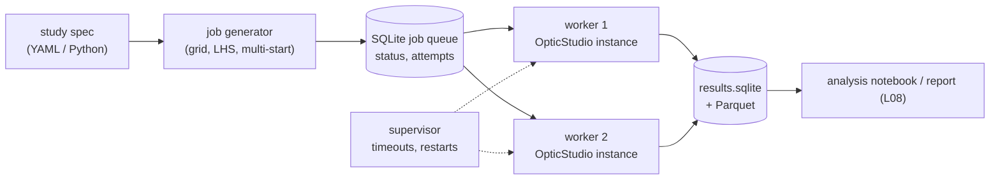

# L07 — Automated optimization and tolerancing

> **Course 07 · Automation with ZPL and the ZOS-API** · Estimated time: lecture ~2.5 h, tasks ~7 h (+ stretch)
> **Prerequisites:** [L03](../L03-zos-api-architecture-and-python-setup/lecture-notes.md) (connection, `zlens` repo), [L04](../L04-building-and-editing-systems-from-python/lecture-notes.md) (LDE/MFE edits, `optimize.py`), [L05](../L05-running-analyses-and-extracting-data/lecture-notes.md) (tidy tables + sidecar JSON), [L06](../L06-batch-ray-tracing-and-custom-metrics/lecture-notes.md) (custom metrics); [Course 03 L05](../../03-image-quality-optimization/L05-optimization-strategies-and-global-search/lecture-notes.md) (DLS, Hammer, Global); [Course 06 L02–L03](../../06-tolerancing-manufacturing/L03-sensitivity-and-monte-carlo/lecture-notes.md) (TDE, compensators, Monte Carlo, yield)
> **Next:** [L08 — Capstone: automated design report](../L08-capstone-automated-design-report/lecture-notes.md)

## Learning objectives
- Drive local (DLS/OD), Hammer and Global optimization from Python with explicit cycle and time budgets, and close every tool even when a run fails or hangs.
- Design a parameter study — glass sweep over a filtered catalogue subset, F/# sweep, multi-start from randomized starting points — as a list of independent, hashable **jobs**.
- Store every run in a results database (SQLite for run metadata, Parquet for bulk arrays) with the provenance needed to reproduce or audit it: input-file SHA-256, code commit, OpticStudio/ZOSPy/Python versions, seeds, core counts.
- Compute how many random starts you need to find a basin with a given confidence, and how many Monte Carlo trials you need for a yield claim (Wilson interval).
- Configure and run sensitivity and Monte Carlo tolerancing from the ZOS-API, save the `.ZTD` data file and the Monte Carlo lens files, and extract yield tables in Python.
- Run work in parallel within the real constraints: one API connection per process, one OpticStudio instance per process, licence instance limits, and cores per optimizer.
- Make long runs robust: per-job timeouts, a supervisor that kills hung workers, a resumable job queue, and idempotent jobs.

## Reading
- **Core (corpus):** [Kidger §8.3.2, pp. 181–182] — the air-spaced doublet has two solutions (Fraunhofer and Gauss). A local optimizer started near one never reaches the other, because it would have to pass through a region with a worse merit function. This is the textbook argument for multi-start and global search.
- **Core (corpus):** [Geary Ch. 8, p. 89] — the merit-function landscape and local minima (his Fig. 8.4: start at Z, end at B, never at the deepest well A).
- **Core (online):** ZOS-API Python example 15 *Sequential Optimization* (Local, Hammer, Global, `RunAndWaitWithTimeout`, `Cancel`, `WaitForCompletion`, `NumberToSave`): <https://developer.synopsys.com/docs/zos-api-interface-2025-r2/page_ex15_py.xhtml>
- **Core (online):** ZOS-API Python example 14 *Sequential Tolerance* (tolerance wizard, `OpenTolerancing`, `SetupMode`, `Criterion…`, `NumberOfRuns`, `NumberToSave`): <https://developer.synopsys.com/docs/zos-api-interface-2025-r2/page_ex14_py.xhtml>
- **Core (online):** Zemax Community, "How to save all tolerancing data (Monte Carlo, sensitivity and summary) in ZOS-API" — `OutputFile`, `SaveTolDataFile`, `TolDataFile`, `OpenToleranceDataViewer`, `MonteCarloData`, `SensitivityData`: <https://community.zemax.com/got-a-question-7/how-to-save-all-tolerancing-data-montecarlo-sensitivity-and-summary-in-zosapi-5125>
- **Optional:** Zemax Community, "How to use MATLAB or Python to use ZTD tolerance analysis data" (viewer pattern; *close the tolerancing tool before opening the viewer*): <https://community.zemax.com/got-a-question-7/how-to-use-matlab-or-python-to-use-ztd-tolerance-analysis-data-1769>
- **Optional:** Ansys Optics KB, D. Hill, inspecting the lens files OpticStudio builds for each tolerance (`SAVE` operand, `MC_T000x.zmx` naming): <https://optics.ansys.com/hc/en-us/articles/43071088477587>
- **Optional:** Zemax Community, "ZOS-API tolerancing scripts and saving Monte Carlo files" (unanswered 2020 thread: a user found that MC files were not saved from an API run). Read it as a reason to *test* file saving in your own version: <https://community.zemax.com/zos-api-12/zos-api-tolerancing-scripts-and-saving-monte-carlo-files-426>

> **API caveat for the whole lesson.** Names confirmed in the official examples 14/15 or the Zemax Community threads above are used without comment. Everything marked *(verify)* comes from the general `ISystemTool` pattern or from memory. Check it against your installed version's **ZOS-API Syntax Help** (Help tab) before you rely on it, and record what you found in your `notes.md`.

---

## 1. Why automate optimization at all?

In the GUI you optimize one design at a time and judge by eye. Three kinds of question cannot be answered that way:

1. **"Is this the best basin?"** The merit function (MF) landscape has many local minima [Geary Ch. 8, p. 89]. DLS goes downhill from wherever you start, so for the air-spaced doublet the start decides whether you end with a Fraunhofer or a Gauss form [Kidger §8.3.2, pp. 181–182]. Hammer and Global help, but they are stochastic and time-limited. A systematic **multi-start** gives you a statistic ("12 of 40 starts reached MF ≤ 1.02 × best") instead of a hope.
2. **"How does the answer depend on a choice?"** Examples: which flint for the triplet's negative element, how the best achievable MF changes from F/3 to F/5.6, or whether a cheaper glass costs 5 % or 50 % in MTF. These are **parameter sweeps**: the same optimization repeated over a grid of inputs.
3. **"What fraction of built lenses will pass?"** Monte Carlo tolerancing answers this ([Course 06 L03](../../06-tolerancing-manufacturing/L03-sensitivity-and-monte-carlo/lecture-notes.md)). Scripting it lets you compare tolerance sets and criteria, rerun after every design change, and post-process each trial with metrics the tolerancer cannot compute, such as the L06 distortion residuals or the C06 L08 station evaluation.

All three share one structure. A **job** is a small, fully specified recipe: input file, edits, optimizer settings, seed. A **runner** executes jobs in one or more OpticStudio instances. A **database** collects results with enough provenance to trust them a year later. The rest of this lesson builds that structure in the `zlens` repo.



---

## 2. Optimizers as tools: the complete pattern

### 2.1 What every system tool shares

In the ZOS-API every optimizer, the tolerancer, the batch ray trace and the tolerance data viewer is a **tool** opened from `system.Tools`. **Only one tool can be open at a time** (L03 §2). The methods you need come from the common tool interface:

| Member | Meaning | Source |
|---|---|---|
| `RunAndWaitForCompletion()` | blocking run until the tool decides it is done | ex. 14, 15 |
| `RunAndWaitWithTimeout(seconds)` | blocking run for at most *seconds* | ex. 15 |
| `Cancel()` then `WaitForCompletion()` | stop a running tool and wait until it has really stopped | ex. 15 |
| `Close()` | release the tool; **required** before another tool can open | ex. 14, 15 |
| `Run()`, `IsRunning`, `Progress`, `Succeeded`, `ErrorMessage` | non-blocking start and polling | *(verify)* |

Local optimization stops by itself (Automatic cycles or a fixed cycle count). Hammer and Global **never** stop by themselves, so you always give them a time budget, then `Cancel()` and `WaitForCompletion()`. Example 15 does exactly that.

`RunAndWaitWithTimeout` returns a status value in recent versions (an enum with something like *Completed / TimedOut*). *(verify the type and member names)*. Do not branch on it until you have printed it once in your version.

### 2.2 A robust optimizer wrapper

Extend L04's `optimize.py` so that every call returns the same record:

```python
# src/zlens/optimize.py — extends L04; names from ZOS-API example 15 unless marked
import time, contextlib
import zospy as zp
C = zp.constants
Opt = C.Tools.Optimization

@contextlib.contextmanager
def open_tool(opener):
    t = opener()
    if t is None:                       # another tool is still open (crashed earlier run?)
        raise RuntimeError("tool did not open: close the open tool or restart the instance")
    try:
        yield t
    finally:
        try:
            if getattr(t, "IsRunning", False):      # (verify) property name
                t.Cancel(); t.WaitForCompletion()
        finally:
            t.Close()

def run_local(oss, algorithm="DLS", cycles="auto", cores=8) -> dict:
    alg = {"DLS": Opt.OptimizationAlgorithm.DampedLeastSquares,
           "OD":  Opt.OptimizationAlgorithm.OrthogonalDescent}[algorithm]   # OD name: verify
    cyc = {"auto": Opt.OptimizationCycles.Automatic}.get(cycles)           # fixed-cycle members: verify
    with open_tool(oss.Tools.OpenLocalOptimization) as lo:
        lo.Algorithm, lo.NumberOfCores = alg, cores
        if cyc is not None:
            lo.Cycles = cyc
        mf0, t0 = lo.InitialMeritFunction, time.perf_counter()
        lo.RunAndWaitForCompletion()
        return dict(kind="local", algorithm=algorithm, cycles=str(cycles), cores=cores,
                    mf_start=mf0, mf_end=lo.CurrentMeritFunction, wall_s=time.perf_counter() - t0)

def run_timed(oss, kind="hammer", seconds=120, cores=8, algorithm="DLS") -> dict:
    opener = {"hammer": oss.Tools.OpenHammerOptimization,
              "global": oss.Tools.OpenGlobalOptimization}[kind]
    with open_tool(opener) as t:
        t.Algorithm = Opt.OptimizationAlgorithm.DampedLeastSquares
        t.NumberOfCores = cores
        if kind == "global":
            t.NumberToSave = Opt.OptimizationSaveCount.Save_10
        mf0, t0 = t.InitialMeritFunction, time.perf_counter()
        status = t.RunAndWaitWithTimeout(seconds)
        t.Cancel(); t.WaitForCompletion()
        best = [t.CurrentMeritFunction(j) for j in range(1, 11)] if kind == "global" \
               else [t.CurrentMeritFunction]
        return dict(kind=kind, algorithm=algorithm, cores=cores, budget_s=seconds,
                    status=str(status), mf_start=mf0, mf_end=min(best), mf_saved=best,
                    wall_s=time.perf_counter() - t0)
```

Points that matter more than they appear:

- **The lens in memory is modified in place.** After `run_local` the system holds the optimized prescription. In a sweep, every job must therefore start with `oss.load(path_of_its_own_copy)`, never from "whatever the previous job left".
- **Global saves its best solutions as lens files** in the lens folder (with `NumberToSave`). The current system is not necessarily the best one. Look at which files appear after a run in your version, record the naming pattern, and load the best file explicitly. Run Global only on a copy in a per-job run directory, never in `designs/`.
- **Hammer in chunks.** Hammer is "keep perturbing and re-optimizing". A useful automatic stop rule: run 60 s chunks, close the tool after each chunk (the lens keeps the improvement), and stop after three chunks with less than 0.5 % improvement. Re-opening per chunk avoids depending on whether a cancelled tool can be restarted (behaviour not documented in the examples).
- **Count variables before you run.** A job that silently has zero variables "optimizes" in 0.01 s and reports MF unchanged. Walk the LDE cells and count solve type Variable (`cell.GetSolveData().Type == SolveType.Variable`, *verify*). Store the list (surface, column) with the run.

### 2.3 Is DLS deterministic? Hammer is not

Treat this as an empirical question for your version (Task 1). Typical findings:

- **Local DLS** from the same file, the same OpticStudio version and the same `NumberOfCores` should give the same result to many digits. With a different core count, summation order can change and the last digits may differ. In a nearly flat valley the run can even stop at a different cycle. Record cores per run.
- **Hammer and Global** use random perturbations. As far as the documented API goes, you cannot set their random seed. Two runs differ, and longer runs are not guaranteed to be better. Reproducibility for them means **keeping the output file and its hash**, not rerunning.

This distinction runs through the whole lesson:

| Kind | Example | How to reproduce |
|---|---|---|
| **Re-executable** | local DLS from a stored start; your own Python randomization with a stored seed | rerun the job; compare hash/metrics |
| **Archived** | Hammer, Global, OpticStudio's Monte Carlo draws | keep the output `.zmx`/`.ZTD`/MC files + SHA-256; never "regenerate" |

---

## 3. Studies: sweeps, DOE and multi-start

### 3.1 Jobs as data

A job is a small dict that fully determines the run:

```python
job = {
  "study": "triplet_flint_sweep_v1",
  "design": "designs/L09_T2_triplet.zmx",         # path in the repo
  "design_sha256": "3f2a…",                        # checked before the run
  "edits": [{"comment": "L2", "column": "Material", "value": "N-SF5"}],
  "start": {"kind": "perturb", "sigma": 0.15, "seed": 1047},
  "optimizer": [{"kind": "local", "cycles": "auto", "cores": 2}],
  "metrics": ["mf", "dashboard", "rms_spot_um"],
}
job_id = sha256(json.dumps(job, sort_keys=True).encode()).hexdigest()[:16]
```

The **job id is the hash of its canonical JSON**. That gives three properties for free. (1) **Idempotence**: if a result row with this id exists, skip the job. A restarted study resumes where it stopped. (2) **Deduplication**: two studies that ask for the same run share it. (3) **Traceability**: a number in a report links to exactly one recipe.

Add the code commit (`git describe --always --dirty`, L03) to the *result*, not to the job id. Otherwise every commit invalidates every result. If a code change does change results, bump a `"recipe_version"` field in the job instead.

### 3.2 Glass sweep over a catalogue subset

Do not sweep "all of SCHOTT" (≈ 120 glasses, many obsolete or special). Filter first. The catalogue `.AGF` files (in `Documents\Zemax\Glasscat`, location varies by installation) are text. Each glass starts with an `NM` line holding, in order: name, dispersion-formula number, MIL code, $n_d$, $V_d$, exclude flag, **status** (0 standard, 1 preferred, 2 obsolete, 3 special, 4 melt) and melt frequency *(verify the field order on your file: open it in a text editor)*. Newer files may be UTF-16 encoded, so detect the BOM. A 20-line parser in `src/zlens/glass.py` gives a DataFrame you can filter:

```python
flints = agf[(agf.status.isin([0, 1])) & agf.nd.between(1.60, 1.76) & agf.vd.between(25, 40)]
```

Filter on the things that matter in production as well: status *preferred*, and if you need them, stain/climate resistance and price from the catalogue's other lines or from the Glass Catalog tool. Then sweep:

- **One element** (the triplet's flint): one job per glass, all radii and the air spaces variable, local DLS to convergence. For a fair comparison use **several starts per glass** (§3.4). Otherwise you compare starting points, not glasses.
- **Two elements** (crown × flint): the full grid is $N_c \times N_f$ jobs (e.g. 8 × 18 = 144). Above a few hundred jobs, consider OpticStudio's own glass substitution in Hammer (substitution template, Course 03 L05) as the search and your sweep as the *verification* of its top candidates.

Report not only the MF. Also store the dashboard rows (EFFL, TOTR, Petzval, axial colour, L04 `dashboard()`), the glass properties, and later a sensitivity indicator (§5) — a glass pair that wins nominally but doubles the sensitivity is not a win.

### 3.3 F/# sweep: continuation vs cold start

To map "best achievable MF vs F/#" you have two strategies:

- **Cold start:** every F/# starts from the same reference design. The results are independent, but the large-aperture points may land in poor basins.
- **Continuation:** start at the easiest F/#, optimize, use the result as the start for the next F/#, and so on. The design tracks one solution family smoothly. It can also stay in a family that becomes the wrong one, which is exactly the doublet trap of [Kidger §8.3.2].

Do both. Where the curves disagree, a second solution family exists, and that is a design insight in itself. Set the aperture through the system data (`oss.SystemData.Aperture.ApertureValue`, plus `ApertureType` if you switch EPD ↔ image-space F/#; *verify*). Remember that a marginal-ray-angle solve on the last radius (Course 01 L07) may *be* your F/# control. Know which one your design uses.

### 3.4 Multi-start and how many starts you need

Generate starts by perturbing the curvatures (not the radii, which go through infinity) of the reference design:

$$c_i' = c_i + \sigma\,\bar c\,\xi_i, \qquad \xi_i \sim \mathcal N(0,1),$$

where $c_i$ is curvature $i$ (1/mm), $\bar c$ is the RMS of the nonzero curvatures (a scale, so that $\sigma$ is dimensionless) and $\sigma$ is the perturbation strength (0.1–0.3 is typical). Use `numpy.random.default_rng(seed)` with a seed per job. Derive the seeds from one study seed with `np.random.SeedSequence(study_seed).spawn(n)` so that the whole study is reproducible from a single integer. Keep thicknesses, or perturb them within the edge/centre-thickness constraints. A start that violates `MNCT`/`MNET` boundaries only wastes time.

After the local optimization, **cluster** the end points. Two runs belong to the same basin if their MFs agree to ~1 % **and** their prescriptions are close (e.g. max $|\Delta c_i|/\bar c < 0.02$). The MF alone can tie between genuinely different forms (Fraunhofer vs Gauss).

**How many starts?** If one start reaches the best basin with probability $p$, the probability that at least one of $n$ independent starts reaches it is $1 - (1-p)^n$. To be confident at level $P$:

$$n \ge \frac{\ln(1-P)}{\ln(1-p)}.$$

You estimate $p$ from a pilot run. The estimate is uncertain, so use a pessimistic bound on $p$ (worked example 1). Note the assumptions: independent starts, and "best" meaning the best basin you have *seen*. Multi-start cannot prove that a better basin does not exist. It tells you how hard the known ones are to find.

### 3.5 Designed experiments beyond grids

For more than ~3 continuous factors, full grids explode ($k$ levels on $d$ factors means $k^d$ jobs). A **Latin hypercube** sample (`scipy.stats.qmc.LatinHypercube(d, seed=…)`) covers each factor's range evenly with any number of points. Fit a cheap surrogate (quadratic regression, or a Gaussian process if you like) to see main effects and interactions. For lens design this works best for *system-level* factors: F/#, field, track length, a fixed sensor cover-glass thickness. It does not work for raw prescription variables, which are the optimizer's job.

---

## 4. Logging, results databases and reproducibility

### 4.1 Two storage layers

| Layer | Content | Format | Why |
|---|---|---|---|
| Run metadata + scalar metrics | one row per job/run: ids, status, timings, MFs, provenance; long table `(run_id, name, value)` for metrics | **SQLite** (`results/L07/results.sqlite`) | transactional, safe for several worker processes (WAL mode), queryable, single file |
| Bulk arrays | MC trial tables, ray grids, MTF curves | **Parquet** (`results/L07/<study>/<run_id>.parquet`, needs `pyarrow`) | columnar, compressed, typed, fast in pandas |
| Artifacts | optimized `.zmx`, `.ZTD`, MC lens files, logs | files under `results/L07/runs/<run_id>/` | inspectable in the GUI; hashed in the DB |

A minimal schema:

```sql
CREATE TABLE IF NOT EXISTS jobs(
  job_id TEXT PRIMARY KEY, study TEXT, spec_json TEXT,
  status TEXT CHECK(status IN ('pending','running','done','failed')) DEFAULT 'pending',
  attempts INTEGER DEFAULT 0, worker TEXT, heartbeat REAL, error TEXT);
CREATE TABLE IF NOT EXISTS runs(
  job_id TEXT PRIMARY KEY REFERENCES jobs(job_id),
  started REAL, finished REAL, wall_s REAL, mf_start REAL, mf_end REAL,
  design_sha256 TEXT, out_file TEXT, out_sha256 TEXT,
  code_commit TEXT, os_version TEXT, zospy_version TEXT, python_version TEXT,
  host TEXT, cores INTEGER, seed INTEGER);
CREATE TABLE IF NOT EXISTS metrics(job_id TEXT, name TEXT, value REAL,
  PRIMARY KEY(job_id, name));
```

Open every connection with `PRAGMA journal_mode=WAL` and a busy timeout (`sqlite3.connect(path, timeout=30)`). Keep transactions short, and **never hold a transaction open while OpticStudio runs**. Claim a job atomically:

```sql
UPDATE jobs SET status='running', worker=?, heartbeat=?, attempts=attempts+1
WHERE job_id = (SELECT job_id FROM jobs WHERE status='pending' ORDER BY job_id LIMIT 1)
RETURNING job_id, spec_json;            -- RETURNING needs SQLite ≥ 3.35 (check sqlite3.sqlite_version)
```

Analysis is then plain pandas: `pd.read_sql("SELECT … FROM runs JOIN metrics USING(job_id)", con)`, with `pivot` to wide format.

### 4.2 Provenance checklist (what each run row must carry)

- **Input identity:** SHA-256 of the design file *read from disk just before loading*, plus the edits from the job spec. A `.zmx` hash is exact but brittle: re-saving may change bytes without changing optics. Add a **prescription fingerprint** as well: hash a rounded table of radius, thickness, material, conic and semi-diameter per surface, plus fields, wavelengths and aperture. Two files with the same fingerprint are optically identical for your purposes.
- **Code identity:** `git describe --always --dirty`. Refuse to run a "production" study on a dirty tree (a flag in the runner).
- **Software identity:** OpticStudio version (ZOSPy `zos.version`; raw API `ZOSMajorVersion`/`ZOSMinorVersion`/`ZOSSPVersion` on the application object, *verify*), ZOSPy, pythonnet, numpy and Python versions, and the glass catalogue files' hashes (a catalogue update changes indices).
- **Execution identity:** host, cores per optimizer, number of parallel workers, seed(s), time budgets, wall time.
- **Output identity:** SHA-256 of every artifact, recorded at write time.

A result without this is a rumour. With it, a reviewer can rerun a re-executable job and expect identical numbers. Where numbers differ, they can find out whether the cause is the design, the code, the catalogue or the OpticStudio version.

### 4.3 Logging

Use the `logging` module with one logger per worker, writing a file `results/L07/logs/<worker>.log` with timestamps and the job id in every line. Log at least: job claimed, design hash, variable count, optimizer start/end MF, artifacts written, exceptions with traceback. When a worker dies, the log tail tells you whether OpticStudio was mid-optimization or mid-load.

---

## 5. Scripted tolerancing

### 5.1 Setting up from code

The official example 14 shows the essential sequence (names confirmed there):

```python
Tol = C.Tools.Tolerancing
# (1) Default tolerances via the wizard — or load a reviewed TDE from file instead
wiz = oss.TDE.SEQToleranceWizard
wiz.SurfaceRadius = 0.1          # example values; see ex. 14 for the full list of wizard fields
wiz.SurfaceThickness = 0.05
wiz.IsIndexUsed = True
wiz.OK()

# (2) Configure and run
with open_tool(oss.Tools.OpenTolerancing) as tol:
    tol.SetupMode = Tol.SetupModes.Sensitivity
    tol.Criterion = Tol.Criterions.RMSSpotRadius
    tol.CriterionSampling = 3
    tol.CriterionComp = Tol.CriterionComps.OptimizeAll_DLS
    tol.CriterionCycle = 2
    tol.CriterionField = Tol.CriterionFields.UserDefined
    tol.NumberOfRuns = 200               # Monte Carlo trials
    tol.NumberToSave = 20                # MC lens files to keep
    tol.OutputFile = "tol_report.txt"    # file name only — written next to the lens [Community 5125]
    tol.SaveTolDataFile = True
    tol.TolDataFile = "tol_data.ZTD"     # same rule
    tol.RunAndWaitForCompletion()
```

Practical rules:

- **The tolerancer writes its files into the folder of the current lens file.** `OutputFile` and `TolDataFile` take a *name without a path*. So every tolerance job first copies the design into its run directory, loads it from there, and saves it. Then the report, the `.ZTD` and the `MC_T0001.zmx…` files land in `results/L07/runs/<job_id>/`, never in `designs/`. The C06 L08 extractor globbed `…_MC_T*.ZMX`. Check the exact prefix your version uses and make your glob match it.
- **Test file saving once.** A 2020 community thread reports MC files not appearing from an API run. Run 10 trials with `NumberToSave = 10` and assert that ten files appeared. Make this a smoke test.
- **TDE as a versioned file.** For real work do not rely on the wizard. Load the reviewed TDE you built in Course 06 (`.TOL` file via the TDE's load method, or apply it once and keep it in the `.zmx`), and keep it under git. Verify the TDE load/save method names in the Syntax Help. The settings you saved in the GUI as `.TOP` files (C06 L08 `tier1.TOP`, `tier2.TOP`) document the intent. In the script, set every value explicitly so that the code is the single source of truth.
- **Criterion = merit function.** For a custom criterion (the C06 L08 station MF), load that MF into the MFE *before* opening the tool and choose the merit-function criterion (`Criterions.MeritFunction`, *verify* the member name). For a tolerance script (`.tsc`), the Community thread notes that `tol.UserScript` does not exist. You set `tol.CriterionScript` to an integer index found by matching names via `GetCriterionScriptAt(i)` *(verify)*.
- **Statistics and seeds.** The distribution of each tolerance (normal/uniform/parabolic) is set in the TDE (`STAT`, Course 06 L03), not in the tool. I could not confirm a documented API property for the Monte Carlo random seed. Look in the Syntax Help for `ITolerancing` and for a seed-related TDE control operand in your version's Help. If none exists, MC draws are **archived, not re-executable** (§2.3): keep the `.ZTD` and the MC files. Your own Python post-perturbations (§5.4) use your own seeded generator.
- **Cores.** The GUI tolerancing dialog has a core-count setting. Look for the matching `ITolerancing` property *(verify)* and record its value.
- **Inverse modes** (`SetupModes.InverseLimit`, `InverseIncrement`, *verify* the members) modify the TDE's limits. Always run them on a copy and diff the TDE before and after.

### 5.2 Reading results: the Tolerance Data Viewer

Do not parse the text report except for a sanity check. Its layout changes between versions. Open the saved `.ZTD` with the viewer tool, **after closing the tolerancing tool** (one tool at a time):

```python
with open_tool(oss.Tools.OpenToleranceDataViewer) as tdv:
    tdv.FileName = str(run_dir / "tol_data.ZTD")         # full path here [Community 1769]
    tdv.RunAndWaitForCompletion()
    mc = tdv.MonteCarloData.Values                       # 2-D .NET double array
    rows, cols = mc.Rows, mc.Cols                         # shown in Community 5125 — verify which is which
    data = mc.Data                                         # double[,]
    sens = tdv.SensitivityData                             # GetCriterion(i), GetOperand(i).GetEffectOnCriterion(j)
    summary = str(tdv.Summary)                             # (verify)
```

Convert the `double[,]` to numpy with the L06 helpers. For a 2-D array, `GetLength(0)`/`GetLength(1)` give the dimensions. An element loop is fine for a few thousand cells; use `Marshal.Copy` (L06 §3) for big tables. Get the column headers from the data series metadata (`GetMetadata()` per the Community thread, *verify*). Never hard-code column positions. Then write one tidy Parquet table per tolerance run (`trial, criterion, comp_1…, op_1…`) and one SQLite row with the summary statistics.

### 5.3 Yield and its uncertainty

With $k$ passing trials out of $n$, the yield estimate is $\hat y = k/n$. Its standard error is $\sqrt{\hat y(1-\hat y)/n}$. For reporting, use the **Wilson score interval**, which behaves well near 0 and 1:

$$y_{\pm} = \frac{\hat y + \dfrac{z^2}{2n} \pm z\sqrt{\dfrac{\hat y(1-\hat y)}{n} + \dfrac{z^2}{4n^2}}}{1 + \dfrac{z^2}{n}},$$

with $z = 1.96$ for a two-sided 95 % interval and $z = 1.645$ for a one-sided 95 % lower bound (the "we are 95 % sure the yield is at least …" statement used in [C06 L08](../../06-tolerancing-manufacturing/L08-capstone-tolerancing-the-camera-lens/tasks.md)). The number of trials for a half-width $h$ is approximately $n \approx z^2\,\hat y(1-\hat y)/h^2$. Halving the error bar costs four times the trials.

The tolerancer's own "90 % of Monte Carlo runs have criterion ≤ x" lines are percentiles of the same sample, with the same sampling noise. Compute the yield **from the trial table against your spec threshold** rather than reading it off the report.

### 5.4 Post-processing Monte Carlo lens files

The saved `MC_T*.zmx` files are complete perturbed lenses, with compensators already applied. Anything you can compute on a lens you can compute on each trial: the L05 MTF table, the L06 distortion residual and CRA, the C06 L08 evaluation MF (`mc_extract.py`). Two patterns:

1. **Evaluate:** load trial, load evaluation MF, read the operand rows. This is the C06 L08 sketch, now running inside the job runner with one Parquet row per trial.
2. **Perturb further, then evaluate:** apply effects the tolerancer did not model, such as the C06 L08 post-cure shift of the active-alignment coordinate break. Use a **seeded** numpy generator: draw $m$ perturbations per trial, set them via the LDE (comment lookup, L04), evaluate, restore. This is fully re-executable, because the randomness is yours.

The trade-off: the tolerancer saves at most the trials you ask it to save, and every saved file costs disk space and load time. Saving 500 trials of a 30-surface lens is fine (a few MB). Loading them takes a fraction of a second each in standalone mode, so post-processing 500 trials is minutes, not hours.

---

## 6. Parallelism: what actually scales

### 6.1 The hard constraints

- **One ZOS-API connection per Python process** (L03 §2.1; ZOSPy makes `ZOS` a singleton). Threads inside one process share that one connection and gain nothing. Parallelism means **processes**: `multiprocessing` with the *spawn* start method (the only one on Windows), or separate `python` invocations.
- **One standalone OpticStudio instance per worker process**, connected once and reused for many jobs (the L03 worked example: starting an instance per job was 40 % slower overall).
- **Licence instance limits.** Each standalone instance is an OpticStudio instance in the licence's eyes. How many you may run at once depends on your licence type and settings. Ask your licence administrator, then *test*: launch 1, 2, 3 … workers and log `IsValidLicenseForAPI`/`LicenseStatus` (L03) at connect. A worker that fails to get a licence must exit with a clear message, not retry in a tight loop.
- **Cores.** Each optimizer and the tolerancer has its own core count. Total busy cores ≈ workers × cores per tool. Oversubscription (4 workers × 8 cores on an 8-core machine) slows everything through context switching and cache thrashing. Start with workers × cores ≈ physical cores, then measure.

### 6.2 What scales and what doesn't

Single-job multi-threading inside OpticStudio speeds up an optimization by distributing the MF evaluations. Its efficiency depends on how many fields, configurations and rays the MF holds, and it is sublinear. Independent jobs in separate processes are *embarrassingly parallel*: no communication, so throughput scales almost linearly until you hit licences, cores, memory or disk. For sweeps with many short jobs, **more workers with fewer cores each** usually wins (worked example 3). For one long Hammer run, one worker with all cores is the right choice.

### 6.3 Memory, disk and the GUI

Each instance holds its own copy of the lens, catalogues and analysis buffers. Check its memory once in Task Manager and multiply by the number of workers. Parallel workers writing MC files into the *same* folder will collide. Per-job run directories prevent that. Keep interactive-extension mode for debugging one job (you see the lens change). Never use it for a parallel study.

---

## 7. Robustness: timeouts, hangs and crash recovery

Long unattended studies fail in four ways. Each needs its own defence.

1. **A Python exception in a job** (glass not found, ray failure in an analysis, an assertion in your metric). Catch it per job, write `status='failed'` with the traceback, reset the system (`oss.new()` or reload), and continue. One bad job must not stop the study.
2. **A tool that never returns.** `RunAndWaitForCompletion` on a local optimization with a pathological MF, or an analysis stuck in a huge sampling, blocks the worker. Use `RunAndWaitWithTimeout` wherever the tool supports it. For everything else, a **supervisor process** watches heartbeats (each worker updates `jobs.heartbeat` at every step). When a heartbeat is older than the job's budget plus a margin, the supervisor kills the worker and its OpticStudio process, sets the job back to `pending` (if `attempts < 3`) or `failed`, and starts a fresh worker.
3. **A dead OpticStudio instance** (crash, licence lost). The next API call raises or hangs. Detect it (exception from a trivial call such as reading `NumberOfSurfaces`), exit the worker, and let the supervisor restart it. Do not try to reconnect inside the same process: the one-connection-per-process rule makes that unreliable.
4. **Orphaned instances.** When Python is killed, the hidden instance may survive and keep its licence. Before the first run, look in Task Manager at how the standalone instance appears in your version (a child process of `python.exe`, or in-process). The supervisor then kills the worker's whole process tree (`psutil.Process(pid).children(recursive=True)`) and logs every kill. At study start, warn if stray `OpticStudio.exe` processes exist.

Two design rules make recovery cheap:

- **Idempotent jobs** (§3.1): rerunning a job that already finished is a no-op. Rerunning a half-finished one overwrites its own run directory only.
- **Atomic result writes:** write artifacts to `<name>.tmp`, hash them, rename, *then* write the DB row in one transaction. A crash leaves either no row (the job reruns) or a complete row, never a row that points at a half-written file.

---

## 8. In OpticStudio

- **Optimize tab ↔ API:** Optimize! = `OpenLocalOptimization`, Hammer = `OpenHammerOptimization`, Global = `OpenGlobalOptimization`. The dialog fields (algorithm, cycles, cores, number to save) map one-to-one to tool properties. Run a job once in the GUI with the same settings and compare MF to 1e-9 before scaling up.
- **Tolerance tab ↔ API:** the Tolerancing dialog tabs (Set-Up, Criterion, Monte Carlo, Output…) map to `ITolerancing` properties. Configure in the GUI once, run 10 trials, then reproduce the same 10-trial statistics from Python. The mean must match within MC noise, and **exactly** if your version's seeding repeats.
- **Tolerance Data Viewer** (Tolerance tab, location varies by version): open your script's `.ZTD` and check that the trial table and the Python Parquet file agree in shape and in a few spot values.
- **Pitfalls:**
  - Tools left open by a crashed run make the next `Open…()` return `None`. Close it, or restart the instance.
  - **Ray aiming, fields and configurations** in the tolerancer: the criterion's "Configuration" setting (all vs. one) changes the yield (C06 L08). Set it explicitly in code.
  - **Fast tolerance mode / criterion sampling** trade accuracy for speed. Record them.
  - The **MC files include compensators already applied**. Re-optimizing them in post-processing double-counts the compensation.
  - A sweep job that changes glass must also handle **catalogue availability**: the system's catalogue list (System Explorer → Material Catalogs) must include it, or the edit fails, sometimes silently (L04 §8).

---

## Worked example

### 1. How many random starts?

A pilot of $n_0 = 40$ perturbed starts of the air-spaced doublet ends in two clusters. 6 starts reach the lower-MF basin (Fraunhofer-type), 34 the Gauss-type.

- Point estimate: $\hat p = 6/40 = 0.15$.
- Starts needed for 95 % confidence of hitting the good basin at least once with $p = 0.15$: $n \ge \ln 0.05 / \ln 0.85 = (-2.996)/(-0.1625) = 18.4$, so **19 starts**. For 90 %: 14.2 → **15**. For 99 %: 28.3 → **29**.
- But $\hat p$ comes from only 40 trials. Its 95 % Wilson interval is **[0.071, 0.291]**. With the pessimistic $p = 0.071$: $n \ge \ln 0.05/\ln 0.929 = 40.9$, so **41 starts** for 95 % confidence.

Lesson: the pilot itself (40 starts) was already about the right size. For production, plan on ~40 starts per configuration of this difficulty, or change the perturbation so that $p$ grows (e.g. larger $\sigma$, or perturbing bendings rather than individual curvatures).

### 2. How many Monte Carlo trials for a yield claim?

A tolerance run with $n = 500$ trials gives $k = 455$ passes against the spec.

- $\hat y = 0.910$, SE $= \sqrt{0.91 \times 0.09/500} = 0.0128$.
- Wilson 95 % two-sided interval: **[0.882, 0.932]**. One-sided 95 % lower bound ($z = 1.645$): **0.887**. This matches C06 L08 reflection 1: "91 % yield" does not demonstrate "≥ 90 % at 95 % confidence".
- Trials for a ±2 % half-width at $\hat y \approx 0.9$: $1.96^2 \times 0.09 / 0.02^2 = 864$. For ±1 %: 3457.
- Runtime: at a measured 1.6 s per trial (two compensator cycles), 500 trials take 13.3 min, 864 take 23 min and 3457 take 92 min. ±1 % is a lunch-break job for one worker. Splitting it over 4 workers (4 independent tolerance runs of 865 trials, then pooling the trial tables) brings it to ~25 min, as long as each run's trial table is kept separately for audit.

Pooling independent MC runs is valid because trials are independent draws from the same distributions. Pooling runs with *different* TDEs or criteria is not.

### 3. Parallel throughput for a glass sweep

Study: triplet, crown (L1 = L3, pickup) × flint (L2) = 8 × 18 = 144 glass pairs × 3 starts = **432 jobs**. Measured on an 8-core machine: standalone start-up 15 s; one worker with 8 optimizer cores takes **9.0 s/job**; with 4 workers × 2 cores each, a job takes **14 s** in each worker (each job is slower, but four run at once).

- 1 worker: $T_1 = 15 + 432 \times 9.0 = 3903$ s ≈ **65 min**.
- 4 workers: $T_4 = 15 + (432/4) \times 14 = 1527$ s ≈ **25 min** (speed-up 2.56 with the same 8 cores, *if* the licence allows 4 instances).
- Hang insurance: if 2 % of jobs hang and the timeout is 60 s, the cost is $0.02 \times 432 \times 60/4 \approx 130$ s ≈ 2 min. Without a timeout, a single hang stalls one worker forever and the study never finishes.

The numbers are illustrative. Measure your own (Task 4), because the ratio depends on MF size and the machine.

---

## Key takeaways
- Optimizers and the tolerancer are tools: open → configure every setting explicitly → run (with a time budget for Hammer/Global) → `Cancel`+`WaitForCompletion` → `Close` in `finally`. One tool at a time.
- Make studies out of **jobs as data**: canonical JSON, hashed id, idempotent, resumable. Every sweep, DOE and multi-start is just a job generator.
- Local DLS is (nearly) re-executable. Hammer, Global and OpticStudio's MC draws are **archived**: keep their files and hashes. Your own Python randomness is seeded and recorded.
- The number of random starts and MC trials follows from simple probability. Report intervals (Wilson), not just point estimates.
- Tolerance files land next to the lens: run each tolerance job on a copy in its own run directory, save `.ZTD`, read it with the Tolerance Data Viewer, and compute yield from the trial table.
- Parallelism means processes, each with one OpticStudio instance, limited by licence instances and physical cores. Many small jobs → more workers with fewer cores each.
- Robustness costs little: per-job exception capture, timeouts, a heartbeat supervisor that kills process trees, atomic writes.
- Provenance (file SHA-256, prescription fingerprint, git commit, OpticStudio/ZOSPy versions, seeds, cores) is what makes L08's report trustworthy.

## Glossary (new terms in this lesson)
| Term | Meaning |
|---|---|
| Job | Fully specified, serialisable recipe for one run (input, edits, optimizer, seed) |
| Job id | Hash of a job's canonical JSON; makes runs idempotent and deduplicated |
| Multi-start | Repeating local optimization from many randomized starting points to sample basins |
| Basin | Set of starting points that a local optimizer drives to the same minimum |
| Continuation | Using the solution at one parameter value as the start for the next value in a sweep |
| Latin hypercube sampling (LHS) | Space-filling design in which each factor's range is evenly stratified |
| Re-executable vs archived result | Reproduced by rerunning vs reproduced only by keeping the output files |
| Prescription fingerprint | Hash of a rounded table of the optical prescription, insensitive to file formatting |
| `.ZTD` | Tolerance data file, read with the Tolerance Data Viewer tool |
| Wilson interval | Confidence interval for a binomial proportion (yield), well-behaved near 0 and 1 |
| WAL mode | SQLite write-ahead logging; allows concurrent readers with one writer |
| Heartbeat / supervisor | Timestamp a worker updates regularly / process that kills and restarts stale workers |
| Idempotent | Safe to run again: repeating the operation does not change the result |

## References
1. [Kidger §8.3.2, pp. 181–182] — Fraunhofer vs Gauss solutions of the air-spaced doublet; local optimizers cannot cross the MF barrier; motivation for global methods.
2. [Geary Ch. 8, p. 89] — merit function value, local minima, starting-point dependence (Fig. 8.4).
3. [Geary Ch. 38, p. 439] — early ZEMAX tolerancing walkthrough (criterion, sensitivity, Monte Carlo settings); historical contrast to scripted tolerancing.
4. ZOS-API Python example 15, *Sequential Optimization*: <https://developer.synopsys.com/docs/zos-api-interface-2025-r2/page_ex15_py.xhtml>
5. ZOS-API Python example 14, *Sequential Tolerance*: <https://developer.synopsys.com/docs/zos-api-interface-2025-r2/page_ex14_py.xhtml>
6. Zemax Community, saving all tolerancing data in ZOS-API (`OutputFile`, `SaveTolDataFile`, `TolDataFile`, viewer, `MonteCarloData`, `SensitivityData`, `CriterionScript`): <https://community.zemax.com/got-a-question-7/how-to-save-all-tolerancing-data-montecarlo-sensitivity-and-summary-in-zosapi-5125>
7. Zemax Community, using `.ZTD` data from MATLAB/Python (viewer pattern, one tool at a time): <https://community.zemax.com/got-a-question-7/how-to-use-matlab-or-python-to-use-ztd-tolerance-analysis-data-1769>
8. Zemax Community, accessing `MonteCarloData` in table form (open question; confirms the property exists): <https://community.zemax.com/zos-api-12/how-to-access-montecarlodata-in-table-form-through-the-zosapi-4949>
9. Zemax Community, ZOS-API tolerancing scripts and saving Monte Carlo files (reported saving issue, 2020): <https://community.zemax.com/zos-api-12/zos-api-tolerancing-scripts-and-saving-monte-carlo-files-426>
10. Ansys Optics KB, D. Hill, inspecting tolerance lens files (`SAVE`, `MC_T000x.zmx`): <https://optics.ansys.com/hc/en-us/articles/43071088477587>
11. Zemax Community, "Monte Carlo statistics" (distributions, `STAT`): <https://community.zemax.com/got-a-question-7/monte-carlo-statistics-171>
12. Zemax Community, OpticStudio random number generator seed (NSC context; seeding not exposed in the GUI at the time): <https://community.zemax.com/got-a-question-7/opticstudio-random-number-generator-seed-3208>
13. ZOSPy FAQ (one connection per process, disconnect/reconnect): <https://zospy.readthedocs.io/en/latest/user_guide/getting_started/faq.html>
