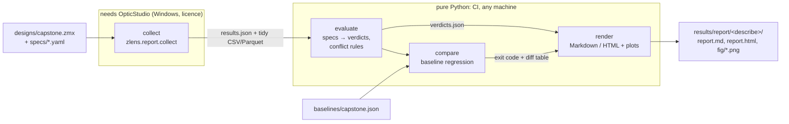
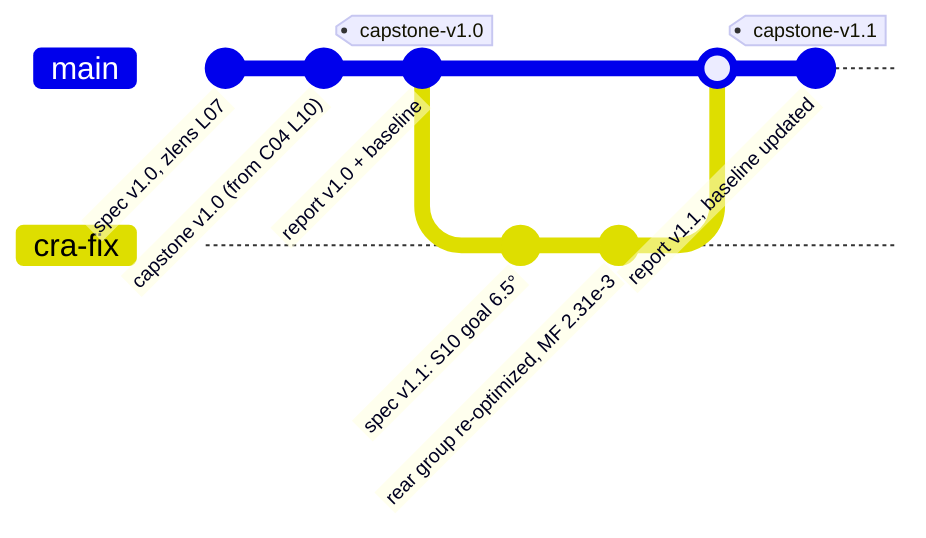

# L08 — Capstone: a reproducible automated design report

> **Course 07 · Automation with ZPL and the ZOS-API** · Estimated time: lecture ~2 h, tasks ~14–18 h (two to three sessions)
> **Prerequisites:** [L03](../L03-zos-api-architecture-and-python-setup/lecture-notes.md) (`zlens` repo, `connect.py`, git conventions), [L04](../L04-building-and-editing-systems-from-python/lecture-notes.md) (comment lookup, `dashboard()`), [L05](../L05-running-analyses-and-extracting-data/lecture-notes.md) (tidy tables + sidecar JSON, MTF), [L06](../L06-batch-ray-tracing-and-custom-metrics/lecture-notes.md) (distortion map, Brown–Conrady, CRA, S13), [L07](../L07-automated-optimization-and-tolerancing/lecture-notes.md) (provenance, job runner, Monte Carlo, Wilson bounds); [Course 04 L10](../../04-machine-vision-camera-lenses/L10-capstone-machine-vision-lens/lecture-notes.md) (the lens and its specification S1–S19); optionally [Course 06 L08](../../06-tolerancing-manufacturing/L08-capstone-tolerancing-the-camera-lens/lecture-notes.md) (tolerance files and yield)
> **Next:** end of Course 07. Return to the [course README](../README.md) for the definition of done.

## Learning objectives
- Design a report pipeline as four separable stages (collect → evaluate → render → compare). Only the first stage needs OpticStudio. The rest can be unit-tested and run in CI on any machine.
- Encode a lens specification (Course 04 capstone S1–S19) as **data**, with limit and goal levels, units, verification method and source. Evaluate it into PASS / GOAL-MISSED / FAIL / NOT-EVALUATED verdicts with margins.
- Write **cross-spec consistency rules** that flag requirements which cannot both be met, such as S10 (CRA goal ≤ 8°) against S13 (≤ 0.5 px for ±15 µm, which implies CRA ≤ 6.56°). Evaluate them both from the spec alone and from the measured design.
- Record provenance (code commit, file SHA-256, OpticStudio/ZOSPy/Python versions, analysis settings, seeds) so that a reviewer can decide whether two reports are comparable.
- Implement a CI-style regression check against a stored baseline with per-metric tolerances derived from measured numerical noise. Return machine-readable exit codes.
- Run a git workflow in which every design revision is a tag, every tag has a report, and a design change is reviewed as a diff of two reports.

## Reading
- **Core:** [Course 04 L10 §3–§4](../../04-machine-vision-camera-lenses/L10-capstone-machine-vision-lens/lecture-notes.md): the report template and hand-off conventions you now automate. Re-read the specification table §1.3.
- **Core:** your own L05–L07 `tasks.md` deliverables. The capstone reuses them, so check that each still runs on the current `designs/capstone.zmx`.
- **Core:** [Geary §2.6, p. 17], keeping track of designs: why every step, merit function and file name must be documented. Geary's floppy-disk naming protocol is the 2002 ancestor of a git tag. [Geary §1.2.4, pp. 5–6]: specifications, under- and over-specification, and the designer's duty to negotiate realistic requirements. The S10/S13 conflict below is an example of this.
- **Core:** [Geary §38.3, p. 436]: "a design is not really complete until you do a tolerance analysis". This is why the report has a yield section, even if it is optional in the pipeline.
- **Optional:** [Kidger §11.1.1, p. 210]: what a real specification lists (eyepiece example). Compare its structure with S1–S19.
- **Optional online:** `git describe` and `git tag` manuals (refs 4–5), matplotlib `savefig` metadata (ref 6), Jinja templating (ref 7), GitHub self-hosted runners (ref 8).

## 1. Why automate the report?

The Course 04 capstone ended with a hand-written report: about 15 figures, a spec table and a hand-off note. Writing it took a day. It was correct for exactly one version of the lens. Then three things happen:

1. **The design changes.** Course 06 L08 changes field definitions and apertures. A sensitivity result makes you rebend an element. The C07 L07 glass sweep proposes a different flint. Each change invalidates every figure, and in practice nobody regenerates all of them.
2. **The question changes.** A reviewer asks for MTF at 1.0 field instead of 0.9, or for distortion with the object-space field definition. With a script this is a one-line change and a re-run. With a GUI report it is half a day.
3. **Trust decays.** Six months later nobody can tell which `.zmx`, which sampling and which OpticStudio release produced figure 7.

An automated report fixes all three if it is built for **reproducibility** and not just for convenience. Reproducibility here means that one command, given the same commit, the same lens file and the same OpticStudio release, produces the same numbers. When the numbers differ, the report tells you which of those inputs changed.

This is the same discipline Geary asks for in §2.6, now enforced by a program. It is also what makes the report useful outside optics: the 3D-camera calibration and firmware teams can consume `results.json` directly, for example to read the Brown–Conrady starting values or the CRA curve for shading correction.

## 2. Architecture: four stages and one data contract



The key design decision is the **data contract** between stage 1 and the rest. `collect` writes a single `results.json` (plus bulky tidy tables in CSV/Parquet). It contains every number the report shows, in SI-ish units stated in the key name, and it is the only thing that later stages read. Consequences:

- `evaluate`, `render` and `compare` never import ZOSPy or pythonnet. They run on Linux CI, on a colleague's laptop, or on results that are a year old.
- You can re-render an old report with a new template, which is useful when management wants a different layout, without re-running OpticStudio.
- The regression check compares two JSON files. It does not compare two PDFs.

A suggested schema, flat keys with explicit units, one entry per metric:

```json
{
  "schema": "zlens.report/1",
  "provenance": { "git_describe": "capstone-v1.1-3-g9a1c2e4", "dirty": false,
                  "lens_sha256": "…", "opticstudio": "…", "zospy": "…", "python": "…",
                  "settings_sha256": {"mtf": "…", "distortion": "…"}, "utc": "2026-11-02T10:14:03Z" },
  "metrics": {
    "first_order.efl_mm":            {"value": 8.0012, "src": "MFE row 'EFL'"},
    "mtf.c1.f0p9.T.36p2":            {"value": 0.512, "src": "FFT MTF 128x128, 850 nm"},
    "cra.max_deg":                   {"value": 7.4,   "src": "batch chief rays, 51x5 az"},
    "s13.max_shift_px":              {"value": 0.57,  "src": "traced, ±15 µm image shift"},
    "...": {}
  }
}
```

Use a dotted naming scheme you can glob (`mtf.c*.f*.T.36p2`) and never rename a key without bumping `schema`. Old baselines must stay comparable or be explicitly declared incomparable.

The numbers in this JSON snippet are placeholders that show the format. Your design produces its own values.

### 2.1 Where the numbers come from

| Report section | `zlens` module (lesson) | Spec rows |
|---|---|---|
| Prescription table (surface, comment, R, t, material, semi-diameter, conic/aspheres) | `lde.py` (L04) | S17, S18 |
| First-order data: EFL, WFNO, TOTR, EXPP, PMAG per config | `mfe.dashboard()` (L04) | S1, S2, S5, S17 |
| MTF vs field per config, T & S, 36.2 and 72.5 lp/mm | `analyses.py` (L05) + `plots.py` | S8, S9 |
| Distortion map, Brown–Conrady fit, residuals | `raytrace.py`, `metrics.fit_brown_conrady` (L06) | S12 |
| CRA curve, S13 traced shift | `raytrace.py`, `metrics.cra` (L06) | S10, S13 |
| Filter AOI | `raytrace.py` (L06) or the L02 UDOC | S7 |
| Relative illumination | `RELI` rows / analysis (L05) | S11 |
| Lateral colour | `LACL` row or chief-ray trace at 835/865 nm (L06) | S15 |
| Thermal check (focus shift, EFL change) | `mce.py` (L04), thermal configs from C04 L10 | S14 |
| Tolerance / MC yield summary (optional) | `tolerance.py`, `stats.wilson` (L07), C06 L08 Parquet | S19, P-rows of C06 L08 |
| Provenance block | `provenance()` (L07) | — |

Ghosts (S16) and the sensitivity preview (S19) are usually **imported** results: GUI or long-running jobs whose output file is hashed and cited. A report may contain imported evidence, but it must say so and carry the hash of the evidence file and of the lens it was computed for (§4.2).

## 3. Specifications as data

Typing the spec into the template means the template and the spec drift apart. Put it in `specs/capstone_v1.0.yaml` instead, versioned like code:

```yaml
spec: capstone
version: "1.0"
source: "04-machine-vision-camera-lenses/L10-capstone-machine-vision-lens/lecture-notes.md §1.3"
pixel_um: 3.45
rows:
  - id: S1
    what: "EFL"
    metric: first_order.efl_mm
    limit: {op: within, value: 8.00, tol_rel: 0.01}
  - id: S8a
    what: "MTF 36.2 lp/mm, 0.8 m, 0-0.9 field, T&S"
    metric: "mtf.c2.f{0,0p3,0p5,0p7,0p9}.{T,S}.36p2"   # glob → min over matches
    reduce: min
    limit: {op: ">=", value: 0.60}
  - id: S10
    what: "CRA at image"
    metric: cra.max_deg
    limit: {op: "<=", value: 12.0}
    goal:  {op: "<=", value: 8.0}
  - id: S13
    what: "chief-ray shift for ±15 µm sensor shift"
    metric: s13.max_shift_px
    limit: {op: "<=", value: 0.5}
    params: {dz_um: 15}
  - id: S16
    what: "ghosts"
    metric: imported.ghosts.worst_rel_irradiance
    limit: {op: "<=", value: 1.0e-4}
    evidence: "evidence/ghosts_v1.1.txt"     # imported, hashed
```

Rules for the evaluator:

- **Four verdicts.** `PASS` (limit and goal met), `GOAL-MISSED` (limit met, goal not), `FAIL` (limit violated), `NOT-EVALUATED` (metric missing, evidence stale, or the hash does not match). A missing metric is never a pass. Silent skips are the most common failure of homegrown reports.
- **Margin** with a sign: for `<=`, margin = (limit − value)/|limit|, so a positive margin is good. Print it. A row passing with 1 % margin and one passing with 40 % margin are different engineering facts.
- **Reductions are explicit.** S8 is "min over fields 0–0.9, T and S, per config". Write the reduction into the spec file so the reviewer sees exactly which numbers were compared. Report the arg-min (which field and azimuth) next to the value.
- **Spec version ≠ design version.** The report prints both. A design can be re-evaluated against spec v1.1 (for example after the S10/S13 fix below) without touching the lens.

## 4. Cross-spec consistency: the report as a requirements reviewer

[Geary §1.2.4] warns about over-specification. Requirements are often written by different people (optics, calibration, mechanics) and can be **jointly infeasible** or **redundant** even if each looks reasonable. The report should find this. There are two kinds of rules.

### 4.1 Static rules (from the spec alone)

These are physics relations that turn one requirement into an implied bound on another quantity:

**R1 — S13 ⇒ CRA bound.** Moving the sensor by $\Delta z$ moves a chief-ray landing point radially by

$$
\delta r \approx \Delta z \,\tan\theta_\text{CRA},
$$

where $\theta_\text{CRA}$ is the chief-ray angle at the image and $\Delta z$ the axial sensor shift (L06 §5.2; exact for a straight chief ray in image space). S13 requires $\delta r \le 0.5\,p$ with pixel pitch $p$ = 3.45 µm at $\Delta z$ = 15 µm:

$$
\theta_\text{CRA} \le \arctan\frac{0.5 \times 3.45}{15} = 6.56^\circ .
$$

S10 states CRA ≤ 12° (limit) and ≤ 8° (goal). **Both levels are looser than what S13 implies**, so a design that meets S10 even at goal level can fail S13. A design with 8.0° corner CRA gives 0.61 px. The rule should report: *"S13 implies CRA ≤ 6.56° at full field; S10 limit 12° and goal 8° are not sufficient. Proposed: tighten S10 goal to ≤ 6.5°, or relax S13 to ≤ 0.62 px, or reduce the ±15 µm focus budget to ≤ 12.3 µm (for CRA 8°)."* The last alternative follows from $\Delta z \le 0.5p/\tan 8^\circ$ = 12.27 µm.

**R2 — S7 vs S10 + aperture.** The worst filter AOI is roughly CRA plus the image-side marginal cone half-angle $u'$. At F/2.4, $u' = \arctan(1/4.8)$ = 11.77° (paraxial), or $\arcsin(1/4.8)$ = 12.02° (aplanatic). S7's 24° then allows CRA ≤ 11.98–12.23°. The S10 limit of 12° sits exactly at the edge, so the rule should give a warning, not a conflict. This is consistent with the Course 04 L10 worked example (23.8°). The approximation ignores the filter's position (the filter is not at the image, and off-axis cones are not symmetric about the chief ray). The design-based rule below checks it with traced rays.

**R3 — feasibility ceilings.** S8 at the range ends (≥ 0.45) is compared with the perfect-lens ceiling at F/2.4, 850 nm and ±27.2 µm defocus: 0.73 (Course 04 L10). S9 (≥ 0.45 at 72.5 lp/mm) is compared with the diffraction ceiling 0.81. A threshold above its ceiling is a hard conflict. A threshold above, say, 85 % of its ceiling is a warning ("requires near-perfect correction").

Static rules can be unit-tested with numbers, and they run before OpticStudio is even opened. Put them in `zlens/report/rules.py` as small functions returning `{rule, rows, severity, message, numbers}`.

### 4.2 Design-based rules (from measured results)

- **Consistency of measurements.** The traced S13 shift should equal $\Delta z\tan(\text{CRA})$ to within a few % (L06 Task 4). A larger disagreement means one of the two measurements is wrong, for example a wrong configuration or a field-type trap. The report flags it as an error in the measurement, not in the design.
- **Verdict pattern conflicts.** If S10 passes (or reaches its goal) while S13 fails, the report prints R1's explanation next to both rows. The pattern itself is the evidence of a spec conflict.
- **Stale evidence.** Imported evidence whose recorded lens SHA-256 differs from the current lens gives NOT-EVALUATED for its rows. This applies to the ghost report, the MC Parquet from L07 and the C06 L08 sensitivity table. This rule prevents the most embarrassing error a design report can contain: a yield computed for the previous revision.

The conflicts table goes right after the summary. A reviewer should see "the spec contradicts itself here" before reading 20 pages of plots.

## 5. Provenance and determinism

The provenance block answers: *could someone regenerate exactly this report, and if two reports differ, why?*

| Item | How | Why |
|---|---|---|
| Code version | `git describe --always --dirty --tags` (ref 4) | identifies code and design revision in one string when both live in one repo |
| Dirty tree | refuse unless `--allow-dirty`; then watermark every page "DIRTY" | an uncommitted change makes the report unreproducible |
| Lens file | SHA-256 of the file bytes as loaded | the `.zmx` under git may be UTF-16 (L03 §5.1); hash bytes, do not decode |
| Prescription fingerprint | hash of the canonicalised prescription table (L07) | distinguishes "file re-saved" from "lens changed". Check whether re-saving an unchanged file changes its bytes in your version |
| Spec file, MF files, settings files, glass catalogues | SHA-256 each | an analysis-settings change is a result change |
| OpticStudio, ZOSPy, pythonnet, numpy, Python | versions (`provenance()` from L07) | results can change between releases. Re-baseline deliberately |
| Analysis settings | sampling, wavelengths, fields, frequency, field type, for every analysis | the sidecar habit from L05, inlined |
| Seeds, core counts | for anything stochastic or parallel | MC and optimization determinism (L07) |
| UTC time, host | informational | **excluded** from regression comparison |

**Determinism of outputs.** Make `results.json` byte-stable: sorted keys, fixed float formatting (`f"{x:.6g}"` or stored as full `repr` floats, but consistently), no timestamps inside `metrics`. Then `git diff` of two `results.json` files is a meaningful review artefact. Plots are harder. PNG/PDF/SVG writers embed metadata such as software version and creation date. matplotlib's `savefig` takes a `metadata` argument for this, and which keys exist depends on the backend (ref 6). Do not chase byte-identical images. Compare numbers, and treat images as views of them.

**The collect stage must not optimize.** A report analyses the lens as saved. If the pipeline ran Quick Focus or a local optimization "to be safe", the reported lens would no longer be the file whose hash is printed, and DLS results can depend on core count (L07). Load the file, save a scratch copy into the run folder, analyse the scratch copy, and never write to `designs/`.

## 6. Regression checking against a baseline

A design-review question that comes up often: *did this change make anything worse that we were not looking at?* The regression stage answers it mechanically.

`baselines/capstone.json` is a committed copy of the `metrics` block of an accepted report. It is updated only by an explicit command (`--update-baseline`) in a commit of its own, whose message says why. `compare(current, baseline, tolerances)` classifies every metric:

| Class | Condition | Meaning |
|---|---|---|
| `same` | $\lvert\Delta\rvert \le \text{tol}$ | numerical noise |
| `better` / `worse` | beyond tol, direction from the spec operator (or a `direction:` field for info metrics) | real change |
| `new` / `missing` | key only in one file | schema or pipeline change; `missing` is a failure |

**Tolerances come from measured noise, not from wishful thinking.** For MTF, run the collector at two samplings (e.g. 128 and 256) or on two machines and take, say, 3× the largest difference observed for that metric family, with a floor (e.g. 0.003). EFL and other paraxial quantities are deterministic to ~1e-9 relative. Ray-traced quantities depend on grids and are deterministic for a fixed grid. MC yields are statistical: compare Wilson intervals, not point values (§Worked example c).

**Exit codes** turn the report into a CI gate. Use a bit mask so that one run can signal several things:

| Bit | Value | Meaning |
|---|---|---|
| 0 | 1 | at least one spec **limit** FAIL |
| 1 | 2 | at least one `worse` regression or `missing` metric |
| 2 | 4 | at least one NOT-EVALUATED row or a stale evidence file |
| 3 | 8 | at least one cross-spec **conflict** (warnings do not set it) |

Exit 0 means "all limits met, nothing worse, everything evaluated, spec consistent". The capstone as specified (v1.0) will exit with at least 8 because of R1, and that is the intended behaviour.

## 7. Git workflow for design revisions



Conventions that work for one engineer and still work for a team of five:

- **One repo** containing `designs/`, `specs/`, `src/zlens/`, `baselines/`, `evidence/`. `results/` is gitignored except for tagged report folders (or publish those as release assets).
- **Annotated tags per design revision** (`git tag -a capstone-v1.1 -m "…"`, ref 5). The tag message summarises the spec verdicts and the main change. The report folder is named by `git describe`, so `results/report/capstone-v1.1/` was produced exactly at the tag.
- **Branch per design change**, merged after a review whose main artefact is `python -m zlens.report.diff capstone-v1.0 capstone-v1.1`. This is a table of every metric that changed beyond tolerance, with spec rows and verdict changes. A reviewer then sees, for example, "rear element Ø +0.6 mm, CRA −1.6°, S13 now PASS, MTF@36.2 config 1 −0.02 (still PASS)" in ten lines.
- **Commit message convention** from Course 04: state the MF value and what changed. Baseline updates get their own commit.
- **CI.** Pure stages (`evaluate`, `render`, `compare`, rules, unit tests) run on every push on any hosted runner, using the committed `results.json` of the last tagged report as a fixture. The `collect` stage needs Windows, OpticStudio and a licence. You can run it manually before tagging, or on a self-hosted runner on a licensed workstation (ref 8). **Check your licence terms** before letting an unattended service start OpticStudio, as in L07 Task 4.

## 8. In OpticStudio — what to cross-check before trusting the report

An automated report is only as good as its spot checks. For each new report revision, compare a handful of numbers with the GUI:

- Prescription: open *Prescription Data* (Analyze → Reports, location varies by version) and compare 3 radii, the stop surface and the "FOCUS COMP" thickness with the report table.
- First order: EFL, WFNO and total track in the MFE dashboard rows. Make sure the configuration shown is the configuration the report claims (config 2 for nominal).
- MTF: one point (config 1, 0.9 field, T, 36.2 lp/mm) in the FFT MTF window with the same sampling as the report.
- Distortion: `DIST` at full field vs the Field Curvature/Distortion plot. Note again that the Brown–Conrady fit uses the object-space field scratch copy (L06 Task 3).
- CRA: `RAID` at the image surface for $H_y$ = 1 vs the report curve.
- Thermal: in the thermal configurations, check that the TEMP values and the barrel's thermal pickups are as documented in the C04 hand-off.

Write the spot-check results into `evidence/spotcheck_<tag>.md`. The report hashes that file too, and it is part of the definition of done.

## Worked example

**(a) The S10/S13 conflict in numbers.** $p$ = 3.45 µm, $\Delta z$ = 15 µm.

| Corner CRA | $\delta r = \Delta z\tan\theta$ | in px | S13 (≤ 0.5 px) | S10 |
|---|---|---|---|---|
| 6.0° | 1.58 µm | 0.46 | PASS | PASS (goal met) |
| 6.56° | 1.72 µm | 0.50 | at limit | PASS (goal met) |
| 8.0° | 2.11 µm | 0.61 | FAIL | PASS (goal met, at goal) |
| 12.0° | 3.19 µm | 0.92 | FAIL | PASS (at limit, goal missed) |

The exit-pupil distance needed for 6.56° at the 5.5 mm sensor corner is $5.5/\tan 6.56^\circ$ = 47.8 mm, compared with 39.1 mm for 8° (Course 04 L03 relation $\tan\theta \approx \rho/d_{XP}$). At 5.7 mm (the full image circle) the numbers are 49.6 mm and 40.6 mm. Pushing the exit pupil from ~39 to ~48 mm within a 30 mm track is a real design cost (larger rear element, S17 Ø ≤ 16 mm). This is why the report should make the conflict visible early instead of the designer discovering it at the final review.

Thermal side note for S14: a ±5 µm best-focus shift at 8° CRA moves the corner by $5\tan 8^\circ$ = 0.70 µm = 0.20 px. That is compatible with S13's budget, so no conflict rule fires between S13 and S14. Write such checks too: a rule that confirms consistency is documentation.

**(b) Margin and regression on one MTF row.** Baseline (v1.0): config 1, 0.9 field, T, 36.2 lp/mm = 0.512. New revision: 0.497. Tolerance for this metric family, from the sampling-noise run: 0.005.
- Spec: S8 at range ends ≥ 0.45 → PASS, margin (0.497 − 0.45)/0.45 = +10.4 % (was +13.8 %).
- Regression: Δ = −0.015, |Δ| > 0.005 and lower is worse for a `>=` row → `worse`, exit bit 1 set.

The report therefore says "passes spec, but worse than baseline". That is exactly the information a reviewer needs to accept the change (the CRA gain was worth it) or reject it. The decision is recorded by the explicit baseline update commit.

**(c) Comparing Monte Carlo yields between revisions.** v1.0: 455 of 500 trials pass, $\hat y$ = 0.910. Wilson 95 % two-sided interval [0.882, 0.932]; one-sided 95 % lower bound 0.887 (L07 worked example). v1.1: 462 of 500, $\hat y$ = 0.924, one-sided lower bound 0.902. The two-sided intervals overlap heavily, so the regression stage must classify this as `same` (statistically indistinguishable), even though the point value rose by 1.4 points. The spec-style claim "≥ 90 % at 95 % confidence" passes for v1.1 (0.902) but not for v1.0 (0.887). Report both statements. They answer different questions.

## Key takeaways
- Split the report into collect (OpticStudio) → evaluate → render → compare (pure Python), joined by one `results.json` contract. Most of the pipeline becomes testable anywhere.
- The specification is data with limits, goals, reductions and sources. Missing evidence is NOT-EVALUATED, never PASS.
- Cross-spec rules turn the report into a requirements reviewer. The capstone's S10 (≤ 8° goal) and S13 (implies ≤ 6.56°) conflict, and the report must say so with numbers and alternatives.
- Provenance (git describe, dirty flag, SHA-256 of lens/spec/settings/evidence, software versions, seeds) decides whether two reports are comparable. Evidence computed for another lens hash is stale.
- Regression tolerances come from measured numerical noise. Compare statistical quantities with intervals, and use exit bit masks to make the report a CI gate.
- Tag every design revision, generate its report at the tag, and review changes as a diff of two reports.

## Glossary (new terms in this lesson)
| Term | Meaning |
|---|---|
| Data contract | the fixed schema (`results.json`) between the OpticStudio-dependent stage and all pure stages |
| Verdict | PASS / GOAL-MISSED / FAIL / NOT-EVALUATED for one spec row |
| Margin | signed relative distance of a value from its limit, positive = good |
| Cross-spec (consistency) rule | a physics relation that turns one requirement into a bound on another, used to detect jointly infeasible specs |
| Stale evidence | an imported result whose recorded lens hash differs from the current lens |
| Baseline | committed metrics of an accepted revision, used for regression comparison |
| Regression | a metric change beyond its noise tolerance in the "worse" direction |
| Provenance | the record of inputs, code and software versions that produced a result |
| Annotated tag | git tag object with author, date and message; used to mark design revisions |
| Self-hosted runner | a CI worker running on your own (licensed) machine |

## References
1. [Geary §1.2.4, pp. 5–6] specifications, over-specification; [Geary §2.6, p. 17] keeping track of designs; [Geary §38.3, p. 436] a design is not complete without tolerancing.
2. [Kidger §11.1.1, p. 210] structure of a real optical specification (eyepiece).
3. Course cross-references: [Course 04 L10](../../04-machine-vision-camera-lenses/L10-capstone-machine-vision-lens/lecture-notes.md) (spec S1–S19, report template, hand-off); [Course 04 L03](../../04-machine-vision-camera-lenses/L03-relative-illumination-and-telecentricity/lecture-notes.md) (CRA vs exit pupil); [Course 03 L09](../../03-image-quality-optimization/L09-thermal-and-environmental-analysis/lecture-notes.md) (thermal configurations); [Course 06 L08](../../06-tolerancing-manufacturing/L08-capstone-tolerancing-the-camera-lens/lecture-notes.md) (yield files); this course's [L05](../L05-running-analyses-and-extracting-data/lecture-notes.md), [L06](../L06-batch-ray-tracing-and-custom-metrics/lecture-notes.md), [L07](../L07-automated-optimization-and-tolerancing/lecture-notes.md).
4. `git describe` manual (`--always`, `--dirty`, `--tags`): <https://man.archlinux.org/man/git-describe.1.en>
5. `git tag` manual (annotated tags): <https://git-scm.com/docs/git-tag>
6. matplotlib `savefig` API (the `metadata` parameter and backend-specific keys): <https://matplotlib.org/stable/api/_as_gen/matplotlib.pyplot.savefig.html>
7. Jinja (Pallets project page; templating for Markdown/HTML reports): <https://palletsprojects.com/p/jinja/>
8. GitHub Docs, "About self-hosted runners for GitHub Actions" (GHES 3.19 edition; the concepts match github.com): <https://docs.github.com/en/enterprise-server@3.19/admin/managing-github-actions-for-your-enterprise/getting-started-with-github-actions-for-your-enterprise/getting-started-with-self-hosted-runners-for-your-enterprise>
9. ZOSPy API reference, `ZOS` (version properties) and `OpticStudioSystem`: <https://zospy.readthedocs.io/en/latest/api/zospy.zpcore.ZOS.html>, <https://zospy.readthedocs.io/en/latest/api/zospy.zpcore.OpticStudioSystem.html>
10. ZOS-API Syntax Help online (2025 R1): <https://developer.ansys.com/docs/zos-api-interface-2025-r1/index.xhtml>. Always prefer the Syntax Help installed with **your** release.
