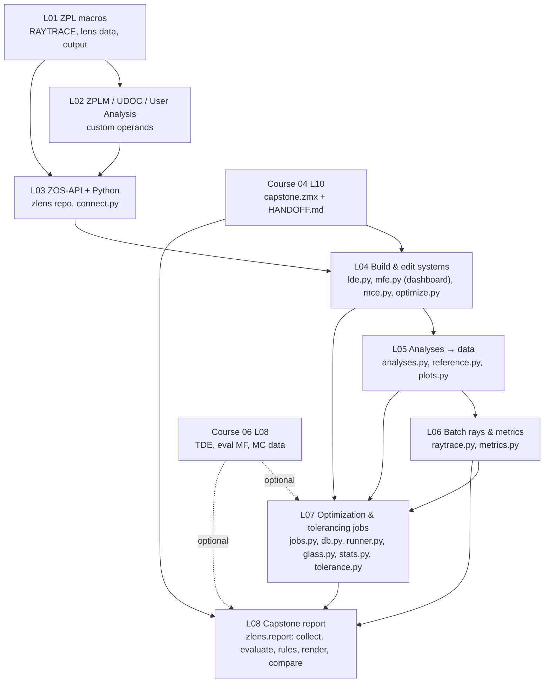

# Course 07 — Automation with ZPL and the ZOS-API

The last specialisation track of the programme. It turns the optical-design skills of Courses 01–06 into **reproducible software**: macros that run inside OpticStudio (ZPL), custom operands and analyses, and Python programs that drive OpticStudio through the ZOS-API. These programs build and edit lenses, extract analysis data, trace millions of rays, run optimization and tolerancing studies as jobs, and finally generate a complete, versioned design report from one command.

The course is written for an engineer who already programs well (Python, C/C#, numpy, git). The optics is not new here. What is new is OpticStudio's object model, its quirks, and the discipline that keeps automated results trustworthy: provenance, tests, baselines.

## Goals
By the end of this course you will be able to:
- Choose the right automation tool for a task: ZPL macro, `ZPLM` merit-function operand, C# User Operand/Analysis, interactive extension or standalone Python application. Justify the choice by run time, access and maintainability.
- Write robust ZPL macros (ray tracing with error checks, lens data access, file output) and custom operands that are safe to use inside optimization.
- Connect Python to OpticStudio (raw pythonnet and ZOSPy), build and edit sequential systems (LDE, MFE, MCE, solves, variables), and find surfaces and operand rows **by comment** so that scripts survive design edits.
- Run any analysis from code, convert the results into tidy, unit-labelled tables with sidecar metadata, and plot them for engineering reviews.
- Batch-trace rays at full speed and compute metrics that OpticStudio does not offer: full-field distortion maps with Brown–Conrady fits, CRA curves, sensor-shift stability, encircled energy in pixels.
- Script optimization and tolerancing as hashable jobs with a results database, seeds and provenance. Quote optimization success rates and Monte Carlo yields with confidence intervals.
- Deliver a reproducible automated design report under git, with spec compliance, cross-spec conflict detection, a regression check against a baseline, and tags per design revision.

## Prerequisites
- **Course 03** completed (merit functions, optimization strategies, multi-configuration, thermal analysis). **Course 04** L10 capstone lens (`capstone.zmx`) finished and handed off with its conventions. It is the main test object from L04 on.
- Optional but recommended: **Course 06** L02–L03 (TDE, compensators, Monte Carlo) before L07, and the Course 06 L08 tolerancing files for the optional yield parts of L07–L08.
- Python 3.11+ on Windows (OpticStudio is Windows-only), a virtual-environment tool (uv, venv, poetry or pipenv), numpy, pandas, matplotlib, pytest, pyarrow; git. Visual Studio (or the .NET SDK) for the C# User Operand in L02.
- Ansys Zemax OpticStudio **Premium** (Professional also works for everything in this course), recent release (~2025 R2 / 2026 R1). Note your exact version from Help → About in the `zlens` README. See the version notes below.

## Lessons

| # | Lesson | Topics | Est. time (lecture + tasks) |
|---|---|---|---|
| L01 | [ZPL macro fundamentals](L01-zpl-macro-fundamentals/lecture-notes.md) · [tasks](L01-zpl-macro-fundamentals/tasks.md) | ZPL vs ZOS-API; variables, loops, subroutines, formatted output; `RAYTRACE` with `RAYE`/`RAYV` checks; lens data functions and `SURP`; `GETTEXTFILE`; robust, state-restoring macros | 2.5 h + 4.5 h |
| L02 | [User-defined operands, solves and analyses](L02-user-defined-operands-and-analyses/lecture-notes.md) · [tasks](L02-user-defined-operands-and-analyses/tasks.md) | `ZPLM` and `OPTRETURN`, macro solves, C# User Operand (`UDOC`) and User Analysis, run-time cost inside optimization, obsolete `UDOP`/DDE | 2.5 h + 5 h |
| L03 | [ZOS-API architecture and Python setup](L03-zos-api-architecture-and-python-setup/lecture-notes.md) · [tasks](L03-zos-api-architecture-and-python-setup/tasks.md) | Standalone vs interactive extension, pythonnet 3, ZOSPy, licences and instances, the `zlens` repository layout, `connect.py`, git and `.zmx` encodings | 2.5 h + 4.5 h |
| L04 | [Building and editing systems from Python](L04-building-and-editing-systems-from-python/lecture-notes.md) · [tasks](L04-building-and-editing-systems-from-python/tasks.md) | System setup, LDE cells and surface types, solves and variables, MFE rows and `dashboard()`, MCE, local/Hammer/Global from code, lookup by comment | 2.5 h + 5 h |
| L05 | [Running analyses and extracting data](L05-running-analyses-and-extracting-data/lecture-notes.md) · [tasks](L05-running-analyses-and-extracting-data/tasks.md) | Generic analysis pattern, ZOSPy wrappers, .NET → numpy, operands vs analysis windows, tidy tables + sidecar JSON, plots with a perfect-lens reference, capstone MTF vs field | 2.5 h + 5 h |
| L06 | [Batch ray tracing and custom metrics](L06-batch-ray-tracing-and-custom-metrics/lecture-notes.md) · [tasks](L06-batch-ray-tracing-and-custom-metrics/tasks.md) | Normalized unpolarized batch trace, fast path, ZPL baseline, distortion maps and Brown–Conrady fits (field-type trap), CRA and the S13 check, RMS spot convergence, depth-shift maps | 3 h + 6 h |
| L07 | [Automated optimization and tolerancing](L07-automated-optimization-and-tolerancing/lecture-notes.md) · [tasks](L07-automated-optimization-and-tolerancing/tasks.md) | Scripted optimization with budgets, determinism, jobs and seeds, SQLite + Parquet results DB, multi-start statistics, worker processes, scripted sensitivity/Monte Carlo, Wilson yield bounds | 2.5 h + 7 h |
| L08 | [Capstone: reproducible automated design report](L08-capstone-automated-design-report/lecture-notes.md) · [tasks](L08-capstone-automated-design-report/tasks.md) | Collect → evaluate → render → compare; spec as data; cross-spec conflict rules (S10 vs S13); provenance; baseline regression with exit codes; tags per design revision; optional yield section | 2 h + 14–18 h |

Total: roughly **70–80 hours**, i.e. 8–10 weeks at one session per week (the capstone takes two to three sessions). L01–L02 can be done in Professional/Premium without any Python. L03 onward assumes Python.

## How the lessons connect

**One repository that grows across lessons: `zlens`.** L03 creates it (`pyproject.toml` with pinned dependencies, `src/zlens/`, `scripts/`, `tests/`, `designs/`, `results/`). The recommended place is a separate git repository whose path you record in each lesson's `work/notes.md`. Every later lesson adds modules to it rather than starting new scripts:

| Lesson | Adds to `src/zlens/` | Used later by |
|---|---|---|
| L03 | `connect.py` (`opticstudio()` context manager) | everything |
| L04 | `lde.py` (`surface_by_comment`), `mfe.py` (`dashboard()`), `mce.py`, `optimize.py` | L05–L08 |
| L05 | `analyses.py` (raw-API + ZOSPy adapters, stable schemas), `reference.py` (perfect-lens MTF), `plots.py`; tidy table + sidecar JSON habit | L06–L08 |
| L06 | `raytrace.py` (batch trace, fast path), `metrics.py` (pure numpy: Brown–Conrady fit, CRA, RMS) | L07–L08 |
| L07 | `optimize.py` extensions, `jobs.py`, `db.py`, `runner.py`, `glass.py`, `stats.py` (Wilson), `tolerance.py`; `provenance()` | L08 |
| L08 | `report/` package: `collect`, `evaluate`, `rules`, `render`, `compare`, `diff`; `specs/`, `baselines/`, `evidence/` | your future projects |

Two lenses are reused throughout: the Course 02 L09 Cooke triplet (`designs/L09_T2_triplet.zmx`) as a small, fast test object, and the **Course 04 capstone** (`designs/capstone.zmx`: f = 8 mm, F/2.4, 850 nm, configs 1/2/3 = 0.6/0.8/1.2 m, "FOCUS COMP" focus thickness, commented dashboard rows at the top of the MFE, surface comments "STOP", "FILTER", "COVER"). Its specification rows S1–S19 (Course 04 L10 §1.3) are the acceptance tests of L05–L08. L06 found a conflict between them (S10 vs S13), and L08 turns that finding into a rule the report checks automatically.

## Conventions used in this course
- Python code separates **pure computation** (numpy/pandas, unit-tested anywhere, no OpticStudio imports) from **API calls** (thin, marked `@pytest.mark.opticstudio` in tests).
- Never write into `designs/`. Load, work on a scratch copy in `results/<run>/`, save there. Pass **absolute paths** to OpticStudio.
- Every result carries provenance: git commit (`git describe --always --dirty`), lens SHA-256, OpticStudio/ZOSPy/Python versions, analysis settings, seeds.
- API members that a lesson could not test are marked *(verify)*. Check them against the ZOS-API Syntax Help of **your** installed release (Help tab) or the ZOSPy API reference before relying on them. Operand names used are standard OpticStudio operands. Menu locations are given where stable, otherwise "location varies by version, search the ribbon".
- Sign conventions and units as in Course 01; lens units mm; angles in degrees unless stated.

## What "done" looks like for this course
You are finished when you can, without notes:
1. Explain when to use ZPL, `ZPLM`, a C# `UDOC` or a standalone Python program, and estimate what a custom operand costs inside an optimization.
2. Open any colleague's `.zmx`, find its surfaces and operand rows by comment, and extract MTF, distortion and CRA data into tidy tables with provenance in under an hour.
3. Write a batch-ray-trace metric that agrees with the corresponding OpticStudio operand to round-off, and explain any remaining difference (sampling, field type, pupil aberration).
4. Run a multi-start or glass-sweep study as resumable jobs and state its result with a confidence statement ("best basin found in 15 % of starts; 19 starts give 95 % confidence").
5. Run `python -m zlens.report designs/capstone.zmx --baseline baselines/capstone.json` on a tagged commit. It produces a report that a reviewer can audit without you in the room: spec compliance with margins, the S10/S13 conflict flagged with numbers, provenance, and regressions against the previous revision. Its exit code can gate a merge.
6. Meet the L08 grading checklist (≥ 70 points with the four core items at full marks).

## Edition, licence and version notes
- **ZPL and `ZPLM`** work in all editions. **The ZOS-API** (standalone applications, interactive extensions, User Operands/Analyses, batch ray tracing) requires an edition that includes it, i.e. Professional or Premium. The application object reports the licence status, and the official boilerplate checks it (L03). Your Premium licence covers everything here.
- **Instances and licences:** each standalone application starts its own OpticStudio instance. How many simultaneous instances your licence permits, and whether unattended services (job runners, self-hosted CI runners) may start them, depends on your licence agreement. Ask your licence administrator before running L07's parallel workers or L08's automated collection unattended.
- **Python bridge:** the official samples use pythonnet. pythonnet 3.x behaves differently from 2.x (interface casting, conversions), so old forum snippets often need adapting. **ZOSPy** wraps connection, constants and many analyses. Its API changed at 2.0, and wrapper column names have changed between releases. Pin it and keep your own adapters (L05). At the time of writing (L03), ZOSPy documents support for Python 3.10–3.14 and lists tested OpticStudio releases on its compatibility page. Check that page for your versions.
- **Release changes:** analysis settings, default samplings and even numeric results can change between OpticStudio releases. Treat an upgrade as a change that needs a re-baseline: run the L08 report on an unchanged lens, compare with the baseline, and commit the new baseline with a message naming both releases.
- **File formats:** keep lens files under git as `.zmx` (text; check the UTF-16/ANSI encoding preference, L03 §5.1). `.zos` (binary, OpticStudio ≥ 21.3) and `.zar` archives are for snapshots only.
- **Tolerancing via the API** (L07) follows the tolerancer's file conventions (output files land next to the loaded lens). Tolerance scripts (`.tsc`) and saving Monte Carlo files behave slightly differently between releases. L07 lists what to verify.

## Further reading
- ZOS-API Syntax Help (installed with OpticStudio, Help tab; online edition for 2025 R1): <https://developer.ansys.com/docs/zos-api-interface-2025-r1/index.xhtml>. The authoritative member reference. Prefer the one matching your release.
- ZOSPy documentation: <https://zospy.readthedocs.io/en/latest/>. Connection, analyses, constants, compatibility. Paper: L. van Vught, C. Haasjes, J.-W. M. Beenakker, *JOSS* 9(96), 5756 (2024), <https://doi.org/10.21105/joss.05756>.
- ZOSPy on GitHub (source and issue tracker, useful for version quirks): <https://github.com/MREYE-LUMC/ZOSPy>.
- Lesson-specific Ansys knowledge-base articles, ZOS-API examples and Zemax Community threads are listed in each lesson's References.
